# MiniMaster

Design, rig, pose, and export **3D-printable tabletop miniatures** — a
low-poly modeling and rigging studio in pure Python. The third program in the
Forge family (alongside DiceForge and DungeonForge): where those make dice and
dungeon terrain, MiniMaster makes the minis that stand on them, working both
as a character creator and an enemy creator.

Build a figure from stretched primitive shapes, place bones and joints for
articulation, pose the skeleton, and export a watertight binary STL scaled to
tabletop size — chunky, faceted minis that look like little carvings and
print cleanly without fussy detail.

| Human Fighter | Dwarf | Goblin | Orc | Skeleton | Four-Armed |
| --- | --- | --- | --- | --- | --- |
| 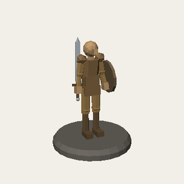 | 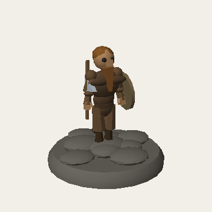 | 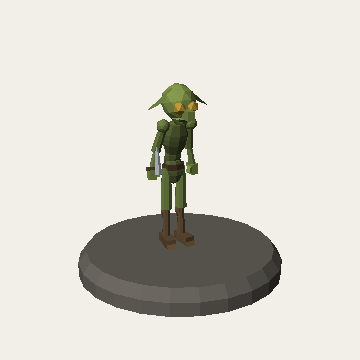 | 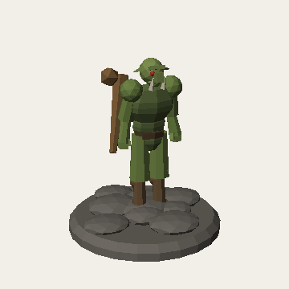 | 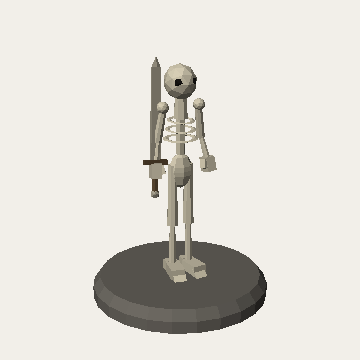 | 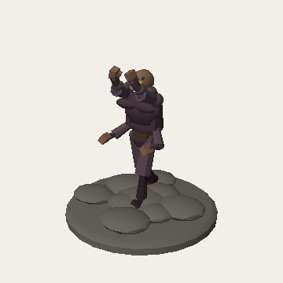 |

One model, four of its shipped poses (idle / walk / attack / guard) — every
figure is articulated by its bones, so posing never breaks the mesh:

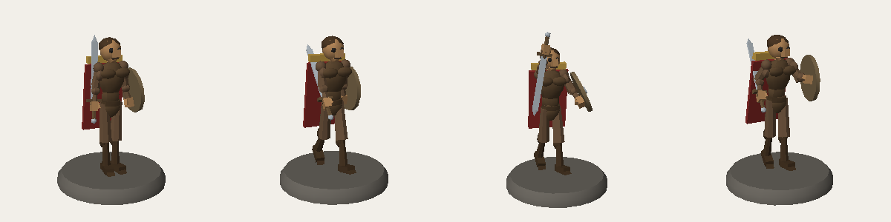

## Install & run

Requires Python ≥ 3.10 with tkinter (Linux: `apt install python3-tk`). The
only third-party dependency is numpy.

```bash
pip install -e .
minimaster                 # launch the studio
# or without installing:
python -m minimaster
```

## The studio

The window is a 3D viewport plus mode tabs:

- **Model** — add primitive shapes (box, wedge, cylinder/cone, capsule,
  icosphere, torus), then stretch and place them: position / rotation /
  per-axis scale, primitive parameters (segment counts, taper, subdivisions),
  color, duplicate, and one-click **Mirror X** for symmetric limbs.
- **Rig** — build the armature: add child joints, drag their positions,
  rename, delete. Bind each shape to a bone by hand or hit **Auto-bind**
  (nearest bone wins). A joint's rotation moves everything below it.
- **Pose** — create named poses, click a joint, drag the X/Y/Z rotation
  sliders and watch the figure move in real time. Poses are stored in the
  project, so one mini can ship with idle, walk, attack, guard…
- **Export** — pick a size category (tiny 15 mm → huge 60 mm, or a custom
  height), a base (round / square / none), and a pose; check printability
  (triangle count, dimensions, watertightness, resin volume); export STL or a
  PNG turnaround.
- **Character** — the realistic Character Lab inside the studio: add, remove
  and tune wings, tails, horns and extra limbs on a MakeHuman character, see
  them live, save a `.mmchar`, export an STL with its printability report
  ([below](#the-character-tab), needs the CC0 assets).

Viewport controls: **drag** orbit · **middle/right-drag** pan · **wheel**
zoom · **click** select · **g** grab (move the selected shape in the view
plane, click to confirm, Esc to cancel) · **Ctrl+D** duplicate · **m**
mirror · **x** delete · **f** frame · **Ctrl+Z / Ctrl+Y** undo/redo.

## Part library (Spore-style)

The **Parts** tab is a snap-on part palette: pick a part, click anywhere on
the mini, and it lands on that surface point oriented outward along the
surface normal, auto-bound to the bone of the body part you clicked. Placed
parts edit as a unit — grab-move, spin about their outward axis, uniform
scale, **Mirror** for symmetric pairs (wings, horns), ungroup, delete — all
undoable.

Parts can be **posable**: a part may carry its own joint chain (the shipped
tail does), which grafts onto the character's skeleton on placement and shows
up in the Pose tab like any other joints. Removing the part removes its
joints; every pose still exports watertight.

Twelve parts ship in the box (eyes, horns, ears, claws, spikes, wings, a
posable tail, and sword/shield/axe/club/dagger), and the library is yours to
grow: model something in the Model tab (origin = attachment point, +Z =
outward), then **Save selection as part…** writes it to `~/.minimaster/parts`
with a thumbnail, ready to snap onto any future mini. Placed parts flatten
into the project, so `.mmp` files stay self-contained and shareable. See
`examples/goblin_gargoyle.mmp` for a goblin with snapped-on horns, a third
eye, mirrored wings, and a pose-curled tail.

## Starter templates

`File → New from template` (or `minimaster new <name> -o my.mmp`) opens a
fully rigged, fully posed figure to reshape instead of a blank scene:
`human_fighter`, `dwarf`, `goblin`, `orc`, `skeleton`, and a four-armed
`four_arms` horror. They come from one parameterized humanoid (21 joints) with
proportion multipliers, anatomy-informed muscle masses (see `docs/anatomy.md`),
a `feminine` build variant, and feature add-ons (beard, ears, tusks, ribcage,
cape, gear). `four_arms` uses `add_arm_pair()` to graft a lower second pair of
arms — dropped well below the primary shoulders so all four fan out cleanly —
onto the base body. Built by `tools/make_templates.py`; add your own factory
there and re-run it to grow the roster.

## Blender backend (optional)

MiniMaster's own engine is pure Python — but if a `blender` binary is on your
`PATH`, two extra commands unlock Blender's geometry and rendering power. This
is an **optional refine/output backend**: `.mmp` scenes, the studio, and the
tests stay the source of truth and never depend on Blender. Blender's bundled
Python imports the MiniMaster kernel directly, so it builds from the exact
posed meshes and colors your scene defines — no lossy STL round-trip.

```bash
# Fuse the overlapping shells into ONE watertight solid (great for printing):
minimaster fuse hero.mmp -o hero_solid.stl --method voxel --size medium
minimaster fuse hero.mmp -o hero_hard.stl  --method boolean   # hard edges kept

# High-quality Cycles render — real lighting, shadows, materials:
minimaster hq-render hero.mmp -o hero.png --smooth --samples 64
minimaster hq-render beast.mmp -o beast.png --union voxel --subdiv 1  # smooth organic
```

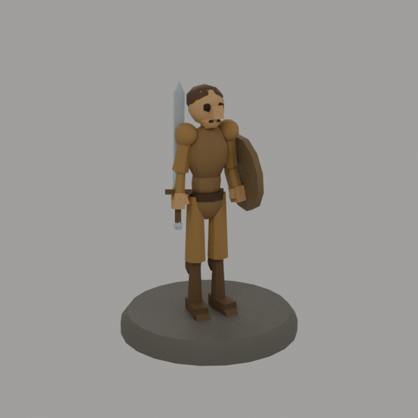

- **`fuse`** unions the shells into a single manifold mesh. `--method voxel`
  (default) is always watertight and auto-smooths into an organic solid;
  `--method boolean` keeps the low-poly hard edges. The result is verified
  watertight by MiniMaster's own STL reader in the test suite.
- **`hq-render`** renders with Cycles (CPU). `--union voxel --subdiv N` melts
  the primitive stack into a smooth sculpted body; `--smooth` just smooth-shades
  the facets; `--transparent` gives an alpha background.

Point `MINIMASTER_BLENDER` at a specific binary if `blender` isn't on `PATH`.
Both commands share MiniMaster's conventions (mm, size categories, poses,
bases) and print a clean error (exit 2) if Blender isn't installed — `export`
and `preview` always work without it. The in-Blender script is
`tools/blender_build.py`; the bpy-free launcher is `minimaster/blender.py`.

## Dynamic body mesh (experimental)

By default a figure exports as a **pile of independent shells** — one closed
mesh per primitive — that the slicer unions at print time. `bake` instead
builds a **continuous body from the bones**, the way Blender's Skin Modifier
does: it sweeps a ring of vertices along each bone chain and stitches them into
one clean, quad-dominant **tube per anatomical region** — head+torso (`core`),
each arm, each leg.

```bash
minimaster bake orc.mmp -o orc_body.png                     # render the body
minimaster bake orc.mmp -o orc_body.stl --size large --pose attack
minimaster bake orc.mmp -o beast.stl --method fuse          # SDF blend instead
```

The rings are framed with a **rotation-minimizing (double-reflection) frame** so
the edge loops never twist, and every joint gets a mitered ring so bends pose
without creasing. This fixes the two things a naive body blob gets wrong:
**limbs stay distinct** (each is its own tube, keyed off the armature — so
`four_arms` is six limb tubes) and **nothing floats** (a hand is topologically
part of its arm). Each limb plugs into the torso by burying its root ring inside
the core tube — the same overlap contract the shell export uses — so the union
prints as one connected figure, and each region keeps its own color. The whole
thing is **watertight and 2-manifold by construction**, hence in every pose
(posing only moves vertices), and poses through the armature's skin matrices.

`--method fuse` is the alternative body path: it treats the shapes as a
**signed-distance field** and blends them per region into a smooth solid with a
native (pure-numpy) **manifold dual-contouring** isosurface (sharp edges kept by
gradient/QEF vertex placement) — smoother/organic where the tube is chunky, at
the cost of heavier, blobbier geometry (`--resolution`, `--blend` tune it). PNG
previews flat-shade for the chunky look (`--smooth` for gouraud). The classic
shell export (`minimaster export`) is always available too.

Both live in `minimaster/core/` (`tubemesh.py`, `bodymesh.py`) and are pure
numpy — no Blender, no third-party mesh libraries.

## Character Lab — realistic humans

A second, higher-fidelity path built on the **CC0** MakeHuman base mesh and its
1,280 morph targets (fetch them once with
`python tools/fetch_makehuman_assets.py`). The mesh is a closed all-quad
2-manifold with professional edge flow, so it drops straight into MiniMaster's
subdivider and watertight export gate.

```bash
# macro sliders: gender / age / muscle / weight / height / ethnicity
minimaster character -o hero.png --gender 1 --muscle 0.8 --face

# 343 named shape sliders reach every one of the shipped morph targets
minimaster character --list-sliders nose -o /dev/null
minimaster character -o hero.png --face \
    --slider nose.nose_curve=0.9 --slider cheek.cheek_bones=1.0

# plausible random faces, and save/load a character
minimaster character -o r.png --face --randomize-face 7
minimaster character -o hero.png --save-character hero.mmchar
minimaster character -o hero.stl --character hero.mmchar --size medium
```

Sliders are **derived from the target names**, not hand-listed: antonym pairs
(`decr`/`incr`, `concave`/`convex`, …) fold into one -1..+1 control, `l-`/`r-`
variants fold into one symmetric control with an optional asymmetry offset,
and exclusive sets (ear shape, body shape) become choices. That covers
**100% of the shipped shape targets** — 830 of them — behind 343 controls.

Rendering uses a skin-aware shader: linear light transport, wrapped diffuse
with a scatter tint approximating subsurface scattering, Fresnel specular,
cavity ambient occlusion, and eyeballs with sclera/iris/pupil.

`.stl` output runs the same per-shell watertight gate as everything else, with
size presets from `tiny` (15 mm) through `bust` (90 mm) and `display` (150 mm).

### Appendages that reshape their host

Wings, tails, horns and extra arm pairs attach as their own closed shells that
overlap the body, so the base mesh's vertex numbering — which all 1,280 morph
targets depend on — is never disturbed. Each is bound to a body face by
barycentric coordinates, so it follows every morph, and a mirrored pair is an
exact mirror image.

A wing is built as a **modified forelimb**, not a shape, and it is **rigged**:
humerus, radius, wrist and an elongated hand form a real joint hierarchy
(shoulder → elbow → wrist → knuckled digits, or one root/tip joint per flight
feather), every vertex is skinned to those joints, and folding, raising or
flapping the wing is a pose of the rig, not a rebuild. Two styles share the
arm — a bat/dragon **membrane** wing (Z-shaped arm, three-segment fingers with
hooked tips, per-gap scalloped edge, propatagium, a root that runs down the back
to the waist, a clawed free thumb) and a bird/angel **feathered** wing (graded,
emarginated primaries fanning −15°…+75°, secondaries, tertials, five covert
tiers, alula, scapulars). Proportions are fitted to measurements of real
flying-fox and eagle/galah/flamingo reference photographs.

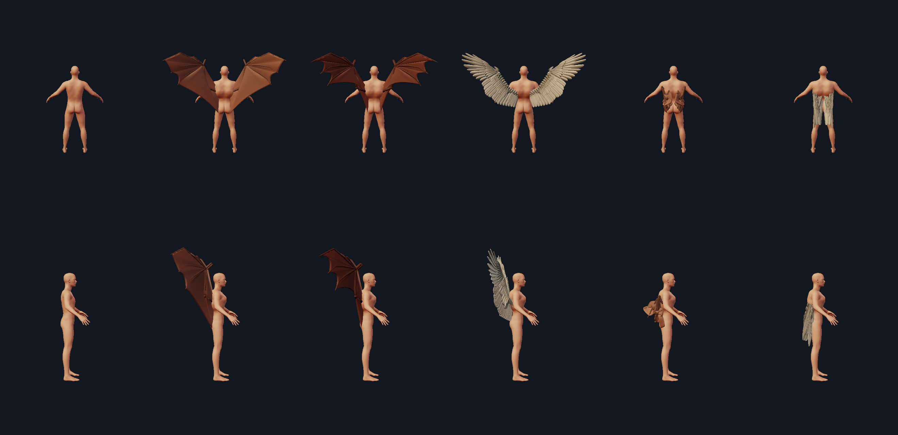

```python
rigs = A.back_wings("membrane").build_rigs(base, verts)   # [("wing_l", PlacedWing), ...]
rigs[0][1].pose("upstroke")                                # or fold=1.0, raise_=40, curl=30 ...
```

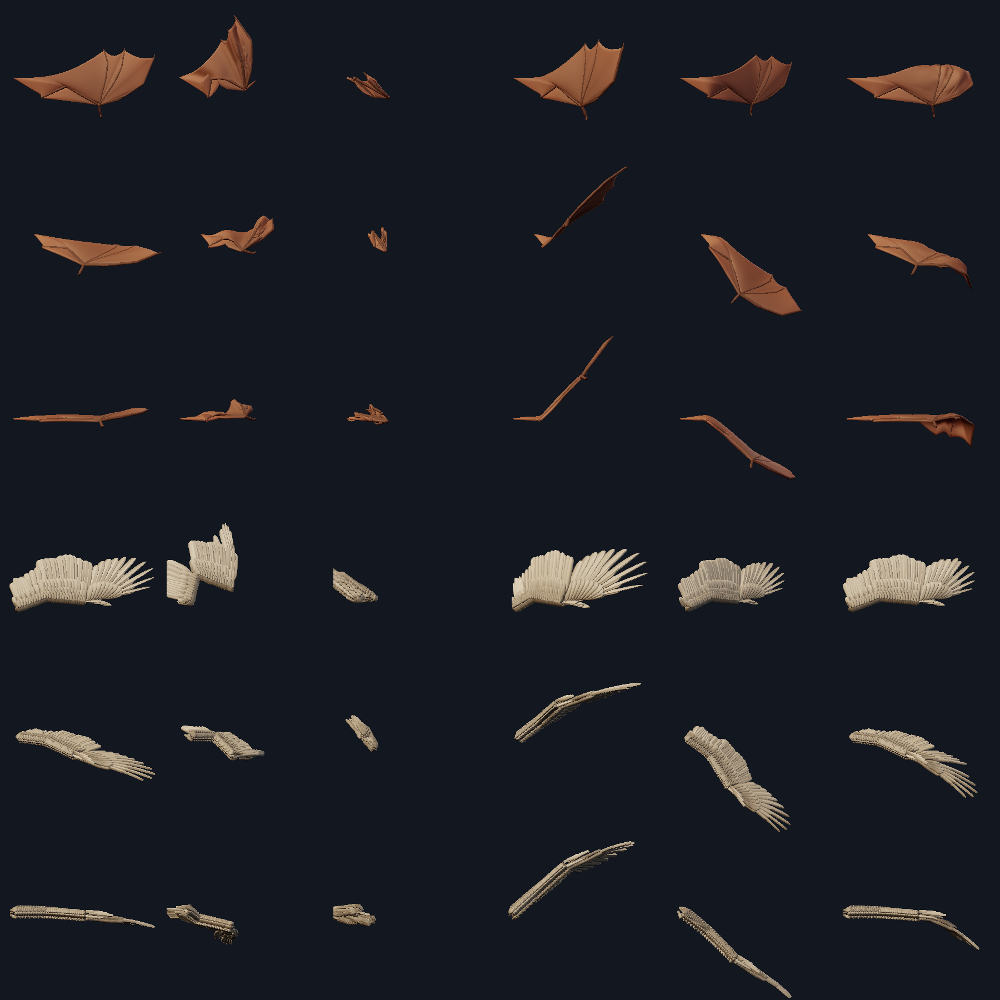

`back_wings()` carries the placement — the shoulder-blade anchor, the span
direction, the sink that welds the root into the torso so it prints attached
rather than hairline-joined, and the body point the membrane root runs down to,
so the wing hangs from the actual back for any body shape. See
[docs/wings.md](docs/wings.md) for the anatomy, the measurements and the rig.

They also **change the body that carries them**. A wing is powered by the
pectoralis and latissimus anchored on the trunk, so attaching one broadens the
chest and back, widens the shoulders, and trims the waist and thighs the way it
would in an animal that flies — via the ordinary sliders, so the result stays
printable and still responds to every other control.

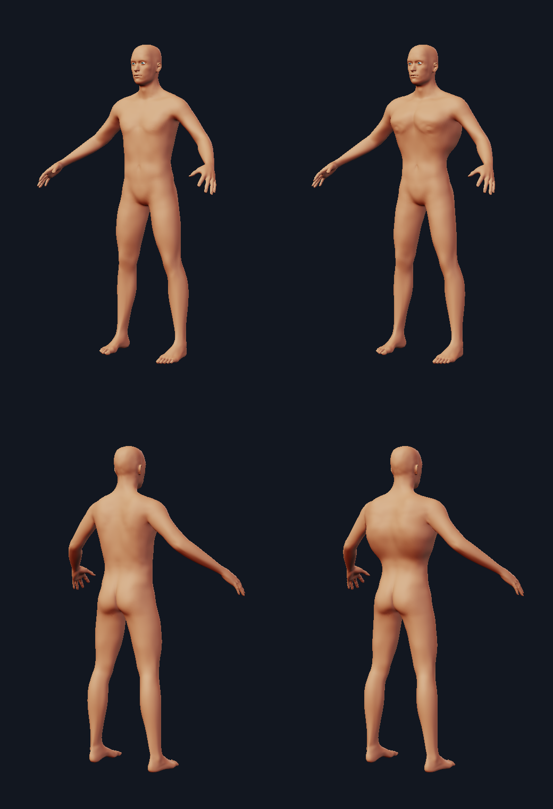

**Printing them.** Appendages are Y-up MakeHuman objects; the print shells are Z-up. One function
moves them across and keeps the size contract: `"medium"` means a 32 mm **body**, the wings ride along
(a spread pair stands ~38 mm tall and overhangs a 25 mm base, which the report states):

```python
shells = printprep.character_print_shells(base, verts)
shells += printprep.appendage_print_shells(appendages, base, verts)      # Z-up, named wing_l, tail, ...
mesh, rep = printprep.assemble_character(shells, size="medium",
                                         reference=printprep.FIGURE_SHELLS, fit_base=True)
report = print_report.appendage_report(appendages, base, verts, rep.scale, assembly=rep)
print(report.as_text())                  # BLOCKED / OK, per appendage, in mm at this size
```

The watertight gate only checks topology, so it passes a tail that merely touches the skin, three feathers
hanging in the air and a sheet thinner than the printer resolves. The report measures them: **blocking**
are a shell that is open or inside-out (every one is listed), a part not overlap-connected to the body, a
root not buried in it (the default tail and horns touch the skin: 2% and 0.2% of their volume), more than
30% of an appendage's area under 0.2 mm at this size (a bat wing at "tiny": 71%), or the same share of a
tail's length; **warnings** are a thin or fragile sheet, a folded membrane's pleats, a tail tip below what
resolves, two appendages that intersect, a base the wings overhang. The thickness floor
(`min_thickness_mm=0.3`) thickens wings for a small print. It assumes the slicer unions overlapping shells.

`flight_report()` gives the honest verdict alongside it, using the character's
own mesh volume for mass: powered flight tops out near 2.2 kg in bats and even
soaring scales out around 41 kg, so a human-scale flyer is off the chart by
~1.7×. It reports that; it does not stop you. See
[docs/creature_anatomy.md](docs/creature_anatomy.md) for the sources behind
every coefficient.

**Rendering speed.** `render_portrait` (the CLI and every figure above) runs on a
vectorised visibility-buffer rasteriser instead of a per-triangle Python loop:
the same pixels, 15–20× faster (a body with two bat wings in 0.065 s, with two
feathered wings in 0.28 s, at 320×480), with the view-independent shading terms
cached per shell, a `check=` hook so a worker can abort a render, an id-buffer
`pick()`, and draft-tier proxies for interactive previews. The old loop survives
in `tests/test_raster.py` as the golden reference; numpy stays at ≥ 1.24. See
[docs/renderer.md](docs/renderer.md).

#### Appendages in a character document

The realistic character is a document (`.mmchar`), and appendages are part of it. A
record is plain data — an `id`, a `kind` (`wing`, `tail`, `horn`, `harvest` = an extra
arm or leg cut from the character's own body), a `side` (`center`, `left`, `right`,
`both`), the kind's parameters, its pose controls and its placement — so a saved
character stays cheap to load (no numpy, no wing code) and can be edited by a UI, a
script or by hand:

```bash
minimaster character --list-kinds                         # kinds, parameters, ranges, presets
minimaster character -o winged.png --save-character winged.mmchar \
    --add wing:style=feathered,span=15 --add tail:length=8 --add horn
minimaster character --character winged.mmchar -o again.png \
    --remove horn-1 --add horn:side=left --pose wing-1:fold=0.6 --pose wing-1.r:raise_=20
minimaster character -o six_arms.stl --size medium --add harvest --add harvest:preset=upper_arms \
    --pose arm-2:elbow=40,raise_=70 --add tail --pose tail-1:lift=25 --add horn:shape=ram
```

```python
doc = Character.load("winged.mmchar")
placed = doc.instantiate_appendages(base, verts, lib)     # [Placed]: wing-1.l, wing-1.r, tail-1, ...
placed[0].mesh(), placed[0].control_range("swing")        # MakeHuman frame; ranges of THIS placed wing
```

* **Placement follows the body.** A record stores the body *quad* it is bound to (a
  preset such as `shoulder_blades`, `tail_base`, `temples`, `shoulder_socket`, or
  `at=X/Y/Z`), not a point in space, so on a taller, smaller, younger or heavier body
  the wing is still on the shoulder blade (the old world-point anchors put a wing 7.7
  units below it on a tall body). The right-hand side is the exact mirror of the stored
  left-hand quad, so a single right wing equals the right wing of a pair, bit for bit, and
  several wings can coexist (`wing-1.l`, `wing-2.r`, ... name their shells and joints).
  The membrane wing's attachment line aims at a waist quad, so it runs to the waist on
  every body. Tails and horns are sunk into the body by default (tail ~20%, horn ~51% of
  their volume embedded, instead of a hairline weld).
* **Extra arms and legs are the character's own limb, rotated and welded.** `--add harvest`
  copies the arm (or `limb=leg`), binds it to a body quad and sinks its narrowed cut end
  into the torso, so it prints attached and sits clear of the original (presets
  `lower_arms`, `upper_arms`, `extra_legs`; ids `arm-1`, `leg-1`). It is rigged: `swing`,
  `raise_`, `twist` and `elbow` (`knee`) pose it about the shoulder with anatomical ranges
  (`placed.control_range("swing")`), the weld never moves, both bones keep their length, and the
  right arm is the exact mirror of the left. `scale` makes a smaller pair; `roll` and `up_hint`
  mean nothing for a limb and are not offered.
  `--add harvest:preset=upper_arms --pose arm-1:elbow=60,raise_=20`.
* **Tail and horn.** A tail is posed by `curl`, `droop` (added to its shape), `lift` and `sway`
  (`--pose tail-1:lift=25,sway=-20`); a horn has four `shape`s (`curved`, `ram`, `spiral`,
  `antelope`). Both end in a rounded tip of `tip_radius` (0.09 / 0.08 units, 0.3 mm at "medium")
  instead of a point 0.04-0.07 mm across, so the printability report no longer warns about it
  (`tip_radius=0` is the old point). See the T3 section of
  [docs/appendages_system_design.md](docs/appendages_system_design.md).
* **Body adaptation is derived, never saved.** The adapted body (broader chest for
  wings, ...) is `your sliders + what the enabled appendages ask for`, recomputed every
  time (`Character.effective()`); the document stores only the switch and the cap
  (`--no-anatomy`, `--anatomy-cap`). Removing an appendage gives the original body back
  exactly; saving and loading change nothing.
* **Versioned and forward compatible.** A character with no appendages is still written
  as version 1, byte for byte; version 2 is written only when appendages exist. Unknown
  kinds, parameters, controls, styles and top-level keys are kept in the file and skipped
  with a warning when something is built from them. (A program older than this change
  loads a version 2 file and its body, but would drop the appendages if it saved it.)

#### The Character tab

The same character, edited in the studio. The **Character** tab (the last one) shows the
realistic figure in its own picture pane and lets you **add** a wing, tail, horn or extra limb
from a menu generated from the kind registry, **remove / duplicate** it, **tune** it with a
property grid generated from the kind's parameters (ranges, steps, `when=` conditions) and the
**live range** of each pose control on the placed appendage, **place it by clicking the body**,
switch its side, undo and redo (Ctrl+Z / Ctrl+Y), save and open `.mmchar`, and **export the STL
with the printability report** shown in the panel (blocking findings stop it until "Export anyway").

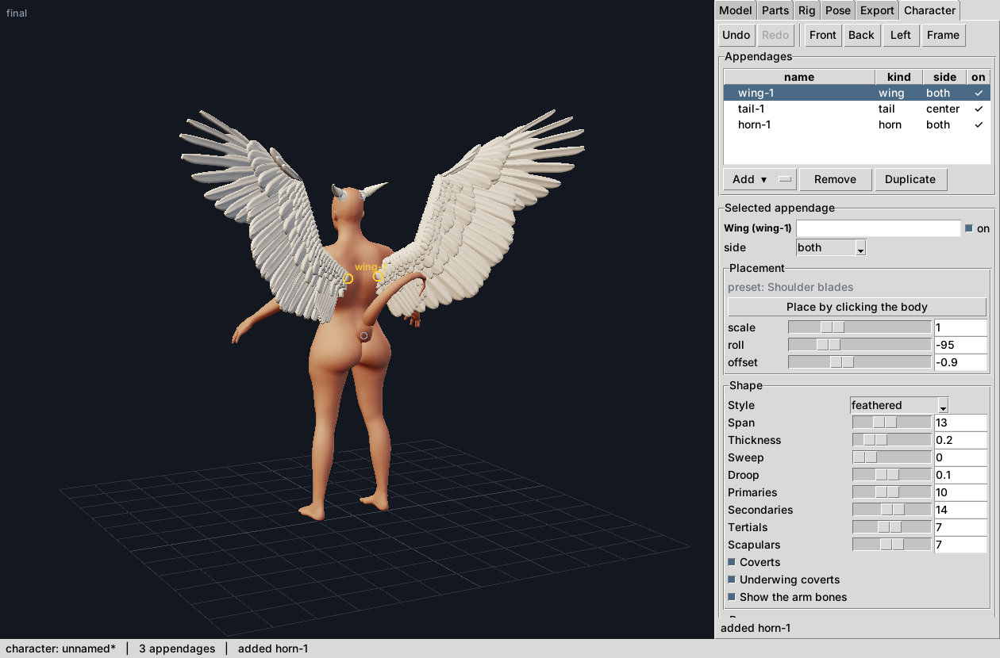

While you drag, a draft (a body proxy and cluster proxies of the posed appendages, ≥ 20 fps for
orbit / pose / body drags and ≥ 10 fps for shape parameters at 900×800, measured through the real
sliders) answers at once; 150 ms after you stop a cancellable worker thread renders the full picture
(the angel, 900×800, cold: 0.6-0.7 s). All the logic is a tkinter-free module
(`minimaster/character/lab.py`) tested without a display; the panel only turns widgets into calls on
it. [docs/character_tab.md](docs/character_tab.md) has the design, how the tab shares the window
with the studio's viewport, the numbers and the limits.

```bash
xvfb-run -a python tools/character_smoke.py --measure   # boot, drive the tab, screenshots, timings
python tools/lab_bench.py                               # the headless timings
```

## Licensing

MiniMaster's source is original work. The only runtime dependency is numpy
(BSD). Blender is optional and invoked as a separate process, never linked.

Character Lab's realistic path can load the MakeHuman Community base mesh and
morph targets, which that project releases under **CC0 1.0** (its AGPL licence
covers only its *program code*, none of which is used here). Those files are
**not committed** — fetch them with `python tools/fetch_makehuman_assets.py`.
MakeHuman makes no claim over generated output, so exported meshes and renders
are yours, commercial use included.

See [THIRD_PARTY_NOTICES.md](THIRD_PARTY_NOTICES.md) for the full record.

## Headless CLI

Everything the Export tab does works without a display:

```bash
minimaster templates                                  # list starter templates
minimaster new orc -o my_orc.mmp                      # start from a template
minimaster export my_orc.mmp -o orc.stl --size large --pose attack
minimaster export my_orc.mmp -o orc.stl --height 40 --no-base
minimaster preview my_orc.mmp -o orc.png --azimuth 335
minimaster bake my_orc.mmp -o orc_body.stl --size large  # fuse into one skin
minimaster validate my_orc.mmp                        # watertightness gate
```

## How it prints

Every shape is an independently **watertight, outward-oriented shell**; the
exported STL is the union of overlapping shells, which every slicer merges at
slice time. Rigid per-bone binding means posing transforms whole shapes —
joints stay covered by design (limb segments overlap ball pads), so any pose
exports watertight. The `validate` command and the test suite enforce this:
every edge shared by exactly two faces, consistent winding, positive volume.

Figures are modeled at roughly 28 mm-heroic scale and rescaled on export;
size categories put the figure at 15 / 24 / 32 / 45 / 60 mm total height on a
25 mm (or custom) base.

## Project files

`.mmp` files are plain JSON: shapes (kind + params + transform + bone +
color), joints (name/parent/position), named poses (joint → XYZ euler
degrees), active pose, and base spec. They diff cleanly and are easy to
generate from scripts — the starter templates are built exactly that way.

## Architecture

```
minimaster/
  core/        geometry kernel: math3d, Mesh (+integrity checks),
               watertight primitive builders, armature FK, binary STL I/O,
               tubemesh (skeletal quad-tube body) + bodymesh (SDF-blend body)
  scene.py     the document: shapes + armature + poses + undo snapshots
  export.py    pose → scale → base → merged STL (shared by GUI, CLI, tests)
  render.py    headless z-buffer flat-shade renderer → PNG (no imaging deps)
  templates/   shipped .mmp starter scenes (regenerable)
  viewport.py  tk Canvas painter's-algorithm viewport with picking
  panels.py    Model / Rig / Pose / Export tabs
  character_panel.py   the Character tab (widgets -> calls on character/lab.py)
  character/lab.py     the tab's tk-free core: document edits, undo, caches, preview tiers, export
  character/imageview.py   tk Canvas + PhotoImage showing a rendered picture, camera input, overlay
  app.py       the studio window: menus, undo, mode-aware refresh
```

## Development

```bash
pip install -e .[dev]
python -m pytest                       # 139 tests, all headless
python tools/make_templates.py         # regenerate starter templates
xvfb-run -a python tools/gui_smoke_test.py   # drive the GUI end-to-end
xvfb-run -a python tools/character_smoke.py  # ... and the Character tab
xvfb-run -a python -m pytest tests/test_character_panel.py   # its tk tests (skipped without tkinter / a display)
```

`examples/` holds a ready-to-print goblin scout (`.mmp` + STL) and an
attack-posed human fighter STL straight from the templates.
