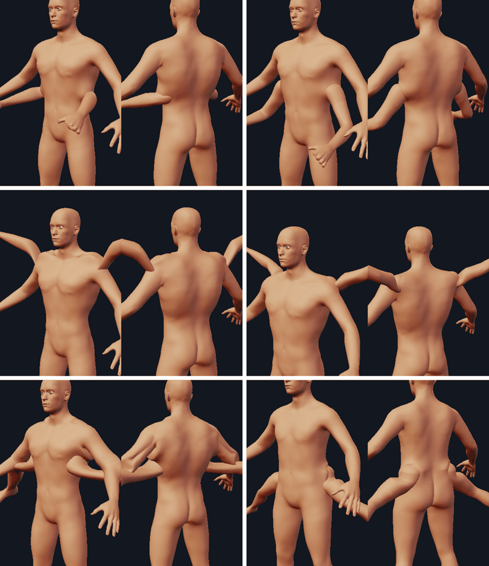
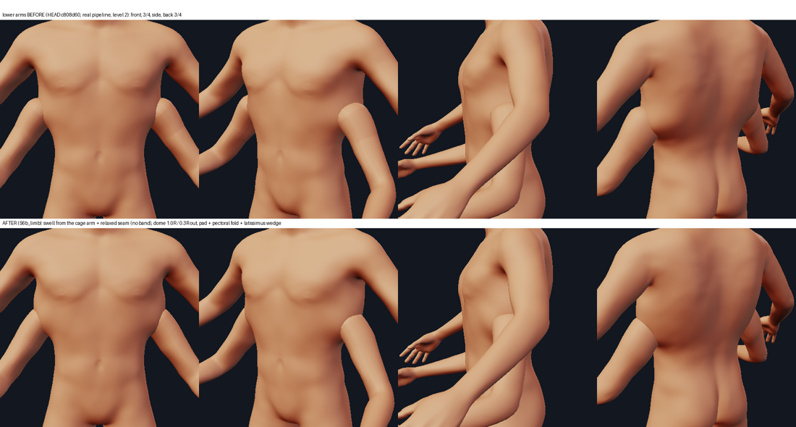
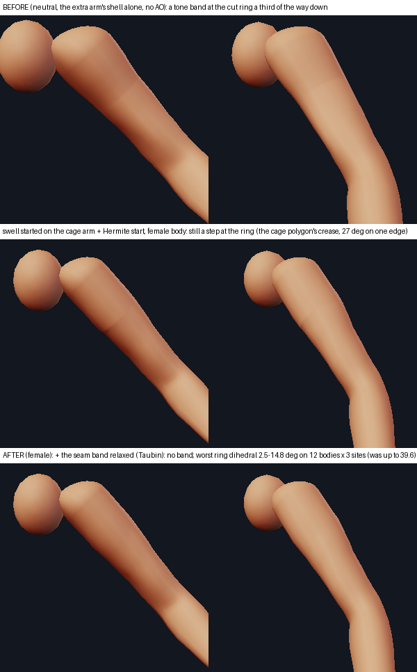
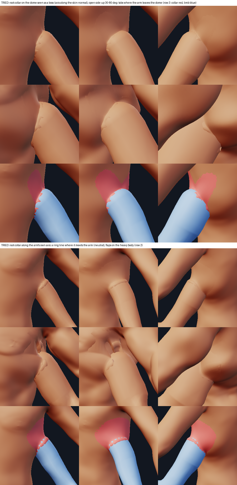
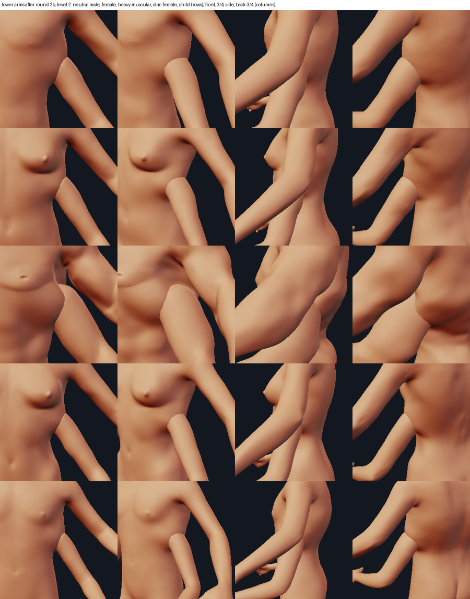
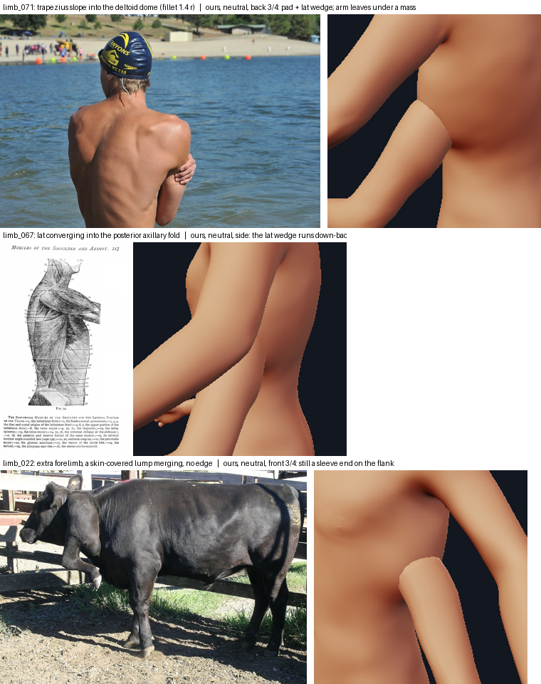
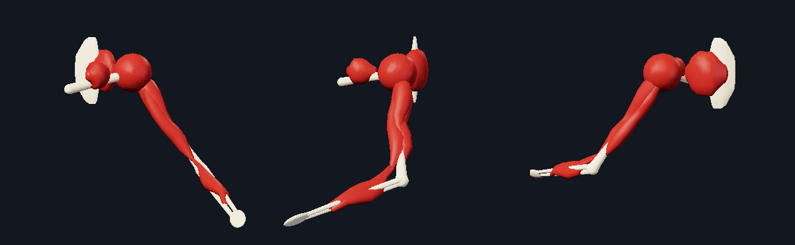
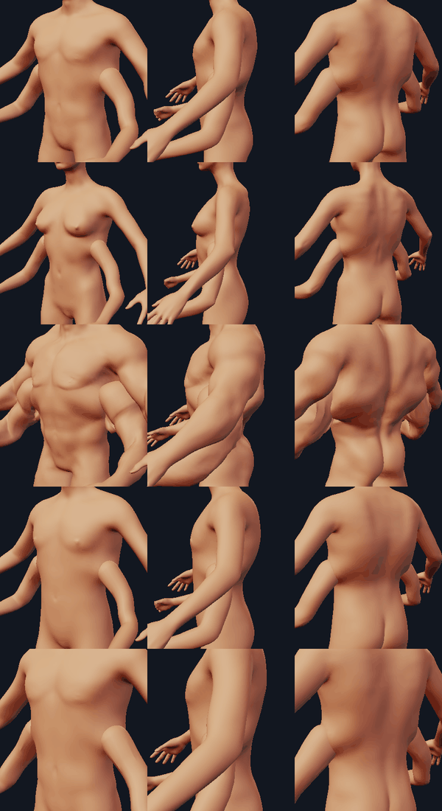
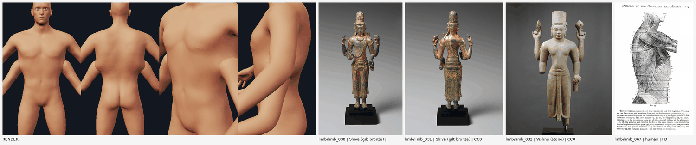

# Extra limbs on a second girdle (`limbgirdle.py`)

Design context: [appendages_system_design.md](appendages_system_design.md), the skin mechanism in
[junctions.md](junctions.md), the kind in `kinds.py` (`HarvestKind`), the rig in `limbrig.py`. The code is
`minimaster/character/limbgirdle.py`, the tests `tests/test_limb_girdle.py`, the picture tool
`tools/limb_view.py`.

## Round 2b (what changed after the round-1 review and the S6 core)

**The tone band across the arm** (the user's close-up, `cmp2_arm.png`). It was the cut ring a third of the way down
the upper arm, and it is geometry, not a material or a vertex-normal bug: with cavity AO off the band stays, and on
the front meridian the shell's normals tilted from 0.03 (cage, below the ring) to 0.12-0.19 (flare, above it) within one
row; the luminance stepped from 0.17 to 0.12. The flare put the whole swell to the dome (x1.2 over 0.9 units) above the
ring: a jump of curvature. Three changes (`dome_root`):

* **the swell starts on the cage's own arm**, `SWELL_BELOW` = one ring-to-joint distance below the ring (about 0.6 Lu: the
  deltoid's V), and grows along a smootherstep (no slope, no curvature at either end) to the dome's equator; the flare
  continues the same curve. The `slope` argument is ignored now;
* **the flare's first rows continue each ring vertex's own meridian** (the chord from the cage vertex below it), blended
  out over `HERMITE_REACH` = 0.45 of the flare;
* **the seam band is relaxed**: `SEAM_ROUNDS` = 6 rounds of Taubin smoothing (no shrink) on the vertices within
  `SEAM_BAND` = 0.45 ring radii of the ring (never the equator or the dome). A female body's ring had a 27-degree crease on
  one edge of the cage polygon that the first two changes left.

Worst ring dihedral on twelve bodies x three sites: 2.5-14.8 degrees (was up to 39.6); `RING_DIHEDRAL_MAX` is now 20 (was
40). On the synthetic tube no meridian turns more than 1.5 degrees per row (3.9 with the swell confined to the flare).

**The root collar: tried, and NOT enabled by default** (`collar` parameter, 0 by default, 0..2). The task was to decide
whether the dome rim or the collar (`collar.py`) carries the transition. Tried on renders, level 2, neutral and heavy:

* the collar around the dome **seen as a boss** (axis along the skin normal through the pivot, `LimbModel.collar_axis`):
  the dome bulges 0.01-0.02 units outside the collar's straight chord from the exit to the wall join (measured: the
  bulge grows with the climb `height` squared, `H^2 / 8 r`), so the arm's flare pokes through the sheet near the wall:
  red tabs along the join. Lowering the climb to 0.12-0.2 root radii and narrowing the open side (30-80 degrees from up)
  leaves tabs where the arm leaves the dome (the hair-thin part of the collar against a wall that is not along its
  generator); `facet_correction` and four axis tilts (0, 30, 50 degrees toward the arm) change nothing;
* the collar **along the arm's own axis**: exact for the dome and flare (they are built round that axis), but it draws a
  ring line where it meets the arm on the neutral body and breaks into flaps on the heavy body's folds.

So **the junction and the dome carry the transition** (one mechanism): the dome is smaller and closer (1.0 R, pivot 0.3 R
out of the skin: 1.1 and 0.4 before, a ball beside the ribs), the masses below are new, and the collar stays available as
an experiment (`harvest:collar=1`; `test_the_root_collar_of_a_girdle_limb_is_opt_in`). A saved record without `collar`
renders without one.

**The masses** (`LimbModel._arm_masses`, `ARM_MASSES`, lower pair; legs and the fan pair as before):

* a **pad** (radius 2.3 R, height 0.6 x the mass unit, centred 1.0 R above the skin point): the flank runs out onto the
  top of the dome, as the trapezius slope runs into the deltoid (`limb_071`: dome 1.23 arm radii over the chord, fillet
  radius 1.4); in the front view the arm now leaves a shoulder mass, not a ball beside the ribs;
* the **anterior fold** (pectoral analogue, the front wall of the axilla: `limb_047`, `limb_069`): a ridge from 0.6 R in front
  and 0.3 R below to 2.2 R in front and 0.9 R above, radius 1.0 R, height 0.26;
* the **latissimus**: a WEDGE from the back of the axilla down and back toward the iliac crest (`limb_067` fig. 74, the lat
  converging into the posterior axillary fold; `limb_068`: a sheet, not a ball), thick at the axilla (radius 1.0 R,
  height 0.24, to 1.6 R behind and 1.0 R down) and thinning (0.8 R, 0.12, to 2.8 R behind and 2.0 R down). It replaces the
  isotropic posterior mound (1.5 R, 0.3 R) that read as a pouch;
* heights are in the **mass unit** `min(R, 0.47 x the trunk's half depth)` (a heavy muscular body's arm is fat, R = 0.83
  against 0.53: masses in R alone made the shelf of the round-1 review; on it the unit is 11 % lower, on lean bodies it is R).

**The tube's centreline follows the mesh** (`LimbModel.centreline`): the centroid of the posed mesh across the rest axis at
each station. The dome is pinned and the arm turns over 0.45 Lu, so the straight line from the pivot to the posed elbow
left the raised fan arm near the root (the S6 core's caveat: two interior stations cut to a 0.01 wire, and the join guard
then applied the fan pair's girdle with its tube only on the thin, child and old bodies, `moved` 80 < 100). Now the join is
34-45 degrees on ten bodies (68-78 without the junction) for the fan pair and 63-87 (105-120) for the lower pair, with no
tube-only, mounds-only or dropped verdict. The radii are the radius law capped by the mesh (`fit_radii_to_mesh`: a 1.0 R
dome is thinner than the law's 1.07 at the joint).

**The Keep**: since the S6 core the junction protects foreign skin twice before the Keep (the tube is cut to its mesh; a
spec moulds only its own part), so the old test's careless tube moved 0.0005 R either way. Measured: the Keep IS what
holds the original arm against the lower pair's own masses (without it the real spec moves the original arm's skin by up
to 0.14 R on the ten bodies), and what holds it when a spec opens both escape hatches (`conform=False, ownership=False`:
0.18-0.2 R without, 0 with). The fan pair's original arm is held by `ownership` (0 without the Keep, 0.03-0.19 R without
both). The extra legs' Keep is never load-bearing in the measured poses.

**The range is measured on the body** (`clear_limits`, `Site.clear_end`): the end of the raise that swings the limb toward
the original limb (the lower pair's abduction, the fan pair's adduction) is pulled in, 3 degrees at a time and never past
the preset's pose, until the limb keeps 0.4 R from the original limb there at both swing extremes. Lower pair: 58 degrees
on the lean bodies, 55 on the heavy one, 40 on the heavy muscular one (its arm hangs at 44 degrees: raise -16..-4 around the
preset's -7; gap 0.30 R at the swing extremes: the swing range is not fitted; it was 0.03-0.05 R at 58). Fan pair: the lower end moves from 60 to 66-78 degrees (gap 0.40-0.61 R; it was
0.02-0.10 R).

**Cost**: a pair is built once per body and placement (cached, 8 entries: a lab edit that changes neither costs 2-3 ms), and
on a symmetric body the right side is the left one reflected without building it (it was built and thrown away). Cold:
80-280 ms a pair (440 ms for the fan pair on the heavy muscular body, where the clearance search takes eleven steps), at
machine load 3; HEAD c808d60 measured 130-220 ms cold on the neutral body at the same load and had no cache. The junction
(`apply_junctions` of a pair) is 70-115 ms.

**A quad off the trunk** (a leg, a foot, the head) no longer builds nothing or an arm at head height: the girdle is
snapped to the nearest height of the trunk where it can be (`_free_band`: an arm's between a radius above the hips and a
third of the upper arm below the shoulder, a leg's between half and three radii above the hip joint).

**The extra legs** are labelled low confidence in the preset ("they splay, they do not stand"); their rest pose is
unchanged. The core's validity pass already keeps the gluteal cleft clean (0 new crossings at levels 0 and 1 on six
bodies); the smallest quad of the heavy body keeps 0.17 of its area, on the medial underside of the root (10 of the 20
most shrunk quads are inside the leg; the core's bound is 0.12).

**References looked at this round** (opened as images, not only the digest): `limb_067` (Duval fig. 74: the latissimus
converging into the posterior axillary fold, the serratus slips and the oblique on the flank: the lat wedge and its
direction down and back), `limb_071` (the swimmer: the trapezius slope running into the deltoid dome with a 1.4-radius
fillet: the pad above the dome), `limb_031` (the Shiva bronze from behind: each shoulder one continuous rounded mound),
`limb_022` (the steer's extra forelimb: a rounded skin-covered lump merging into the shoulder with no edge: what the
transition should read as, and does not yet in the 3/4 view). The `limb` and the `TAKEAWAYS` digests for the numbers
(dome 1.23 arm radii, fillet 1.4, root flare 1.26 over the first quarter, one shallow axillary crease).

Side by side, honestly: against `limb_071` the back of the second shoulder is a mass the arm leaves from, but the top of
the arm still shows a light rim where it meets the trunk instead of a dome flowing out of the slope; against `limb_022`
the front 3/4 view still shows the end of a sleeve on the flank, where the steer's extra limb is a lump the skin runs
over without an edge. The tube junction's per-pose cost is 2-3.5 ms (`Placed.junction` with a new pose: it re-poses the
mesh for the centreline and fits the radii); `harvest:collar=1` on the fan pair and the legs builds (no error) and shows
the same tabs as on the lower pair.

**What still looks wrong** (judged on the renders above): in the front three-quarter view the top of the arm still reads as
a rounded sleeve end lying against the flank (the pad softens the front view, not the 3/4); on the heavy muscular body the
arm leaves the back under a fold with a crease line across it; the fan pair's root shows a round edge where the raised arm
leaves its dome (worst on the heavy body); the extra legs splay and hover. The layers are still derived from the skin (the
muscle is the skin's inscribed radius less the skin thickness), not the other way round: the skin is the character's own
arm, so this is stated, not fixed.

**Disclosure: how a saved document renders now** (no `.mmchar` change, no migration: the records store the preset, the
scale, the controls; everything below is derived): the lower pair's dome is 1.0 R and 0.3 R out (was 1.1 and 0.4), the arm
swells from 0.6 Lu up, the trunk masses are the pad, the fold and the lat wedge (the flank above the second shoulder is
raised up to 0.6 x the mass unit), the junction's tube follows the posed mesh (every girdle pair's skin moulds differently,
most visibly the fan pair's), the range is clamped per body (a stored `raise_` above the fitted limit builds with the
existing clamp warning: on the heavy muscular body anything above -4, the preset's own -7 builds), and `collar` defaults to 0 (nothing changes unless a
record sets it). The anatomy coupling (`CONSEQUENCES["harvest"]`, round 1: the trunk 4.5-7 % wider at the girdle) is
unchanged in this round and still applies to old documents silently: disclosed here, not versioned.

## What was wrong

A harvested limb was the character's own arm or leg cut out with a radius around its bones, moved so that its
**shoulder joint went to a body quad plus 2 units along the donor limb's own axis** (which points down,
forward and out, so the "sink" went up, in and back), narrowed to half its width (`neck = 0.5`), and capped
flat. Measured on the neutral body:

| preset | where the shoulder joint ended up | what it is |
| --- | --- | --- |
| `lower_arms` | (-0.03, 4.34, 0.16) | the sternum, on the midline of the chest |
| `upper_arms` | (0.30, 5.59, 0.25) | the base of the neck |
| `extra_legs` | (1.02, 5.65, 0.16) | the upper chest (the "leg" spans y -0.15 to 5.09: it poked out of the waist) |

What the viewer saw was a cylinder cut, a flat cap, a stub with no shoulder anywhere near it, and (since the
generic junction) skin tented around a pipe. The anatomy was wrong, not only the seam.

## The model: a girdle, a muscle sleeve, a continuous skin

The references agree (`limb_042`, `limb_054`, `limb_078`: the human shoulder joint stands ~0.2 rib spans
OUTSIDE the ribs on a bony outrigger and is covered by a deltoid dome; `limb_023`, `limb_024`, `limb_025`:
the real polymelia limbs root on the nearest girdle and share its skin; `limb_030`..`limb_032`: the
multi-armed bronzes give each side ONE broad shoulder dome that carries several arms). So an extra limb is:

1. **bone**: a girdle strut and a plate on the ribs (the clavicle and scapula analogues; at the hip an
   iliac strut), the humerus with its head at the pivot, radius and ulna, a hand block;
2. **muscle**: the dome (deltoid / gluteal), the sleeve in bellies (deltoid tail, biceps, triceps, flexors,
   extensors) and the masses on the trunk (pectoral/serratus fold, latissimus and scapular mass);
3. **skin**: the limb's own shell (the character's arm, closed with a flared root and a dome) and the
   trunk's skin, moulded over the masses and into the dome by the junction. One continuous surface.

### Where (landmarks that follow the body)

`limbgirdle.measure(base, verts, site, side)` uses only the joint markers and one horizontal slice of the cage
(`slice_loops`, `torso_loop`, `ray_to_loop`), so it follows every morph. `R` is the equivalent radius of the
upper-limb section read off THIS body (at 0.4 of the length, divided by 0.906 for arms / 0.953 for legs: the
neutral body's r(0.4 Lu) / r(0.25 Lu)), `Lu` the upper bone's length. Everything else is in `R` and `Lu`.

| site (preset) | rule | pivot out of the skin | dome | scale | rest pose (`raise_`, `swing`, `elbow`) | range |
| --- | --- | --- | --- | --- | --- | --- |
| `lower_arms` | `y = shoulder.y - 0.85 Lu`, lateral midline of the trunk section there | 0.4 R | 1.10 R | 0.9 | -7, 8, 20 (abduction 35) | abduction 28 to 58, swing -25 to 55 |
| `extra_legs` | `y = hip.y + 1.5 R`, 30 degrees behind the lateral midline | 0.1 R | 0.97 R | 0.7 | 49, 5, knee 25 (abduction 55) | abduction up to 75, swing -20 to 50 |
| `upper_arms` | the primary joint + R (-0.55 medial, +0.5 up, -1.05 behind): the scapular spine | -0.34 R (inside) | 1.07 R | 0.85 | 68, -30, -10 | abduction up to 160, swing -60 to 45 |

* Lower arms, neutral body: `y = 3.11` = 0.45 of the way from the shoulder to the hip joint (0.43 to 0.51 on
  ten bodies: neutral, male, muscular, female, tall, short, heavy, thin, child, old), skin point (1.31, 3.11,
  0.51), pivot (1.40, 3.11, 0.50), `R = 0.488` (children 0.32, tall 0.56). The pivot stands `0.4 R` outside the
  skin along its normal to 1e-9 on every body.
* The fan pair (`upper_arms`): its pivot is the formula (a test pins it to 1e-9) and stands about a third of a
  radius under the back skin on every body.
* The **handle quad** of a record (the document stores a cage quad, as before) is 10351 / 10524 / 10747 for
  `lower_arms` / `extra_legs` / `upper_arms`; it is only a handle (the UI picks and shows it). The pivot is
  computed from the landmarks on the body being built, so a tall or a child body keeps its girdle where the
  rule puts it (a fixed quad drifted 0.1 to 0.7 R on the extremes: measured in the research round).
* **A quad the person chose** (any other `face`) is built on: the girdle is at that quad's height, toward it
  (`measure(point=)`), with the same dome and masses.
* `placement.offset` of a girdle preset is the extra distance of the pivot out of the skin, in R (clamped to
  -0.6 .. 0.6); `scale` scales the limb about its pivot.

### The root: no cut ring, no flat cap

`cut_limb` takes the quads of the body cage beyond a plane across the upper bone (`t0 = 0.30 Lu` from the joint,
perpendicular to the SHOULDER-ELBOW axis: the first version's plane was perpendicular to shoulder-hand) that lie
within 1.4 R of the bone chain (2.4 R beyond the elbow, for the hand), keeps the largest piece (the strip of
flank within reach of the arm is joined to it only through the armpit, which is on the near side of the plane),
shaves the "ear" quads that have three corners on the ring, slides the ring onto one plane and spreads its
vertices evenly along itself (validity-checked: no face of the cut turns over or collapses). The cage's ring has
tiny quads where its edge loops converge (the front of the armpit) and a plane cut of the triangles has
near-duplicate points; both made slivers and a visible seam.

`dome_root` continues the ring with rings that **swell toward the joint** (round 2b: the swell starts on the cage's
own arm below the ring, see above; the first version's cubic started at the ring with the limb's own slope) and then close
over the joint as a **hemisphere of radius `dome R`** that ends in one pole. The rings are the low-pass shape
(Fourier series, four harmonics) of the ring at even angles, so the dome is smooth even though the cage is a
polygon; the ring's own ellipse (longer front to back) is kept. The joint is moved onto the ring's own axis
(the arm's section is centred about 0.2 R in front of the marker): the limb does not bend where the dome
starts. A leg's axis runs along the wall, so its dome closes with a lean into the pelvis (`lean`).

The seam is measured: the angle between the two faces on every edge of the ring has a median of 1.5 to 4.5
degrees and a worst of at most 38.6 on the ten bodies (`ring_dihedral`; `build_side` takes the next cut plane,
0.35, 0.40, 0.45, 0.25 Lu, if a body's cage gives a worse seam than 40 degrees). The old cut had a flat cap
there (90).

A **deep mass** (an ellipsoid half way from the skin to the centre of the trunk section) is part of the printed
shell: the shoulder joint is a fraction of a radius out of the body now, so the weld to the torso is the dome
and this mass (without it a hairline weld: 5 to 8 percent is a print-report warning). It is hidden; on the ten
bodies and the three presets the limb is 17 to 32 percent buried (the rule is 8 percent, `test_limbs`
`0.12 <= share <= 0.45`).

### The flesh around the root (the junction)

`LimbModel.junction()` hands `junction.apply_junctions` a `JunctionSpec` in R units: the **tube** of the posed
limb (pivot, then the radius law below) with `fillet` width 1.0 and height 0.3 (the dome is a visible form: the
skin climbs only a third of the fillet width), **mounds** for the masses the cage can carry (>= 0.8 R), and
**Keep spheres along the original limb**.

* the radius of the limb along its length, in R (`RADIUS_F`, read off the neutral body's own section): 1.07 at
  the joint, 1.0 at 0.2 Lu, 0.93, 0.87, 0.84, 0.82, 0.80, 0.78, 0.76, 0.78 at the elbow (research: arm taper
  1.00, 0.82, 0.79, 0.77, 0.79 in `limb_059`, a flared first quarter then a near-cylinder);
* arms (`MASSES`): a skirt of radius 2.8 R, height 0.25 R (centre 0.35 R behind the skin point), the pectoral /
  serratus fold: a ridge from 0.9 R in front of the dome to 3.2 R, 20 degrees up, radius 1.0 R, height 0.20 R, and the
  scapular / latissimus mass: a ridge behind, radius 1.5 R, height 0.30 R (the research numbers were 0.35, 0.30 and
  0.55 to 0.6; the first versions of the posterior mass read as a sack on the back); legs: skirt 0.25, anterior
  0.18, posterior 0.25 R (shorter: the two sides' masses met on the sacrum);
* there is no deltopectoral groove between the dome and the fold (the research asked for 0.15 to 0.25 R deep and 0.4 R wide: below what the cage resolves, 0.36 to 0.43 R an edge) and the axilla crease is whatever the tube's fillet gives on the underside (the research asked for a 0.5 R fillet there and 1.0 R over the deltoid side: one fillet width is used);
* the fan pair: the skirt (2.4 R, 0.30 R) and a trapezius ridge toward the neck (1.0 R, 0.25 R);
* **Keep spheres** (1.45 R, fading over 0.3) along the original limb's bones (from 0.35 Lu down for a leg, from
  0.5 Lu down for the fan pair, which shares the shoulder): the generic junction pulled the ORIGINAL arm's armpit
  and shoulder (an armpit web and flap on the extra legs, a ridge across the trapezius on the upper arms, cone
  spikes on the chest when a lower arm was swung). The displacement of any cage vertex within 1.3 R of the
  original limb is 0.000 on ten bodies and three presets;
* the whole is pose independent in the dome and the masses (the tube follows the posed limb); at the rig's
  limits nothing far from the girdle moves (`test_the_junction_leaves_nothing_far_from_the_girdle...`: within
  4.5 R of the skin point or within the fillet's reach of the tube).

The largest displacement of a cage vertex is 0.73 to 0.80 R (the research asked for 0.6: the masses and the
fillet add where they overlap). No quad flips, the smallest quad keeps more than 0.2 of its area, and the
validity pass backs off at most 40 vertices.

### The rig and the range of motion

`LimbRig` now takes per-rig `limits`, `pin_fraction`, `blend_fraction`. A girdle limb pins only the dome
(everything up to the joint's plane) and turns the limb over 0.45 of the upper bone beyond it, so the root
flares out of the dome like a joint and not like a bent pipe (pinning the first 0.3 Lu left the leg's root a
vertical slab). The range is the girdle's own:

* lower arms: abduction 28 to 58 degrees (not a slit under 25 against the flank, not into the original arm:
  the clearance to the original arm is 1.06 to 2.37 R at 35 degrees, 0.75 to 1.6 at 55, 0.21 to 1.15 at 60 and
  0.0 to 0.5 at 65 on ten bodies), swing -25 to 55 (+25 at hanging, which keeps the root from tenting the
  chest);
* extra legs: abduction up to 75 (clearance to the first thigh 1.3 to 3 R), swing -20 to 50;
* upper arms: abduction up to 160.

### Layers

`Placed.layers(controls)` returns `{"bone", "muscle", "skin"}` (closed outward meshes in the MakeHuman frame):
`skin` is `Placed.mesh(controls)`. The bone and the muscle are built from the SAME numbers: the posed joints,
`R`, the skin thickness (`SKIN_THICKNESS = 0.12 R`, 6 to 10 mm on a lean male) and the trunk section. The
muscle bellies are spindles along the skin's own centre line at the skin's inscribed radius less the skin
thickness (so the skin is their envelope), the dome muscle is the dome less the thickness, the trunk masses
sit under the mounds (their heights less the thickness); the bone is sized from `R`. On the ten bodies at rest
and posed to `raise 10, swing 5, elbow 20` every muscle and bone vertex is inside the skin or the shaped body
(>= 99.5 percent; 98 percent for the fan pair; `tests/test_limb_girdle.py`).

`tools/limb_view.py OUT.png "harvest:preset=lower_arms" arm 0,4 90,4 --layers bone,muscle,skin --cut coronal`
draws them (`--no-body` for the layers alone; `--pose arm-1:raise_=20,elbow=40`). It uses
`minimaster.character.ecorche` when the tail track's helper is merged and its own copy otherwise.

### Records written by the first versions

* the first presets stored quads 10411 / 7974 / 10349 and a sink of -2.0 / -1.8 / -2.6 (units along the limb
  axis). A record that still has them is **read as the landmark rule** (the quad becomes the preset's handle, the
  sink 0), the document is not rewritten (`LEGACY_HARVEST`; `test_a_record_of_the_first_version_is_read_...`).
  The scale of an old record without one is the site's (0.9 / 0.7 / 0.85: the preset's `girdle_scale`, which is
  not stored in new records either, so a default pair still costs anatomy load 1.0);
* `shoulder_socket` and `hip_socket` (and a limb that does not match its preset's limb) keep the first version's
  placement exactly (the tests of the sink along the axis and the scale about the shoulder now use them);
* the params `radius`, `trim`, `neck` belong to the first version's cut and are ignored by a girdle preset.

### Coupling to the body

`creature_anatomy.CONSEQUENCES["harvest"]` (an arm pair) now moves the sliders that reach the lower ribs where
the second girdle sits (measured on the base mesh: `torso_scale_horiz` changes the half-width at y = 3.1 by
+0.24 per unit, `bust_circ` +0.14, `dorsi` +0.10, `waist_circ` +0.05, `torso_scale_depth` +0.24 depth):
`torso_scale_horiz` 0.45, `bust_circ` 0.30, `torso_muscle_dorsi` 0.40, `waist_circ` 0.20, `torso_scale_depth`
0.15, `measure_shoulder_dist` 0.25, `torso_muscle_pectoral` 0.20 (the first entry widened the upper chest and
the neck, and none of it reached y = 2.5 to 3.5). An extra LEG pair (`LEG_EFFECT`, picked by
`effect_key`) widens the hips: `hip_scale_horiz` 0.35, `measure_hips_circ` 0.25, `buttocks_volume` 0.40. The
magnitudes are guesses; the sensitivities are measured. The flank at the girdle is wider with a pair than
without (`test_the_body_widens_at_the_girdle...`).

## The extra legs: the decision

The default preset was a horizontal knee-bent leg from the waist (a hip in the chest). The references show no
good model: the only real ones are the polymelia cases (`limb_023`, a six-legged goat kid whose extra hind legs
hang from the pelvis/rump on the same side as the normal hind legs; `limb_024`, `limb_025` radiographs: the
extra bones articulate with or near the existing pelvis). So the extra legs are a **second hip girdle on the
iliac wing**, a radius and a half above the first hip, behind and outside it, at 0.7 scale (a full thigh is 0.52
of the pelvic half width and cannot hang from the flank), splayed 55 degrees. They hover (the pivot is 10
units above the ground and a 0.7 leg is 5.6 units long), so they cannot be supports; the dome is a gluteal mass
(`limb_064`..`limb_066`: gluteus maximus is the largest and thickest muscle of the body). Low confidence.

## Numbers (ten bodies unless said)

| what | measured |
| --- | --- |
| time to build a pair (cut, dome, deep mass) | 0.05 to 0.15 s per side |
| second limb buried (print report, medium) | arms 31 percent, legs 25 to 28 (0 blocking, 0 warnings; thinnest 5th percentile 0.5 / 0.6 mm) |
| ring seam, worst dihedral (round 2b, 12 bodies x 3 sites) | 2.5 to 14.8 degrees (limit 20; was <= 38.6, limit 40) |
| keep: displacement within 1.3 R of the original limb | 0.000 R |
| largest cage displacement | 0.73 to 0.80 R |
| clearance to the original arm at rest (35 degrees) | 1.06 to 2.37 R |
| pivot outside the skin | 0.3 R (lower arms, was 0.4) / 0.1 R (legs), exact |

## References used

(ids are `region/limb_NNN` in the reference library; licences in `docs/appendage_references.md`)
`limb_042`, `limb_054` (biacromial 1.38 to 1.40 x the rib span: the joint stands outside the ribs);
`limb_071` (real skin: deltoid dome 1.23 arm radii, fillet radius 1.40, arm flared 1.26x then a cylinder);
`limb_059` (the arm taper law); `limb_078` (Houdon ecorche: the deltoid IS the lateral outline of the shoulder);
`limb_067`, `limb_043`, `limb_047`, `limb_049` (latissimus, teres, serratus, the axillary folds: the masses
and the one shallow axillary crease); `limb_030`, `limb_031`, `limb_032` (a single shoulder dome per side
carrying all its arms, staggered in height: the fan pair); `limb_023`, `limb_022`, `limb_024`, `limb_025`
(real extra limbs root on the girdle and share its skin); `limb_064` to `limb_066` (the hip: gluteal mass);
`limb_012` (the ramp: one crease where the limb leaves the chest).

Compared honestly: the bronzes put several arms on ONE dome per side; the lower pair here has its own dome low
on the ribs (the research's primary recommendation, from the polymelia reports and the artists' notes), the fan
pair (`upper_arms`) is the iconographic version. The back view shows the latissimus / scapular mass gathering
behind the second shoulder like `limb_067`; the front view shows the second dome clear of the original arm.

## Not done, and what is a guess

* The lower pair is the research's recommendation (a second girdle on the lower ribs: polymelia reports and the
  artists' notes), not what the iconography shows (one deltoid dome per side carrying several arms: that is the
  fan pair, `upper_arms`, which is the weakest-evidenced of the three).
* Cost: a pair is cut, domed and welded in 0.05 to 0.15 s per side (up to five cut planes are tried when a
  body's cage gives a bad seam, and an independent right-hand build is made to check the mirror); the lab
  re-instantiates on a body-slider drag, and the cost of that tick was not measured with `tools/lab_bench.py`.

* All the girdle numbers other than the ones tagged in the research as MEASURED (R, y, the skin distance, the
  section radii, the sliders' sensitivities) are proposals: the dome and mass sizes, the skin thickness, the lean
  and the leg site. The fan pair is iconography, not anatomy.
* The dome is a sphere (an ellipsoid of the arm's own section): the cage cannot carry a fillet under 0.8 R, so the
  concave collar is the junction's skirt and fillet at the cage's resolution (rounder after one or two
  subdivisions).
* At large flexion (elbow 45 and a raise) the skinned arm loses volume on the inside of the bend and a belly can
  come 0.05 R through the skin in the layers view; the layers are consistent at rest and at the poses above.
* The muscles are spindles and the bones primitives, not dissected forms; the clavicle and scapula analogues are
  the research's proposal (an outrigger and a plate), the hand and foot are blocks.
* Not run: a real slicer (the print report assumes the union, as before); a very asymmetric body was only
  checked for the left/right independence (the right girdle is computed from the right limb; the pair is the
  exact mirror only where the cage is symmetric).
