# The tail as an anatomy

The first tails were a tapered tube pushed through the skin of the side of the left buttock: the anchor was
one cage quad (`3921`) whose centre is 0.36 R off the midline and whose normal is yawed ~10 degrees off the
sagittal plane, the pipe was sunk 0.6 along that tilted normal, it bent sideways (the `droop` control rotated
about the tangent that points UP), and the skin did not mould around it. A sculptor's verdict was "a shell
placed on the skin". This track rebuilds the tail the way the animal is built: **bone, muscle, skin**, rooted
on the **midline of the sacrum**, with the skin of the sacrum flowing into it.

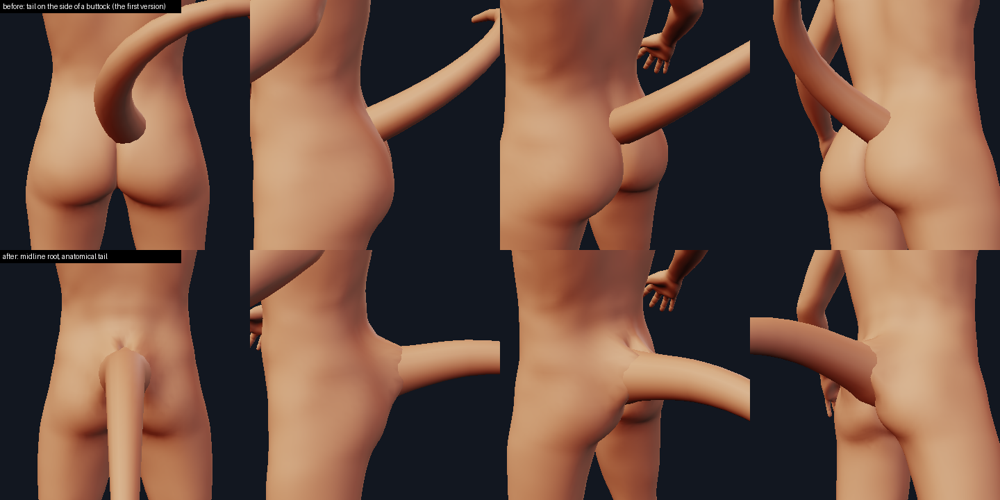

Code: `minimaster/character/tailrig.py` (the model and the junction spec), `kinds.TailKind` (placement and
build), `appendages.SurfaceAnchor` / `face_anchor` (the midline anchor), `creature_anatomy.TailEffect` (what a
big tail asks of the pelvis), `ecorche.py` (the layers drawn). Tests: `tests/test_tail_anchor.py`,
`test_tail_anatomy.py`, `test_tail_junction.py`, `test_tail_ecorche.py`. Numbers: `tools/tail_report.py`.
Pictures: `tools/junction_view.py ... --layers bone,muscle,skin --cut`, `minimaster character --add tail
--layers bone,muscle --cut -o x.png --azimuth 90`.

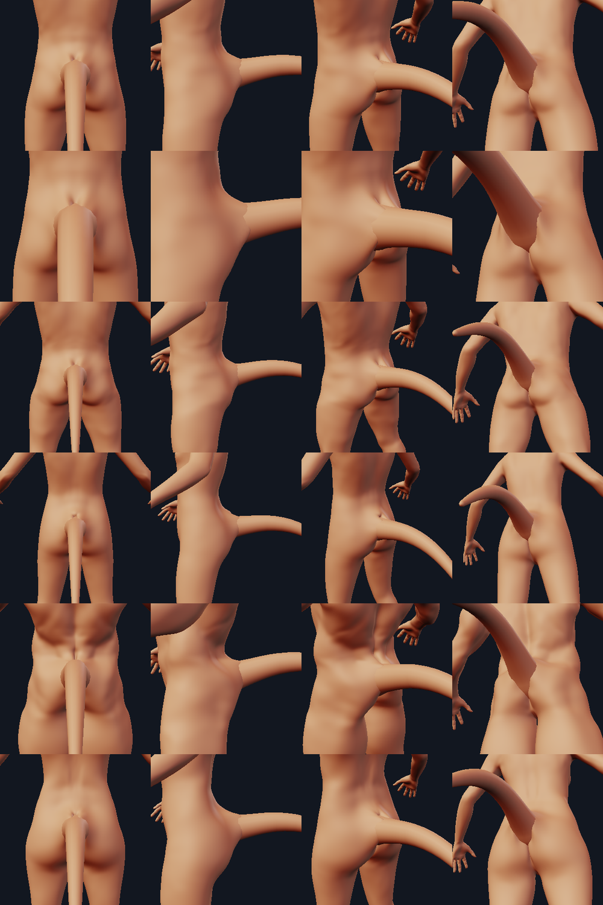

## 1. Where the tail is rooted: the midline

**The landmark rule** (vertex ids of the 13,380-vertex body cage, verified on eight morphs by
`tests/test_tail_anchor.py`): vertices `4223` (the apex, the most posterior midline point), `4215` and
`4205` (the midline edge the tail roots on) and `4387` (the top of the gluteal cleft) are exactly on `x = 0`
on every morph. The root point P is the middle of the edge `4215-4205`. In units of R = 0.0265 H (H the height of
the morphed cage) it measures, over neutral / tall / short / child / heavy / female / old / male bodies:

| | measured | rule |
| --- | --- | --- |
| P over the body's height | 0.522 - 0.581 | 0.50 - 0.585 |
| apex 4223 to P, along the midline | 0.75 - 1.12 R | 0.7 - 1.15 R |
| P to the cleft top 4387 | 0.86 - 1.34 R | 0.8 - 1.4 R |
| axis elevation above horizontal | 5.8 - 17.3 degrees | clamped to 5 - 18 |
| lateral offset of the root point | 0 to 1e-4 R (the base mesh itself is 5e-5 asymmetric) | 0 |

**The anchor.** A single quad cannot carry a midline normal, so `SurfaceAnchor` gained an optional mirror
partner (`mirror_corners`, `mirror_weights`): the bound quad PAIRED with its mirror image. The origin is the
mean of the two weighted points and the normal the sum of the two quads' Newell normals, so both lie exactly
on the sagittal plane of a symmetric body (the polygon, not an arithmetic `x = 0`: a body shifted sideways
carries its anchor with it). `appendages.face_anchor(base, quads, face, weights, hint, midline=True)` builds it;
`Appendage.anchor_midline` (default `False`: the legacy engine is untouched) switches it on. Weights over the
stored (+x) quad slide the root along the spine and stay on the plane.

**Who is midline.** `TailKind.resolve_placement` binds a `center` tail to the quad AND its mirror image when
the stored quad has an edge on the midline (`appendages.is_midline_face`); `anchor.midline: false` in the
record switches it off, and a tail clicked onto the side of the body (a quad that is not a midline quad) or a
`both`/`left`/`right` pair stays on its single quad exactly as before. The lab's anchor markers
(`Engine.anchor_points`) read the same anchor.

**Documents.** Nothing is rewritten. A record written by the first tails has the preset `tail_base`, the
anchor face `3921` (with its corners) and `offset -0.6`: `resolve_placement` reads face `3921` as the new
`tail_base` quad (`10562`, the +x quad around the midline edge) and the first preset's sink `-0.6` as the new
default `0` (`kinds.LEGACY_TAIL_BASE_FACE`, `LEGACY_TAIL_SINK`); a v1 world-point record that resolved to
`3921` is read the same way. An explicit user anchor or offset is honoured. `PRESET_FACES["tail_base"]` is `10562` and
`PRESET_POINTS["tail_base"]` is a point on the neutral cage whose nearest quad is that one
(`test_kinds` recomputes every preset from its point). The old `curl` / `droop` / `lift` / `sway` / `length` /
`base_radius` / `segments` / `ring_verts` / `tip_radius` / `flare` / `fillet` keys all still load; what they MEAN
changed (below), and that is stated, not hidden.

**Direction.** The tail's axis is the sacral surface normal at P, pitched in the sagittal plane into 5 - 18
degrees above horizontal (the first part of a tail is the continuation of the sacrum's axis, not of whatever way
one cage quad faces). This is done in `TailKind._root_frame`, not through the document's `roll`.

**The stem.** The sink is no longer an offset along a tilted normal: the tail's own geometry starts
`STEM_R = 1.75` base radii BELOW the skin point, along its own axis (the hidden bone root: the sacral apex,
Cd1 at 1.0 R). The first ring is inside the body on every body (`test_the_sink_is_the_bone_root_not_an_offset`),
the default tail is 36 % embedded (the first one: 20 %), and `placement.offset` slides the tail along its
axis (0.3 -> 24 %, 0.6 -> 11 %, +0.9 units -> tangent: a hairline weld that the printability report blocks).

**Size follows the body.** `length` (6.0) and `base_radius` (0.45) are the values on the NEUTRAL body
(`kinds.neutral_cage`, height 16.76); the model is scaled by `H / H_neutral`
(`TailKind.body_scale`), so R is 0.0268 H on every body (research: 0.0265 H; the document's own
`placement.scale` multiplies on top). A short body's tail was 0.27 of its hip span and a tall one's 0.16; now the
ratio of the tail to the pelvis is the same on every morph.

## 2. The three layers

`TailModel(TailParams)` builds all three from one parameter set, in a local frame (x up in the sagittal
plane, y lateral, z along the axis, `s` along the axis from the skin point: negative inside the body). `Placed.layers()`
returns `{"bone", "muscle", "skin"}` as meshes in the MakeHuman frame (a kind without an anatomy has the skin
only); the skin IS `Placed.mesh()`, the shell that is printed and rendered.

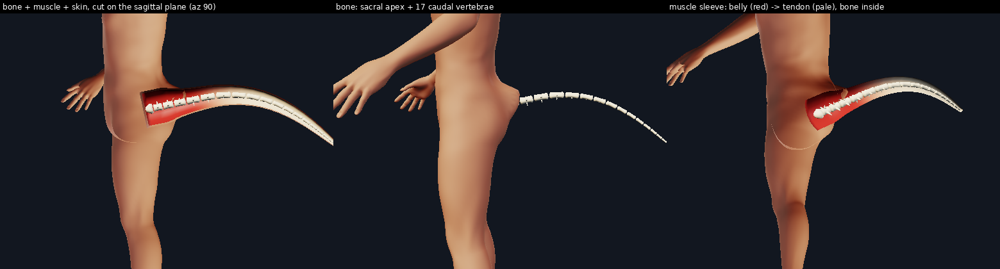

**Bone** (hidden): the sacral apex, then `n = round(48 L / H_ref)` (6 - 30, 17 on the default) caudal vertebrae
from Cd1 (rostral end 1.0 R below the skin point) to the tip. Vertebra lengths rise from 0.55 of the longest at Cd1
to 1.0 at 29 % of the chain and fall to 0.35 at the tip (the longest is Cd7-8 of 26 in the macaque data,
Wakamori & Hamada 2019). Each centrum is a waisted spool of radius 0.30 of the local skin radius at the root
and 0.33 beyond a quarter of the length; the first six carry transverse processes (0.65 R long on Cd1,
shorter after), the first four a neural spine (0.25 R, none by Cd5), and chevron bones hang ventrally from Cd4 to 55 % of the chain,
tapering to nothing. The bone radius is calibrated on the cat skeleton plate (below): the research had guessed
0.40 / 0.55 of the local radius distally, which makes the bone 1.4 - 1.9 times too thick there.

**Muscle** (the sleeve): the primary shape; the radius law inside the skin thickness, lobed where the bellies are
(`LOBE` 12 % peak to peak since round 2b: a dorsal median groove, two dorsal and two ventral bellies, lateral bands), plus
the **body-side muscles**: since round 4 (section 10) the sacrocaudalis dorsalis and ventralis strands along the sacrum and
two oblique gluteal bands, laid under the skin the body is meshed with (round 2b's lenses, section 9, stood out of it). It is muscle belly on the proximal
part (full to 12 % of the length, a cosine fall to nothing at 55 %: bellies arise on the sacrum, ilium and last
lumbar vertebra and act through long tendons) and tendon, fascia and fat beyond. The ecorche colours it so
(`Kind.layer_colors`): red to pale along the length, as in the kangaroo tail model. Seen at print scale the lobes are
under 0.1 mm; they justify the root width and the mound, they are not surface modelling.

**Skin**: the ENVELOPE of the muscle plus the skin thickness (0.08 R at the root rising to 0.12 of the local radius, floor
0.02 units): exactly one thickness over the crest of every belly, more (fat and fascia) over the grooves between them
(`GROOVE_FILL`), never less (`test_the_skin_is_the_envelope_of_the_muscle_plus_the_skin_thickness`; the first version kept 40 % of the lobing
on the skin, so the skin cut into the bellies). On the body side the moulded skin is one thickness over the mass lenses (section 9). `test_every_layer_is_inside_the_next_one`
checks bone inside muscle inside skin, point by point, in six poses.

* **Radius law** (the registry tail's, unchanged so the print report's analytic law stays valid): `r(t) = tip + (R - tip)
  (1 - t)^0.85`, tip 0.2 R (`tip_radius` 0.09), times a **root flare** `1 + F exp(-s / 0.9 R)` held at `1 + F` inside the
  body, `F = flare = 0.35`: 1.35 R at the skin, 1.13 R at 0.9 R, within 5 % of the law by 2 R. Against the
  references (width over base width at 25 / 50 / 75 %): mine 0.83 / 0.64 / 0.45; kangaroo outline 0.79 / 0.47 / 0.34,
  rhinoceros iguana 0.87 / 0.61 / 0.40, spider monkey 0.9 / 0.8 at 50 / 75 %: between the cone-shaped tails and the cylinders.
* **Section**: an ellipse measured in the transported ring frame, wider than tall at the root (lateral : vertical
  1.08 at the skin, 1.0 at 2 R) and slightly taller than wide beyond 0.3 L (0.92). (The research's GUESS was
  1.25 at the root; with it the flared section stuck out laterally past the circle the skin can be moulded around,
  as two ears either side of the root.) `crest` adds a dorsal ridge (a lizard's) along the first 60 %.
* **Rings**: one every 0.4 R from the buried end to 4 R, then `segments` evenly; 24 vertices a ring (16 before round 2b:
  the root collar's join with a 16-gon wall showed its facets as small tabs, `images/tail_r2b_before_after.png`); a rounded
  tip of three rings on a quarter sphere.

## 3. Pose: a chain, not a rubber tube

The centreline is a smooth curve whose tangent is the sum of a few angle laws (`TailModel._path`), the rings
are carried along it by parallel transport:

* **stiff root**: the first 2.5 R (the sacrococcygeal joint and Cd1-3 are muscle-bound; the cat plate's first fifth
  of the tail is within 5 degrees of the lumbar line) is straight, whatever the controls (`lift` and `sway`
  start after it, `lift` through a smooth 3 R);
* `droop` bends it DOWN in the sagittal plane by `85 degrees x droop x u^1.2` (u: 0 at the end of the stiff part, 1 at the tip);
  `curl` curls the distal 45 % UP by `45 x curl x v^2` degrees. Both are sagittal now: the first builder bent `droop`
  sideways. The defaults (0.9, 0.55) leave the tip pointing 52 degrees below the axis (24 degrees at mid-length), a relaxed tail (the research: -50..-70 degrees), 2.35 units below the root over 6 units of length;
* `lift` (degrees) raises the tail. Since round 4 (section 10) a share of it (`LIFT_SHARE` 0.35, within the joint's range
  `LIFT_JOINT` -15 .. +25 degrees) is taken at the sacrocaudal joint (Cd1's rostral end, 1 R below the skin point: the stem
  pivots there, the root's exit rises with it) and the rest by the first free caudals OUTSIDE the body (from 0.4 R beyond the
  skin point over 3.5 R), and the tail stops at the vertical; round 2b bent it from 1.5 R inside the body and a tail lifted 60 -
  90 degrees lay on the back as a bolster. `sway` flexes it sideways (+ toward +X) over the free length;
* the curvature is limited (radius x curvature <= 0.8, `BEND_LIMIT`), so consecutive rings never cross whatever the
  controls: `test_no_pose_folds_the_shell_on_its_inner_side` runs the extremes. The default tail's minimum bend radius is
  8.8 R over the first 40 % and 8 R overall (research: >= 3 R).

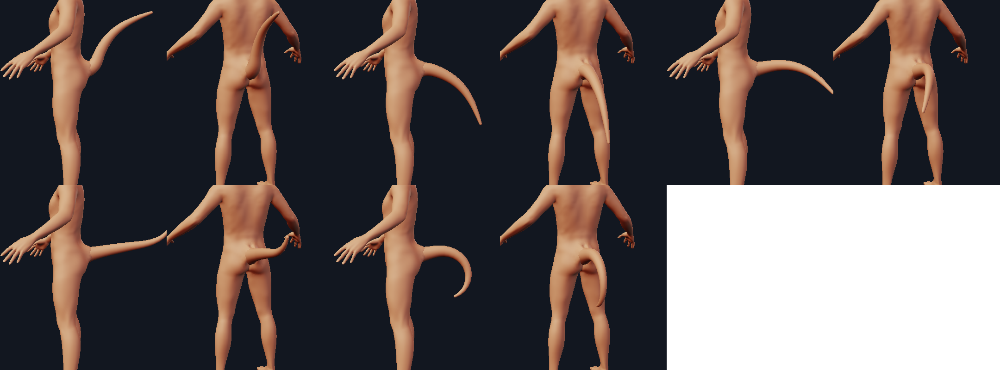

Controls keep their names and ranges (`curl`, `droop`: the sum stays in [-2, 2]; `lift` -60..90; `sway` -90..90) and
are clamped on the document path. The legacy tube (`appendages.make_tail`, the legacy `Appendage("tail")`,
`print_report.TUBE_LAWS`) is untouched; `TailKind.builder_args` still returns its arguments.

## 4. The skin of the sacrum flows into the tail

The generic junction (`junction.py`, S1) raises a collar of skin around a tube. For a tail it tented the skin
around a pipe and folded the two walls of the gluteal cleft through each other (12 new self-intersecting pairs in
the cage, 9 of them outside the tail; 30 / 64 on the subdivided body). `tailrig.junction_spec` is the tail's
own, built in the tail's local frame from the model (so it is the same on every body) and carried by the frame:

* the **skin tube**: the flared section from the buried end to 2 R beyond the skin point, inscribed radius
  (1.35 R at the root); fillet width `fillet = 1.5` base radii and height 1.0 of that (`TAIL_FILLET`, `TAIL_FILLET_HEIGHT`:
  the soft rump is the mound; the research and the references want a dorsal / lateral fillet of at least 1 R, no step, no collar);
* the **sacral rise**: a ridge `Mound` up the back from 0.2 R to 2.6 R above the root, 1.5 R wide, 0.3 R high (the erector
  spinae funnel into the dorsal tail; the dorsal contour of the rump runs into the tail line);
* two **cheek mounds** that draw the medial cheeks 0.18 R toward the axis (the gluteal masses abut the root);
* the **cleft kept**: four `Keep` spheres (0.9 R, fading over 0.6) down the midline below the root, along the cleft
  (kangaroo, cat, iguana: the ventral side meets the thigh in a crease; the natal cleft below the tail is not filled).

**Numbers** (`tools/tail_report.py`, junction on the cage, `measure_junction` at one subdivision level):

| body | H | y/H | elev. | moved | largest move | min quad area | flipped | skin meets the tail at (degrees from tangent) | junction ms | tail build ms |
| --- | --- | --- | --- | --- | --- | --- | --- | --- | --- | --- |
| neutral | 17.48 | 0.557 | 11.7 | 140 | 1.75 R | 0.19 | 0 | 73 -> 46 | 6.1 | 3 - 6 |
| tall | 24.71 | 0.581 | 11.3 | 164 | 1.75 R | 0.16 | 0 | 72 -> 43 | 5.3 | 3.5 |
| short | 13.82 | 0.523 | 12.7 | 118 | 1.74 R | 0.29 | 0 | 74 -> 49 | 4.8 | 3.4 |
| child | 13.11 | 0.537 | 7.8 | 150 | 1.75 R | 0.14 | 0 | 75 -> 44 | 5.1 | 3.5 |
| heavy | 17.48 | 0.555 | 17.3 | 158 | 1.62 R | 0.35 | 0 | 67 -> 53 | 6.5 | 4.1 |
| female | 16.05 | 0.540 | 9.8 | 143 | 1.72 R | 0.39 | 0 | 73 -> 42 | 6.4 | 5.5 |

(the S1 generic spec on the same tail: 91 -> 64 degrees, 12 new self-intersections). The cleft: cage triangles that cross each
other after the junction and did not before, counted outside the tail's own skin (a pair inside the tail is hidden
by the union): **0** below the root on neutral / child / heavy / short at the cage, **0** outside the tail on all six
bodies on the once-subdivided body (the S1 spec: 9 of 12 and 30). Above the root, beside the tail's wall at the dorsal midline, the
heavy body has 3 tiny ones at the cage (4 since round 2b: `tools/tail_report.py`; `test_the_gluteal_cleft_is_not_folded_through_itself`). Without the beads the child's cleft
folds (`test_without_the_cleft_beads_the_walls_do_cross`, the fail-first for it).

## 5. What a big tail asks of the pelvis

`creature_anatomy.TailEffect` replaces the flat coefficients (`hip_scale_horiz +0.45`, `hip_scale_depth +0.35`,
`buttocks_volume +0.55`, `torso_muscle_dorsi +0.30`, `measure_hips_circ +0.35`, applied even to the default tail)
by a function of size: the default tail's base radius is 0.21 of the hip-joint span, a size the pelvis already carries, so
at load 1 it asks for `buttocks_volume +0.15` (and 0.10 / 0.05 / 0.10 / 0.10 for the others), and each unit of load beyond 1 adds
`buttocks +0.35` (cap 0.6), `hip_scale_depth +0.15` (cap 0.3), `hip_scale_horiz +0.2`, `dorsi +0.2`, `hips_circ +0.15`. `TailKind.load` is
`length / 6 x base_radius / 0.45` (x the placement scale): a thicker tail costs the pelvis too. The cleft is never narrowed by a
slider: the junction keeps it.

## 6. References used, and what each one gave

Compiled library (outside the repository): `refs/` (`tail/DIGEST.md`, `TAKEAWAYS.md`); the sheets `images/tail_refs_human.png` and
`images/tail_refs_animal.png` put the public-domain / CC0 references beside the render of the same view. Two consulted images are NOT reproduced:
the Wellcome photograph of a child with a tail (its catalogue lists it as in copyright; research use only) and the CC BY-SA photograph of the
kangaroo tail model.

| id | what it gave |
| --- | --- |
| `tail/cm_Anatomical_technology_as_applied_to_the_domestic` (cat skeleton) | the tail is the continuation of the lumbar line for the first fifth of its length, then droops (the stiff 2.5 R and the sagittal droop); the bone widths 0.98 / 0.59 / 0.50 / 0.32 / 0.19 of the first free caudal at 25 / 50 / 75 / 95 / 100 % (`BONE_FRAC`, `test_the_bone_and_the_skin_taper_like_the_reference_animals`); 19 - 21 caudals; the proximal caudals short and blocky |
| `tail/cm_PSM_V08_D430_Skeleton_of_the_kangaroo` | a thin bone core in a soft outline 3 - 4 times wider along the proximal third; the soft taper 0.79 / 0.47 / 0.34; the dorsal contour runs into the tail with no step and the underside meets the thigh in a crease (the junction's asymmetry: wide dorsal / lateral fillet, the cleft kept) |
| `tail/cm_Kangaroo_tail_anatomical_model_6727490457` | muscle bellies on the proximal third giving way to long tendons under a smooth skin envelope (`belly()`, the belly -> tendon colouring) |
| `tail/cm_Superficial_muscles_of_a_cat` | the rump (gluteals) is the mound the tail grows out of; "muscles concerned in the movements of the tail" at the root: no separate collar, a low wide mound |
| `tail/ov_964703a3` (rhinoceros iguana) | a thick base, a long taper (0.87 / 0.61 / 0.40) with a dorsal crest running on: the radius law's neighbour, the `crest` parameter |
| `tail/cm_A_child_with_a_tail_side_and_posterior_view_Repr` | where a human tail really is: the sacrococcygeal level at the top of the cleft, pointing back and slightly up in profile, hanging in the cleft from behind, the skin continuous with the buttock (research use only: the licence record says so) |
| `tail/wc_dwgghrqs`, `tail/met_250897_2` | the human sacral surface: the spinal furrow into the sacral triangle, the two gluteal masses meeting at the cleft: the root sits on the furrow's end and the cleft below it is kept |
| `tail/cm_Lemur_catta_skelet_1782_Print_Iconographia_Zoolo` | a raised tail bends at the sacrocaudal joint (about 100 degrees): `lift` rotates about it, the buried part does not move |
| Wakamori & Hamada 2019 (Sci Rep 9:1473) | vertebra counts, the longest vertebra at Cd7-8 of 26 (29 % of the chain) and the proximal region of 5 - 8 |
| `TAKEAWAYS.md` section 3 | cone vs fur-cylinder taper profiles; the base 0.18 - 0.37 x hip width (mine is 0.31 x the bitrochanteric width); the tail checklist (midline, first fifth straight, no dorsal collar, one ventral crease, cleft and gluteal mounds visible) |

## 7. Tests, and what existing tests changed

92 new tests (`test_tail_anchor.py` 29, `test_tail_anatomy.py` 39, `test_tail_junction.py` 14, `test_tail_ecorche.py` 6,
`test_tail_coupling.py` 4). 28 single-line mutants of the new code (a stem that is too short, no flare, a thin muscle, bellies that
never end, no curvature limit, no stiff root, a flipped sway, uniform vertebrae, half the vertebrae, the research's bone taper, a lift that
moves the buried part, coplanar caps, a thick root skin, a cheek mound that pushes out, one cleft bead, no sacral rise, a wide root aspect,
no pitch clamp, no face / offset migration, no body scale, every quad a midline quad, unpermuted mirror weights, no mirror normal, the
wrong side cut, no sleeve colours, a flat coupling, a load that ignores thickness): 25 were caught first time and the 3 that survived
(the curvature limit, the stiff root, the aspect) were tightened until caught (a test that compared a constant with itself, a case that
never reached the limit).

Existing tests that had to change, and why (no assertion was loosened to make something pass; each states a premise the mandate overturned):

* `test_kinds`: the tail's registry-only parameters gain `vertebrae` and `crest`; the embedded share of the default tail is 36 %
  (windows 33 - 39 %, and its slides along the axis) instead of 18 - 21 % at `offset = -0.6`; the tail half of "the presets equal the
  legacy placement plus the sink" is replaced (the premise, one quad on a buttock, is the bug), the horn half is unchanged.
* `test_junction`: the tail's generic spec (the loft's rings, no mounds) is now the anatomical spec (stem first, 1.35 R flared radius,
  mounds and keep, scaled with the body); the "tangent tail welded by the junction" test slides the tail out by +1.0 instead of `offset = 0`.
* `test_character_cli`: the blocking-report test needs a tail that only touches the skin: `offset=1.0` (with `--no-junction`) instead of 0.
* `test_limbs`: the rounded-tip report test builds a LEGACY tube through the legacy engine, which needs the legacy sink
  (`LEGACY_TAIL_SINK`) now that `TAIL_SINK` is 0.

## 8. Limits, honestly

* **Guesses** (research-marked and still guesses): the vertebral spool dimensions, the processes and chevrons, the
  belly / tendon fall-off (12 % -> 55 %), the lobing, the skin thickness, the aspect, the root flare (1.35 R: `F = 0.35`); the bone
  radius is the only bone number calibrated (n = 1: one plate). No cross-section or MRI of an animal tail exists in the library.
  At print scale (1 unit = 1.9 mm) every layer above is under 0.1 mm; what shows is the placement, the axis, the flare, the
  taper, the bend and the sacral rise.
* **The seam** (now bridged by the root collar, [collar.md](collar.md): the tail's `collar` parameter, 1 by default) between the tail's shell and the moulded skin was a seam: the cage is 0.28 units a quad and the root is 0.6
  across, so the fillet is 2 - 3 quads wide; subdividing twice rounds it but the intersection of the two meshes wanders by
  about 0.04 units (a few pixels in a close-up: `images/tail_bodies.png` is at two levels). The skin meets the tail at 42 - 53 degrees
  from tangent (it was 64 - 91), not at 0. Making that seam invisible needs vertices the cage does not have (or normal blending across the
  union); it is out of this track.
* **Displacement**: the largest vertex move is 1.6 - 1.75 R (0.7 - 0.8 units at the neutral size), the climb of the collar to its
  full height at the tail wall, mostly vertices the tail covers; the research asked for 0.5 R from a smooth union, which this
  mechanism cannot do and still reach the wall. The junction touches 118 - 164 cage vertices.
* **Stretch** (the S1 review asked for it to be bounded; the limiter still only checks flips and collapse): of the 156 - 216 cage
  quads the junction touches, those outside the tail grow in area by at most 1.9x (neutral), 2.0x (child), 2.5x (short), 3.1x
  (heavy), 95th percentile 1.5 - 1.7x, and their longest edge by 2.5 - 4.0x; the S1 spec on this tail was 2.55x and 3.4x. Not
  worse, not bounded.
* The dorsal midline above the root can fold three tiny cage triangle pairs on the heaviest body (beside the tail's wall).
* `length` and `base_radius` are values on the neutral body; a document that sets them gets them scaled by the body height
  (the same tail on a taller body is longer): `placement.scale` is the absolute knob.
* The Character tab's draft proxy does not show the fillet during a drag (S1); the ecorche is a render option
  (`--layers`), not a lab view.
* A tail has no side since round 2b (`TailKind.allowed_sides = ("center",)`): `new_spec` and the CLI (`--add tail:side=left`) refuse one
  with a hint; an old record that says `left` / `right` / `both` (the round-1 review: two tails in a
  T from the cleft wall) is built as the ONE midline tail with a warning, and costs the pelvis one tail. The lab's `set_side` does not
  check yet (`lab.py` is not this track's): a side set there builds the midline tail with the same warning.
* **Every existing tail document looks different** (midline root, sagittal droop, 36 % embedded, a 1.35 R flared root, a taper that
  ends in a bone-and-tendon tail): there is no switch back (S1's `ring_verts=10` restored the old mesh; here the legacy tube is
  only reachable as `appendages.make_tail` through the legacy `Appendage("tail")`). The values are migrated, not preserved.
* The first preset's sink is read as the new default by its VALUE: a record with `offset = -0.6` gets `0` (it does not matter whether
  the record is old or someone typed it); every other offset is honoured as a slide along the axis.
* `params["length"]` / `["base_radius"]` are the values on the NEUTRAL body, not the built size (that is x `Placed.model.scale`). Anything
  that reads the parameters analytically (the print report's `TUBE_LAWS` for a legacy `Appendage`) is unaffected, but would be off by
  the body scale if it were ever fed a registry tail (the registry path hands it meshes and does not).
* Merging: the shared hooks this track added (`Placed.layers()`, `Placed.model`, `Kind.layers()`, `Kind.layer_colors()` in `kinds.py`, the
  `--layers` / `--cut` hunk in `__main__.py`, `tools/junction_view.py --layers`, five lines in `lab.py`) are the likeliest to conflict with the other tracks;
  `ecorche.py` and `tools/tail_report.py` are new files and stand alone.

## 9. Round 2b: the root grown from the sacrum, with the collar on

What the user was shown after round 2 (`scratchpad cmp2_tail.png`): the tail rose from a sacral swell on the midline, but in the side
view the back ran over a bulge above the root and the root read as a blister, "a pipe in a flange". The round-1 review had asked for
the same things (a ledge where the lumbar line runs over a dorsal crest, "muscle" that is a skin-derived tube, thick tails that shred
the skin, a sack under a lifted tail, T-shaped side pairs). This round re-tuned the cage junction WITH the root collar
([collar.md](collar.md)) on, at subdivision levels 1 and 2, on six bodies.

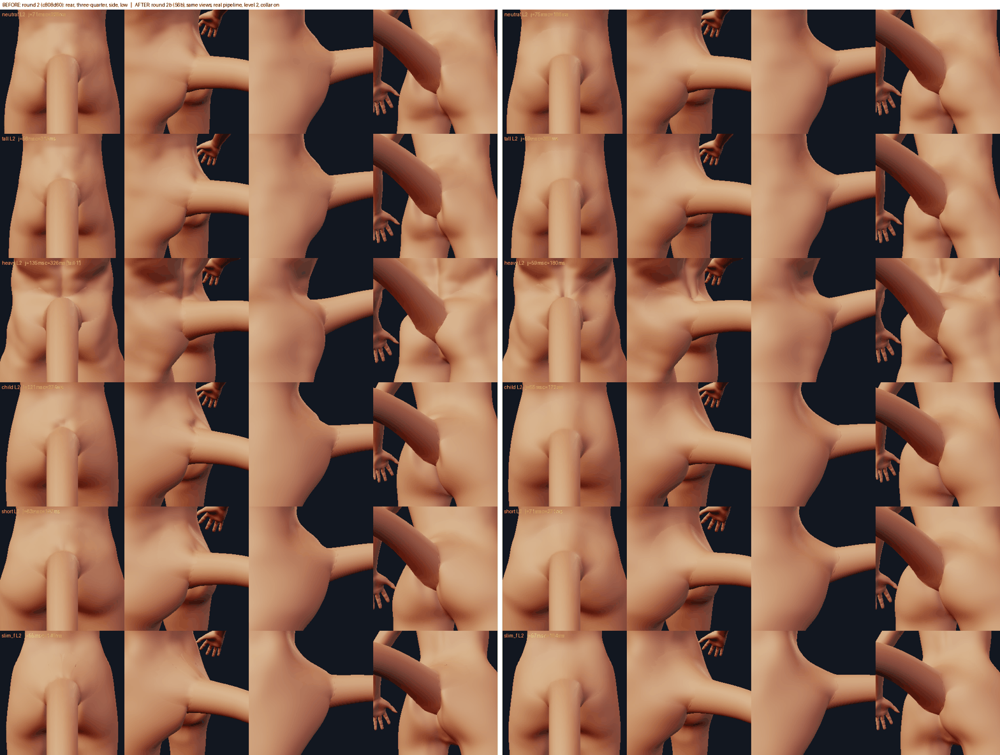

### The balance between the cage and the collar

The cage (0.28-unit quads against a root radius of 0.47) can carry broad, low mass; it cannot carry a fillet. The collar (the tail's own
shell) can. Four corner configurations were rendered on neutral / tall / heavy / child at levels 1 and 2 (round 2 as it was; the first
2b attempt's 0.55 R wedge centred 2.4 R up the back; no masses, a low fillet and the generic collar; the same with a wider, taller
collar). The wedge centred up the back made a convex hump with a shelf on the tall body (worse than round 2); no masses with the generic
collar left a vertical face above the root; a wide collar (2.6 - 3.4 root radii) made the ramp but its rim became a long ragged line
across the buttock. What ships:

* **The sacral wedge** (`tailrig.ROOT_MASSES["sacral"]`, the sacrocaudalis dorsalis and the caudal multifidus): a mound whose crest is AT
  the top of the root (1 R up the back, half-axes 3.5 R up the back and 1.6 R across, 0.6 R high), so only its falling, concave flank shows
  above the tail and the lumbar line runs down a ramp onto the tail's top line. It pushes along the root's own axis, not along the vertex
  normals (`RootMass.along_axis`): along the normals the heavy body's sacral furrow kept its depth (0.1 R of a 0.6 R wedge got through).
  It is taken back as the tail lifts (`fade` 20 - 80 degrees).
* **Two gluteal masses** (gluteus maximus, caudal fibres) 2.2 R either side of the root, 1.6 R across, 0.25 R high, along the normals.
* **The tube fillet** 1.5 R wide and 0.5 of that high (`TAIL_FILLET_HEIGHT`, 1.0 before), smoothed 5 rounds (`tailrig.SMOOTH`; the
  core's 20 cost 4-7 degrees of the join), `tight_gap = 0` (the spec holds the cleft itself with its beads), owner `trunk`.
* **The collar** (`kinds.TAIL_COLLAR`): 1.8 root radii on the back (1.6 generic), climbing 0.7 radii up the wall (0.5), falloff 3
  (curvature-continuous at the rim; 2.5 left the heavy body's rim at p95 10.4 degrees), the fold side a hair as before. A ventral width of
  0.25 or a narrower fold sector (75 / 150 degrees) made flaps under the heavy tail and were dropped.
* **The join guard is off for the tail** (`join_guard=False`): the masses are the muscle layer, and the core's guard, which may apply a spec
  tube-only, did so on the heavy body lifted 60 degrees and left 0.21 R of the gluteal lens showing through the skin. The collar makes the
  join, not the cage.

Measured (`scratchpad/junction/S6b_out/nums.py`; level 2; the join angle is `measure_junction`, degrees from tangent, before -> after the
cage junction; stretch over the touched cage quads outside the tail; "bulge" is the largest bulge of the side silhouette (|x| < 1.5 R) of
body and collar from the top of the root up 5 R over its chord, in R: > 0 is a hump the back runs over):

| body | join, round 2 | join, 2b | moved | largest move | area growth p95 / max | edge growth max | bulge, round 2 -> 2b | flipped / new crossings |
| --- | --- | --- | --- | --- | --- | --- | --- | --- |
| neutral | 74 -> 67 | 73 -> 57 | 142 | 1.26 R | 1.31 / 1.50 | 1.49 | 0.00 -> 0.00 | 0 / 0 |
| tall | 71 -> 61 | 71 -> 55 | 164 | 1.28 R | 1.36 / 1.51 | 1.56 | 0.00 -> 0.00 | 0 / 0 |
| short | 76 -> 63 | 75 -> 55 | 128 | 1.26 R | 1.33 / 1.46 | 1.50 | 0.00 -> 0.00 | 0 / 0 |
| child | 75 -> 65 | 75 -> 51 | 163 | 1.11 R | 1.30 / 1.39 | 1.52 | 0.00 -> 0.00 | 0 / 0 |
| heavy | 66 -> 67 (mounds only) | 65 -> 57 | 162 | 0.99 R | 1.29 / 1.34 | 1.80 | 0.22 -> 0.06 | 0 / 0 |
| slim female | 71 -> 55 | 70 -> 47 | 158 | 1.17 R | 1.33 / 1.44 | 1.54 | 0.00 -> 0.00 | 0 / 0 |

The silhouette metric is blind to what the eye saw on the neutral body: the round-2 side view's "disk" is not a bulge of the outline
(my reading, not measured: a shading discontinuity where the collar's 0.5-radius climb ends against a 16-gon wall); the heavy body's hump is in it. The
round-1 review's stretch numbers (p95 1.85 - 2.15, max 2.9 - 4.4 area, 3.5 - 4.8 edge) were of the first spec before the S1b core's
growth limits; with them they are p95 1.3 - 1.4, max 1.5 area, 1.8 edge.

The collar on the new root (`tools/collar_report.py`'s numbers, `test_collar.py`), rim / wall p95 in degrees, rest and lifted 40:
level 1: 4.6 - 9.1 / 4.8 - 7.1; level 2: 4.2 - 9.8 / 4.9 - 7.2 (the wall's p95 was 8 - 14 lifted with the 16-gon). The heavy body's
rim is the worst at 9.1 / 9.8 against a bound of 10: little margin.

Times (warm, this machine with other jobs running): instantiate a tail 5 ms (8 before: the skin patch for the body-side layers is
sampled on the first `layers()` call, 55 ms, not on every build); the cage junction 19 - 32 ms; the collar 150 - 250 ms at level 2
(above the collar track's 100 ms target, unchanged by this round: the collar's cost is its own).

### Muscle as a mass the skin is the envelope of, on both sides of the skin (superseded in round 4, section 10)

The muscle layer (`Placed.layers()["muscle"]`) is the caudal sleeve AND three closed lenses on the body's own skin (`TailModel.lens`,
a `SkinPatch` height field of the cage under the root, in the tail's frame): the sacral wedge and the two gluteal masses, from the SAME
`RootMass` numbers as the junction's mounds and the same weight (`TailModel.mass_weight`: the mound's 3-D bump, the cleft beads' hold,
the lift fade). The lens top is the body's skin + what the mass adds - the skin thickness, its underside `depth` below. Measured over each
lens' visible top (outside the tail's section) the moulded skin lies one skin thickness above it to within 0.03 R on five bodies, at rest
and lifted 60 degrees; the heavy body's gluteal lenses show through by up to 0.075 R (0.035 units, 0.07 mm at medium: a fat fold where the
normal-direction mound and the height field disagree); its wedge is exact
(`test_the_skin_over_the_masses_is_their_envelope_plus_one_thickness`, fail-first `test_without_the_mass_height_the_skin_is_not_the_envelope`).
The bone layer gains the sacrum (`TailModel.sacrum`: the fused last sacral vertebrae as a wedge under the skin, 3.2 R long, carrying Cd1).

### Thick tails, lifted tails, sides

* **Thick** (the UI allows a base radius up to 2.0): every junction size is in `R_j = min(R, R_MAX = 0.62)` (the tube keeps the tail's
  radius) and the collar's strength is scaled by `R_MAX / R`; above a base radius of 1.2 (wider than the sacrum) there is no collar at all
  (it cost 1 - 2 s a render and the tail hides it). At 0.7, 0.85, 1.5 (length 14), 2.0 and 1.0 with flare 1.5, on the neutral and child
  bodies: at most 689 cage vertices moved and 64 backed off, the largest move 1.4 R_j, nothing beyond 7 R_j up the back or 4.5 R_j across,
  no flips, no new visible crossings (the first version: 3,167 moved, a shredded belt at the waist). A tail of 1.5 is a log wider than
  the hips: the junction does not shred, it does not make it plausible either.
* **Lifted**: the wedge fades (rise 3 R up the back 0.23 -> 0.07 -> 0.06 R at lift 0 / 60 / 90) and the bend starts in the body: no sack
  (`images/tail_r2b_lift.png`).
* **Sides**: see section 8.

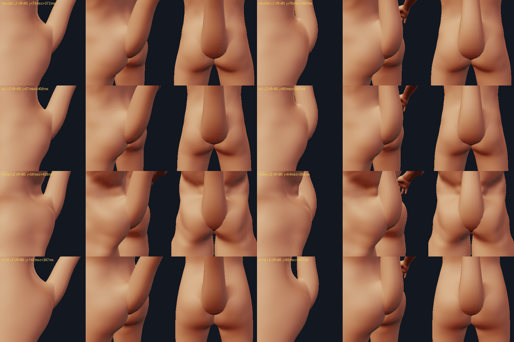

### References, side by side

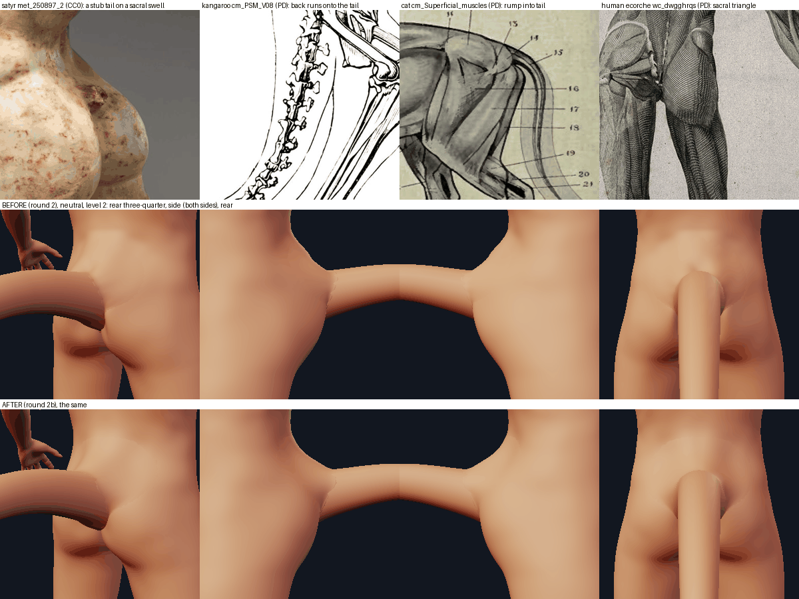

* `tail/met_250897_2` (Met satyr torso, CC0): a stub tail at the top of the cleft on a soft sacral swell, the gluteal masses either side, no
  collar: the target of the rear three-quarter view; the swell is what the wedge and the gluteal masses make.
* `tail/cm_PSM_V08_D430_Skeleton_of_the_kangaroo` (PD): the back runs onto the tail with no step (3 % deviation): the wedge's crest at the
  root and the ramp; the underside meets the thigh in a crease (the collar's hair-thin fold side, kept).
* `tail/cm_Superficial_muscles_of_a_cat` (PD): the rump runs into the tail; "muscles concerned in the movements of the tail" at its root:
  the sacral wedge as muscle, not skin.
* `tail/wc_dwgghrqs` (Wellcome, PD): the sacral triangle between the dimples and the two gluteal masses meeting at the cleft: where the
  wedge lies and the gluteal masses' place; the cleft beads keep the cleft.
* `TAKEAWAYS.md` sections 1 - 3: "the fillet people see is the muscle mound, not skin stretching" (the masses, not a taller cage fillet);
  a soft-tissue transition of at least 1 r on the dorsal and lateral sides and one crease underneath (the collar's 1.8 / 0 split).

### What still looks wrong (honest)

* **Heavy**: from above and behind, a dark V where the sacral furrow between the erector masses meets the top of the tail; the collar's rim
  is ragged where it crosses the fat folds (rim p95 9.8 of 10); the gluteal lenses show through by up to 0.075 R.
* **The collar's rim** is still visible as a faint line on the flanks in some lights, and its wall join shows small tabs on the lateral side
  at close range (fewer with the 24-gon). Those are the collar's construction (the collar-polish stage); the tail tuned only its numbers.
* **Level 0** (the CLI default and the lab's preview level) has no collar: there the root is the cage fillet alone, a softer step than
  round 2's (the fillet is half as tall) but a step.
* The rear view's swell around the root is a little bulbous on the slim and child bodies (the gluteal masses and the wedge's lower half,
  held only by the cleft beads, add up beside the root).

### Document changes (what an existing saved document now renders differently)

`.mmchar` v1 / v2 files load unchanged (no record is rewritten; the tail's parameters are not stored when they are the defaults), but
every saved tail renders differently:

* a 24-vertex ring instead of 16 (a record that set `ring_verts` keeps its value);
* the skin round the root: the sacral wedge (crest at the root, 0.6 R) and two gluteal masses (0.25 R) instead of a ridge 0.2 - 2.6 R up the back
  (0.3 R) and two cheek mounds drawn inward (0.18 R); a fillet half as tall; no cage join guard for the tail;
* the collar (level 1 and 2): 1.8 / 0.7 root radii, falloff 3, instead of the generic 1.6 / 0.5 / 2.5; none on a tail thicker than 1.2;
  a smaller one on a tail thicker than 0.62;
* a lifted tail bends from 1.5 R inside the body (its buried end moves by up to 0.2 R) and the wedge fades with the lift;
* a record with `side` `left`, `right` or `both` is built as ONE midline tail (with a warning; it was a T-pair) and costs the pelvis one tail;
* the muscle layer (`--layers muscle`) has the three body-side lenses, the bone layer the sacrum; the skin envelopes the lobed bellies.

### Tests and existing assertions changed (this round)

New: the masses (`test_the_spec_and_the_layers_are_built_from_the_same_masses`, `..._wedge_is_a_mound_up_the_back_and_not_down_the_cleft`
with its crest at the root, `..._gluteal_masses_wrap_the_root_and_show`), the envelope and its fail-first, thick tails x 2 bodies, lifted
tails x 3 bodies, the lift fade and "no sack", the side refusal and the coercion of old records, the collar's tuning and caps, the guard
exemption, the lazy skin patch, the side-silhouette ramp (`test_the_lumbar_line_runs_down_a_ramp_onto_the_tail_without_a_hump`: 0.23 R on
the heavy body at round 2: it fails on the round-2 code; it does NOT catch the first 2b wedge centred 2.4 R up the back, whose hump is a
shading one the silhouette does not show: `test_the_sacral_wedge_is_a_mound_up_the_back_and_not_down_the_cleft` does). 17 single-line mutants
of the new code (`scratchpad/junction/S6b_out/mut.py`): the wedge's crest back up the back, the wedge along the normals, the lens without
the cleft beads, the join guard on, the collar uncapped / on any thick tail, the skin patch sampled eagerly, no lift fade, the lift bending
at the skin, a side pair costing a pair, old side records not coerced, no R_MAX cap, a 16-gon, the posed muscle ignoring the pose
(the round-1 review's surviving M3), half-height gluteal masses, no side check in `new_spec`, the skin not enveloping the lobes: all 17
killed.
Changed: `test_tail_junction`: the displacement test's bounds (R_j, the masses' larger footprint: 120 - 320 vertices moved, within 4 R
across and 4 R below to 7 R above; the join gain 10 degrees, 4 on the heavy body); the cleft fail-first (the walls no longer cross
without the beads since the S1b core's validity pass: replaced by "the guard has to back off 4 x as many vertices and the cleft below
the apex is dragged"). `test_junction`: the hairline-tail weld (see below), the tail's tube radius (24 facets). `test_kinds`: the tail's
ring is 24, the extreme-parameter test builds a tail on the midline. `test_limbs`: a lifted tail's buried ring moves by < 0.2 R (exact
before). `test_tail_coupling`: a side pair is one tail. `test_tail_anchor`: old side records are coerced. `test_tail_ecorche`: the
sleeve's tip is not the last vertex of the muscle mesh any more (the lenses follow), and the horn has its own layers now (the horn track's).
`test_tail_anatomy`: the skin envelopes the bellies (was: a band of 0.4 - 1.6 thicknesses round a damped copy).

**The hairline weld**: `tail:offset=1.0` slides the tail 1.0 out along its axis, more than its 0.82-unit stem: its buried end is 0.16
units out of the skin on its axis (every point of its skin tube lies 0.16 - 0.97 units above the skin; the core cuts the tube to the tail's
mesh, which begins out there). Round 1 expected the junction to climb round it and weld it; the fillet reaches up to it but holds only
1.6 % of it, and the report blocks it with "sink it into the body", junction or not (the round-2 code did the same, with the same numbers).
The test now asserts that block, and that a tail slid by 0.8 (its end on the skin, 11 % held) exports.

## 10. Round 4: the layers inside the skin, a sacrum the tail continues, a lift that leaves the back

The round-3 critic (verdict "revise": location 6, bone 3, muscle 2, skin 4) measured the round-2b layers against the skin the
figure is meshed with and found: the gluteal lenses of the muscle layer standing OUT of the hips as red flaps (tall body 11 % of
their vertices, up to 0.71 R; base radius 0.62: 27 %, up to 1.18 R), while the test that claimed the skin was their envelope
passed (it measured the skin with the same height field that built the lenses); a sacrum that was a vertical slab with the first
caudal leaving it at 104 degrees (a branch, not the spine); a "sacral mass" that read as a shark fin and gluteal masses that read
as two balls; a lifted tail lying on the back as a bolster; and tests that could not fail. This round rebuilds the body side of
the anatomy and the lift. Code: `tailrig.py` (`RootSkin`, `TailModel.body_muscles`, `sacral_axis` / `sacrum`, `lift_split`,
`inside_skin`), `kinds.TailKind.layers_on` and the `elevation` it hands the model, one call in `ecorche.layer_shells`. Tests:
`tests/test_tail_layers_in_skin.py` (new), `test_tail_anatomy.py`, `test_tail_junction.py`, `test_tail_ecorche.py`.

### The muscle and the bone lie inside the skin they are meshed with

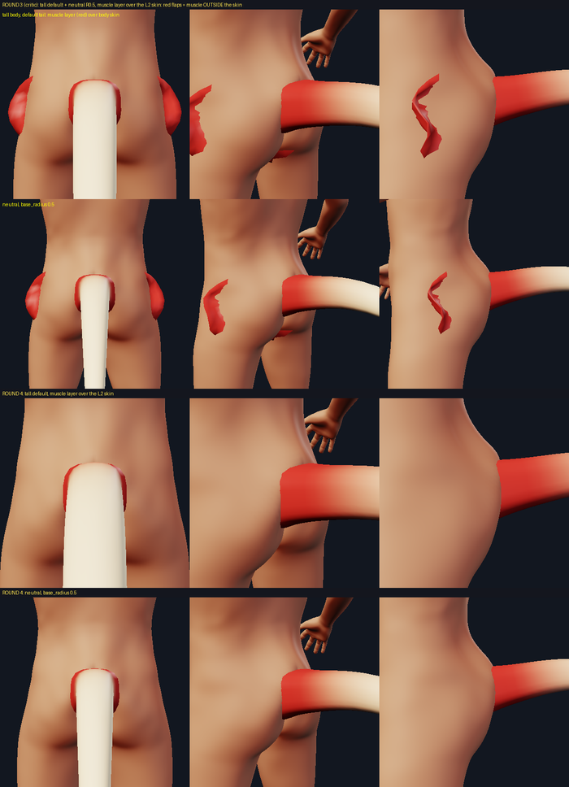

* **`RootSkin`**: the body's skin around the root AS IT IS MESHED, in the tail's local frame: the cage within 7 R_j of the root
  before the junction (twice subdivided: where the muscles are laid out) and after it at subdivision levels 0, 1 and 2 (the
  ceiling). The moulded cage is the tail's own junction applied by `junction.moulded_cage` (what the pipeline does when the tail
  is the only appendage there), or, in a view, the shaped body the view meshes (`ecorche.layer_shells` hands it to
  `TailKind.layers_on`: a tail beside extra legs is laid under the skin both junctions made). Built on the first `layers()`
  call of a pose (0.4 - 0.8 s with the muscles, measured on this shared machine), never by `instantiate` or `junction`.
* **The ceiling, not the shape**: each muscle has its own shape (below); its top is the skin the masses alone would make (the
  body's skin plus the mounds' rise, `TailModel.mass_rise`) one skin thickness down, and `RootSkin.clip` moves any point that
  is not at least one skin thickness under EVERY level of the moulded skin down along its normal. The skin the junction drew up
  inside the root is folded on itself there and is hidden by the tail's shell: it is not a ceiling (`RootSkin(hidden=...)`,
  `TailModel.inside_skin`; with it, the clip pushed the dorsal strands of two random bodies 3 R down into the cleft).
* **Measured** (`test_no_muscle_or_bone_of_the_tail_lies_outside_the_skin_it_is_meshed_with`): a TRUE signed distance, inside /
  outside by ray parity against the closed body along three directions (majority) and against the closed tail, over ALL
  vertices of the muscle (2,646) and bone (1,762) layers: **0 vertices outside both** on six bodies at levels 1 and 2, base radii
  0.5 / 0.62 / 0.85 on neutral, tall and heavy (level 2), two random full bodies, a document with the junction off, a tall
  body's tail lifted 60 and a heavy body's lowered -60 (level 1), and the tail beside `harvest:preset=extra_legs` (neutral and
  heavy, levels 1 and 2: 0). Round 3 on the same measure: tall default 11.3 % / 0.71 R. Fail-first: the same muscles without the
  ceiling stand out of a skin that did not rise (`test_without_the_ceiling_the_muscle_pierces_the_skin`).
* **Not buried to pass** (`test_the_muscle_fills_the_bulge_the_mass_raises_and_is_not_buried`, neutral / tall / child / female):
  over the gluteal band where its mass raises the skin by more than 0.15 R_j, the top is at least one skin thickness under the
  moulded skin, within three thicknesses of it over 75 % (measured 84 % on neutral), and above the skin the body had by half the
  rise less half a thickness over 75 % (100 %); with the junction off it is 0 % (`test_a_skin_that_did_not_rise_...`). The
  heavy body's gluteal mass adds less than 0.15 R_j (its buttock's crown stands 0.6 R proud, twice the mass's centre height):
  nothing to check there.
* **A thick tail's sacrum** is a body's sacrum: sized by `R_s = clip(R, 0.35, 0.50)` and the sacrocaudal joint no deeper than
  0.5 units (`SACRUM_R`); sized by the tail (0.62, 0.85) its base reached the front of the pelvis (the body is 4.2 - 4.5 R deep
  behind the root).

### The bone: a tilted, curved sacrum that the caudal column continues

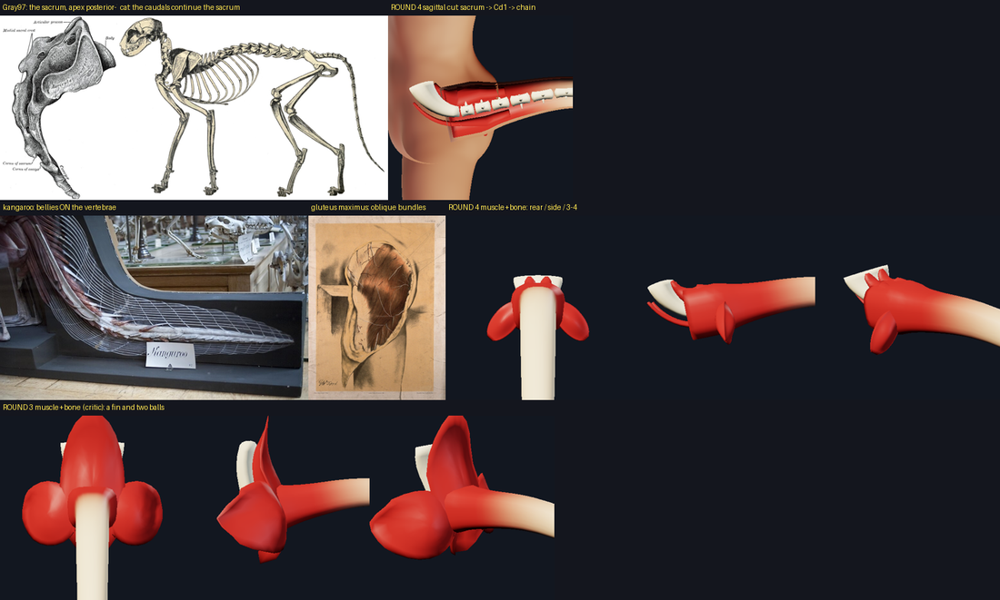

`SACRUM`: from its apex, which carries Cd1 on the tail's axis at the sacrocaudal joint (Cd1's rostral end, 1 R below the skin
point), the sacrum runs UP the back and DEEP, its axis turning from 6 degrees below the tail's axis at the apex to 80 degrees at
the base (`bend_pow` 0.85: the turn grows toward the base, the lumbosacral end); 2.4 R_s long, half widths 0.42 -> 1.30 R_s (the
alae), half thicknesses 0.22 -> 0.50 R_s, a flattened section with a median crest. Measured on the meshes
(`test_the_sacrum_is_a_tilted_curved_wedge_that_cd1_continues`): the axis of its distal fifth and Cd1's centrum differ by **16.4
degrees** at rest (the references: 0 - 20; round 3: 104); its chord (base -> apex) leans 46 degrees below the tail's axis (34
degrees below horizontal on the neutral body; the human sacrum is inclined 40 - 50: Gray97); its base is 1.6 R_s up the back and
2.6 R_s deeper than the apex (anterior-superior); its deepest point is 71 % of the body's depth behind the root (neutral). The
pose never moves it. Lifted 60 / 90 / lowered -60 the sacrocaudal angle is 19.2 / 19.8 / 14.4 degrees and no joint of the first
seven caudals bends more than 25 degrees (lift 90: the raised lemur bends ~100 degrees over its first four joints). From
`tail/cm_Anatomical_technology_as_applied_to_the_domestic` (the column continues the sacral line), `tail/cm_Gray97` and
`tail/wc_w3snb3r5` (the sacrum's inclination, apex posterior-inferior), `tail/cm_Lemur_catta_skelet_1782_Print_Iconographia_Zoolo`
(a raised tail bends at the sacrocaudal joint and the first caudals). Honest: a human sacrum is concave forward and its coccyx
turns forward; this one turns BACK into the tail over its lower part (it has to: the tail leaves the body pointing back): in the
sagittal cut it reads as a curved horn more than as Gray's bulky lateral view.

### The muscles: strands on the vertebrae and oblique gluteal bands, not a fin and two balls

* **Sacrocaudalis dorsalis** (`DORSALIS`, left and right): a strand ON THE BONE, on the dorsal face of the sacrum beside the
  median crest, from 95 % of the sacrum's length down to its apex and on into the tail's dorsal belly (the kangaroo model,
  `tail/cm_Kangaroo_tail_anatomical_model_6727490457`: the bellies lie on the vertebrae and become long tendons). Thin up the
  sacrum (0.2 R_j), it thickens toward the root and, over the lower sacrum, its section turns to stand toward the skin and
  fills the room between the bone and the skin (`fill`). Measured over the sacral wedge's footprint where the wedge raises the
  skin by more than 0.15 R_j: the strands' top lies 0.5 - 0.65 R (median; neutral, tall, child; heavy 0.12 R) under the skin
  the body had, and about half of that footprint (its flanks beyond the strands and its tail up the back past the sacrum's top)
  has no muscle of the layer under it: there the wedge's rise is soft tissue over the body's own erector mass, which no layer
  draws. Not closed: the wedge is only partly this muscle's bulk.
* **Sacrocaudalis ventralis** (`VENTRALIS`): deep, on the ventral face of the lower sacrum, into the tail's ventral belly (only a
  cut shows it).
* **Gluteus maximus, coccygeal fibres, with the caudofemoralis** (`GLUTEAL_SHEET`, the gluteal `RootMass`): a fusiform band of
  parallel fibres (five bundles 6 % proud) from the first caudals beside the root INFERO-LATERALLY (138 degrees from up the back)
  toward the femur, ending within `GLUTEAL_REACH` = 2.5 R_j of the midline (beyond, it is the body's own buttock). The cat's
  caudofemoralis and the fibre direction of `tail/wc_j42auhe2` / `wc_kpq8pswh`. The junction's gluteal mound is the same oblique
  ellipse (centre 1.55 R_j out, 0.3 R proud: the buttock's crown; round 3: a round mass 2.2 R_j out whose lens left the body).
* Honest: in the muscle-only view the bands read as small leaves beside the root and the dorsal strands as two nubs above it;
  they are the tail's part of muscles whose bulk is the body's own (the buttock, the erector mass), which no layer draws.

### The lift: the tail leaves the sacrum raised and rises off the back

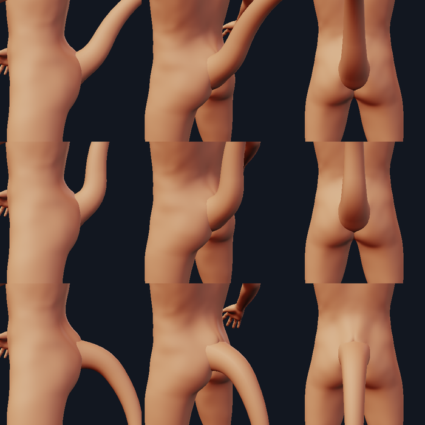

`TailModel.lift_split`: a share (0.35, within the joint's range -15 .. +25 degrees, `LIFT_JOINT`) at the sacrocaudal joint,
spread over the joint and the first two caudal joints (`LIFT_JOINT_LEN` 1.6 R: over 0.6 R it folded the collar of a tail lifted
40 - 70 degrees, 110 - 200 crossings), the rest by the first free caudals OUTSIDE the body (from 0.4 R beyond the skin point
over 3.5 R); the path is anchored at the joint (the stem before it does not move, the root's exit rises 0.1 R at lift 60); a tail
stops at the vertical (`LIFT_MAX_ELEVATION`, with its axis' own elevation, which the kind hands the model): lifted 90 on the
heavy body it leaned into the lumbar bulge. Measured (`test_a_lifted_tail_stands_off_the_back`, level 1, neutral / heavy /
child): beyond 2.5 R from its skin point no vertex of a tail lifted 60 or 90 is inside the body and the tail keeps 0.79 - 1.34 R
off the skin (beyond 1.5 R: 0.35 - 0.48 R); round 2b: 7 % (neutral) and 44 % (heavy) of a tail lifted 90 lay inside the back.
A lowered tail (-30, -60) leaves a valid cage (no flip, no new crossing at the cage or once subdivided, the cleft below the apex
untouched: `test_a_lowered_tail_leaves_a_valid_skin`). The collar the core track builds on it (the critic's `jr.py`, neutral,
level 2, round 3 -> round 4): lift -60 rim_max 177.7 -> 8.1 degrees (its rim no longer folds back: the torn diagonal edge up the
buttock is gone), self-crossings 346 -> 164, crease p99 23.6 -> 12.3; lift 60: crossings 175 -> 137. A side-placed tail
(`anchor.midline: false`, or a quad off the midline) is not clamped at the vertical: its axis is the quad's normal.

### The back's rise onto the tail

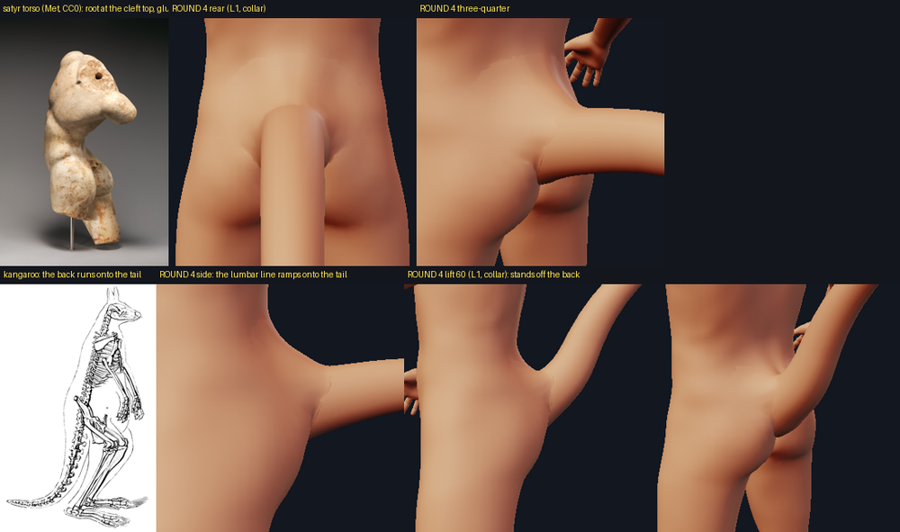

`test_the_back_rises_onto_the_tail_with_its_crest_at_the_root` replaces a ramp test that could not fail on the neutral and child
bodies: the rise of the moulded skin over the skin the body had, along the midline, twice subdivided, is largest at the root's
top, falls up the back with no second hump, halves within 3 R_j of the skin point (measured 2.5 - 2.75) and is under a quarter of
its root value 3.5 R_j up (0.07 - 0.14); the critic's surviving mutant M1 (the wedge centred 2.4 R up the back) halves only by 3.75
and keeps 0.41 - 0.57 there: it fails on every body (`test_a_wedge_centred_up_the_back_makes_a_hump_and_fails_the_crest`).

### The junction alone (no collar): what was tried, what was reached

The task asked for the junction-only join (the collar's `before_p50`, level 2) to drop from 49 toward 25 degrees. Tried inside the
tail's spec (no `junction.py` change): fillet height 0.8 / 1.0 (worse: 53 - 59), smoothing 0 / 2 (39 - 44 on neutral, but with 0
the heavy body's lifted skin crossed itself), a narrower fillet, an axial mound that lifts the hidden skin further up the wall
(`CLIMB`: -10 to +5 degrees across six bodies, noise; off), a steeper root flare (worse). Reached, with the round-4 masses:
**neutral 49.4, tall 44.5, short 48.2, child 39.3, heavy 52.4, female 38.5** (round 3: 49.5, 47.6, 48.6, 42.6, 53.3, 39.8): no real
gain. The cage has 2 - 3 quads across the fillet; the subdivided skin near the wall is an average of the last visible ring and the
hidden ones, and no displacement of 0.28-unit quads makes it tangent to a 0.6-unit root. The seam at level 0 and with
`collar=0` is the same: a tube meeting the skin at 40 - 50 degrees. That is the collar's and the level policy's (the core track).

### The collar's inputs (`tools/collar_report.py`, level 2, before -> after)

Rest: unchanged (self-crossings neutral 6 -> 4, tall 5 -> 5, short 4 -> 2, child 121 -> 120, heavy 226 -> 226; rim p95 within
0.1 degree). Lifted 40: neutral 5 -> 4, tall 7 -> 6, short 144 -> 128, child 133 -> 128, but **heavy 56 -> 225** (its rest value:
the heavy body's collar crosses itself at rest, 226, and the round-4 lift no longer happens to avoid it). `TAIL_COLLAR` and
`TAIL_COLLAR_MAX_R` are unchanged.

### Tests and mutants

New: `test_tail_layers_in_skin.py` (the true signed distance x 23 cases and its fail-first, the two-sided muscle test x 4 and its
fail-first, the lifted clearance x 6, the lowered tail x 2, the crest x 4 and M1), the sacrum (x 4 poses), the body-side muscles'
shapes, the mass's own axis, `layers_on` in the ecorche. 23 mutants of the new code, the critic's two survivors and round 2b's guards
(`scratchpad/junction/S7_tail_out/scr/mut.py`), each run against the test files that should see it: 24 killed (the critic's M1 by
the crest test, M1b by the two-sided muscle test; no ceiling, the hidden skin kept as a ceiling, the gluteal mass back at 2.2 R_j,
the vertical-slab sacrum, a straight sacrum, no lift at the joint, the round-2b lift, no stop at the vertical, the path anchored at
the skin point, the dorsalis on the skin, a gluteal band along the back, a sacrum and a joint sized by a thick tail, an ecorche that
ignores the shaped body, a muscle top without its skin thickness, a gluteal mass without its crown height, the wedge along the
normals (the crest test on the heavy body: the round-2b envelope test that guarded it is gone), a wedge that never fades,
`R_MAX` uncapped, old side records not coerced, the join guard on, the lift clamp on a side-placed tail); one survived: the
ceiling at level 2 only (levels 0 and 1 dropped from `RootSkin.depth`) passes every case, so on every body and pose tested a
level-2 ceiling one skin thickness down also clears the cage and level 1; the multi-level ceiling is kept as the stated
guarantee and is, on these inputs, an equivalent mutant.

### Document changes (round 4)

Every saved tail document still loads; none is rewritten. What renders differently:

* the skin beside the root: the gluteal mounds are oblique bands 1.55 R_j out (round 3: round masses 2.2 R_j out), 0.3 R proud;
* a LIFTED or LOWERED tail: a share of the lift is taken at the sacrocaudal joint (the root's exit rises with it) and the rest
  outside the body, so the tail stands off the back; a lift that would take the axis past the vertical is clamped (the heavy
  body's 90 is its 72.7); the buried end does not move;
* the layers (`--layers`, the ecorche): new body-side muscles (strands, bands, ventralis) laid under the meshed skin and a new
  sacrum; a thick tail's (base radius > 0.5) bone starts at most 0.5 units deep;
* unchanged: the tail at rest, its size, its anchor, the junction's tube and fillet, the collar's profile, the migration of the
  first tails' records and of `left` / `right` / `both` side records (one midline tail with a warning:
  `test_an_old_document_with_a_tail_pair_loads_builds_one_midline_tail_and_saves_unchanged`).
