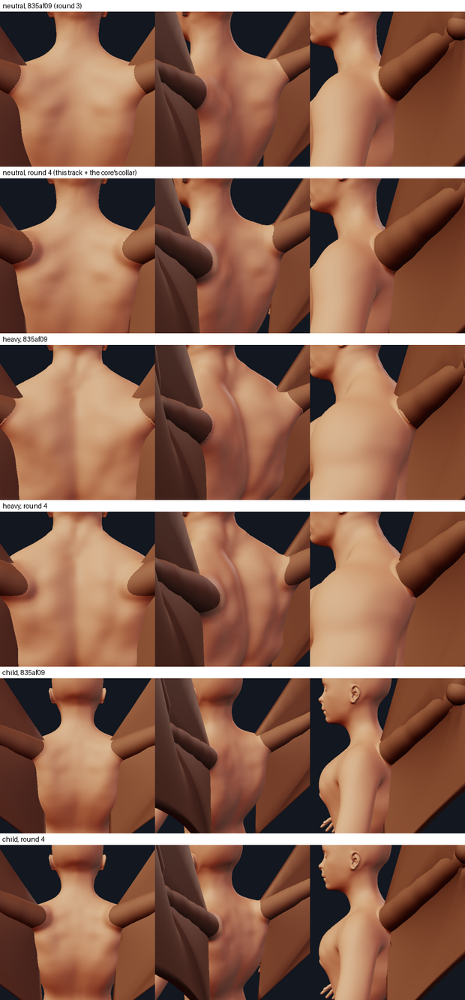
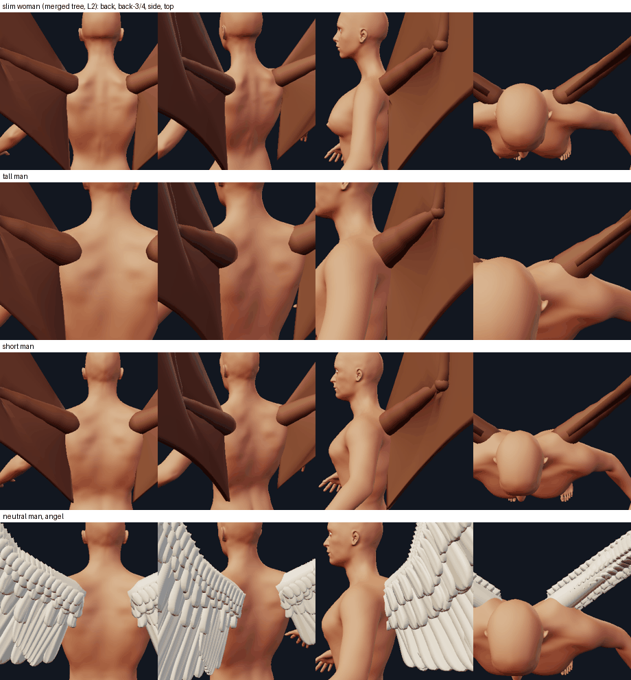
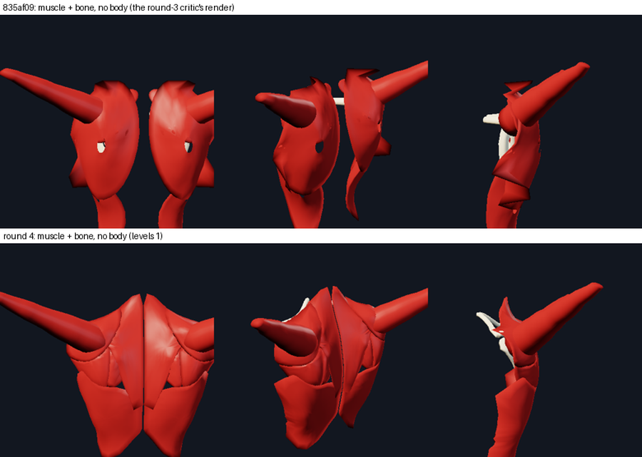
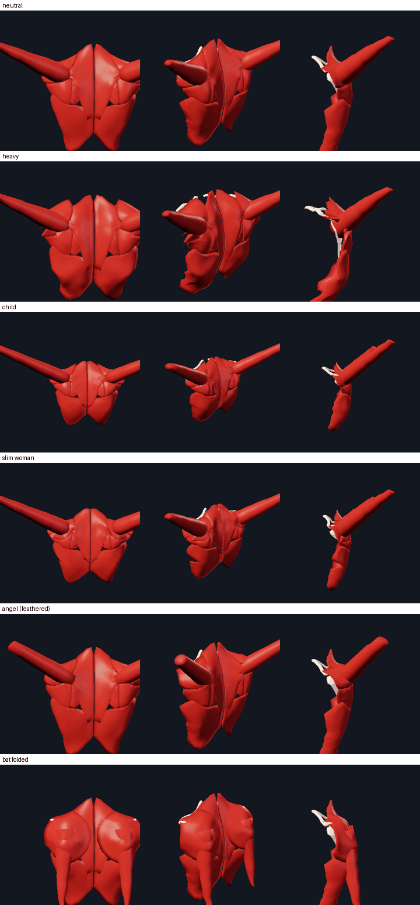
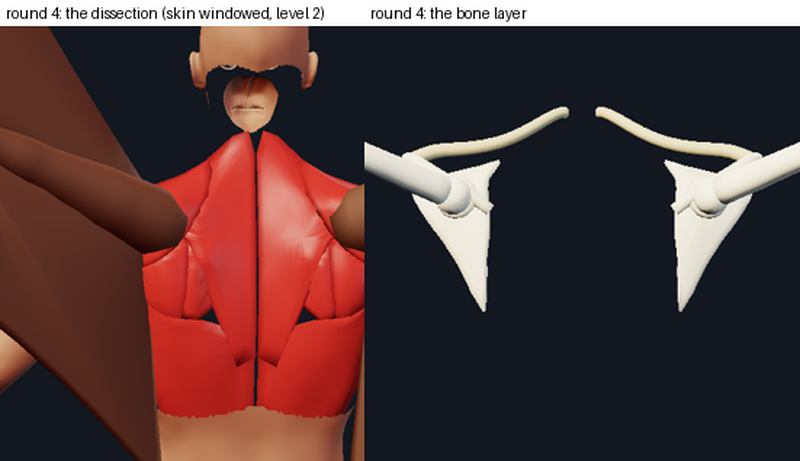
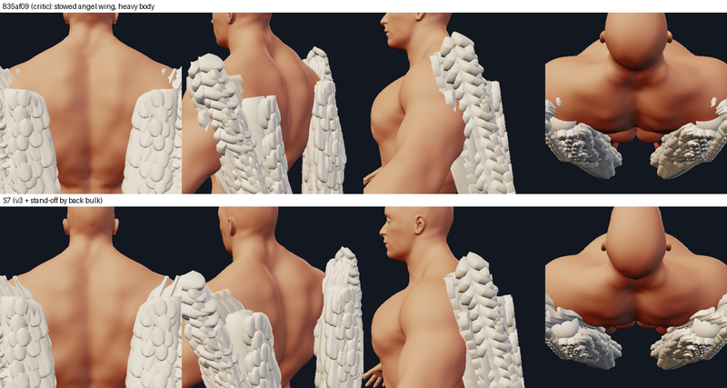
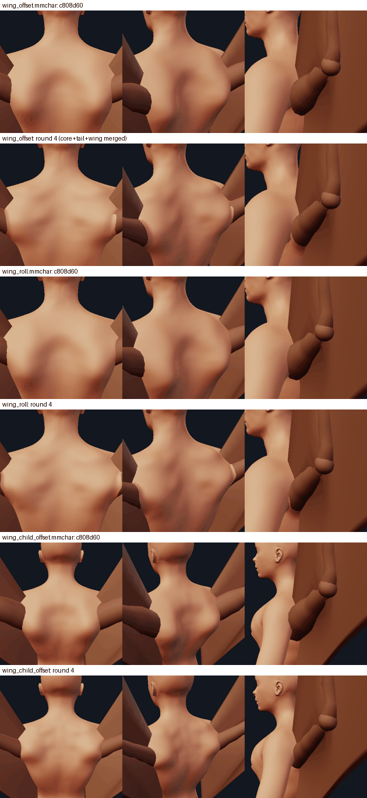

# The wing's root: a shoulder girdle, a muscular upper arm and the skin over both

Tracks S3 (round 1), S6b (round 2b) and S7 (round 4) of the anatomical junctions ([junctions.md](junctions.md) has the skin
mechanism it builds on, [collar.md](collar.md) the root collar, [appendages_system_design.md](appendages_system_design.md) the
appendage system). The complaint was that the appendages "seem placed onto the model", "slapped over skin". For the wing that
was literally true: a 0.2-unit bone-thin rod left the corner of the back through a flat patch of skin. Round 1 gave it a
shoulder girdle and a muscular sleeve; round 2b moved the joint onto the ribs under the shoulder blade, removed the bullseye and
the ridge from the back and gave the arm a root collar. The round-3 review (verdict "revise": location 6, bone 5, muscle 4,
skin 4) found five things round 4 answers here:

* **B4, documents**: a file written by c808d60 (the tree the user was last shown) whose wing a person had edited loaded with the
  bone-thin rod instead of the muscular arm it had shown. Fixed (section 6).
* **B5, the muscle layer**: one egg-shaped shield a side, with holes the bone showed through, torn edges, its scapular pad running
  from the lumbar region to the neck and poking 0.48 out of the skin there; the test that should have seen it measured pads it
  built itself, without their rims. Rebuilt as anatomical sheets laid under the moulded skin (section 2), measured on six bodies.
* **The bone path**: the joint sat on the ribs under the medial blade and the buried humerus ran 0.8 units up through the human
  scapula. The joint is on the blade now (placement version 3, section 1) and the bone layer is a coherent girdle.
* **The mound**: "a plain human trapezius with a tube in it"; restored a rounded mound behind and above the root (section 3).
* **Honest numbers**: the join angle the docs quoted was measured inside the arm; the join is now measured where it is seen
  (section 5), plus the stowed heavy wing, the collar's on/off threshold and the sliders' extremes.

```python
placed.layers()                 # {"bone", "muscle", "skin"}, the muscles under the skin this wing's junction moulds
placed.kind.layers_on(placed, shaped)   # ... under the skin of a body shaped with every appendage (the ecorche view)
placed.model                    # wingroot.WingRoot: .masses(c) .sheets(c) .muscles(skin) .bones(skin) .spec(c) .joints(c)
                                #   .exit_angle(c) .collar_strength(c) .moulded(c, shaped)
wingroot.visible_join(plain, skin, S, E, r, k)  # the join one sees, on a ring k root radii round the arm
```

Files: `minimaster/character/wingroot.py` (the anatomy), `wings.py` (`Sleeve`: the arm's base), `kinds.py` (`WingKind`:
placement versions, the model, the junction, the collar profile, the layers, the stow root), `appendages.py` (`WING_SOCKET_*`,
`WING_SLIDE`, `Appendage.slide`, `wing_arm_axis`), `creature_anatomy.py` (the body adaptation), `tools/wing_root_view.py`,
`tools/wing_root_report.py`, `tests/test_wing_root.py`, `tests/fixtures/wing_c808d60/`.





## 1. Where the joint is (the placement's third version)

| | version 1 (`back_wings()`, pinned records) | version 2 (S6b) | version 3 (every new record) |
|---|---|---|---|
| socket | the anchor quad 0.9 units in | the back's skin point at **x 0.48 shx, y spine-1 + 0.50 Lt**, sunk 0.50 s | the same socket |
| joint | the socket | the socket, **on the ribs under the blade**: 0.59 deep on the neutral man | the socket **slid out along the arm's own axis by 0.30 s** (0.20 s for the feathered wing), the frame's orientation kept: **on the blade**, 0.30 deep (0.39 feathered) |
| where the arm leaves the back | x 0.83-1.12 shx, through the human deltoid | x 0.71-0.80 shx, y 0.64-0.67 Lt | the same point and angle (the line is the same) |
| buried humerus | ~1 unit | 0.70 (neutral) / 0.85 (heavy) | 0.35 / 0.49 (feathered 0.47 / 0.55) |

`s = shx / 1.72` (the body size: 1.17 on the neutral man, 0.83 on the child, 1.47 tall), `shx` the x of `joint-l-shoulder`,
`Lt = neck.y - spine-1.y`.

**Why slide, and why along the arm.** The round-3 review measured the version-2 joint at 0.29 of the back-to-front depth,
at the rib surface under the medial blade: the humerus then had to run up through the human scapula and supraspinatus to reach
the skin. A bird's and a bat's shoulder joint lie just under the skin at the top of the thorax, the proximal humerus wrapped in
muscle (wing/A07 pigeon skeleton, A17 and A18 flying fox: "the shoulder joints sit just outside the top of the ribcage"). A
shallower sink at the same socket (the cheap fix) moved the exit medially and laid the arm flatter on the back (plain exit
62 -> 50 degrees on the neutral man, 39 -> 36 on the heavy one, under the collar's threshold; scratchpad
`junction/S7_wing_out/probe_depth1.jsonl`). Sliding the joint out along the arm's own rest axis with the frame kept
(`Appendage.slide`, `appendages.wing_arm_axis`) leaves the line, the exit point and the angle exactly where version 2 had them
(neutral 0.743/0.644 -> 0.739/0.643, plain angle 62.3 -> 63.1) and halves the buried humerus. The wing as a whole sits 0.35
units further out along its arm. The feathered arm is slimmer and longer: slid 0.30 s, 3.8% of it lay in a body printed without
the junction (the print report blocks under 5%); slid 0.20 s, 6.2% (12.2% with the junction).

| body (membrane) | joint x/shx, y/Lt | joint depth (units, s) | blade depth | head radius | buried | exit x/shx, y/Lt | plain angle |
|---|---|---|---|---|---|---|---|
| neutral | 0.61, 0.57 | 0.30, 0.25 | 0.40 | 0.18 | 0.35 | 0.74, 0.64 | 63.1 |
| child | 0.61, 0.59 | 0.20, 0.24 | 0.28 | 0.12 | 0.23 | 0.74, 0.66 | 60.4 |
| heavy | 0.61, 0.57 | 0.33, 0.28 | 0.40 | 0.18 | 0.49 | 0.79, 0.67 | 46.3 |
| tall | 0.61, 0.57 | 0.38, 0.26 | 0.50 | 0.25 | 0.44 | 0.74, 0.64 | 62.4 |
| short | 0.61, 0.57 | 0.27, 0.25 | 0.36 | 0.16 | 0.31 | 0.74, 0.64 | 64.1 |
| slim woman | 0.61, 0.59 | 0.20, 0.20 | 0.33 | 0.15 | 0.21 | 0.71, 0.65 | 65.2 |

The anchor (`Placed.anchor`) stays the skin point over the socket: the collar's patch and the lab's framing are centred on it.

## 2. The layers





### Muscle: anatomical sheets under the moulded skin

Round 3 drew each mass as a pad: a lens over a footprint projected along ONE normal, its top the plain skin plus the relief. Where
a ray missed the skin (the scapular footprint ran over the top of the shoulder) the point kept its place in the air: the 0.48 poke
at the neck; its pole fans were wound against its rings: the holes. Round 4 draws the muscles a dissection shows
(`wingroot.SHEETS`, `CAP_SHEET`), each an OUTLINE on the back in the body's own units read off **wing/H06** (Sobotta, superficial
back) and **H05** (Gray 409), with its shoulder joints, C7 and the inferior scapular angles as landmarks (the grid overlay:
scratchpad `junction/S7_wing_out/h06_grid.png`):

| sheet (layer, outermost first) | outline (x / shx, y / Lt) | thickness at the belly | reference |
|---|---|---|---|
| `deltoid` (0): the wing's deltoid, the cap the arm leaves through | the boss' footprint round the root | 0.10 s + its relief | H24's shoulder mound, H22 |
| `trapezius` (1): the kite | from the nape (1.18) down the spine to T12 (-0.56), out to the acromion (0.97, 0.82), its free border along the scapular spine and down to T12 | 0.05 s + relief | H06, H05 |
| `latissimus` (2): the sheet over the inferior angle to the axilla | upper border at y 0, lateral border along the flank | 0.05 s + relief | H06 |
| `scapular` (3): infraspinatus / teres, below the spine (the root leaves through it) | spine root (0.43, 0.53) to (0.87, 0.75), the lateral border, the inferior angle (0.50, -0.03) | 0.12 s + relief | H06's infraspinous window, H03 |
| `supraspinatus` (3): the fossa above the spine | (0.41, 0.87) .. (0.97, 0.82) down to the spine | 0.10 s + relief | H04, H07 |
| `rhomboid` (4): spines of C7-T5 to the medial border, under the trapezius | (0.01, 0.96) .. (0.45, 0.56) .. (0.51, 0.05) | 0.08 s + relief | H07, H06 (its window) |

The surface they lie under (`WingRoot.moulded`, `MouldedSkin`): the body moulded by this wing's own junction (or by every
appendage's, `layers_on`, the hook the tail track's `ecorche.layer_shells` calls), subdivided once. `MouldedSkin.from_behind`
casts rays from behind (+Z) onto it: a seed on the backmost back-facing vertex of a grid cell, then the tangent plane solved for
the ray, three times. A sheet's spoke ends where the back ends (a ray finding no back-facing skin), bisected to the outline of the
body (a ring-wise cut drew a sawtooth on the flank). The top of every sheet is the skin's thickness (`SKIN_T`, 0.06, wing/H08)
under the skin, rounding 0.025 lower at its edge so the bellies read; where an outer sheet covers it, under that sheet's
thickness too (the deeper muscle passes UNDER the trapezius, as in H06); its bottom is its own lens of thickness plus the relief
of the mass of its name (the `scapular` mass thickens the `scapular` sheet: the skin's relief IS muscle). Every lens is closed and
wound one way (`_lens`: the round-3 fans were wound against the rings).

**Measured** (`tests/test_wing_root.py::test_the_muscle_lies_a_skin_thickness_under_the_shaped_skin`, six bodies, the pipeline's
shaped skin subdivided once and twice; every vertex of every sheet as the ecorche lays it and as `Placed.layers()` lays it):

```
body      level  nearest muscle vertex to the skin   skin over the relief -> first muscle straight in: hit / p50 / p90 / max
neutral   1 / 2  -0.058 / -0.053                     100% / 0.070 / 0.084 / 0.127   100% / 0.067 / 0.083 / 0.128
child     1 / 2  -0.057 / -0.054                     100% / 0.067 / 0.079 / 0.089   100% / 0.064 / 0.077 / 0.088
heavy     1 / 2  -0.051 / -0.043                     100% / 0.069 / 0.084 / 0.098   100% / 0.065 / 0.081 / 0.122
tall      1 / 2  -0.056 / -0.048                     100% / 0.073 / 0.088 / 0.143   100% / 0.069 / 0.087 / 0.139
short     1 / 2  -0.056 / -0.051                     100% / 0.068 / 0.083 / 0.100   100% / 0.066 / 0.081 / 0.097
slim woman 1 / 2 -0.056 / -0.052                      99% / 0.068 / 0.084 / 0.155    98% / 0.065 / 0.081 / 0.156
```

Nothing of the muscle comes within 0.04 of the skin (round 3: 0.48 OUTSIDE it); and from the skin the masses raise, a ray straight
in meets muscle one skin thickness down (the skin is the envelope of the muscle, not of fat or air): median 0.064-0.073.

### Bone: the blade, its spine, the clavicle, the humerus



* `scapula`: the blade of THIS body (`SCAPULA_BLADE`, from **wing/H03** Gray 204 and **H01** Albinus: the medial border 0.37 /
  0.53 of the biacromial width apart at the spine's root / the inferior angle, height 0.44 of it), laid `SCAPULA_DEPTH` = 0.34 s
  under the PLAIN skin (the relief over it is muscle), 0.05 s thick; its **spine** (`SCAPULA_SPINE`) rising from the medial border
  across the blade (22.7-24.9 degrees, H03) to the **acromion** at the top of the shoulder, 0.08 s under the skin; and the
  **glenoid**: a rim on the blade round the rest joint, under the head (the joint does not move when the arm turns about it).
* `clavicle`: the strut of the girdle, from the acromion OVER the top of the rib cage to the manubrium beside the midline, 0.08 s
  under the skin all the way (a bird's coracoid and furcula brace its shoulder against the sternum, **wing/A02, A07**; round 3's
  strut ran from the joint THROUGH the chest).
* `humerus`: the arm's own rings at 0.30 of the sleeve's radius (pose with the skin), from inside its head, which sits on the
  joint (round 3 put the head 1.2 radii out along the arm, under the skin of nothing).

Measured on six bodies (`test_the_joint_sits_on_the_blade_and_the_humerus_leaves_it_through_muscle_only`): the blade's top lies
between 1.6 head radii under the joint's centre and half a head radius over it (the head sits in its glenoid ON the blade); the
humerus from the head's surface to where it crosses the skin meets no bone; every bone vertex is inside the skin (at least 0.02),
the clavicle within 0.35 s of it. With the version-2 joint (no slide) the joint is 0.2 under the blade and the test fails
(the mutation run below).

## 3. The relief (the masses) and the mound behind and above the root

`PERMANENT_MASSES` (left side; heights in s) and the boss (`CAP`):

| mass | where | footprint (long x wide) | height | round 3 |
|---|---|---|---|---|
| `scapular` (infraspinatus / teres) | 0.66 shx, +0.28 Lt, along the lateral border | 0.46 Lt x 0.34 shx | 0.14 | 0.56, +0.22, 0.80 Lt x 0.46 shx (lumbar region to the neck), 0.105 |
| `rhomboid` | 0.30 shx, +0.40 Lt | 0.24 Lt x 0.17 shx | 0.06 | same |
| `latissimus` | 0.66 shx, -0.55 Lt | 0.80 Lt x 0.32 shx | 0.10 | same |
| `trapezius` (slope) | 0.34 shx, +0.74 Lt | 0.30 Lt x 0.15 shx | 0.07 | same |
| `supraspinatus` (NEW: the wing's elevators above the scapular spine) | 0.66 shx, +0.80 Lt, along the spine | 0.30 Lt x 0.18 shx | 0.15 | - |
| `deltoid` (the boss) | from the skin over the joint to the crossing and 1.0 r beyond, its crest moved 0.8 r half up the back and half the way the arm leaves | 2.2 r wide | up to 0.30 (by how shallow the arm leaves; half of it for an arm lying along the back), less what the others raise at its crest | up to 0.24, crest on the run |

TAKEAWAYS wing checklist 2 / **wing/H24** (Winged Victory, side): "a rounded shoulder mound rises behind and above the root". Round
2b had lowered every mass to remove the bullseye; the critic: "a plain human trapezius with a tube set into it; find the middle".
Tried on renders (scratchpad `junction/S7_wing_out/mound_sheet*.png`, `m2_sheet.png`, `m3_sheet.png`): a supraspinatus mass
behind and above the root, a taller boss, its crest lifted up the back and toward the side the arm leans over. The side views show
the arm growing out of the flank of a shoulder mound; no ring, no ridge on six bodies (`cmp` sheets). Relief: 0.46 L the pair on
the neutral man (0.84 heavy), against 0.97 at 835af09, of which 0.29 L was the ridge the junction raised over the buried humerus
running 0.7 units under the skin (gone with the joint on the blade) and the rest the plateau over the whole back.

## 4. The junction, the collar profile

`WingRoot.spec`: the masses as `Mound`s (displaced backwards), the arm as the tube the skin flows into (the arm's own axis carried
by the pose; from 0.15 of the humerus for the feathered arm, `TUBE_START`: its rounded buried end is narrower than its tube and the
skin over the heavy man's shoulder was called hidden), Keep spheres round the human upper arm, `owner="trunk"`, `join_guard=False`.

**The collar** (`collar.py`, the core's; `WingKind.collar_profile`): width 1.1 root radii on the open side (the side the arm comes
FROM: toward the spine and down), 0.35 on the side it leans over, 0.55 up the arm, sunk 0.2, `collar` scales it.

* **It ramps in** (`WingRoot.collar_strength`): nothing at a plain exit of 40 degrees or less (`COLLAR_MIN_EXIT`), all of it from
  45 (`COLLAR_FULL_EXIT`), a smoothstep between; under a fifth of a collar (the ramp times the `collar` slider,
  `WING_COLLAR_MIN_STRENGTH`) is none: a weaker one kept only a fragment of its ring on the round-4 core (heavy man, arm lowered:
  strength 0.07 kept 10% of the ring with a 93-degree crease, 0.11 35% / 47 degrees, 0.17 63% / 25, 0.30 89% / 14;
  `S7_wing_tools/partial_collar.py`), so the collar appears at 41.4 degrees a fifth of its height high (0.04 units on the heavy
  man) instead of as a frayed fragment. Round 3 cut at a hard 43 degrees, with the heavy
  dragon collared at 44.7 and the heavy feathered folded wing not at 40.4: a pose or a slider moving the exit by a degree switched
  the collar on or off. With version 3 the rest exits are 44.7-67.5 (heavy dragon 44.7: strength 0.99) and the folded ones 12-35.
* **It climbs the arm**: measured now (`test_the_collar_climbs_the_arm`): the collar's top 0.38-0.44 root radii up the arm past the
  crossing with the round-3 construction, 0.33-0.34 with the core's round-4 one (a collar 0.05 high: 0.03-0.12; the round-3
  mutation M11 survived).
* **The feathered collar's crossings and the tall body's acute-side tear** (round-3 B2, B3) are the construction's: with the
  core's round-4 `collar.py` and this track's anatomy merged (scratchpad `junction/S7_wing_merge`), every collared row of
  neutral, heavy, child, tall and slim woman x bat, dragon, angel x rest, swing -45, raise -20, fold 0.5 is watertight with
  **0 self-crossings** (45 rows, `S7_wing_out/creport_merge.jsonl`), so the profile keeps its numbers. With the round-3
  construction alone they stay as the review measured them.

## 5. Numbers: the join one sees

`wingroot.visible_join`: the angle between the arm's axis and the skin's tangent plane on a ring k root radii round where the axis
crosses the plain skin (`min`: the side the arm leans over, negative where the skin folds over the arm; 90: the skin square to the
arm). The angle where the axis itself meets the skin (the 62 -> 74 round 2b quoted) is inside the arm. Membrane wing at rest,
level 0 cage (`S7_wing_tools/visible_join.py` on the three trees):

```
            c808d60 (shown to the user)      835af09 (round 3)               round 4
            1.3 r min/mean  1.8 r min/mean   1.3 r          1.8 r            1.3 r          1.8 r
neutral     -14.4 / 49.3    -16.7 / 49.5     23.3 / 46.6    11.5 / 39.9      28.8 / 50.6    21.1 / 43.2
child       -21.2 / 53.6     16.8 / 46.7     34.0 / 52.6    11.1 / 42.8      30.4 / 51.0    24.5 / 44.2
heavy       -25.8 / 42.2    -33.8 / 42.4     33.3 / 47.5    19.9 / 44.7      27.4 / 45.1    29.0 / 46.4
tall         14.3 / 50.5     14.2 / 48.1     27.9 / 48.9    17.2 / 43.1      22.8 / 46.3    21.5 / 43.3
short         5.9 / 52.1     -0.2 / 52.1     26.5 / 47.4    10.7 / 40.4      28.3 / 51.2    20.8 / 42.7
slim woman  -39.3 / 42.3     -1.6 / 40.5     30.4 / 51.3    10.1 / 43.6      29.9 / 52.0    17.3 / 44.3
```

At 1.8 root radii the leaning side improves on every body (to 17-29 from 10-20) and the mean rises on every body against round 3
(39.9 -> 43.2 on the neutral man). Against c808d60 the mean is lower on the neutral man, the child and the short body: there the
arm pierced the back at 45 degrees with the skin folding over it on one side (negative minimum) and square to it on the other. A
fillet that flows into the arm lowers the angle near it on every side; the mean is not a score to maximise, the minimum and the
spread are. The hidden axis angle went DOWN (73.6 -> 64.1 on the neutral man) because the boss now lifts the skin under the
leaning side instead of tilting the skin at the axis.

Poses (membrane, neutral): folded exit 21 (no collar), fold 0.5 45.7 (full collar), swing -45 49.9, raise -20 57.1.

**Stowed wings** (`test_a_stowed_wing_of_the_second_placement_rests_on_the_back`, now with the heavy body, on the body as the
document draws it): the share of the stowed angel wing inside the torso: neutral 6.1%, child 4.1%, woman 6.1%, heavy **3.8%**
(round 3: 14.1%, feathers out of the shoulder tops); the bat and the dragon stay within the first placement's 15%. A version-3 feathered wing's stow root stands off
the back by how much thicker the back is behind the shoulder joints than the neutral man's (`kinds.stow_root`, `WING_STOW_BULK`).



**Timings** (neutral man, best of 5, a machine shared with other builders, re-measured after the last edit; round 4 /
835af09, `S7_wing_tools/timing.py`): the wing pair's build 50 / 49 ms (bat), 341 / 327 (angel); the specs 5 / 5 and 8 / 8 ms;
`apply_junctions` 61 / 55 ms (bat), 79 / 72 (angel); `Placed.layers()` per wing 269 / 750 ms (bat), 286 / 754 (angel) warm (the
moulded skin is cached per pose; cold it adds the wing's own junction, 60-150 ms, a level-1 subdivision, 80 ms, and the skin
patch, 45 ms). `wing_arm_axis` builds a light rig once per wing shape (cached; a cold first build of a new shape pays it).

**Print** (the lab's export, medium, the share of the arm piece inside the body, junction off / on; `S7_wing_tools/weld.py`,
re-measured after the last edit): bat 8.7% / 11.0%, dragon 8.4% / 10.4%, angel 6.2% / 12.2% (835af09: 20.7 / 27.9,
18.7 / 25.8, 11.6 / 19.4); the same on the core + tail + wing merged tree. The arm is less buried because the joint slid out
along it. No blocking finding; the angel without the junction is under the report's 8% "shallow weld" warning.

## 6. Documents

* **New records** carry `placement.version = 3`.
* **A version-2 record** (written by 835af09, S6b) is read as version 2: its joint on the ribs, NOT slid; the joint, the exit
  point and the arm are where 835af09 put them. Its moulded skin is NOT as it was: the masses, the boss, the collar ramp and
  the tube start below are not versioned, so they reach version-1 and version-2 records too (neutral man, measured on the cage
  against 835af09: the skin moves at most 0.25 units further, 134 of 13,378 vertices by more than 0.02, bat; 0.26 / 140 angel;
  a version-1 record 0.16-0.18 / 113-116; `S7_wing_tools/v2_diff.py`).
* **Records written before the versions** have no stamp. One that holds the first preset's numbers untouched is read as the latest
  version: it moves (to version 3). One in which a person changed the sink, the hint, the roll or the quad keeps exactly the
  placement they chose (version 1) **and the muscular sleeve** every tree that could write it drew (round 1 .. c808d60): **B4**.
  Only an explicit `placement.version = 1` stamp gives the first versions' bone-thin rod. The fixtures in
  `tests/fixtures/wing_c808d60/` were WRITTEN by c808d60 (`S7_wing_tools/gen_c808d60_fixtures.py` on an export of it) with
  `manifest.json` holding what c808d60 drew: the edited records keep their exit point exactly, the neutral man's arm radius at
  0.3 of the humerus is 0.411 against c808d60's 0.428 (the sleeve tapers now), the dragon's 0.444 / 0.459, the angel's 0.380 /
  0.374, the child's **0.297 against 0.428** (the sleeve is body-scaled since S6b: c808d60 gave a child the man's arm).



* **What renders differently** (disclosure): EVERY record with a wing: the new masses (the supraspinatus mound, the taller boss
  lifted toward the leaning side, the smaller infraspinatus plateau), the collar ramp (40-45 degrees), the angel's tube start and
  the slider clamps below; the muscle and bone layers are new. On top of that, an untouched record, a new record and a version-3
  record: the joint 0.30 s further out
  along the arm (the whole wing 0.35 units out on the neutral man; the visible upper arm that much longer), the new masses (the
  supraspinatus mound, the taller boss lifted toward the leaning side, the smaller infraspinatus plateau), the collar ramping in
  between 40 and 45 degrees (43 was a hard cut), the stowed angel wing standing off a bulkier back, the junction tube of the
  angel wing from 0.15 of its humerus; the muscle and bone layers are new. An edited unstamped record gets the sleeve back
  (835af09 drew the rod). **The sliders**: `muscle` 0.5-1.4 (was 0-2), `collar` 0-1.3 (was 0-2): a record storing more is clamped
  with a note (muscle 2.0 drew an arm a third of the shoulder's half-width wide, muscle 0 a rod in a frayed collar, collar 2.0 a
  doubled stripe; `S7_wing_out/ext_sheet_S7.png`). A pinned version-1 record without `muscle` keeps its rod.
  **The collar's floor**: a collar weaker than a fifth (the `collar` slider times the ramp) is not drawn, so a record storing
  `collar` 0.05-0.19 now has NO collar in any pose (835af09 drew a thin one), and with the slider under 1 the collar appears at
  a steeper exit than 41.4 degrees (slider 0.5: the ramp must reach 0.4, about 42.2 degrees).
* `.mmchar` v1 and v2 files load without error and nothing in them is rewritten; they render with the differences above.

## 7. References used

(library ids: `refs/wing/<id>`; `TAKEAWAYS.md` section 5; side-by-side sheets, third-party images kept out of the repository:
scratchpad `junction/S7_wing_out/ref_muscle_H06_H05_vs_S7.png`, `ref_bone_H03_vs_S7.png`)

* **wing/H06** (Sobotta, superficial back) and **H05** (Gray 409): the outlines of the trapezius kite (nape to T12, the acromion,
  the free border along the scapular spine), the latissimus' upper border over the inferior angle, the infraspinatus window
  between trapezius, deltoid and latissimus, the rhomboid's window; the order of the layers. Measured on a landmark grid.
* **wing/H07** (Sobotta, deep): the rhomboids under the trapezius, the supraspinatus in its fossa. **H04**: the attachments.
* **wing/H03** (Gray 204) and **H01** (Albinus): the blade's outline, the medial border's gap (0.37 / 0.53), the spine's rise
  (23-25 degrees), its height (0.44): `SCAPULA_BLADE`, `SCAPULA_SPINE`. **H08** (back section): the skin and fat over the muscle
  (`SKIN_T`), the muscle over the blade (`SCAPULA_DEPTH`).
* **wing/A07, A02** (pigeon skeleton, Fuerbringer's girdle plate) and **A17, A18** (flying fox): the shoulder joint at the top of
  the thorax just under the skin, a short buried humerus (version 3), the strut to the sternum (the clavicle).
* **wing/H24** (Winged Victory, side), **H22, H23** (Canova): the rounded shoulder mound behind and above the root (the
  supraspinatus mass, the boss' lift); the back swelling into the root without a seam.
* **wing/H15, H16** (muscular and lean backs): the relief's scale (no rings; the blade's mound and its lower edge read).

## 8. What it does not do (honestly)

* **The folded bat and dragon** pivot about the joint 0.35 units further out: their stowed membrane's root panel (the rig's,
  between the arm and the waist) shows larger flat flaps at the inner edge than at 835af09 (scratchpad
  `S7_wing_out/folded_slide.png`). The folded pose has no collar (exit 12-35 degrees); its boss eases to 0.6 of its height
  (`BOSS_FLAT`: a whole boss beside an arm lying along the back is a lobe); the skin beside the folded arm moves up to 0.38.
  In the ecorche the folded deltoid (the cap sheet laid round an arm lying along the back) reads as a round disc.
  Folded, every sheet and bone still lies inside the skin (bat and angel, neutral and heavy: the largest signed distance
  -0.051; `S7_wing_tools/folded_layers.py`, not a test); the white at the top of the shoulder is the acromion and the
  clavicle where no sheet covers them.
* **The folded angel wing's arm does not cross the plain skin** on four of six bodies (neutral, child, slim woman, short:
  `exit_angle` is `None`, so no collar and no open side); it did not at 835af09 either (`S7_wing_out/probe_v3.jsonl`).
* **The visible join's mean** at 1.8 root radii is below c808d60's on three bodies (section 5); the hidden axis angle fell.
* **The relief** is 0.23 L a side on the neutral man (the research's estimate for flight muscle: 0.7-1.2): the visible mound is
  modest by design (no rings).
* **The bone layer is schematic**: a blade without fossae or a coracoid process, a spine bar, a ring for the glenoid, a clavicle
  tube; only the humerus is posed (the blade does not rotate with the arm). The blade is the same for the human arm and the wing;
  the human arm's own glenoid and humerus are not drawn.
* **The muscle sheets end where rays from behind stop meeting the back**: over the top of the shoulder (the trapezius' upper part)
  and round the flank (the latissimus) the ecorche shows their cut edge; a small flap of the trapezius stands at the nape in a
  side view.
* **The angel wing printed without the junction** has 6.2% of its arm in the body (a "shallow weld" warning; 5% blocks); with
  the junction 12.2% (835af09: 19.4%).
* **Collar artifacts with the round-3 construction** (B1-B3: the sawtooth ring, the tone rim, the feathered crossings, the tall
  body's acute-side tear) are the core's; merged with the core's round-4 collar the wing rows have none (section 4).
* **Level 0** (the CLI's and the lab's default in 835af09) has no collar: the core track's level policy decides that.

## 9. Tests and mutations

`tests/test_wing_root.py` (83 tests). Each round-4 behaviour has a test that fails without it; a mutation run on a copy
(scratchpad `S7_wing_tools/mutrun.py`, each mutant alone) catches all 16:

| mutant | caught by |
|---|---|
| an edited unstamped record gets the rod again (B4) | `test_an_edited_record_written_by_c808d60_keeps_the_muscular_arm_it_had`, `test_an_unstamped_record...` |
| the muscles laid under the PLAIN skin (round 3's construction in spirit) | `test_the_muscle_lies_a_skin_thickness_under_the_shaped_skin[neutral]` |
| the skin's thickness doubled; the edge dip tripled; no cover (deeper sheets not under outer ones) | the same / `test_a_muscle_sheet_is_a_closed_lens_a_skin_thickness_under_the_skin` |
| the lens fans wound back (round 3's holes) | `test_a_muscle_sheet_is_a_closed_lens...` (every directed edge once) |
| the ray from behind not solved onto the tangent plane | `test_a_ray_from_behind_meets_the_back_and_nothing_past_it` |
| no slide (the version-2 joint under the blade) | `test_the_joint_sits_on_the_blade_and_the_humerus_leaves_it_through_muscle_only` |
| the strut through the chest (round 3's furcula) | the same (bones inside the skin, the clavicle just under it) |
| the collar cut at a hard 43 degrees | `test_the_collar_ramps_in_as_the_arm_rises_off_the_back` |
| a collar drawn at 0.05-0.2 strength (a fragment of a ring) | `test_a_collar_ramped_in_less_than_a_fifth_is_left_out_not_drawn_as_a_fragment` |
| the collar 0.05 high (round 3's surviving M11) | `test_the_collar_climbs_the_arm` |
| no stand-off for a bulky back | `test_a_stowed_wing_of_the_second_placement_rests_on_the_back[macro3]` (the heavy man) |
| the muscle slider back to 0-2 | `test_the_muscle_and_collar_sliders_stop_before_the_drumstick_and_the_double_ring` |
| the boss' lift removed | `test_the_arm_leaves_a_steeper_skin_than_it_did` (the visible join) |
| no supraspinatus mound | `test_the_masses_sit_on_the_back...` (a value pin) |

Round 3's surviving M3 (`PAD_STACK`) and M12 (each pad on its own mound) targeted `pad_mesh`, which is gone: the stacking is the
cover term and the moulded skin, both caught above. Two guards the first sheets had (a seed filter by the body frame's trunk, a
height limit at the occiput) survived their mutants on six bodies: they were removed. The full suite (2373 passed, 30 skipped)
and the Tk tests (183 passed) run green on this tree; `tests/test_wing_root.py` and the tail track's ecorche tests run green on
this tree with the core's and the tail track's round-4 patches applied.

## 10. Looking at it

```
python tools/wing_root_view.py OUT.png "wing:style=membrane" 180,8 --layers bone,muscle,skin --window 2.4 --levels 2   # a dissection
python tools/wing_root_view.py OUT.png "wing" 180,10 140,20 90,5 --layers muscle,bone --no-body --levels 1           # the layers alone
python tools/wing_root_report.py --bodies neutral,child,heavy --styles membrane,dragon --poses "rest;preset=folded"  # incl. the seen join
minimaster character --add wing --subdivide 2 -o x.png          # the collar needs --subdivide 1 or 2
```
