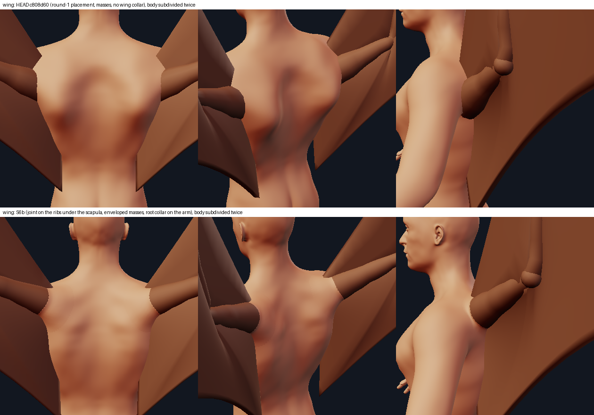
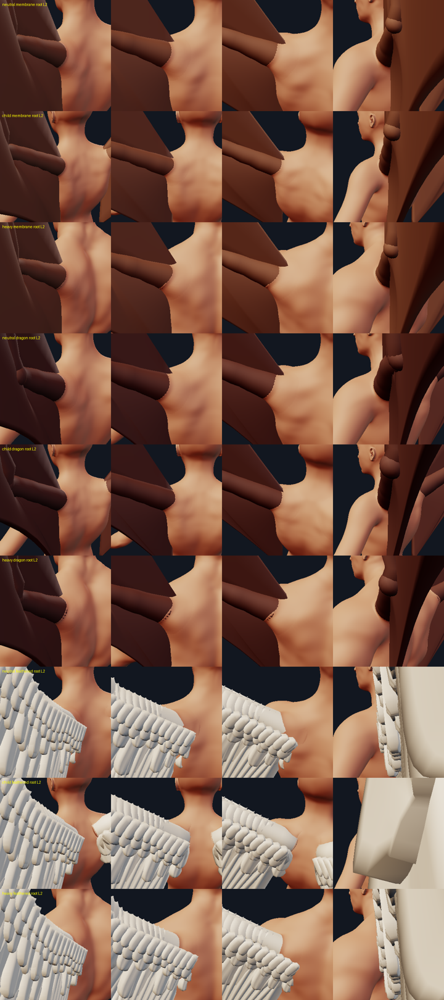

# The wing's root: a shoulder girdle, a muscular upper arm and the skin over both

Tracks S3 (round 1) and S6b (round 2b) of the anatomical junctions ([junctions.md](junctions.md) has the skin mechanism it
builds on, [collar.md](collar.md) the root collar, [appendages_system_design.md](appendages_system_design.md) the appendage
system). The complaint was that the appendages "seem placed onto the model", "slapped over skin". For the wing that was
literally true: a 0.2-unit bone-thin rod left the corner of the back through a flat patch of skin. Round 1 gave it a shoulder
girdle and a muscular sleeve but kept the first placement; its critic scored location 4, bone 3.5, muscle 5, skin 5: the
joint sat 0.9 units inside the torso, the arm left through the human deltoid at 57-62 degrees (46 on the heavy body), and the
shaped back showed a round bullseye between the shoulder blades and a ridge from the shoulder to the spine. Round 2b moves
the joint, rebuilds the masses so the back has no ring, gives the arm a root collar and versions everything a saved wing
renders differently.

What a wing root is, in every winged body the references show: a **skeletal joint on a girdle** (a scapula plate on the ribs,
a strut to the sternum), a **mass of muscle gathered over the girdle** that wraps the proximal arm two to three times thicker
than the bone, and **one skin sheet** that rolls over both and flows tangentially into the arm. The code has all three, each
derived from the same numbers, and exposes them as layers:

```python
placed.layers()   # {"bone": Mesh, "muscle": Mesh, "skin": Mesh}   (MakeHuman frame, under the spec's own pose)
placed.layers({"preset": "folded"})
placed.model      # wingroot.WingRoot: .masses(c) .muscles(skin) .bones(skin) .spec(c) .joints(c) .exit_angle(c) .collar_up(c)
```

Files: `minimaster/character/wingroot.py` (the anatomy), `wings.py` (`Sleeve`: the arm's base), `kinds.py` (`WingKind`:
placement versions, the model, the junction, the collar, the layers), `appendages.py` (`WING_SOCKET_*`, `WING_*_V2`),
`creature_anatomy.py` (the body adaptation), `tools/wing_root_view.py`, `tools/wing_root_report.py`, `tests/test_wing_root.py`.



## 1. Where the joint is (the placement's second version)

| | first version (round 1, `back_wings()`) | second version (every new record) |
|---|---|---|
| joint | the anchor quad's point sunk **0.9 units** straight in, under the posterolateral corner of the back | **on the ribs under the shoulder blade**: the back's skin point at **x = 0.48 shx**, **y = spine-1 + 0.50 Lt** (the level of the scapular spine), sunk **0.50 s** straight in (`appendages.WING_SOCKET_*`, `wingroot.socket_anchor`) |
| span axis | `WING_UP_HINT` (1, 1.4, -0.45) | `WING_UP_HINT_V2` (1, 1.4, -0.6): 5 degrees further back |
| where the arm leaves the back | x 0.83-1.12 shx (beyond the human shoulder joint on the child and the woman), through the human deltoid | **x 0.72-0.76 shx, y 0.64-0.70 Lt** on every body: over the upper blade, medial to the acromion, 0.8-1.6 units clear of the human arm |
| angle to the plain skin | 28-47 degrees (heavy 28) | **57-64** (heavy 45, female 57) |
| angle after the shoulder anatomy | 57-62 (heavy 46) | **69-81** at rest on the neutral, tall and short bodies (tall dragon 68.5); 63-71 child and female; 60-61 heavy (table in section 5) |
| upper arm | the thick sleeve for every body (a 0.46 radius on a child too) | the sleeve scaled with the body (`kinds.wing_sleeve`: 0.46 neutral, 0.32 child, 0.63 tall) and `muscle` |

`s = shx / 1.72` (the body size: 1.17 on the neutral man, 0.83 on the child, 1.47 tall), `shx` the x of `joint-l-shoulder`,
`Lt = neck.y - spine-1.y`. The numbers came from a ray-cast search (no wing builds) over socket x 0.40-0.56 shx, y 0.25-0.55 Lt,
depth 0.40-0.70 s and 28 span hints on six bodies, scored by the smallest plain exit angle, the crossing's x and the clearance
of the human arm's Keep spheres; the least sweep that reaches about 70 degrees after shaping won. A steeper arm needs the wing
swept further back: the most vertical candidates (exit 75 on every body) aimed the humerus straight back and turned the
whole spread wing 45 degrees backward; this one turns it 5. The full-figure front and top silhouettes stay as they were, the
wings sit 0.9 units higher on the back.

The skin point is resolved in `WingKind.resolve_placement` to the cage quad it lies on and the weights of its corners, so the
placement engine binds it like any quad anchor (the right wing is the exact mirror) and everything that reads the anchor
without building (the lab's markers, `Engine.anchor_points`, the collar's patch) sees the same point.

## 2. The layers

**Bone** (hidden; `WingRoot.bones`): the `scapula` plate under the scapular plateau, the `furcula` strut from the joint
forward to beside the sternum, the `humerus` (the arm's own rings at 0.30 of the skin radius, a ball for the head).

**Muscle** (`WingRoot.muscles`): five masses and the arm's belly. Round 2b changed them (table: left side; heights in s).

| mass | where | footprint (long x wide) | height | was (round 1) |
|---|---|---|---|---|
| `scapular` (infraspinatus / teres plateau, under the root) | 0.56 shx, spine-1 + 0.22 Lt, 9 deg off vertical | 0.80 Lt x 0.46 shx | 0.105 | 0.52 shx, +0.12 Lt, 0.85 Lt x 0.40 shx, 0.16 |
| `rhomboid` (rhomboid / middle trapezius, NEW) | 0.30 shx, +0.40 Lt, running up-medially | 0.24 Lt x 0.17 shx | 0.06 | - |
| `latissimus` (fan to the flank) | 0.66 shx, -0.55 Lt | 0.80 Lt x 0.32 shx | 0.10 | 0.13 |
| `trapezius` (slope from the neck to the root) | 0.34 shx, +0.74 Lt, along the 30-degree slope | 0.30 Lt x 0.15 shx | 0.07 | 0.26 shx, +0.60 Lt, 0.62 Lt x 0.34 shx, 0.11 (it crossed the midline) |
| `deltoid` (the shoulder boss: the "rounded shoulder mound behind and above the root", wing/H24) | from the skin over the joint to the crossing and 0.9 sleeve radii beyond | half the run + 0.9 r x 1.7 r (r: the sleeve's radius at the skin) | up to 0.24, by how shallow the arm leaves, **minus what the other masses raise at its crest** | up to 0.34, in units of s, on top of the plateau |
| `sleeve` (the arm's belly) | the humerus' rings | the skin minus 0.06 | - | - |

**Why the bullseye and the ridge.** Every mound is a smoothstep bump, concave over its outer half: its edge draws a dark ring
under the renderer's light. Round 1's two trapezius masses (0.26 shx from the midline, 0.34 shx wide) met across the spine and,
with the two plateaus below them, enclosed an unraised island between the shoulder blades: the ring read as a bullseye. The boss
ran from the skin over a joint 0.9 units deep (its skin point medial) to a crossing at the posterolateral corner: the ridge from
the shoulder to the spine. And the junction ADDS mounds, so the boss on the plateau stood 0.48 units high (the folded wing's
lobe). Found by rendering with one mass removed at a time (scratchpad `junction/S6b_out/drop_sheet.png`). Fixed by: a trapezius
that stops short of the midline, a rhomboid mass that fills the interscapular region from the blade toward the spine (the
groove stays open at both ends, so it reads as the spinal furrow, not a basin), lower and wider masses (the edge's curvature
goes with height / radius^2), a short boss on the root (the joint is under the blade now), and `wingroot.envelope`: the boss
stands its height over the skin the permanent masses leave. Largest move on the neutral man 0.23-0.33 units (0.48 before).

**Pad = envelope.** `wingroot.pad_mesh(..., acting=masses)` builds each pad's top from the SUM of every mound acting on that
patch (the skin the junction makes), not from the pad's own mound. Measured against the shaped, subdivided skin on the neutral
man: median 0.056, p90 under 0.075 (the skin's thickness is 0.06); each pad on its own mound (round 1's construction): p90 0.14.
The fillet that climbs the arm lies over the arm's sleeve, not over a pad (`test_the_muscle_lies_a_skin_thickness_under_the_shaped_skin`).

**The sleeve** (`wings.Sleeve`): the humerus' radius is the elbow's plus `gain x L_h x (f(t) - f(1))`, `f` through 0.150 /
0.146 / 0.134 / 0.104 / 0.070 at t = 0 / 0.15 / 0.30 / 0.60 / 1. Round 1's plateau to 0.45 read as a drumstick on a thin
forearm once the joint moved up and more of the arm showed; now it tapers from the skin to the elbow like a real upper arm
(0.14 of the humerus where it leaves the back at t 0.15-0.30), round (32 facets: 14 drew a zigzag at the collar's top edge),
and the feathered arm's buried end is no longer blunted under a sleeve (it narrowed the arm just where it leaves the skin).
`kinds.wing_sleeve(style, muscle, s)`: the style's gain x `muscle` x (s / 1.17)^2, clipped to 0.6-1.3: the wing is not scaled
with the body but the shoulder it grows from is.

## 3. The junction and the root collar

`WingRoot.spec`: the masses as `Mound`s (displaced backwards, `-Z`), the arm as the tube the skin flows into, Keep spheres round
the human upper arm, `owner="trunk"`, `join_guard=False`.

* **The tube lies on the arm's own axis**, the rest ring centres carried by the pose (the humerus' skin follows the rig's `elbow`
  bone), not the shoulder -> elbow line of the joints: the feathered arm is lifted 0.2-0.25 wing units off that line into the
  feather stack, a tube on it lay half outside the arm and the core's conform step cut it away (the feathered wing's skin met
  its arm at 98 -> 88 degrees; now 102 -> 68).
* **Fillet** 2.0 elbow radii wide, **0.45** high (0.3 in round 1): 0.6 met the join better (101 -> 66) but backed off 8 cage
  quads on the neutral man in the validity pass.
* **`join_guard=False`**: the masses are the body's anatomy. The core's guard compares the skin's join with the tube before and
  after; on an arm leaving obliquely the masses tilt the skin on the acute side and the tall body's feathered junction was
  dropped WHOLE. The seam is the collar's job.
* **No arm (`bones=false`)**: round 1 had no model and no junction. Now the model is built on `wingroot.virtual_arm_profile`
  (the rest humerus of the rig with the feathered arm's radius) and the junction is the masses alone: no tube (no arm skin to
  flow into: the coverts cover the root), no collar, layers with a humerus under the coverts.

**The collar** (`collar.py`, `WingKind.collar_profile`): width 1.1 root radii on the open side, 0.35 on the side the arm leans
over, 0.55 up the arm, sunk 0.2, `collar` scales it (0 = off). At 1.3 the hidden skirts of the two collars met under the skin
of a child's spine (40 crossing pairs, a print-report warning); at 1.1 they stay apart on every body tested. Choices made on renders:

* **The open side** (`profile.up`, per placed wing: `WingRoot.collar_up`) is the side the arm comes FROM: minus its direction along
  the skin, toward the spine and down, where the back runs into the arm over the boss (wing/H22, A12). `collar.py` cuts the
  acute side further where the wall leans over the skin.
* **Skin-coloured.** The back's skin climbs the arm and the wing's own integument begins on the arm above a tangent join
  (a skin-to-membrane boundary, anatomically fine). An arm-coloured collar would put the colour step at the rim, on the flat of
  the back, a painted ring.
* **The wall is the arm piece only** (`Kind.collar_wall`, a hook added to `kinds.Kind` and used by `collar_pieces` and
  `join_report`): the membrane, the fingers and the feathers are not what the skin meets, and casting the collar's rays
  against the whole wing took 600 ms a wing (80-160 ms now). `join_report` measured the feathered wall against the feathers
  (p95 140 degrees); against the arm it is 1-2.
* **No collar where the arm lies along the back** (plain exit under `wingroot.COLLAR_MIN_EXIT` = 43 degrees, decided in
  `WingKind.collar_axis` for the pose the collar is built in: the folded wing, 21-40 degrees; the heavy body's swing -45 and
  raise -20). That is where the construction fails: the wall leans over the skin on most of the ring, `collar.py`'s lean cut
  takes the width to its floor and the hair-thin shell left crossed itself 300-1,200 times, with rim normals 175 degrees off and
  a leak on the heavy body (measured before the cut-off; scratchpad `junction/S6b_out/collar_report.txt`). The worst such row
  leaves at 40.4 degrees (heavy feathered, folded), the shallowest good one at 44.7 (heavy dragon at rest): the margin is 2.6
  and 1.7 degrees. Those poses keep the junction's fillet seam.



## 4. The body the wing adapts

`creature_anatomy` gives a winged figure `measure_bust_circ` 0.25, `torso_muscle_dorsi` 0.35, `torso_muscle_pectoral` 0.85
(unchanged in round 2b; a test now pins the dorsi coupling at most 0.4, round 1's test let 0.5 through).

| neutral man (64.9 L) | litres |
|---|---|
| sliders | +1.20 |
| relief of the two shoulder girdles | +0.97 (0.49 a side) |
| total | 2.17 (3.3% of the body) |

Round 1 had 1.64 L of relief; the research asked 0.7-1.2 L a side. The lower relief is the price of a back without a ring: the
round-1 masses stood 0.11-0.34 s high and stacked to 0.48 units where they overlapped; the relief now is lower and wider
(`test_the_volume_of_the_wing_is_mostly_local_and_within_budget`: 0.35-0.8 L a side). Child 0.20 L, tall 1.77 L.

## 5. Numbers

The angle of the arm's axis to the skin, plain -> shaped (degrees, 90 = square), at rest (bodies through the pipeline:
`effective_target_weights`):

```
body     membrane      dragon        feathered
neutral  62.3 -> 73.6  63.9 -> 73.8  63.5 -> 74.2
child    60.4 -> 66.7  60.3 -> 65.7  61.9 -> 71.3
heavy    45.3 -> 59.8  44.7 -> 61.0  49.5 -> 59.5
tall     63.2 -> 70.6  62.2 -> 68.5  62.9 -> 81.0
short    63.3 -> 70.0  63.2 -> 72.8  64.0 -> 72.1
female   57.0 -> 63.4  58.3 -> 66.0  60.0 -> 68.9
```

Poses (membrane; neutral / child / heavy): folded 33 -> 49 / 37 -> 53 / 37 -> 57; fold 0.5 55 -> 66 / 53 -> 67 / 49 -> 69;
raised 45 69 -> 75 / 69 -> 74 / 58 -> 68; swung 30 77 -> 85 / 76 -> 81 / 72 -> 78; swung -45 51 -> 59 / 49 -> 58 / 40 -> 50.
**The angle never gets shallower after shaping** in these rows (round 1: child fold 0.5 79 -> 71, child swing -45 69 -> 65);
on the feathered wing in steep poses it can go down by up to 11 degrees but stays at 70 or more (slim woman, raised 45:
82 -> 71; measured at fillet height 0.6, before the final 0.45).

The core's join angle (`junction.measure_junction`, level 2, the test body), before -> after:

```
           round 1 (HEAD c808d60)   S1's generic wing (after only, round-1 review)   S6b
bat        88.4 -> 78.7             67.4                                              101 -> 72
dragon     87.5 -> 77.4             63.5                                               96 -> 65
feathered  85.1 -> 62.9             47.4                                              102 -> 68
```

The gain is 29-34 degrees (round 1: 10); the after value is better than round 1's on the bat and the dragon and worse on the
feathered wing (68 against 62.9; the S1 generic wing's 47.4 is still the lowest). The before value rose because the arm leaves
more steeply (a steep arm's measure includes the acute side's skin facing into the wall). `test_the_skin_meets_the_root...[wing]`
asks the generic 15 degrees again (round 1's 8-degree exception is gone) and an after value under 75.

The root collar (`collar.join_report`, level 1 / 2; `rim`: the collar's shading normal against the skin's at the rim, `wall`:
against the arm's at the top, degrees; `before`: the skin against the arm where they meet without it):

```
(at rest, levels 1 / 2)     rim p50/p95          wall p50/p95       before   self-crossings   ms a wing
neutral   bat / dragon       2.5-3.0 / 3.3-5.1    0.8-1.1 / 1.4-2.1  47-49    0                73-132
neutral   feathered          2.9-3.6 / 3.8-5.3    0.6 / 1.0          55-57    0 / 99           72-87
child     3 styles           2.3-3.4 / 3.2-6.9    1.4-2.7 / 3.4-9.3  57-76    0-4; feathered 182-295   77-120
heavy     3 styles           2.0-2.6 / 3.2-5.7    0.6-1.8 / 2.1-7.9  50-65    0-3              77-117
tall      3 styles           2.5-2.9 / 3.2-5.1    1.3-2.7 / 2.4-5.4  44-51    0                70-106
slim woman 3 styles          2.0-3.0 / 3.7-8.0    1.1-1.8 / 3.8-5.2  52-58    5-183            93-116
poses (fold 0.5, raised 45, swung +-45, raised -20; neutral, child, heavy): rim p95 3.0-7.2, wall p95 1.5-7.0, 0-50 self-crossings,
          child dragon at fold 0.5: 336-350
```

`before` is what the skin and the arm make where they meet without the collar (the junction alone: 44-76 degrees);
with it, the visible join is within a few degrees of tangent on both sides. The self-crossings are inside the hidden thin
sector (the arm's acute side) as with the tail; the visible sheet never sinks under the skin. Cost per wing: 70-132 ms on a
machine at load 2 (the collar's target is 100 ms; level 2 is over it on some rows).

Timings (neutral man, best of 3-7 on a machine at load ~2, this tree / HEAD c808d60): the wing pair's build 50 / 54 ms (bat),
345 / 434 ms (angel); the specs 5 / 6 ms; specs plus `apply_junctions` 63 / 69 ms (bat), 78 / 70 ms (angel); a collar 72-91 ms
per wing (none at HEAD). `WingKind.resolve_placement` now finds the joint on the body (landmarks and a ray against the cage):
8.5 ms per wing spec against 0.2, paid by every caller that reads an anchor without building (the lab's overlay markers,
`Engine.anchor_points`, once per draw).

Validity (`junction.junction_quality` on 6 bodies x 3 styles x rest / folded / raised 45): 0 violations; the validity pass backs
off no quad on the neutral, child, heavy and tall membrane at rest (`tools/wing_root_report.py`).

## 6. Documents

* **New records** carry `placement.version = 2` (stamped by the preset: `presets["shoulder_blades"]["stamp"]`, a generic
  one-line hook in `new_spec`), `offset = -0.5` (in units of s for a version-2 record) and `up_hint = WING_UP_HINT_V2`.
* **Records written before** have no stamp and store the first preset's numbers explicitly. One that holds them untouched (the
  preset's quad without weights, offset -0.9, `WING_UP_HINT`, `WING_ROLL`, or leaves them out) is read as version 2: **it moves**
  (the joint onto the ribs, the arm over the blade, the body-scaled sleeve, the collar), because that placement is the defect
  the user and the critics named. It renders exactly as a new record (`test_an_unstamped_record_with_the_first_numbers_moves...`).
  The document is not rewritten.
* **A record in which a person changed** the sink, the hint, the roll or the quad keeps exactly what they chose: version 1
  (and the first versions' bone-thin upper arm unless the record sets `muscle`). `placement.version = 1` pins the first version
  on any record; `muscle` on a version-1 record gives it the sleeve.
* **What renders differently** (disclosure): an untouched wing moves (above) and gets the body-scaled sleeve, the new masses and a
  skin-coloured root collar (a second shell `wing-1.l/collar` in the picture and the STL, at `--subdivide` 1 or 2 only);
  a pinned or hand-edited (version-1) wing goes back to the bone-thin rod it had before round 1 (HEAD gave every wing the thick
  sleeve); a wing with `bones=false` now reshapes the back (the masses; round 1 left it alone); every wing's junction has the
  fillet 0.45 high instead of 0.3. The print report's arm embed at `--subdivide 1` drops from 48% to 28% (neutral bat), 42% to 13%
  (child bat), 31% to 19% (neutral angel), 25% to 9% (child angel): still 0 blocking (the joint is half as deep and the arm leaves
  more steeply, so less of it is inside the body).
* A pinned record (`version: 1`) that leaves out the sink or the hint gets the first version's numbers.
* A stamped record is read as its stamp; its stored numbers are never sniffed. `.mmchar` v1 and v2 files load unchanged
  (`test_the_version_survives_a_save_and_old_files_still_load`); `back_wings()` (the builder API) is the first version, bit for
  bit (`test_kinds::test_the_membrane_root_is_exactly_where_it_always_was...` compares a version-1 record with it again).

## 7. References used

(library ids: `refs/wing/<id>`; `TAKEAWAYS.md` section 5)

* **wing/H22** (Canova, Cupid's root) and **H23**: the roots sit HIGH on the back flanking the spine between the shoulder blades and
  the back swells into the root with no seam: the joint's y (the level of the scapular spine) and x (over the medial half of the
  blade), the skin-coloured collar that rolls the back into the arm. His collar of small feathers is not built.
* **wing/H24** (Winged Victory, side): a rounded shoulder mound rises behind and above the root; wings swept back: the boss on the
  root, and why a wing swept 5 degrees further back is acceptable.
* **wing/A12** (mockingbird from behind, wings raised): the root at the shoulder top, a smooth saddle between the two roots: the
  rhomboid mass that fills the interscapular region without a basin, the open side of the collar toward the spine.
* **wing/H03, H01** (scapulae on the rib cage): medial border at 0.37-0.53 of the biacromial width, scapula height 0.42-0.47:
  the socket's x (0.48 shx: inside the blade's outline) and its depth (the blade and its muscles lie on the ribs 0.4-0.6 units
  under the skin of a man).
* **wing/H05, H06, H07** (superficial and deep back muscles): the trapezius' insertion on the scapular spine and acromion (the
  slope runs to the root), the rhomboids from the spine to the medial border (the new mass), the latissimus V.
* **wing/H21** (Michelangelo's back) and **H15**: masses are elongated and directional, the spinal furrow runs through; no
  concentric rings: the diagnosis of the bullseye.
* **wing/A16** (flying-fox skin over its skeleton) and **limb/limb_059**, **skin/wm_leonardo_shoulder_photo** (TAKEAWAYS
  section 2: the root flare is carried by the first quarter of the limb, then the limb tapers): the sleeve's taper.
* **wing/A02, A07** (bird girdle) for the strut; **wing/A17** (bat glenoid outside the ribs).

Side-by-side sheets (my renders beside the references, third-party images, kept out of the repository):
scratchpad `junction/S6b_out/S6b_refsheet.png`.

## 8. What it does not do (honestly)

* **The 70-degree exit is met on the neutral, tall and short bodies** (the tall dragon 68.5), not on the child (66-71), the woman
  (63-69) or the heavy body (60-61: its trapezius slope tilts the skin the other way; plain 45).
* **The folded wing has no root collar** (above), and the folded bat itself is the first versions' fold geometry (a tangle of
  struts lying on the back).
* **Collar artifacts**: on the heavy body a few dark dots on the acute side where the hair-thin part of the collar meets the arm;
  self-crossings in that hidden zone (0-50 on most rows; 99-295 on the feathered roots of the neutral man, the child and the slim
  woman; 336-350 on the child dragon at fold 0.5); the heavy body's level-1 collar top shows a slightly toothed colour line on
  the arm. The child's feathered wall p95 is 9 degrees.
* **Stowed (folded) wings** of the second placement lie 4-9% inside the torso on the neutral man, the child and the woman (the
  first placement's bounds, `test_a_stowed_wing_of_the_second_placement_rests_on_the_back`), but the heavy body's feathered wing
  14.5% (7.2% in the first placement).
* **The print report's arm embed** halves (section 6): no case blocks, but the weld is thinner than the first placement's.
* **No feather collar / mantle** (wing/H22) and **no membrane flank line** (wing/A16): the feathered root's coverts still end on
  the skin; the membrane still meets the flank as in round 1.
* **Bone is schematic**: the plate, the strut and the humerus; only the humerus is posed.
* **Relief volume** is lower than the research's estimate (section 4).
* **`FILLET_PULL`**: the in-plane redistribution moves the skin by less than 1e-4 here (the arm leaves steeply): a mutant setting
  it to 0 is near-equivalent; it is pinned by value.

## 9. Looking at it

```
python tools/wing_root_view.py OUT.png "wing:style=membrane" 180,12 140,25 --pair --r 3.2
python tools/wing_root_view.py OUT.png "wing:style=membrane" 150,25 --layers bone,muscle,skin --window 2.1     # a dissection
python tools/wing_root_report.py --bodies neutral,child,heavy --styles membrane,dragon --poses "rest;preset=folded"
minimaster character --add wing --subdivide 2 -o x.png          # the collar needs --subdivide 1 or 2
```
