# The wing's root: a shoulder girdle, a muscular upper arm and the skin over both

> Round 6: the seam at the arm's root is the weld ([weld.md](weld.md), `kinds.WING_WELD`), ramping in as the arm rises off the back; the folded preset has none (a crease). The collar described below is opt-in (`anatomy["collar"] = "shell"`).

Tracks S3 (round 1), S6b (round 2b) and S7 (round 4) of the anatomical junctions ([junctions.md](junctions.md) has the skin
mechanism it builds on, [collar.md](collar.md) the root collar, [appendages_system_design.md](appendages_system_design.md) the
appendage system). The complaint was that the appendages "seem placed onto the model", "slapped over skin". For the wing that
was literally true: a 0.2-unit bone-thin rod left the corner of the back through a flat patch of skin. Round 1 gave it a
shoulder girdle and a muscular sleeve; round 2b moved the joint onto the ribs under the shoulder blade, removed the bullseye and
the ridge from the back and gave the arm a root collar. The round-3 review (verdict "revise": location 6, bone 5, muscle 4,
skin 4) found five things round 4 answers here:

* **B4, documents**: a file written by c808d60 (the tree the user was last shown) whose wing a person had edited loaded with the
  bone-thin rod instead of the muscular arm it had shown. Fixed (section 6).
* **B5, the muscle layer**: one egg-shaped shield a side, with holes the bone showed through, torn edges, its scapular pad running
  from the lumbar region to the neck and poking 0.48 out of the skin there; the test that should have seen it measured pads it
  built itself, without their rims. Rebuilt as anatomical sheets laid under the moulded skin (section 2), measured on six bodies.
* **The bone path**: the joint sat on the ribs under the medial blade and the buried humerus ran 0.8 units up through the human
  scapula. The joint is on the blade now (placement version 3, section 1) and the bone layer is a coherent girdle.
* **The mound**: "a plain human trapezius with a tube in it"; restored a rounded mound behind and above the root (section 3).
* **Honest numbers**: the join angle the docs quoted was measured inside the arm; the join is now measured where it is seen
  (section 5), plus the stowed heavy wing, the collar's on/off threshold and the sliders' extremes.

**Round 6 (track S8, after the round-5 review: location 6, bone 5.5, muscle 6, skin 4, silhouette 5, robustness 4,
pose 3, print 5)**: section 0 below. The seam itself (the collar, its lobes and notches, level 0 and the lab draft) is
the weld track's (`weld.py`, [weld.md](weld.md)); this track fixes where the arm meets the skin it leaves, the arm's own
end and integument, the print weld on small bodies, the feathered tube and the honesty of the join numbers.

```python
placed.layers()                 # {"bone", "muscle", "skin"}, the muscles under the skin this wing's junction moulds
placed.kind.layers_on(placed, shaped)   # ... under the skin of a body shaped with every appendage (the ecorche view)
placed.model                    # wingroot.WingRoot: .masses(c) .sheets(c) .muscles(skin) .bones(skin) .spec(c) .joints(c)
                                #   .exit_angle(c) .collar_strength(c) .moulded(c, shaped)
wingroot.visible_join(plain, skin, S, E, r, k)  # the join one sees, on a ring k root radii round the arm
```

Files: `minimaster/character/wingroot.py` (the anatomy), `wings.py` (`Sleeve`: the arm's base), `kinds.py` (`WingKind`:
placement versions, the model, the junction, the collar profile, the layers, the stow root), `appendages.py` (`WING_SOCKET_*`,
`WING_SLIDE`, `Appendage.slide`, `wing_arm_axis`), `creature_anatomy.py` (the body adaptation), `tools/wing_root_view.py`,
`tools/wing_root_report.py`, `tests/test_wing_root.py`, `tests/fixtures/wing_c808d60/`.

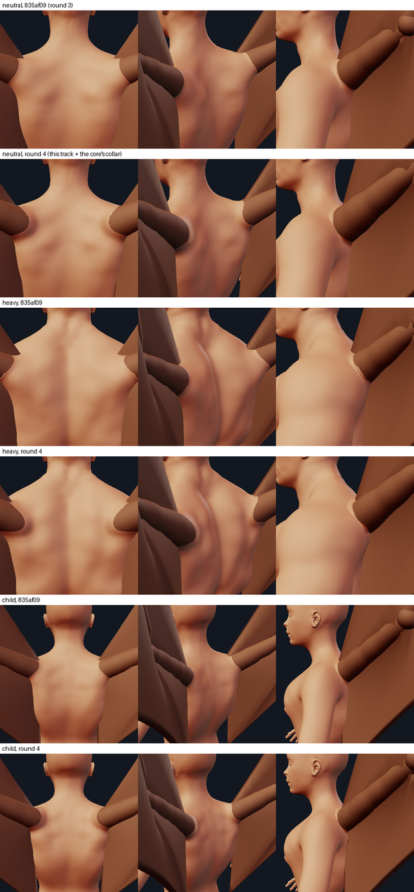

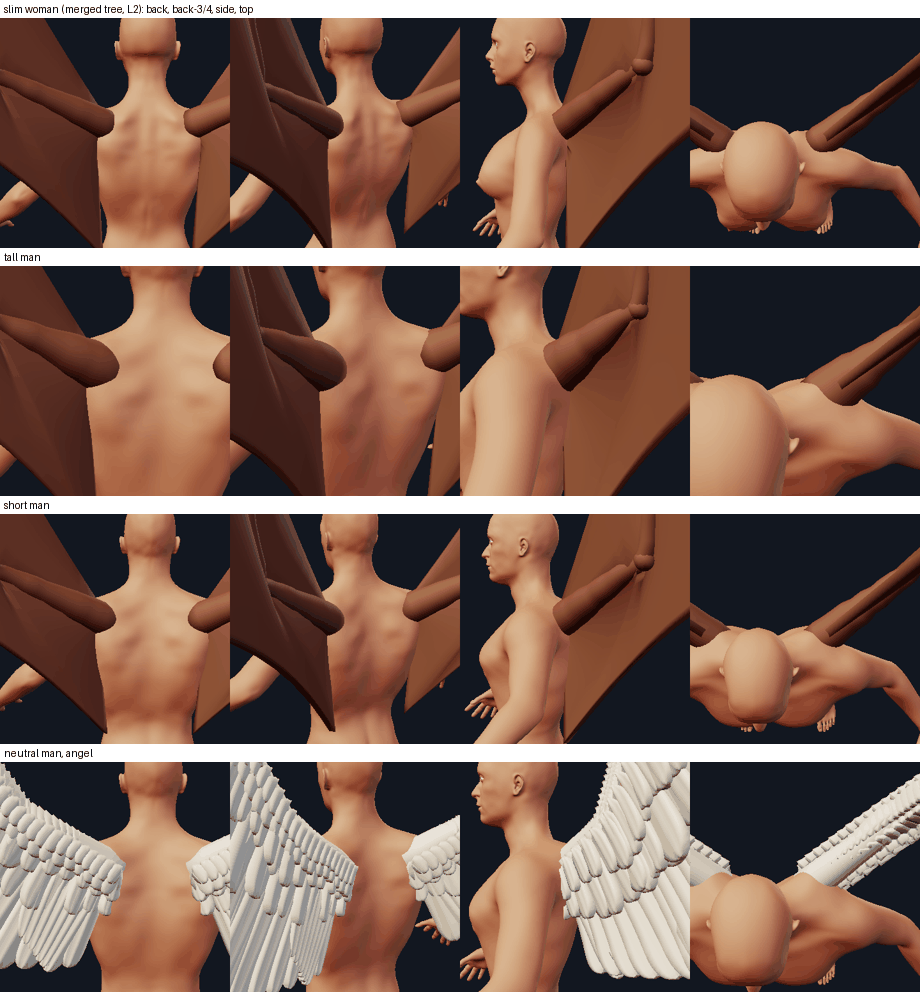

## Round 8: the wing grows out of the body

The owner's finding on a7f84cd: *"wings themselves don't seem to connect to the body"*. Measured on that tree, on four bodies
(neutral man, muscular heavy man, child, slim woman), against the skin the pipeline draws (moulded by the root, subdivided once):

| | a7f84cd | now |
|---|---|---|
| bat / dragon: the sheet's inner edge, lower corner | **0.40 - 0.57 off the skin** (daylight between sheet and flank) | under it |
| ... the whole edge, shoulder to waist | a straight line: 0.5 off the lumbar hollow, 0.3 under the shoulder blade | 0.17 - 0.42 under the skin on all eight of its points, evenly along it |
| ... the sheet where its middle meets the skin | a blade, 0.17 - 0.21 thick | 0.22 - 0.41 on the four middle columns of the edge (their median 0.29 - 0.35) |
| ... its colour there | the wing's, to a hard edge on the skin | the body's skin, turning into the wing's over about a unit |
| feathered: arm's top and leading side with no feather over it, first 1.2 past the skin | **27 - 62%** (a bare skin-coloured stub) | 0 - 3% |
| ... coverts round the shoulder | the nose row, 76 - 99% of each feather inside the muscle | 36 - 76 small ones per wing, each rooted in the arm and lying on it |

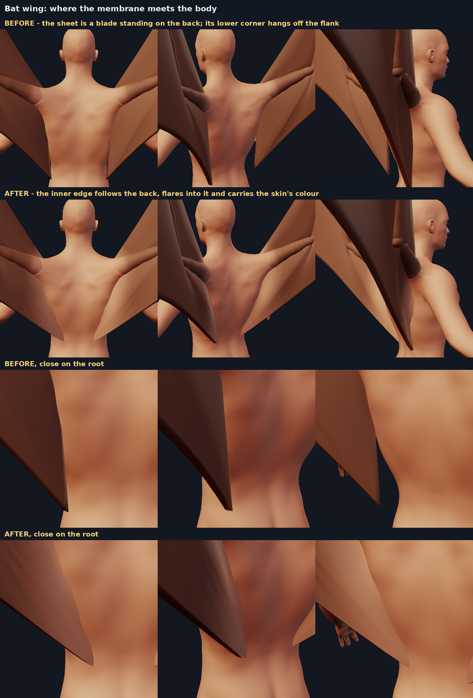

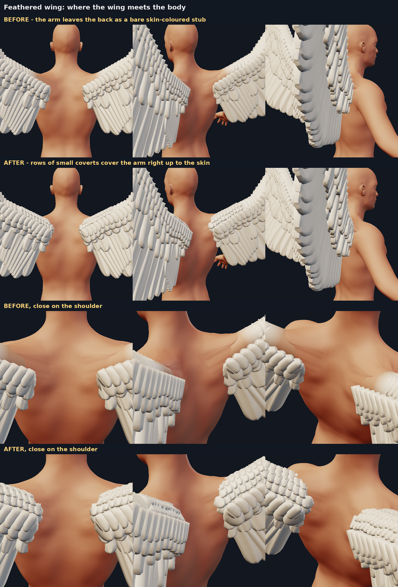

### The cause, and what a wing knows now

A wing is built flat in its own frame and then placed (`Appendage.place_rigs`), so its builder never knew where the back was: the
membrane's inner edge was the plan's straight line, the feathers at the shoulder were laid on a bare rod. The placement is computed
first now and the builder is handed the body's skin in the wing's own frame: **`appendages.SkinProbe`** (`distance(points, within=,
normals=)`: signed distance in wing units, positive outside; `normal(points)`; `size`: the body's height against the reference
man's, 0.6 - 1.3). It reads the body's **cage** (before the root's relief is moulded and before subdivision: both depend on the
placed wing), inside `SKIN_PROBE_RADIUS` = 6 wing units of the wing's origin. A wing built alone (`make_wing_rig(style)`, `skin=None`)
is bit-identical to what it was.

Two rules keep the rest of the pipeline where it was:

* **The right wing reads the left side's skin through the mirror** when the body is its own mirror image (within `SKIN_SYMMETRY_TOL`
  = 1e-4 of its height; the child's cage is 2.4e-5 off). A cage quad and its mirror image are split along different diagonals, so
  the two sides' triangles are not mirror images (1e-6 apart) and a root fitted to each was 0.005 - 0.05 off its mirror image: eleven
  existing tests of the pair's exact symmetry failed. An asymmetric body's right wing reads its own side.
* **The skeleton and the bones are the plan's.** The joints are lifted onto the sheet as the plan has it and the bones are laid on
  it; only the sheets (`membrane`, `propatagium`) and, on a feathered wing with a muscular sleeve, the coverts of the shoulder
  differ from a wing built alone. (Lifted onto the fitted sheet, the elbow of a rolled wing moved by 0.07: an old document's arm
  left the back 0.0095 of the shoulder's width from where c808d60 put it, and the tall man's trapezius yielded to the arm at rest.)

### The membrane (`wings.membrane_pieces`)

1. **The edge follows the back** (`_conform_root`). Each of the root line's eight points moves ACROSS the line, in the wing's plane,
   until it is `ROOT_BURY` (0.025 of the wing's scale, 0.11 units on the man) under the skin *as the sheet's foot has it*
   (`_foot_distance`: the greatest of its own distance and of the points `ROOT_FOOT` = 0.4 fillets to either side: a sheet meets the
   back at a slant, and the face that leans away is higher over it than the middle). The moves are evened along the edge but never
   short of the skin; the waist corner moves with its point and the last five trailing-edge points follow it. The rows crowd toward
   the edge on these columns (`ROOT_ROWS`).
   *Tried first: each point along its own column's ray from the arm. The rays next to the shoulder run along the back and meet it
   at a slant, up to 2.6 past the line on a ray 1.7 long: five of the eight points ended within half a unit of the waist corner.
   And a reach of 1.2 with plain evening left five points of eight up to 0.4 off the heavy man's skin.*
2. **Each face leaves the sheet in a fillet of its own** (`_root_fillet`, `_slab_from_grid(..., swell=)`). Within `ROOT_FILLET`
   (0.10 of the scale: 0.44 units) of the skin a face stands out along a quarter circle whose foot is `ROOT_BURY` under the skin, so
   it crosses the skin at about 40 degrees and ends in a lip under it. The lip `w` of the face that leans away from the back
   solves `w = g(d + c w)`: `d` the middle's height, `c` the cosine between the sheet's normal and the skin's, `g` the quarter
   circle -- first with the skin taken as a plane under the sheet's middle, then twice more with the plane moved to where the
   skin IS under the lip (one reading of the skin there each time). The face that leans in is sized by the middle's height.
   *Sized by the middle's height alone, the face that leans away stood 0.14 over the muscular man's skin and came out of his
   back in torn flaps.* Under the skin the slab narrows again (`ROOT_KEEL`). The fillet runs out toward the waist corner
   (`ROOT_FADE`), where a column is too short to carry it (next to the shoulder), and on a column that never leaves the skin; a
   child's is a child's (`SkinProbe.size`).
   *Tried and dropped (it was in 5b2ad16): drawing in, vertex by vertex, every lip that still stood out of the skin where the
   sheet's middle was under it. It took the fillet away row by row, at a different row on every column: notches along the root,
   and saw teeth on an old document's rolled wing (`tests/fixtures/wing_c808d60/wing_hint.mmchar`). Reading the skin under each
   lip leaves as few of them out (below) and the sheet only widens toward the skin.*
3. **The sheet is the body's skin where it grows out of it** (`Piece.skin_share`, per vertex; `WingRoot.tint` colours by it, as it
   does the arm). Colour only.
4. **The fillet goes as the arm swings** (`wingrig.SWELL_SWING` = 6 - 30 degrees of the upper arm off its rest; `pleat["swell"]`).
   It is built against the back as the wing rests; a folding wing dragged it across the back and its tucked lips came out along
   the flank as a jagged flap. A half-folded wing leaves the back in a plain skin-coloured web.

### The feathered wing (`wings._coverts`)

The marginal (nose) rows are not built where the muscular sleeve is fatter than `SHOULDER_SWELL` over the bone (a long vane seated
on a fat sleeve is a chord through it with only its shaft proud: the "ribs" of the first attempts). There, rings of **small
coverts** (`shoulder_scales`: `SHOULDER_SCALE` = 0.11 of the scale long, at most 0.8 of the arm's radius, `SHOULDER_PITCH` apart,
alternate rows staggered, over `SHOULDER_ARC` = 100 degrees to either side of the leading edge) lie tangent on the sleeve, above
and below, up to the skin; one rooted `ROOT_PROUD` or less outside the body is not built (its end came out of the back as a slat).
A bird's wing meets its body under a mound of coverts (wing/A11), a sculpted angel's in rows of ever smaller feathers (wing/H22).
Spread, half folded and folded the wing's 340 solids are one connected body.

### What changes for a saved document, and what it costs

No new parameter and no version stamp: every wing ON A BODY changes at its root when the document is next built (the sheet's inner
edge, its fillet and colour; the shoulder's coverts). The joints, the bones, the arm, the placement, the poses and their limits,
the junction, the weld and the collar are what they were. A bat pair builds in 0.35 s (0.10), a feathered pair in 0.38 s (0.28);
drafts carry the fitted sheet too (a feathered draft has no coverts, as before). The print report of a bat pair on the neutral
and the muscular man has no blocking finding and no warning, before or after, and the wing's share of area under 0.3 mm is
0.2 - 0.3% (0.5%). Probed alone, the sheet's own share goes from 0.8% to 1.9% (the rules are 20% and 30%): faces of the buried
lip, which read the distance to the edge under the skin. (The report's self-crossing check looks at collar shells only.)

### What it does not do

* **The fillet is small.** The sheet is under twice its own thickness where it meets the skin and its faces cross the skin at
  55 - 65 degrees (the blade's: 68 - 82). `ROOT_FILLET` = 0.14 was tried: the line where the sheet meets the back came out notched.
  In one colour the join reads as a sheet set into the back along a clean line, not as a web; a web proper would be the body's own
  skin raised onto the sheet (the weld of `weld.py`, which is built for round roots, not for a line).
* **The probe reads the cage**, not the moulded, rounded skin (up to 0.19 off it beside the arm, 0.05 elsewhere): one to six lip
  vertices per wing still stand up to 0.05 out of the skin (up to ten on the old documents' edited wings), and a small spur
  shows at the root of the rolled one.
* **A posed wing has no fillet** (see 4), and a folded bat's root shows as skin-coloured parts in the pack.
* The folded feathered wing still shows two stray slats and a bare patch at the shoulder (they were there; the stub is covered).
* The sheet crosses itself at its root: 78 - 260 pairs of faces per sheet (it had 220 - 266 at the elbow and the wrist, and
  has them still), where the lips of neighbouring columns meet under the skin. All of them are under the skin on the neutral
  man; one or two pairs have a face at or just out of it on the slim woman and the child (0.05) and six on the muscular man
  (up to 0.2). Nothing in the pipeline looks for them.
* No critic has looked at this round.

Tests: `tests/test_wing_connect.py` (50). Of the first 43, 32 fail on a7f84cd -- 24 of them on what they measure (the edge, the
fillet, the bare arm, the coverts), 8 because what they test did not exist -- and 11 are invariants; with both faces sized by
the middle's height (a mutant) seven of the eight lip tests fail; of the seven added after 5b2ad16 (the sheet only widens
toward the skin; three old documents' edited wings) six fail on 5b2ad16. In `tests/test_wing_root.py`
the sleeve test (the coverts on the sleeve change with it now) and the colour test (a sheet carries the skin's colour at its root).
`tests/test_print_report.py`: the 200-ray estimate is held to 0.006 on the sheet as the plan has it (as before) and to 0.02 on
the fitted sheet, whose 1.7% of thin-reading area (the buried lip's small faces) two hundred rays do not find at all.
`tests/test_creature_anatomy.py`: a wing assembled in the WRONG frame is 0.86 from the body for 2.43 (the control asks for 0.5
for 1.0). On this tree every test file runs green: 2616 passed and 29 skipped outside the two Tk files, 183 passed in them.

## 0. Round 6: the arm against the skin it leaves

### What the review found, and the cause

* **N3, every body, folded**: a flat brown fin (a triangle or a half disc) stood on the back beside each folded arm.
* **N2, the heavy man at the swing's floor and half folded**: flat decal islands where the buried arm broke through the
  junction-moulded back. (The critic asked for `swing=-45`; the placed wing clamps it to its range, -20 for the bat,
  -15 for the angel: these are the range's floor.)

Measured, not guessed (scratchpad `junction/S8_wing_tools/coplanar.py`, `isolate.py`): the arm piece's surface against the
level-1 skin the pipeline meshes, every triangle sampled 15 times, true distance to the skin's nearest point; **coplanar
contact** = the area within 0.03 of the skin whose outward normal is within 30 degrees of the skin's (two sheets lying on
each other: a clean crossing meets the skin at its exit angle and is not counted). e7e16b8: neutral folded 0.44 units^2,
heavy folded 0.26, heavy half_fold 0.22, heavy swing floor 0.31 (rest: 0). Then each part of the wing's junction alone,
the same rows:

| neutral folded / heavy half_fold / heavy swing floor | coplanar contact (units^2) |
|---|---|
| the whole junction (e7e16b8) | 0.44 / 0.22 / 0.31 |
| the tube alone (no masses) | 0 / 0 / 0.005 |
| the masses alone (no tube) | 0.18 / 0.09 / 0.08 |
| no shoulder boss | 0.10 / 0 / 0.015 |
| no fillet climb (the tube's `height` 0) | 0.25 / 0.09 / 0.08 |
| no junction | 0 / 0 / 0 |

So the masses, and above all the masses and the fillet's climb up the arm together, lifted the skin to a hair under the
arm's top where the arm lies along the back (the arm's top 0.27 out of the plain skin over a unit of its length, the
skin raised 0.2-0.25 under it); and the sleeve's buried end was a **flat disc on the joint** (the joint is 0.30 deep, the
sleeve 0.46 thick there), which, folded, stood out of the back: the half-disc of the fin, and the red half-discs of the
ecorche view.

### What changed

1. **The sleeve ends in a cone** (`wings.Sleeve.cap`, `kinds.WING_SLEEVE_CAP`): its pole is set back behind the joint by
   0.7 of the first ring's radius (1.0 for the slimmer feathered arm), not a flat fan on the joint. The rings still start
   on the joint, so the arm profile, the layers and the collar read the arm as before. (A first try rounded the end INTO
   the arm, a dome over its first ring: it removed the disc but took 30% of the buried arm and blocked the child's print,
   5.2 -> 3.5%; the cone adds buried volume instead.) The junction's tube follows: its first station (a ball of its
   radius, `junction.tube_distance`) may be no fatter than the ball that fits in the cone (`TUBE_END_FIT` = 0.5 of the
   first ring's radius, plus how far the station is past the joint), and a full-radius station at 0.1 of the humerus
   (`TUBE_NEAR`) carries the tube to the arm's radius before the exit: a full ball on the joint stood out of the cone and
   called the skin over a folded arm's end hidden though no arm covers it (`tests/test_junction.py::
   test_the_tube_the_junction_uses_lies_inside_the_appendage_it_stands_for`, folded and the child's angel).
2. **The fillet's climb ramps out with the exit angle** (`WingRoot.climb`, `CLIMB_MIN_EXIT, CLIMB_FULL_EXIT = 45, 55`):
   the junction tube's `height` is `WING_FILLET_HEIGHT` at an exit of 55 degrees or more, none at 45 or less (at rest
   60-65 degrees on five bodies: all of it; the heavy man's 46.3: a twentieth, the dragon's 44.7 on him: none). The climb
   is not inert: it buries the feathered arm for the print (15% of it in the body with it, 10% without, neutral man).
   **And the rest skin is NOT what it was**: with the cone end, the junction's tube keeps its station on the joint (on the
   flat-ended arm `conform_spec` cut that station: the tube began past the exit, which is why the climb moved nothing at
   rest on four bodies and round 5's M2 "survived"), so the fillet now acts at rest on every body: the cage moves up to
   0.06-0.22 units more than at e7e16b8 near the root (24-185 of 13,378 vertices by more than 0.01, every body and
   style; scratchpad `S8_wing_tools/restcages.py`), the skin tilting toward the arm (D below).
3. **The masses yield to an arm lying on the back** (`WingRoot.yield_to_arm`, every call of `WingRoot.masses`): the
   posed humerus is sampled (its rings, 24 points each, to 0.75 of the way to the elbow) against the plain body's cage;
   a sample outside the plain skin by `h` whose outward normal is within 20 degrees of the moulded skin's (all of
   `YIELD_CLEAR` = 0.08; none at 40 degrees, smoothstep between; the masses' slope tilts the predicted normal) asks the
   relief under it, predicted from the masses' own weights, to stay under `h - YIELD_CLEAR` or over `h + YIELD_COVER`
   (0.06: covered); the worst ask is met by scaling down the masses that raise the skin there, in turn (at most 24
   rounds). A sample the plain skin itself lies on (it clears it by less than asked) is no ask: the masses did not put
   the skin there. Centres and footprints stay: the same muscles, flatter under the arm. **At rest no mass yields on any of
   the six bodies** (a test; the rest skin changes for the reason in item 2, not the yield); folded the scapular plateau and the boss under the arm drop to 0-55% of their height.
   The muscle sheets of the ecorche carry the same lowered relief (they read `WingRoot.masses`).
4. **The arm's integument runs from the body's skin into the wing's** (`WingRoot.tint`, `TintedMesh`, item C below).
5. **The feathered tube starts inside the skin** (`WingRoot.tube_start`, item E below).

Tried and dropped: a deltoid mound over the joint covering the folded arm's end (`head_cover`): to stand 0.06 over an end
0.26 out of the back it needed a 0.35-0.42 mound falling off within a ring of the arm (0.26 units, one cage quad), and the
second yield pass then flattened it or the masses round it; the folded arm's cone end now leaves the back at 45-50
degrees, a clean crossing at the root, under the weld's region.

### Measured (left wing; level 1; e7e16b8 -> round 6)

| row | coplanar contact (units^2) | outside pieces |
|---|---|---|
| bat, folded: neutral / child / heavy / slim woman / tall / short | 0.44 / 0.34 / 0.26 / 0.38 / 0.65 / 0.30 -> 0 / 0 / 0 / 0 / 0 / 0.003 | neutral, heavy 2 (an island) -> 1 |
| bat, half folded, the same bodies | 0.040 / 0.040 / 0.22 / 0.017 / 0.098 / 0.034 -> 0.024 / 0.007 / 0.020 / 0.017 / 0.046 / 0.004 | heavy 2 -> 1 |
| bat, the swing's floor (-20), the same bodies | 0.016 / 0.030 / 0.31 / 0 / 0.070 / 0.009 -> 0.019 / 0 / 0.003 / 0.008 / 0.030 / 0.034 | 1 |
| bat, rest, the same bodies | 0 / 0 / 0 / 0 / 0.023 / 0 -> 0.022 / 0.022 / 0 / 0.006 / 0.035 / 0.022 | 1 |
| dragon, folded, six bodies | (not measured at e7e16b8) -> 0 everywhere | 1 |
| dragon, half folded: neutral / child / heavy / slim / tall / short | 0.054 / 0.033 / - / - / 0.157 / 0.046 -> 0.040 / 0.033 / 0.013 / 0.005 / 0.051 / 0.041 | 1 |
| dragon, rest, the same bodies | 0 / 0 / - / - / 0.065 / 0 -> 0.036 / 0.042 / 0 / 0.020 / 0.045 / 0.038 | 1 |
| angel, rest: neutral / child / tall (the others) | 0.082 / 0 / 0.123 -> 0.057 / 0.018 / 0.097 (heavy 0.001, slim 0.026, short 0.037) | 1 |
| angel, the swing's floor: neutral / tall | 0.054 / 0.084 -> 0.084 / 0.084 | 1 |
| angel, folded and half folded, six bodies | -> 0 everywhere (its arm lies off the back or does not cross it) | 1 |

What is left lies at the root, within 0.55 units of the joint, never along the arm, on the side of the arm facing out
of the back (5-17 degrees from it): the top of the sleeve's first rings and the shoulder of its cone lying within 0.03 of
the skin raised over the joint, nearly parallel to it, and the fillet meeting the arm's wall tangentially at the exit
(measured, `copwhere.py`: tall man at rest, samples on the cone 0.04 behind the joint, 0.02 proud; the neutral dragon,
12 of 27 on the cone, the rest on the first ring; the child's angel, its first 0.24 units). The yield leaves it (the plain
skin itself lies there: lowering the masses would not clear it). That is why rest rows that were 0 show 0.006-0.045 now: the cone's shoulder sits where the flat disc's edge
was and the fillet now acts at the exit. It is inside the weld's region (the skin there becomes the weld's plug). Corners of the control ranges (fold 0 /
0.5 / 1 x swing and raise_ at both ends): the heavy man, bat and dragon,
20 rows on the final code: at most 0.003, one outside piece everywhere; the tall man, bat and dragon, 20 rows: at the
double floor (swing -20 and raise_ -26 together) **0.104 / 0.117** (e7e16b8, bat: 0.30), at fold 0.5 0.03-0.05, the
rest at most 0.014. The tall man's double floor is NOT closed: his sleeve is 0.63 thick on a joint 0.38 deep and there the
plain skin itself lies along the top of its first three rings (the yield cannot clear what the masses did not raise; a
larger `YIELD_CLEAR`, 0.12, changes nothing there). The level-2 skin, the eight test rows: folded on the six bodies
0-0.003, the heavy man half folded 0.016, at the swing's floor 0.

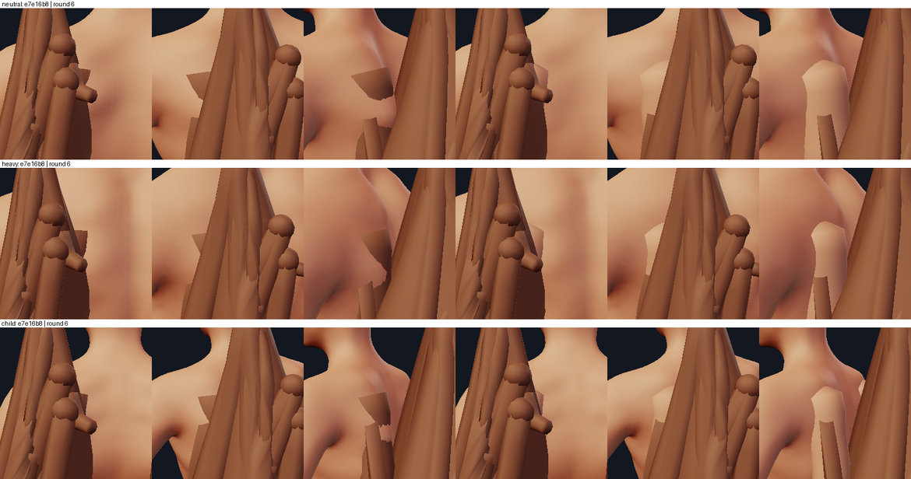

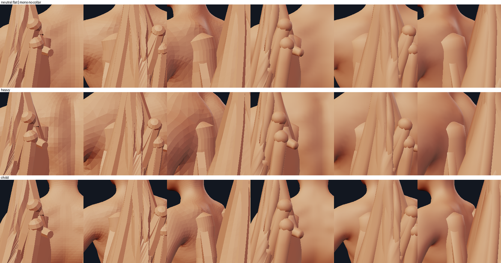

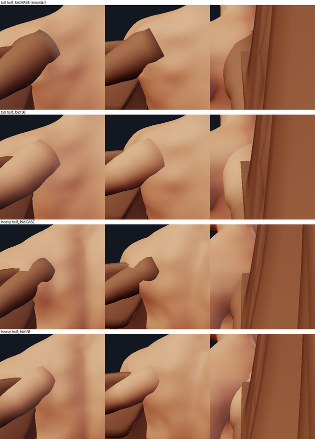

### C. The arm's integument (the colour step at the root)

The skin-coloured root ended on the brown arm in a serrated line (round 5, B1; with the weld the skin climbs the arm
about 0.9 root radii and ends in a clean ring, still a two-colour step). The placed wing's mesh (`PlacedWing.pose`,
`PlacedWing.mesh`) is now a `wingroot.TintedMesh`: a mesh that carries a per-vertex albedo through its transforms. The arm
piece's albedo is the body's skin (`material_named("skin")`, the skin every pipeline renders the figure with; a figure
has no skin-tone setting) up to `TINT_HOLD` = 1.0 root radius past where the posed arm crosses the plain skin, then turns
into the wing's own over `TINT_BLEND` = 1.5 more (smoothstep); folded, the crossing is further along the arm and so is the
skin colour. A bat's and a dragon's arm leaves a furred or scaled shoulder whose coat runs onto the arm (wing/A14, A16).
The renderer takes a mesh's own albedo where the shell sets none (`portrait._shell_colors`, `draft._face_colors`: one line
each). Only the albedo blends (the arm keeps the wing's roughness and scatter). The lab's draft view draws wings from a
cluster proxy and shows no blend; the final render, the CLI picture and the weld preview do. Geometry is untouched (a
print is the same).

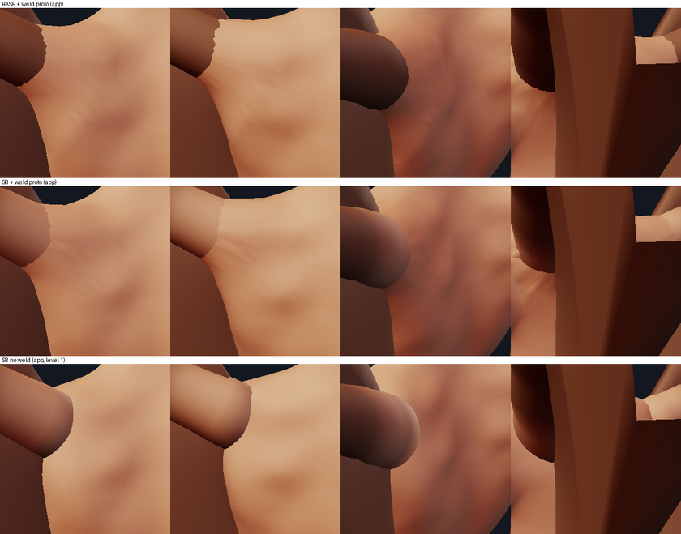

### E. The print weld on small bodies, the feathered tube, an old document

The share of the arm piece's volume in the body (lab export, medium; `print_report` blocks under 5%, warns under 8%):

| body | bat e7e16b8 -> r6 | dragon | angel |
|---|---|---|---|
| neutral | 14.7 -> 24.0 | 13.0 -> 21.7 | 15.1 -> 19.2 |
| child | 5.2 -> 11.8 | 5.1 -> 12.4 | 5.8 -> 10.9 |
| slim woman | 7.0 -> 12.7 | 5.2 -> 11.6 | 7.5 -> 13.0 |
| heavy | 28.5 -> 29.6 | 25.0 -> 24.6 | 20.5 -> 21.3 |
| tall | 23.3 -> 32.2 | 22.3 -> 30.6 | 24.5 -> 28.4 |
| short | 10.6 -> 20.0 | 9.6 -> 18.0 | 11.7 -> 16.9 |

(The round-5 critic quoted the angel only: slim woman 5.7%, child 7.4% by the CLI export; the lab export gives every
style 5-7.5% on the child and the slim woman at e7e16b8.) The cone end buries more of every arm; the feathered tube now
starts inside the skin (below), so its root has a tube to flow into again.

Posed (the arm piece's share in the level-1 body, `print_report.embedded_volume_share`, e7e16b8 -> round 6): the bat folded
31.7 -> 22.9% (child), 36.5 -> 24.9% (slim woman), half folded 11.5 -> 9.9%, 12.3 -> 15.4%: the masses that yield to a lying
arm cover less of it, above the 8% warning still. The angel folded or half folded keeps only 0.7-2.5% of its arm piece in
the body (e7e16b8: 1.1-1.6%): its folded arm lies off the back (it does not cross the skin); the print report judges the
group by its best-buried root piece, and the arm is not it there. Not changed by this round.

**The feathered tube** (`TUBE_START` 0.15 of the humerus) began 0.05 units OUTSIDE the plain skin on the neutral man and
0.18-0.21 outside on the child and the slim woman: their collars were dropped ("the appendage's axis never enters the
skin", round 5 B3), and with them the tube the weld finds the root by. `WingRoot.tube_start` moves the start back toward
the joint until it lies 0.05 under the skin (0.075 neutral, 0.025 child, 0.05 slim woman, at rest): their collars are
built again at rest (child at the swing's floor: the collar's own construction drops one side, the weld track's).

**`old_taillef.mmchar`** (round 2, an angel at placement scale 1.3, unstamped and untouched: read as version 3): it
renders with the cone end, the tube from 0.05 of its humerus (inside the skin: e7e16b8 dropped both collars, this tree
builds them), the arm's skin-coloured base, and 16.5% of its left arm in the body (e7e16b8: 9.0%).

### D. The join one sees, measured densely and against the plain skin

`visible_join` samples 72 directions now (24 missed the leaning side's minimum by up to 9 degrees). The round-4 table
compared trees, not the junction against no junction; the shaped skin at 1.8 root radii equals the plain skin of the same
placement within a degree or two, so "the mean rose 39.9 -> 43.2" was the placement's, not the moulding's. Round 6, at
rest, the moulded skin against the PLAIN skin on the same ring (min / mean, degrees):

| body | 1.3 root radii: moulded / plain (e7e16b8 moulded) | 1.8 root radii: moulded / plain (e7e16b8) |
|---|---|---|
| neutral | 21.3 / 44.6 against 32.5 / 50.7 (28.8 / 50.6) | 17.3 / 40.8 against 24.4 / 43.9 (20.2 / 43.4) |
| child | 19.4 / 44.2 against 33.0 / 50.6 (30.0 / 51.0) | 16.2 / 40.0 against 16.2 / 43.7 (16.2 / 43.3) |
| heavy | 30.0 / 47.5 against 29.6 / 49.1 (27.0 / 45.1) | 21.2 / 46.7 against 18.5 / 48.6 (19.8 / 46.3) |
| tall | 23.5 / 45.7 against 30.6 / 49.3 (22.8 / 46.3) | 18.7 / 41.9 against 18.7 / 43.5 (18.7 / 42.9) |
| short | 18.9 / 43.9 against 32.0 / 51.2 (28.3 / 51.1) | 15.6 / 39.7 against 17.1 / 43.6 (17.1 / 43.0) |
| slim woman | 24.7 / 45.2 against 29.4 / 50.0 (29.5 / 52.0) | 11.5 / 40.4 against 16.8 / 44.1 (16.2 / 44.3) |

Honest reading: at e7e16b8 the moulded skin's mean at 1.3 root radii equalled the plain skin's on four of six bodies (the
fillet did not act: the tube's station on the joint was cut, item 2) and was 3-4 degrees under it on the heavy and the
tall man; now it is 1.6-7.3 degrees under the plain skin's on all six (the junction tube's fillet tilting the skin toward
the arm: a fillet's direction, not a flange's; the heavy man's 1.6 is the thin margin, his climb is a twentieth),
and it folds over the arm nowhere (minimum 19-30 at 1.3, 11.5-21 at 1.8); at 1.8 the moulding changes little. The skin that flows INTO the arm (tangent to its wall) is the weld's, on the subdivided skin; the cage
cannot shape it (a quad is 0.28 units, the root 0.46). `test_the_visible_join_measured_densely_against_the_plain_skin`
replaces the round-4 test's floor on the mean (which rewarded a flange).

### Cost

Neutral man, best of 5 on a box shared with three other builders (round 6 / e7e16b8): the wing's spec 9-11 ms / 2.5-7
(the yield's arm samples against the plain cage; the pose is memoised per controls: a feathered pose is ~10 ms), the pair's
`apply_junctions` 140-175 ms / 115-175 (bat), 240-425 / 230-505 (angel; noisy), `Placed.mesh` +1 ms (the tint).

## 1. Where the joint is (the placement's third version)

| | version 1 (`back_wings()`, pinned records) | version 2 (S6b) | version 3 (every new record) |
|---|---|---|---|
| socket | the anchor quad 0.9 units in | the back's skin point at **x 0.48 shx, y spine-1 + 0.50 Lt**, sunk 0.50 s | the same socket |
| joint | the socket | the socket, **on the ribs under the blade**: 0.59 deep on the neutral man | the socket **slid out along the arm's own axis by 0.30 s** (0.20 s for the feathered wing), the frame's orientation kept: **on the blade**, 0.30 deep (0.39 feathered) |
| where the arm leaves the back | x 0.83-1.12 shx, through the human deltoid | x 0.71-0.80 shx, y 0.64-0.67 Lt | the same point and angle (the line is the same) |
| buried humerus | ~1 unit | 0.70 (neutral) / 0.85 (heavy) | 0.35 / 0.49 (feathered 0.47 / 0.55) |

`s = shx / 1.72` (the body size: 1.17 on the neutral man, 0.83 on the child, 1.47 tall), `shx` the x of `joint-l-shoulder`,
`Lt = neck.y - spine-1.y`.

**Why slide, and why along the arm.** The round-3 review measured the version-2 joint at 0.29 of the back-to-front depth,
at the rib surface under the medial blade: the humerus then had to run up through the human scapula and supraspinatus to reach
the skin. A bird's and a bat's shoulder joint lie just under the skin at the top of the thorax, the proximal humerus wrapped in
muscle (wing/A07 pigeon skeleton, A17 and A18 flying fox: "the shoulder joints sit just outside the top of the ribcage"). A
shallower sink at the same socket (the cheap fix) moved the exit medially and laid the arm flatter on the back (plain exit
62 -> 50 degrees on the neutral man, 39 -> 36 on the heavy one, under the collar's threshold; scratchpad
`junction/S7_wing_out/probe_depth1.jsonl`). Sliding the joint out along the arm's own rest axis with the frame kept
(`Appendage.slide`, `appendages.wing_arm_axis`) leaves the line, the exit point and the angle exactly where version 2 had them
(neutral 0.743/0.644 -> 0.739/0.643, plain angle 62.3 -> 63.1) and halves the buried humerus. The wing as a whole sits 0.35
units further out along its arm. The feathered arm is slimmer and longer: slid 0.30 s, 3.8% of it lay in a body printed without
the junction (the print report blocks under 5%); slid 0.20 s, 6.2% (12.2% with the junction).

| body (membrane) | joint x/shx, y/Lt | joint depth (units, s) | blade depth | head radius | buried | exit x/shx, y/Lt | plain angle |
|---|---|---|---|---|---|---|---|
| neutral | 0.61, 0.57 | 0.30, 0.25 | 0.40 | 0.18 | 0.35 | 0.74, 0.64 | 63.1 |
| child | 0.61, 0.59 | 0.20, 0.24 | 0.28 | 0.12 | 0.23 | 0.74, 0.66 | 60.4 |
| heavy | 0.61, 0.57 | 0.33, 0.28 | 0.40 | 0.18 | 0.49 | 0.79, 0.67 | 46.3 |
| tall | 0.61, 0.57 | 0.38, 0.26 | 0.50 | 0.25 | 0.44 | 0.74, 0.64 | 62.4 |
| short | 0.61, 0.57 | 0.27, 0.25 | 0.36 | 0.16 | 0.31 | 0.74, 0.64 | 64.1 |
| slim woman | 0.61, 0.59 | 0.20, 0.20 | 0.33 | 0.15 | 0.21 | 0.71, 0.65 | 65.2 |

The anchor (`Placed.anchor`) stays the skin point over the socket: the collar's patch and the lab's framing are centred on it.

## 2. The layers

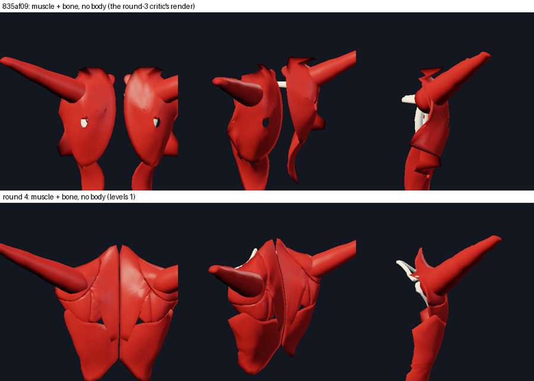

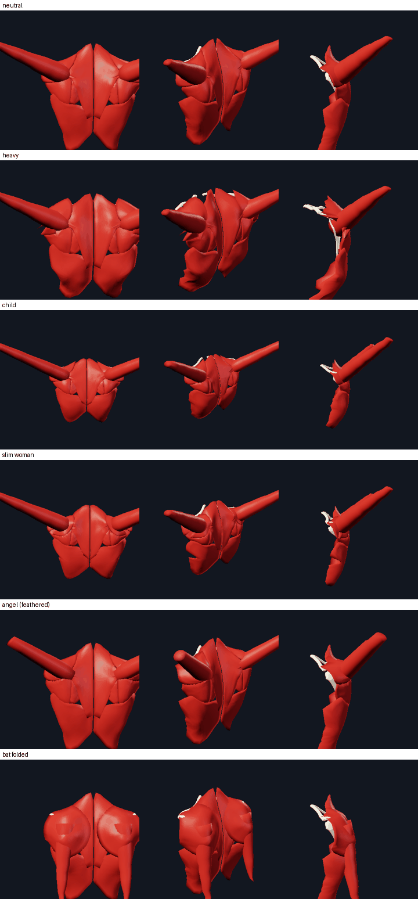

### Muscle: anatomical sheets under the moulded skin

Round 3 drew each mass as a pad: a lens over a footprint projected along ONE normal, its top the plain skin plus the relief. Where
a ray missed the skin (the scapular footprint ran over the top of the shoulder) the point kept its place in the air: the 0.48 poke
at the neck; its pole fans were wound against its rings: the holes. Round 4 draws the muscles a dissection shows
(`wingroot.SHEETS`, `CAP_SHEET`), each an OUTLINE on the back in the body's own units read off **wing/H06** (Sobotta, superficial
back) and **H05** (Gray 409), with its shoulder joints, C7 and the inferior scapular angles as landmarks (the grid overlay:
scratchpad `junction/S7_wing_out/h06_grid.png`):

| sheet (layer, outermost first) | outline (x / shx, y / Lt) | thickness at the belly | reference |
|---|---|---|---|
| `deltoid` (0): the wing's deltoid, the cap the arm leaves through | the boss' footprint round the root | 0.10 s + its relief | H24's shoulder mound, H22 |
| `trapezius` (1): the kite | from the nape (1.18) down the spine to T12 (-0.56), out to the acromion (0.97, 0.82), its free border along the scapular spine and down to T12 | 0.05 s + relief | H06, H05 |
| `latissimus` (2): the sheet over the inferior angle to the axilla | upper border at y 0, lateral border along the flank | 0.05 s + relief | H06 |
| `scapular` (3): infraspinatus / teres, below the spine (the root leaves through it) | spine root (0.43, 0.53) to (0.87, 0.75), the lateral border, the inferior angle (0.50, -0.03) | 0.12 s + relief | H06's infraspinous window, H03 |
| `supraspinatus` (3): the fossa above the spine | (0.41, 0.87) .. (0.97, 0.82) down to the spine | 0.10 s + relief | H04, H07 |
| `rhomboid` (4): spines of C7-T5 to the medial border, under the trapezius | (0.01, 0.96) .. (0.45, 0.56) .. (0.51, 0.05) | 0.08 s + relief | H07, H06 (its window) |

The surface they lie under (`WingRoot.moulded`, `MouldedSkin`): the body moulded by this wing's own junction (or by every
appendage's, `layers_on`, the hook the tail track's `ecorche.layer_shells` calls), subdivided once. `MouldedSkin.from_behind`
casts rays from behind (+Z) onto it: a seed on the backmost back-facing vertex of a grid cell, then the tangent plane solved for
the ray, three times. A sheet's spoke ends where the back ends (a ray finding no back-facing skin), bisected to the outline of the
body (a ring-wise cut drew a sawtooth on the flank). The top of every sheet is the skin's thickness (`SKIN_T`, 0.06, wing/H08)
under the skin, rounding 0.025 lower at its edge so the bellies read; where an outer sheet covers it, under that sheet's
thickness too (the deeper muscle passes UNDER the trapezius, as in H06); its bottom is its own lens of thickness plus the relief
of the mass of its name (the `scapular` mass thickens the `scapular` sheet: the skin's relief IS muscle). Every lens is closed and
wound one way (`_lens`: the round-3 fans were wound against the rings).

**Measured** (`tests/test_wing_root.py::test_the_muscle_lies_a_skin_thickness_under_the_shaped_skin`, six bodies, the pipeline's
shaped skin subdivided once and twice; every vertex of every sheet as the ecorche lays it and as `Placed.layers()` lays it):

```
body      level  nearest muscle vertex to the skin   skin over the relief -> first muscle straight in: hit / p50 / p90 / max
neutral   1 / 2  -0.058 / -0.053                     100% / 0.070 / 0.084 / 0.127   100% / 0.067 / 0.083 / 0.128
child     1 / 2  -0.057 / -0.054                     100% / 0.067 / 0.079 / 0.089   100% / 0.064 / 0.077 / 0.088
heavy     1 / 2  -0.051 / -0.043                     100% / 0.069 / 0.084 / 0.098   100% / 0.065 / 0.081 / 0.122
tall      1 / 2  -0.056 / -0.048                     100% / 0.073 / 0.088 / 0.143   100% / 0.069 / 0.087 / 0.139
short     1 / 2  -0.056 / -0.051                     100% / 0.068 / 0.083 / 0.100   100% / 0.066 / 0.081 / 0.097
slim woman 1 / 2 -0.056 / -0.052                      99% / 0.068 / 0.084 / 0.155    98% / 0.065 / 0.081 / 0.156
```

Nothing of the muscle comes within 0.04 of the skin (round 3: 0.48 OUTSIDE it); and from the skin the masses raise, a ray straight
in meets muscle one skin thickness down (the skin is the envelope of the muscle, not of fat or air): median 0.064-0.073.

### Bone: the blade, its spine, the clavicle, the humerus

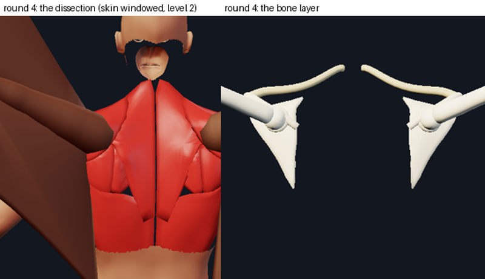

* `scapula`: the blade of THIS body (`SCAPULA_BLADE`, from **wing/H03** Gray 204 and **H01** Albinus: the medial border 0.37 /
  0.53 of the biacromial width apart at the spine's root / the inferior angle, height 0.44 of it), laid `SCAPULA_DEPTH` = 0.34 s
  under the PLAIN skin (the relief over it is muscle), 0.05 s thick; its **spine** (`SCAPULA_SPINE`) rising from the medial border
  across the blade (22.7-24.9 degrees, H03) to the **acromion** at the top of the shoulder, 0.08 s under the skin; and the
  **glenoid**: a rim on the blade round the rest joint, under the head (the joint does not move when the arm turns about it).
* `clavicle`: the strut of the girdle, from the acromion OVER the top of the rib cage to the manubrium beside the midline, 0.08 s
  under the skin all the way (a bird's coracoid and furcula brace its shoulder against the sternum, **wing/A02, A07**; round 3's
  strut ran from the joint THROUGH the chest).
* `humerus`: the arm's own rings at 0.30 of the sleeve's radius (pose with the skin), from inside its head, which sits on the
  joint (round 3 put the head 1.2 radii out along the arm, under the skin of nothing).

Measured on six bodies (`test_the_joint_sits_on_the_blade_and_the_humerus_leaves_it_through_muscle_only`): the blade's top lies
between 1.6 head radii under the joint's centre and half a head radius over it (the head sits in its glenoid ON the blade); the
humerus from the head's surface to where it crosses the skin meets no bone; every bone vertex is inside the skin (at least 0.02),
the clavicle within 0.35 s of it. With the version-2 joint (no slide) the joint is 0.2 under the blade and the test fails
(the mutation run below).

## 3. The relief (the masses) and the mound behind and above the root

`PERMANENT_MASSES` (left side; heights in s) and the boss (`CAP`):

| mass | where | footprint (long x wide) | height | round 3 |
|---|---|---|---|---|
| `scapular` (infraspinatus / teres) | 0.66 shx, +0.28 Lt, along the lateral border | 0.46 Lt x 0.34 shx | 0.14 | 0.56, +0.22, 0.80 Lt x 0.46 shx (lumbar region to the neck), 0.105 |
| `rhomboid` | 0.30 shx, +0.40 Lt | 0.24 Lt x 0.17 shx | 0.06 | same |
| `latissimus` | 0.66 shx, -0.55 Lt | 0.80 Lt x 0.32 shx | 0.10 | same |
| `trapezius` (slope) | 0.34 shx, +0.74 Lt | 0.30 Lt x 0.15 shx | 0.07 | same |
| `supraspinatus` (NEW: the wing's elevators above the scapular spine) | 0.66 shx, +0.80 Lt, along the spine | 0.30 Lt x 0.18 shx | 0.15 | - |
| `deltoid` (the boss) | from the skin over the joint to the crossing and 1.0 r beyond, its crest moved 0.8 r half up the back and half the way the arm leaves | 2.2 r wide | up to 0.30 (by how shallow the arm leaves; half of it for an arm lying along the back), less what the others raise at its crest | up to 0.24, crest on the run |

TAKEAWAYS wing checklist 2 / **wing/H24** (Winged Victory, side): "a rounded shoulder mound rises behind and above the root". Round
2b had lowered every mass to remove the bullseye; the critic: "a plain human trapezius with a tube set into it; find the middle".
Tried on renders (scratchpad `junction/S7_wing_out/mound_sheet*.png`, `m2_sheet.png`, `m3_sheet.png`): a supraspinatus mass
behind and above the root, a taller boss, its crest lifted up the back and toward the side the arm leans over. The side views show
the arm growing out of the flank of a shoulder mound; no ring, no ridge on six bodies (`cmp` sheets). Relief: 0.46 L the pair on
the neutral man (0.84 heavy), against 0.97 at 835af09, of which 0.29 L was the ridge the junction raised over the buried humerus
running 0.7 units under the skin (gone with the joint on the blade) and the rest the plateau over the whole back.

## 4. The junction, the collar profile

`WingRoot.spec`: the masses as `Mound`s (displaced backwards), the arm as the tube the skin flows into (the arm's own axis carried
by the pose; from 0.15 of the humerus for the feathered arm, `TUBE_START`: its rounded buried end is narrower than its tube and the
skin over the heavy man's shoulder was called hidden), Keep spheres round the human upper arm, `owner="trunk"`, `join_guard=False`.

**The collar** (`collar.py`, the core's; `WingKind.collar_profile`): width 1.1 root radii on the open side (the side the arm comes
FROM: toward the spine and down), 0.35 on the side it leans over, 0.55 up the arm, sunk 0.2, `collar` scales it.

* **It ramps in** (`WingRoot.collar_strength`): nothing at a plain exit of 40 degrees or less (`COLLAR_MIN_EXIT`), all of it from
  45 (`COLLAR_FULL_EXIT`), a smoothstep between; under a fifth of a collar (the ramp times the `collar` slider,
  `WING_COLLAR_MIN_STRENGTH`) is none: a weaker one kept only a fragment of its ring on the round-4 core (heavy man, arm lowered:
  strength 0.07 kept 10% of the ring with a 93-degree crease, 0.11 35% / 47 degrees, 0.17 63% / 25, 0.30 89% / 14;
  `S7_wing_tools/partial_collar.py`), so the collar appears at 41.4 degrees a fifth of its height high (0.04 units on the heavy
  man) instead of as a frayed fragment. Round 3 cut at a hard 43 degrees, with the heavy
  dragon collared at 44.7 and the heavy feathered folded wing not at 40.4: a pose or a slider moving the exit by a degree switched
  the collar on or off. With version 3 the rest exits are 44.7-67.5 (heavy dragon 44.7: strength 0.99) and the folded ones 12-35.
* **It climbs the arm**: measured now (`test_the_collar_climbs_the_arm`): the collar's top 0.38-0.44 root radii up the arm past the
  crossing with the round-3 construction, 0.33-0.34 with the core's round-4 one (a collar 0.05 high: 0.03-0.12; the round-3
  mutation M11 survived).
* **The feathered collar's crossings and the tall body's acute-side tear** (round-3 B2, B3) are the construction's: with the
  core's round-4 `collar.py` and this track's anatomy merged (scratchpad `junction/S7_wing_merge`), every collared row of
  neutral, heavy, child, tall and slim woman x bat, dragon, angel x rest, swing -45, raise -20, fold 0.5 is watertight with
  **0 self-crossings** (45 rows, `S7_wing_out/creport_merge.jsonl`), so the profile keeps its numbers. With the round-3
  construction alone they stay as the review measured them.

## 5. Numbers: the join one sees

**Round 6: the table below is round 4's, sampled at 24 directions, comparing trees; it does not survive 72 samples and
does not separate the junction from the placement (the round-5 review). Section 0 (D) has the dense numbers against the
plain skin; the claims under the table that rest on the mean are withdrawn.**

`wingroot.visible_join`: the angle between the arm's axis and the skin's tangent plane on a ring k root radii round where the axis
crosses the plain skin (`min`: the side the arm leans over, negative where the skin folds over the arm; 90: the skin square to the
arm). The angle where the axis itself meets the skin (the 62 -> 74 round 2b quoted) is inside the arm. Membrane wing at rest,
level 0 cage (`S7_wing_tools/visible_join.py` on the three trees, n = 24):

```
            c808d60 (shown to the user)      835af09 (round 3)               round 4
            1.3 r min/mean  1.8 r min/mean   1.3 r          1.8 r            1.3 r          1.8 r
neutral     -14.4 / 49.3    -16.7 / 49.5     23.3 / 46.6    11.5 / 39.9      28.8 / 50.6    21.1 / 43.2
child       -21.2 / 53.6     16.8 / 46.7     34.0 / 52.6    11.1 / 42.8      30.4 / 51.0    24.5 / 44.2
heavy       -25.8 / 42.2    -33.8 / 42.4     33.3 / 47.5    19.9 / 44.7      27.4 / 45.1    29.0 / 46.4
tall         14.3 / 50.5     14.2 / 48.1     27.9 / 48.9    17.2 / 43.1      22.8 / 46.3    21.5 / 43.3
short         5.9 / 52.1     -0.2 / 52.1     26.5 / 47.4    10.7 / 40.4      28.3 / 51.2    20.8 / 42.7
slim woman  -39.3 / 42.3     -1.6 / 40.5     30.4 / 51.3    10.1 / 43.6      29.9 / 52.0    17.3 / 44.3
```

At 1.8 root radii the leaning side improves on every body (to 17-29 from 10-20) and the mean rises on every body against round 3
(39.9 -> 43.2 on the neutral man). Against c808d60 the mean is lower on the neutral man, the child and the short body: there the
arm pierced the back at 45 degrees with the skin folding over it on one side (negative minimum) and square to it on the other. A
fillet that flows into the arm lowers the angle near it on every side; the mean is not a score to maximise, the minimum and the
spread are. The hidden axis angle went DOWN (73.6 -> 64.1 on the neutral man) because the boss now lifts the skin under the
leaning side instead of tilting the skin at the axis.

Poses (membrane, neutral): folded exit 21 (no collar), fold 0.5 45.7 (full collar), swing -45 49.9, raise -20 57.1.

**Stowed wings** (`test_a_stowed_wing_of_the_second_placement_rests_on_the_back`, now with the heavy body, on the body as the
document draws it): the share of the stowed angel wing inside the torso: neutral 6.1%, child 4.1%, woman 6.1%, heavy **3.8%**
(round 3: 14.1%, feathers out of the shoulder tops); the bat and the dragon stay within the first placement's 15%. A version-3 feathered wing's stow root stands off
the back by how much thicker the back is behind the shoulder joints than the neutral man's (`kinds.stow_root`, `WING_STOW_BULK`).

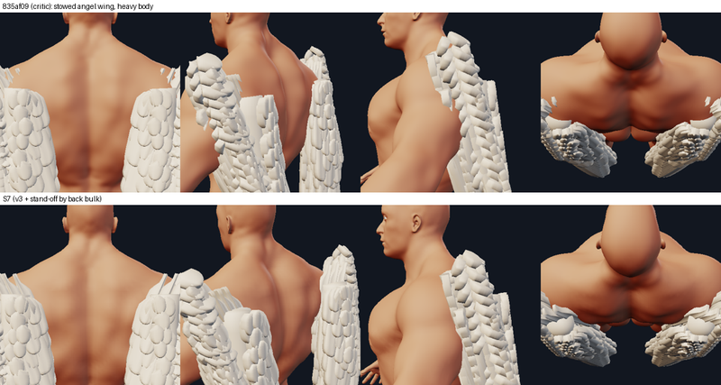

**Timings** (neutral man, best of 5, a machine shared with other builders, re-measured after the last edit; round 4 /
835af09, `S7_wing_tools/timing.py`): the wing pair's build 50 / 49 ms (bat), 341 / 327 (angel); the specs 5 / 5 and 8 / 8 ms;
`apply_junctions` 61 / 55 ms (bat), 79 / 72 (angel); `Placed.layers()` per wing 269 / 750 ms (bat), 286 / 754 (angel) warm (the
moulded skin is cached per pose; cold it adds the wing's own junction, 60-150 ms, a level-1 subdivision, 80 ms, and the skin
patch, 45 ms). `wing_arm_axis` builds a light rig once per wing shape (cached; a cold first build of a new shape pays it).

**Print** (the lab's export, medium, the share of the arm piece inside the body, junction off / on; `S7_wing_tools/weld.py`,
re-measured after the last edit): bat 8.7% / 11.0%, dragon 8.4% / 10.4%, angel 6.2% / 12.2% (835af09: 20.7 / 27.9,
18.7 / 25.8, 11.6 / 19.4); the same on the core + tail + wing merged tree. The arm is less buried because the joint slid out
along it. No blocking finding; the angel without the junction is under the report's 8% "shallow weld" warning.

## 6. Documents

* **New records** carry `placement.version = 3`.
* **A version-2 record** (written by 835af09, S6b) is read as version 2: its joint on the ribs, NOT slid; the joint, the exit
  point and the arm are where 835af09 put them. Its moulded skin is NOT as it was: the masses, the boss, the collar ramp and
  the tube start below are not versioned, so they reach version-1 and version-2 records too (neutral man, measured on the cage
  against 835af09: the skin moves at most 0.25 units further, 134 of 13,378 vertices by more than 0.02, bat; 0.26 / 140 angel;
  a version-1 record 0.16-0.18 / 113-116; `S7_wing_tools/v2_diff.py`).
* **Records written before the versions** have no stamp. One that holds the first preset's numbers untouched is read as the latest
  version: it moves (to version 3). One in which a person changed the sink, the hint, the roll or the quad keeps exactly the
  placement they chose (version 1) **and the muscular sleeve** every tree that could write it drew (round 1 .. c808d60): **B4**.
  Only an explicit `placement.version = 1` stamp gives the first versions' bone-thin rod. The fixtures in
  `tests/fixtures/wing_c808d60/` were WRITTEN by c808d60 (`S7_wing_tools/gen_c808d60_fixtures.py` on an export of it) with
  `manifest.json` holding what c808d60 drew: the edited records keep their exit point exactly, the neutral man's arm radius at
  0.3 of the humerus is 0.411 against c808d60's 0.428 (the sleeve tapers now), the dragon's 0.444 / 0.459, the angel's 0.380 /
  0.374, the child's **0.297 against 0.428** (the sleeve is body-scaled since S6b: c808d60 gave a child the man's arm).

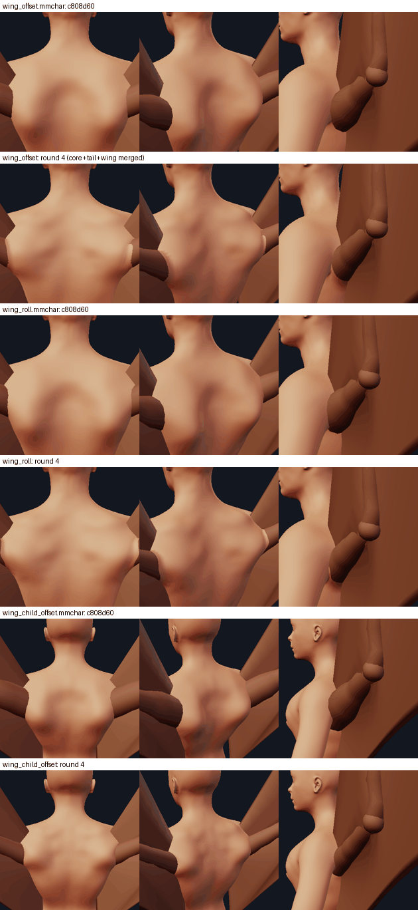

* **What renders differently** (disclosure): EVERY record with a wing: the new masses (the supraspinatus mound, the taller boss
  lifted toward the leaning side, the smaller infraspinatus plateau), the collar ramp (40-45 degrees), the angel's tube start and
  the slider clamps below; the muscle and bone layers are new. On top of that, an untouched record, a new record and a version-3
  record: the joint 0.30 s further out
  along the arm (the whole wing 0.35 units out on the neutral man; the visible upper arm that much longer), the new masses (the
  supraspinatus mound, the taller boss lifted toward the leaning side, the smaller infraspinatus plateau), the collar ramping in
  between 40 and 45 degrees (43 was a hard cut), the stowed angel wing standing off a bulkier back, the junction tube of the
  angel wing from 0.15 of its humerus; the muscle and bone layers are new. An edited unstamped record gets the sleeve back
  (835af09 drew the rod). **The sliders**: `muscle` 0.5-1.4 (was 0-2), `collar` 0-1.3 (was 0-2): a record storing more is clamped
  with a note (muscle 2.0 drew an arm a third of the shoulder's half-width wide, muscle 0 a rod in a frayed collar, collar 2.0 a
  doubled stripe; `S7_wing_out/ext_sheet_S7.png`). A pinned version-1 record without `muscle` keeps its rod.
  **The collar's floor**: a collar weaker than a fifth (the `collar` slider times the ramp) is not drawn, so a record storing
  `collar` 0.05-0.19 now has NO collar in any pose (835af09 drew a thin one), and with the slider under 1 the collar appears at
  a steeper exit than 41.4 degrees (slider 0.5: the ramp must reach 0.4, about 42.2 degrees).
* `.mmchar` v1 and v2 files load without error and nothing in them is rewritten; they render with the differences above.

## 7. References used

Round 6: **wing/A07** (pigeon skeleton, folded: the humerus folds back along the flank from a joint at the top of the
thorax, inside the body's contour: the folded arm lies ON the back, it is not lifted off it, so the relief yields to it
rather than the arm being raised); **wing/A10** (hawk, folded: the wing lies on the body contour, no gap and no fin);
**wing/A14, A16** (fruit bat; flying fox skin-skeleton preparation: the furred coat of the shoulder runs onto the arm and
the membrane's root, the colour changes along the arm, not at a line round it: the integument blend); **wing/H03, H04**
(Gray 204; the scapula's attachments: the coracoid hooking forward from the superior border at the glenoid's neck, the
bowed medial border, the round inferior angle); **wing/H24** (the shoulder mound the cover was meant to make, not
reached). Side-by-side sheets: scratchpad `junction/S8_wing_out/ref_*.png`.


(library ids: `refs/wing/<id>`; `TAKEAWAYS.md` section 5; side-by-side sheets, third-party images kept out of the repository:
scratchpad `junction/S7_wing_out/ref_muscle_H06_H05_vs_S7.png`, `ref_bone_H03_vs_S7.png`)

* **wing/H06** (Sobotta, superficial back) and **H05** (Gray 409): the outlines of the trapezius kite (nape to T12, the acromion,
  the free border along the scapular spine), the latissimus' upper border over the inferior angle, the infraspinatus window
  between trapezius, deltoid and latissimus, the rhomboid's window; the order of the layers. Measured on a landmark grid.
* **wing/H07** (Sobotta, deep): the rhomboids under the trapezius, the supraspinatus in its fossa. **H04**: the attachments.
* **wing/H03** (Gray 204) and **H01** (Albinus): the blade's outline, the medial border's gap (0.37 / 0.53), the spine's rise
  (23-25 degrees), its height (0.44): `SCAPULA_BLADE`, `SCAPULA_SPINE`. **H08** (back section): the skin and fat over the muscle
  (`SKIN_T`), the muscle over the blade (`SCAPULA_DEPTH`).
* **wing/A07, A02** (pigeon skeleton, Fuerbringer's girdle plate) and **A17, A18** (flying fox): the shoulder joint at the top of
  the thorax just under the skin, a short buried humerus (version 3), the strut to the sternum (the clavicle).
* **wing/H24** (Winged Victory, side), **H22, H23** (Canova): the rounded shoulder mound behind and above the root (the
  supraspinatus mass, the boss' lift); the back swelling into the root without a seam.
* **wing/H15, H16** (muscular and lean backs): the relief's scale (no rings; the blade's mound and its lower edge read).

## 8. What it does not do (honestly)

Round 6 (this track; the older items below stand where not superseded):

* **The folded arm's end is not covered by a shoulder mound.** Its cone end leaves the back at 45-50 degrees, a clean
  crossing at the root, but a sculptor would put the humeral head under a deltoid and have the arm come out of the
  mound's flank. The cover was tried and dropped (section 0); with the weld the skin at least climbs it.
* **Residual contact at the joint**: 0.01-0.05 units^2 of the arm within 0.03 of the skin and nearly parallel to it on
  some rows (the tall man half folded 0.048, the neutral man at fold 0.5 / swing 16 / raise 26 0.033), all within 0.35
  units of the joint, on the first ring's top and the cone's shoulder: inside the weld's region. The yield cannot help
  there (the plain skin itself lies on the arm). **The tall man at the double floor** (swing -20 and raise_ -26) keeps
  0.10-0.12 within 0.55 units of the joint (e7e16b8: 0.30): not closed; a per-body clamp of the raise floor was not made.
* **The yield is a prediction**: the masses' relief on the plain cage, not the subdivided, validity-limited skin; the
  tube's own displacement is not in it (with it, the raw undiffused fillet over-predicted and flattened the child's rest
  mound: dropped). The tests measure the real level-1 skin.
* **The integument blend is albedo only** and the lab's draft view (a cluster proxy) does not show it.
* **The print weld** of the angel on the child is 10.9% (it was 5.8%); the round-5 critic's CLI figures were not re-run
  through the CLI (the lab export and `print_report.embedded_volume_share` were).
* **The bone layer** has a coracoid hook and rounded borders now, still no fossae and no posed scapula (the blade does not
  rotate with the arm).

* **The folded bat and dragon** pivot about the joint 0.35 units further out: their stowed membrane's root panel (the rig's,
  between the arm and the waist) shows larger flat flaps at the inner edge than at 835af09 (scratchpad
  `S7_wing_out/folded_slide.png`). The folded pose has no collar (exit 12-35 degrees); its boss eases to 0.6 of its height
  (`BOSS_FLAT`: a whole boss beside an arm lying along the back is a lobe); the skin beside the folded arm moves up to 0.38.
  In the ecorche the folded deltoid (the cap sheet laid round an arm lying along the back) reads as a round disc.
  Folded, every sheet and bone still lies inside the skin (bat and angel, neutral and heavy: the largest signed distance
  -0.051; `S7_wing_tools/folded_layers.py`, not a test); the white at the top of the shoulder is the acromion and the
  clavicle where no sheet covers them.
* **The folded angel wing's arm does not cross the plain skin** on four of six bodies (neutral, child, slim woman, short:
  `exit_angle` is `None`, so no collar and no open side); it did not at 835af09 either (`S7_wing_out/probe_v3.jsonl`).
* **The visible join's mean** at 1.8 root radii is below c808d60's on three bodies (section 5); the hidden axis angle fell.
* **The relief** is 0.23 L a side on the neutral man (the research's estimate for flight muscle: 0.7-1.2): the visible mound is
  modest by design (no rings).
* **The bone layer is schematic**: a blade without fossae or a coracoid process, a spine bar, a ring for the glenoid, a clavicle
  tube; only the humerus is posed (the blade does not rotate with the arm). The blade is the same for the human arm and the wing;
  the human arm's own glenoid and humerus are not drawn.
* **The muscle sheets end where rays from behind stop meeting the back**: over the top of the shoulder (the trapezius' upper part)
  and round the flank (the latissimus) the ecorche shows their cut edge; a small flap of the trapezius stands at the nape in a
  side view.
* **The angel wing printed without the junction** has 6.2% of its arm in the body (a "shallow weld" warning; 5% blocks); with
  the junction 12.2% (835af09: 19.4%).
* **Collar artifacts with the round-3 construction** (B1-B3: the sawtooth ring, the tone rim, the feathered crossings, the tall
  body's acute-side tear) are the core's; merged with the core's round-4 collar the wing rows have none (section 4).
* **Level 0** (the CLI's and the lab's default in 835af09) has no collar: the core track's level policy decides that.

## 9. Tests and mutations

Round 6 (`tests/test_wing_root.py`, BODIES now six: the slim woman and the short man added): every new test fails on e7e16b8 with
the defect's own numbers (the arm-lying test: 0.22-0.65 units^2 of coplanar contact on all 8 rows; the print test:
4.8-7.2%; the feathered tube: 0.05-0.21 outside the skin; the dense visible join: the moulded mean equal to the plain on
four bodies; the cone, the tint, the climb ramp and the coracoid do not exist there), and a mutation run on a copy
(scratchpad `S8_wing_tools/mut.sh`, `muts.sh`, each mutant alone) catches every mutant:

| mutant | caught by |
|---|---|
| no yield (the masses as the anatomy has them in every pose) | `test_an_arm_lying_along_the_back_leaves_it_cleanly_and_does_not_lie_on_its_skin[neutral-folded]` |
| the climb never ramps out | the same (the heavy man at the swing's floor) |
| the flat end disc (`WING_SLEEVE_CAP` 0) | `test_the_sleeve_ends_in_a_cone...` (its pole at least half a radius behind the joint; on the final code the print test alone no longer catches it: the tube's near station lets the fillet bury 8% or more without the cone) |
| the yield's clearance 0; the yield blind to the masses' slope | the arm-lying test |
| the yield also asks samples the plain skin lies on | `test_the_relief_does_not_yield_to_skin_the_masses_did_not_put_there` |
| no tint hook; the tint held all the way; the renderer ignoring a mesh's albedo; the albedo shown in another material | `test_the_arm_runs_from_the_skin_colour_into_the_wing_s` |
| the feathered tube from 0.15 again | `test_the_feathered_tube_starts_inside_the_skin` |
| `visible_join` back to 24 samples | `test_the_visible_join_measured_densely_against_the_plain_skin` |
| `WING_FILLET_HEIGHT` 0 (round 5's surviving M2) | `test_the_skin_climbs_the_arm_at_rest_and_not_where_the_arm_lies_along_the_back` |
| the coracoid not reaching forward | `test_the_blade_has_a_coracoid_hook_and_rounded_borders` |
| the tube's first station a full ball on the joint (no `TUBE_END_FIT`) | `tests/test_junction.py::test_the_tube_the_junction_uses_lies_inside_the_appendage_it_stands_for` (folded bat, the child's angel; it failed so before the fix) |

Changed existing tests (each with the reason in the test): `test_the_arm_leaves_a_steeper_skin_than_it_did` is replaced by
the dense test (its floor on the mean rewarded a flange and its numbers held only at 24 samples); in
`test_a_folded_wing_adds_no_lobes...` the permanent masses are the same muscles at every pose, no higher than at rest
(they were asserted identical: the yield lowers them under a lying arm); `test_the_shoulder_boss_follows_the_arm...` reads
the anatomy's masses (`yielding=False`) for the boss's own law; `test_the_report_tool_measures_what_the_tests_pin` asserts
the dense relation instead of the floor on the mean; `tests/test_junction.py::
test_the_skin_meets_the_root_at_a_smaller_angle_and_without_new_creases[wing]` likewise (it asserted the visible join's
min >= 20 and mean >= 45 at 24 samples; now: no fold, min >= 12, and the moulded mean at least a degree under the plain
skin's; the neutral man there: 15.9 / 44.0 against the plain 29.0 / 50.9).

Round 4:

`tests/test_wing_root.py` (83 tests). Each round-4 behaviour has a test that fails without it; a mutation run on a copy
(scratchpad `S7_wing_tools/mutrun.py`, each mutant alone) catches all 16:

| mutant | caught by |
|---|---|
| an edited unstamped record gets the rod again (B4) | `test_an_edited_record_written_by_c808d60_keeps_the_muscular_arm_it_had`, `test_an_unstamped_record...` |
| the muscles laid under the PLAIN skin (round 3's construction in spirit) | `test_the_muscle_lies_a_skin_thickness_under_the_shaped_skin[neutral]` |
| the skin's thickness doubled; the edge dip tripled; no cover (deeper sheets not under outer ones) | the same / `test_a_muscle_sheet_is_a_closed_lens_a_skin_thickness_under_the_skin` |
| the lens fans wound back (round 3's holes) | `test_a_muscle_sheet_is_a_closed_lens...` (every directed edge once) |
| the ray from behind not solved onto the tangent plane | `test_a_ray_from_behind_meets_the_back_and_nothing_past_it` |
| no slide (the version-2 joint under the blade) | `test_the_joint_sits_on_the_blade_and_the_humerus_leaves_it_through_muscle_only` |
| the strut through the chest (round 3's furcula) | the same (bones inside the skin, the clavicle just under it) |
| the collar cut at a hard 43 degrees | `test_the_collar_ramps_in_as_the_arm_rises_off_the_back` |
| a collar drawn at 0.05-0.2 strength (a fragment of a ring) | `test_a_collar_ramped_in_less_than_a_fifth_is_left_out_not_drawn_as_a_fragment` |
| the collar 0.05 high (round 3's surviving M11) | `test_the_collar_climbs_the_arm` |
| no stand-off for a bulky back | `test_a_stowed_wing_of_the_second_placement_rests_on_the_back[macro3]` (the heavy man) |
| the muscle slider back to 0-2 | `test_the_muscle_and_collar_sliders_stop_before_the_drumstick_and_the_double_ring` |
| the boss' lift removed | `test_the_arm_leaves_a_steeper_skin_than_it_did` (the visible join) |
| no supraspinatus mound | `test_the_masses_sit_on_the_back...` (a value pin) |

Round 3's surviving M3 (`PAD_STACK`) and M12 (each pad on its own mound) targeted `pad_mesh`, which is gone: the stacking is the
cover term and the moulded skin, both caught above. Two guards the first sheets had (a seed filter by the body frame's trunk, a
height limit at the occiput) survived their mutants on six bodies: they were removed. The full suite (2373 passed, 30 skipped)
and the Tk tests (183 passed) run green on this tree; `tests/test_wing_root.py` and the tail track's ecorche tests run green on
this tree with the core's and the tail track's round-4 patches applied.

## 10. Looking at it

```
python tools/wing_root_view.py OUT.png "wing:style=membrane" 180,8 --layers bone,muscle,skin --window 2.4 --levels 2   # a dissection
python tools/wing_root_view.py OUT.png "wing" 180,10 140,20 90,5 --layers muscle,bone --no-body --levels 1           # the layers alone
python tools/wing_root_report.py --bodies neutral,child,heavy --styles membrane,dragon --poses "rest;preset=folded"  # incl. the seen join
minimaster character --add wing --subdivide 2 -o x.png          # the collar needs --subdivide 1 or 2
```

## 11. Where the joints go when the wing folds

The humeral head of the feathered wing leaves its socket as the wing closes. The stock wing and the relief
study use the same rig and shoulder anatomy. The relief covers the arm, so the gap is easiest to see with
the skin hidden. The membrane and dragon rigs also move the head, but it still touches the socket rim in
all nine poses sampled from spread to folded on the reference figure.

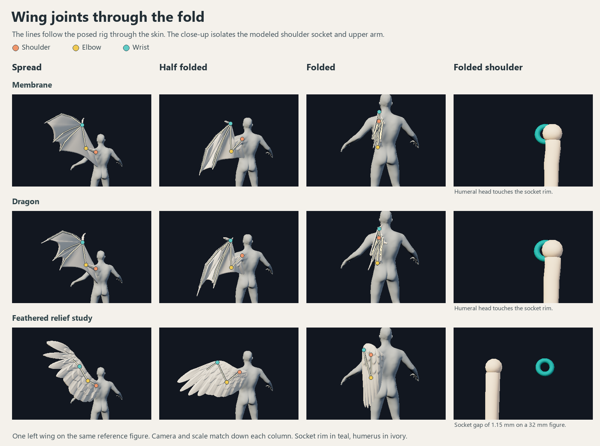

| Wing | Folded elbow angle | Folded wrist angle | Head travel from rest | Gap between head and socket rim |
| --- | ---: | ---: | ---: | ---: |
| Membrane | 20° | 17° | 0.32 mm | 0 mm |
| Dragon | 20° | 19° | 0.32 mm | 0 mm |
| Feathered | 14° | 7° | 1.73 mm | 1.15 mm |

Each measurement uses one left wing on the same body (`gender=1, muscle=0.55`) at the 32 mm figure scale
of 32 / 17.5 mm per model unit. The angles are the interior angles of the posed shoulder–elbow–wrist chain
and the elbow–wrist–third metacarpal chain. A straight joint is 180°. Head travel is the distance between
the rest and posed shoulder centres. The gap is the minimum distance between the modeled humeral head
from `WingRoot.sleeve_meshes` and the rim from `WingRoot.glenoid`. At half fold the feathered gap is
already 0.36 mm. The membrane and dragon head and rim meshes intersect at both half and full fold.

The socket rim is built on the shoulder blade at the rest joint. In `WingSkeleton.controls_to_pose`,
the feathered wing turns about its root to lie against the back. The shoulder is a child of that root,
so the rotation carries the head away from the fixed rim. Removing only the root rotation from a copy
of the folded pose returned the head to its rest centre and preserved the elbow and wrist angles on
the reference, child and heavy bodies. A change to the pivot would also need to preserve the wing's
clearance against the back.

### The joints on the original feathered wing

The views below use the stock builder from `ba659ad`, with one left wing on the reference figure and
the same 32 mm scale as above. The intact wing has its original coverts and flight feathers. The other
columns isolate the posed meshes so the feathers cannot hide what happens at a joint.

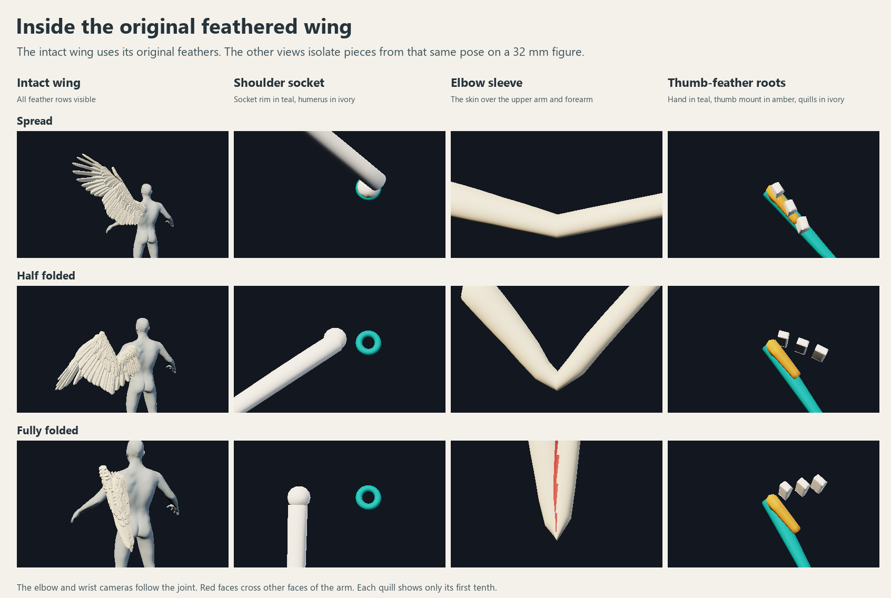

| At 32 mm figure scale | Spread | Half folded | Fully folded |
| --- | ---: | ---: | ---: |
| Gap from humeral head to socket rim | 0 mm | 0.36 mm | 1.15 mm |
| Narrow diameter of the sleeve at the elbow | 0.97 mm | 0.79 mm | 0.33 mm |
| Pairs of crossing triangles within the arm sleeve | 0 | 0 | 75 |
| Thumb-feather roots separated from their mount | 0 of 3 | 2 of 3 | 3 of 3 |
| Largest gap from a thumb-feather root to its mount | 0 mm | 0.61 mm | 0.98 mm |

The elbow is the middle ring of a single tube from the shoulder to the wrist. The ring flattens as
the two arm segments fold together. Its narrow diameter is the vertex span along its shorter in-plane
principal axis. Of nine equally spaced fold settings, the first to show any sleeve crossings was
0.875, with 21 pairs. The folded wrist still has direct overlap between the forearm and hand.

The three thumb feathers form the alula. Their supporting rod follows the wrist transform, while the
feather roots also inherit the thumb rotation. With the wing folded, the first tenth of each feather
lies 0.98, 0.53 and 0.09 mm from the rod, respectively. Each complete feather still overlaps other
plumage. In a diagnostic copy, binding the rod to the moving thumb (`thumb_tip` in this child-keyed
rig) kept it in contact with the hand and all three quills at all nine fold settings.

### Folding the relief wing about the shoulder

The lower row turns the upper arm about the glenoid on the blade. The existing rig puts part of
the rotation on the root, which carries the shoulder sideways. In the experiment the shoulder takes
the combined rotation of the root and upper arm. The head stays at its rest centre while the elbow,
wrist and hand keep their orientations. Both rows use the relief wing on the same reference figure.

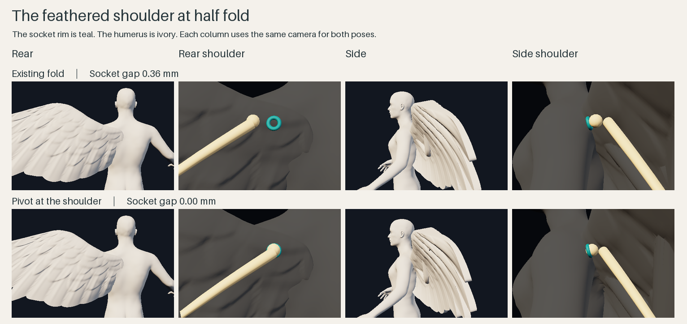

| On a 32 mm figure | Existing half fold | Seated half fold | Existing full fold | Seated full fold |
| --- | ---: | ---: | ---: | ---: |
| Gap from humeral head to socket rim | 0.36 mm | 0 mm | 1.15 mm | 0 mm |
| Clearance from the wrist knob to the body | 6.50 mm | 5.77 mm | 1.22 mm | 0.37 mm |

At all nine sampled folds the head touched the socket, the wing formed a closed solid, and its
intersection with the body was one connected region at the attachment. At half fold the elbow was
84° and the wrist 85.9° in both rows. The small line between the modeled humeral head and shaft in
the side view is a separate 0.02 mm gap in both versions.

The skin transition still needs a closer look at five-eighths fold. The weld guard could fit 61% of
its ring there and kept the moulded shoulder surface. The wing still overlapped the body at its root.
Bone and muscle vertices were enclosed by the wing or body at spread, half fold and full fold.
These measurements cover one reference figure. The pivot lives in the comparison tool.

```
python tools/wing_shoulder_study.py out/shoulder.png --sweep
```
