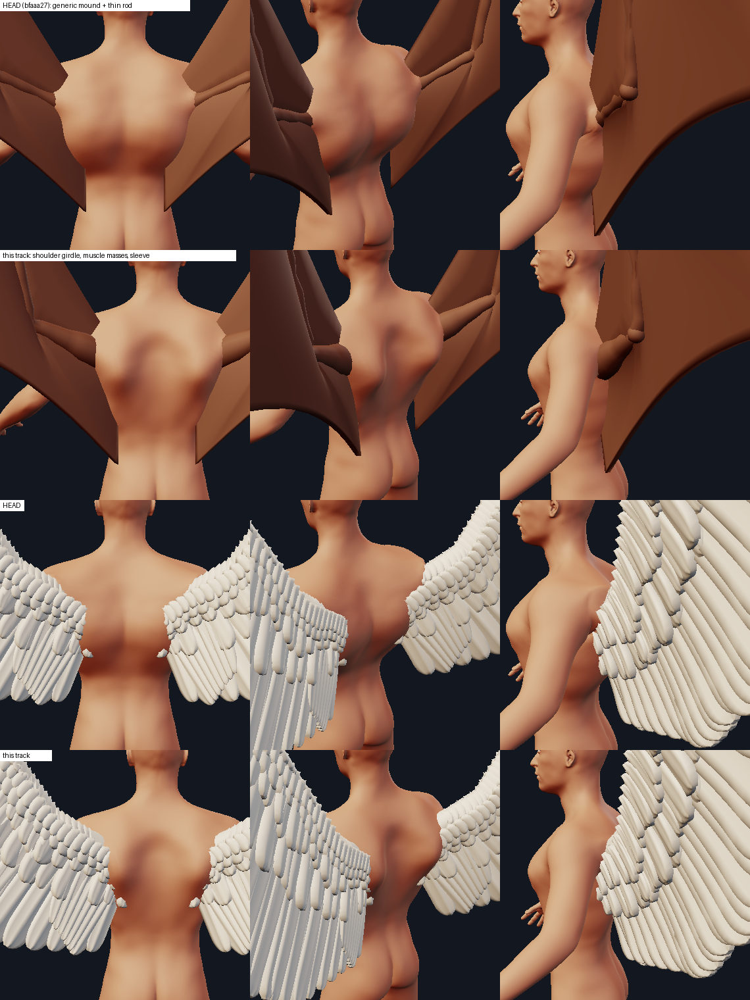
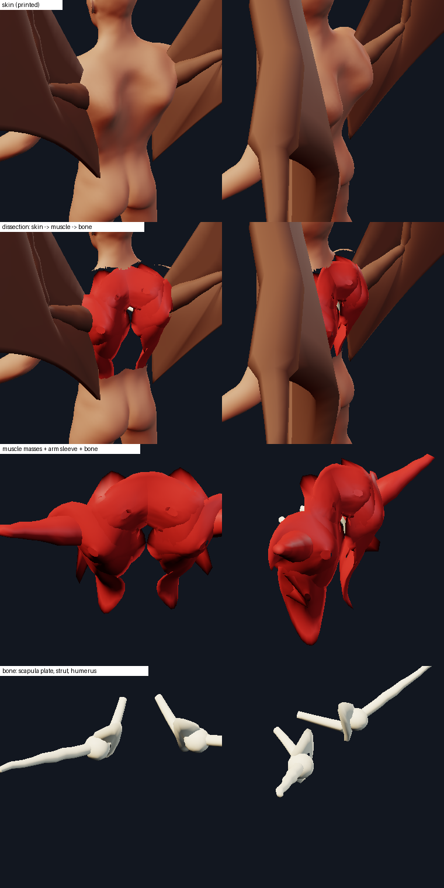
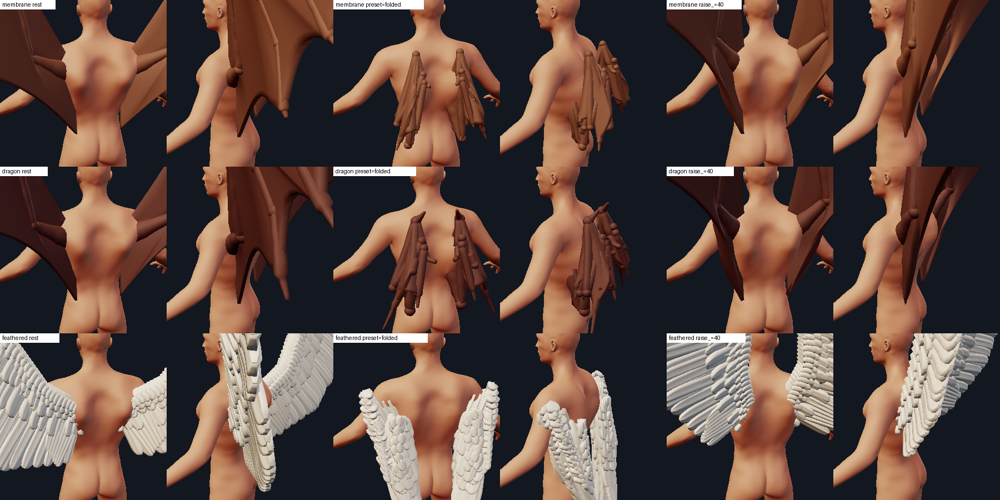
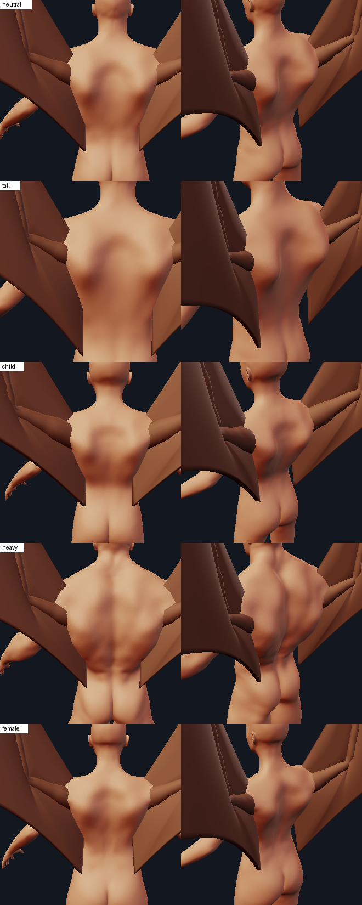

# The wing's root: a shoulder girdle, a muscular upper arm and the skin over both

Track S3 of the anatomical junctions ([junctions.md](junctions.md) has the skin mechanism it builds on,
[appendages_system_design.md](appendages_system_design.md) the appendage system). The complaint was that the
appendages "seem placed onto the model", "slapped over skin". For the wing that was literally true: a 0.2-unit
bone-thin rod left the corner of the back through a flat patch of skin, the back wore a rib-cage inflation (a sack
with a hard lower rim) instead of a shoulder girdle, and the generic scapular mound of the first junction core was
the same size on a child as on a giant (it puffed the child's back, and the folded wing grew two pillow lobes).



What a wing root is, in every winged body the references show: a **skeletal joint on a girdle** (scapula plate
braced on the ribs, a strut to the sternum), a **mass of muscle gathered over the girdle** that wraps the
proximal arm two to three times thicker than the bone, and **one skin sheet** that rolls over both and flows
tangentially into the arm. The code now has all three, each one derived from the same parameters, and exposes them as
layers:

```python
placed.layers()   # {"bone": Mesh, "muscle": Mesh, "skin": Mesh}   (MakeHuman frame, under the spec's own pose)
placed.layers({"preset": "folded"})
placed.model      # wingroot.WingRoot: .masses(controls) .muscles(skin) .bones(skin) .spec(controls) .joints(controls)
```



Files: `minimaster/character/wingroot.py` (the anatomy), `wings.py` (`Sleeve`: the arm's base), `kinds.py` (`WingKind`
builds the model, hands it to the junction and to `layers()`), `creature_anatomy.py` (the body adaptation),
`tools/wing_root_view.py` (the ecorche view), `tools/wing_root_report.py` (the numbers below),
`tests/test_wing_root.py`.

## 1. What each layer is

All lengths are in MakeHuman units (1 unit = 10 cm of the character; 1.91 mm on a 32 mm print). `s = shx / 1.72`
(`shx` the x of `joint-l-shoulder` on THIS body, 1.72 on the default-macro body; neutral man 1.09 here, child 0.83,
tall 1.39) and `Lt = neck.y - spine-1.y` size everything: a mass is a number of `s` and `Lt` on any body.

**Landmarks** (`wingroot.landmarks`, `BodySurface`): the shoulder, neck, spine-1 and elbow markers of the live body
and a ray-cast of its cage. Nothing is stored; the model is rebuilt with every body.

**Bone** (hidden; `WingRoot.bones`):

| bone | what | sized by |
|---|---|---|
| `scapula` | a thin flat plate on the back under the muscle pads, outline scaled from 1.7 x 0.9 s (about 1.2 x 0.5 s once its corners are rounded), centred on the scapular plateau | wing/H03, H01 |
| `furcula` | a strut from the humeral head forward and toward the midline, ending under the sternum | wing/A02, A07, A06 |
| `humerus` | the arm's own rings scaled to 0.30 of the skin radius, with a ball for the humeral head (0.75 of the muscle's radius) | wing/A09 (bird and man) |

**Muscle** (what shapes the surface; `WingRoot.muscles`): five named masses.

| mass | where (left side; the right is its x-mirror) | footprint (long x wide) | height over the plain skin | follows the pose |
|---|---|---|---|---|
| `scapular` (infraspinatus / rhomboid plateau) | x = 0.52 shx, y = spine-1 + 0.12 Lt, long axis 9 degrees off vertical | 0.85 Lt x 0.40 shx | 0.16 s | no |
| `latissimus` (latissimus / teres fan to the flank) | x = 0.66 shx, y = spine-1 - 0.55 Lt | 0.80 Lt x 0.32 shx | 0.13 s | no |
| `trapezius` (the slope from the neck) | x = 0.26 shx, y = spine-1 + 0.60 Lt, along the 30-degree slope | 0.62 shx x 0.34 shx | 0.11 s | no |
| `deltoid` (the shoulder boss over the humeral head and the buried humerus) | a ridge from the skin over the joint to where the arm crosses the skin | half the run + 0.6 s x 0.85 s | 0.34 s x how badly the arm needs it | **yes** |
| `sleeve` (the arm's belly) | the humerus' rings | the skin minus 0.06 | - | yes (it IS the arm) |

A `Mass` is ONE set of numbers (centre on the skin, axis, footprint, height, depth). `Mass.mound()` is the skin relief
the junction raises; `wingroot.pad_mesh` is the muscle mesh: a lens whose top is that same relief minus the skin's
thickness (0.06) and whose bottom reaches `pad` under the skin. So the skin is the envelope of the muscle plus its
thickness by construction, and `tests/test_wing_root.py` checks the nesting on real bodies (the pads of every mass,
the sleeve and the bone are inside the shaped body and the arm's shell; the same test with the relief switched off
fails: the pads poke out). The relief is displaced **backwards** (`RELIEF_DIRECTION = -Z`), not along the skin's normal:
at the flank the normal swings to the side and a normal bump shuts the slot between arm and trunk (the posterior
axillary fold: new self-intersections in 2 of 3 bodies) or swells the flank into a breast.

**Skin** (the printed shell): the body's cage with the masses' relief and the fillet around the arm, and the wing's
own shell, whose upper arm is now the muscular sleeve (`placed.layers()["skin"]` is `placed.mesh()`).

**The sleeve** (`wings.Sleeve`, built into the rig's `arm` piece): the humerus' radius is the elbow's plus
`gain x L_h x (f(t) - f(1))` with `f` through 0.150 / 0.140 / 0.140 / 0.095 / 0.070 at `t` = 0 / 0.20 / 0.45 / 0.75 / 1
(a smoothstep between the knots: no crease; the plateau puts the swell at the skin on every body whatever the
crossing, which is 0.29 - 0.55 of the humerus). The numbers: 0.14 of the humerus' length where the arm crosses the
skin, measured 0.135 (bat) / 0.149 (dragon) / 0.137 (feathered), a deltoid-level 0.38-0.46 units (a human upper arm is 0.45-0.52),
2.3 / 1.9 / 1.45 times the elbow's radius; the elbow, the forearm and the hand are what they were. It is
**opt-in at the builder** (`membrane_pieces(..., sleeve=)`, default `None` = the old rod, so `back_wings()`, the print
tests and the rig tests are untouched) and the registry wing always passes it (`kinds.WING_SLEEVES`).

## 2. The junction (`WingRoot.spec`)

`WingKind.junction` returns the spec of the model: the arm sleeve (five stations from the joint to the elbow, the
rings' real radii, posed) as the tube the skin flows into, the masses as `Mound`s, `Keep` spheres around the human
upper arm and `owner="trunk"` when the core has the field (S1b). `fillet` (the property-grid parameter) is now 2.0
elbow radii, 0.3 high (it was 3.0, 0.4 on a rod): the bulk is the relief; a wider fillet round a 0.45-unit sleeve
stretched the skin 3x and pushed it through itself in the armpit (measured in the sweep, section 5).

* **Body-relative**: every length is a number of `s`, `Lt` and `shx`; the permanent masses are re-derived on every body.
  Child, tall, short, heavy and female: `tests/test_wing_root.py` checks the landmarks, the masses' ratio to `s` and
  that nothing on the chest moves.
* **Mirror**: the right wing is the exact x-mirror of the left (the spec by `mirrored()`, the layers by a mirrored
  mesh), on a symmetric body to 1e-9.
* **Pose**: the scapular plateau, the latissimus fan and the trapezius slope are **body anatomy and never move**;
  only the shoulder boss and the tube follow the arm. The boss is what tilts the skin so that the arm leaves it
  steeply, so it fades out when the arm already does (`need = (75 - exit_deg) / 35`, clipped): the arm sticking
  straight out of the flank (`fold = 0.5`: 79 degrees) gets none. That is what removes the S1 review's folded-wing
  pillow lobes and the round bulges at the side that a boss at every pose gave. `test_a_folded_wing_adds_no_lobes...`
  checks that everything the junction moves lies in a mass's footprint or the arm's fillet at rest, folded, half
  folded and raised.
* **Draft**: the feathered draft keeps the arm (`draft_params` no longer sets `bones=False`), so the draft's skin has
  the final's junction.




## 3. The body the wing adapts

`creature_anatomy` made a winged figure by sliders: `measure_bust_circ` 0.75 and `torso_muscle_dorsi` 0.70 moved the
BACK 3-4x more than the chest and were 76% of the +4.9 L (7.5% of the body): the sack with the hard rim at y = 3.2.
They are 0.25 and 0.35 now; the chest slider (the keel) stays at 0.85.

| | litres | share |
|---|---|---|
| sliders, before (neutral man, 64.9 L) | +4.88 | 100% inflation of the whole rib cage |
| sliders, now | +1.20 | |
| relief of the two shoulder girdles | +1.64 (0.82 a side) | 58% of the 2.84 L total, all of it on the back |

The research asked for 0.7-1.2 L of local relief a side (met) and a total near 4.2-4.5 L; this is lighter (2.84 L,
4.4% of the body): a human trunk carries less than a flyer's 15-25% flight muscle, and every litre more showed as a
lumpy sack. `test_the_volume_of_the_wing_is_mostly_local_and_within_budget` pins it.

## 4. References used

(library ids: `refs/wing/<id>`; `TAKEAWAYS.md` section 5; every measured number there rests on one image)

* **wing/H03** (Gray 204) and **H01** (Albinus): scapulae on the rib cage: interscapular gap 0.37-0.38 of the biacromial
  width at the spine roots and 0.52-0.55 at the inferior angles, scapula height 0.42-0.47, spine rising 23-25 degrees. Used
  for the plateau's place (x about half-way between the spine and the shoulder), the plate's size and the 9 degrees of
  its long axis.
* **wing/H05, H06, H07** (Gray 409, Sobotta): the superficial back: the trapezius' diamond and its slope, the
  latissimus' V, the infraspinatus: the three permanent masses and their directions. **H15** (muscular man's back,
  shoulder : waist 1.38, trapezius 27-33 degrees): the proportions of the relief on the neutral man.
* **wing/A02, A07, A09** (bird girdle, folded pigeon skeleton, bird and man): scapula + coracoid + furcula: the strut and
  the idea that the folded wing's bones lie low and behind the joint.
* **wing/A10, A11** (hawks): the folded wing's shoulder is a rounded mass that continues the outline of the back: the
  deltoid boss is a hill over the joint, not a ball. **A16** (flying-fox skin over its skeleton, a thick mantle over
  the girdle) and **A14, A15**: the bat's shoulder is a mass round the humerus, the sleeve.
* **wing/A12** (mockingbird from behind): a saddle between the two roots with no gap and no seam: the trapezius slope
  and the plateau run into the boss on both sides. **H22** (Canova's Cupid): the back swells into the root with no
  seam: the masses roll into the arm (his collar of small feathers is NOT built: see the limits).
* **wing/H10, H14** (arms overhead): the scapula slides up and out under the skin: the pose model (the plateau stays,
  the boss follows the arm). **H18, H19** (winged scapulae): bone ridges tent thin skin with a very short fillet: why
  the fillet is narrow and the bulk is relief.

Side-by-side sheets (my renders against these) are in the track's scratchpad, not in the repository (the images are
third-party): `junction/S3_out/refs_sheet2.png`.

## 5. Numbers (`python tools/wing_root_report.py`)

Membrane wing, rest / folded / raised 45, six bodies. `moved` vertices, `lim` quads the validity pass backed off,
`area` smallest and largest area ratio of the touched quads, `edge` largest edge growth, `exit deg` the angle at which the
arm's axis crosses the skin before and after (90 = square), `litres` the volume added, `cross` NEW pairs of crossing
cage triangles near the junction (the skin pushed through itself).

```
body     style     pose                  ms moved  lim        area  edge   exit deg litres cross
neutral  membrane  rest                 107   458    0  0.71-1.96  1.75   45-> 59   1.64     0
neutral  membrane  preset=folded        101   403    0  0.78-1.60  1.62   44-> 61   1.72     0
neutral  membrane  raise_=45.0           90   442    0  0.88-1.60  1.38   50-> 71   1.58     0
child    membrane  rest                 138   407    0  0.82-1.97  1.74   41-> 62   0.67     0
child    membrane  preset=folded        139   478    0  0.55-1.78  1.56   53-> 63   0.58     0
child    membrane  raise_=45.0          105   393    0  0.78-1.45  1.37   61-> 70   0.53     0
heavy    membrane  rest                  99   368    0  0.69-1.56  1.64   28-> 46   1.91     0
heavy    membrane  preset=folded        120   320    0  0.84-1.65  1.54   58-> 65   1.38     0
heavy    membrane  raise_=45.0          106   346    0  0.72-1.47  1.48   40-> 67   2.10     0
tall     membrane  rest                  87   410    0  0.71-1.59  1.46   47-> 58   2.98     0
tall     membrane  preset=folded         69   370    0  0.87-1.57  1.54   37-> 56   3.40     0
tall     membrane  raise_=45.0           89   396    0  0.90-1.70  1.49   43-> 72   3.28     0
short    membrane  rest                 152   502    0  0.71-2.25  1.84   45-> 57   1.22     0
short    membrane  preset=folded        111   453    0  0.62-1.72  1.65   50-> 64   1.19     0
short    membrane  raise_=45.0          123   498    0  0.81-1.50  1.40   54-> 72   1.12     0
female   membrane  rest                 108   342    0  0.92-1.74  1.85   38-> 58   1.08     0
female   membrane  preset=folded        116   351    0  0.61-1.94  1.67   48-> 61   0.98     0
female   membrane  raise_=45.0          116   336    0  0.89-1.47  1.30   59-> 69   0.85     0
```

Against the S1 review of the generic spec: 12-52 new self-intersections in the gluteal cleft and armpits ->
**0 on all 18 rows** (and 0 on the dragon and feathered wings at rest, folded, half folded, raised and swung on the neutral body;
the heavy body's dragon at rest 10 and its feathered wing swung 30 degrees 6); stretch 2.5x (bat) and 5.5x
(feathered) area growth -> at most 2.25x (bat, 2.4x feathered); the folded wing's lobes -> none; the child's puffed
back -> relief 0.5-0.7 L for a pair against 3.0-3.4 L on a tall body.

Cost: building the model with a wing is about 4 ms (landmarks, the cage's normals, the arm's rings) on top of the wing's
~40 ms; the first spec of a pose 15 ms (the three permanent masses and the arm's Keep spheres are shared by the pair and
cached on the surface; the ray casts only look at the quads along the ray), the junction 7-10 ms (`ms` above includes
the validity pass). `tools/lab_bench.py`: the draft tier's body drag with the wings REBUILT every frame 131 ms at HEAD,
111 ms here; the other draft and final numbers are within the run-to-run noise of the machine (+-15%).

How the numbers were chosen (sweeps on six bodies while tuning): the fillet of the tube alone, 3.0 x 0.5 (width in
elbow radii x height over width), stretched the skin 3.2-3.9x and crossed it 4-48 times; 2.0 x 0.3 stretches it at most
2.3x with 0-10 crossings. The relief direction `-Z` took the crossings of the masses alone on the heavy body from 42 to 0
and Keep spheres around the human arm took the child's from 54 to 0 and the neutral man's from 10 to 0.

## 6. What it does not do (honestly)

* **The arm leaves the skin at 57-62 degrees at rest, not the 70 the research asked for** (46 on the heavy body, where
  the arm crosses the underside of the deltoid's overhang; 70+ when raised). The boss tilts the skin by 12-23 degrees
  but the cage resolves a hill about 0.9 units across, and raising it (height 0.5 s, shorter) bought 4 degrees for twice
  the stretch. The wing's rest pose points the arm up-and-out-and-back from a socket 0.9 units under the skin, so it
  crosses the posterolateral corner at a slant; steeper needs a different socket (see 'Placement').
* **Placement was not changed** (`WING_ANCHOR`, `WING_OFFSET = -0.9`, `WING_UP_HINT`, `WING_ROLL`): every saved wing
  records them, the rig and stow tests assume the sink, and the research's own probes showed that relocating the anchor
  leaves the exit direction alone. The consequence: the socket sits 0.9 units inside the torso (where a real shoulder
  joint is on the OUTSIDE of the ribs, wing/A17) and on the child and the short body the wing's arm leaves through the
  human shoulder's own skin (the Keep spheres hold the human arm still there; the sleeve overlaps it).
* **The membrane's attachment line down the flank** (the plagiopatagium, the research's flange and flank ridge) is not
  built: the membrane's root edge is inside the torso only for y = 3.6-5.4 on the neutral body and hangs beside it below.
  The root still meets the flank as it did.
* **The feather root** (a collar of small coverts about 0.2 x the root footprint, wing/H22; the humeral tract) is not
  built; the angel's scapular row now stands on the crest of the relief instead of on a flat back, which is all.
* **Bone** is schematic: a plate, a strut, a rod with a ball. Nothing but the humerus is posed with the rig, the plate
  and strut follow the body. The scapula's depth (0.6 s) is a choice; there is no rib cage in the body mesh.
* **Heavy body, dragon wing at rest** pushes 10 pairs of cage triangles through each other near the posterior armpit
  without the S1b guard (and the heavy feathered wing swung 30 degrees 6): 0 elsewhere, and none with S1b (section 7).
* The ecorche view (`tools/wing_root_view.py --layers`) is the wing's own; it draws the same `Placed.layers()` the shared
  `--layers` option of S2 will.

## 7. Merging

* `Placed.model`, `Placed.layers()`, `Kind.layers()` and `Kind.layer_colors()` in `kinds.py` are written **identically** to
  the tail track's (S2): the hunks merge as one. `WingKind.layers` is mine; `ecorche.py`, `__main__.py --layers` are S2's
  (`tools/wing_root_view.py` is standalone).
* `JunctionSpec(owner="trunk")` is passed only if the field exists (`wingroot._OWNER`): with the S1b core (bodyframe.py,
  `junction_checks.py`) the wing's skin is protected by its guard too. Measured on a copy of this track with S1b applied
  (the same 18 rows as above): **0 new crossings, area growth at most 1.96, edge growth at most 1.97, 0-8 quads backed off, the
  exit angle unchanged** (45 -> 54-73 degrees, 28 -> 46 on the heavy body at rest): the spec is already inside S1b's bounds.
* S1b rewrites the wing's `Mound(scale="trunk")` in `WingKind.junction`; that code is replaced by the model's spec.
* `tests/test_kinds.py::test_the_membrane_root_is_exactly_where_it_always_was_on_the_neutral_body` compared the registry
  wing with `back_wings(style)` bit for bit; the registry wing now has the sleeve, so it compares with
  `back_wings(style, sleeve=K.WING_SLEEVES[style])`. `tests/test_junction.py::test_the_skin_meets_the_root_at_a_smaller_angle...`
  asks 15 degrees of join-angle gain of every kind; the wing's is 10 (the boss does the work, over a longer distance than the
  fillet's quarter-width band measures): the wing's bar is 8.

## 8. Looking at it

```
python tools/wing_root_view.py OUT.png "wing:style=membrane" 180,12 140,25 --pair --r 3.2
python tools/wing_root_view.py OUT.png "wing:style=feathered" 165,18 --pose preset=folded --macro child
python tools/wing_root_view.py OUT.png "wing:style=membrane" 150,25 --layers bone,muscle,skin --window 2.1     # a dissection
python tools/wing_root_view.py OUT.png "wing:style=membrane" 175,45 --layers bone,muscle --no-body
python tools/wing_root_report.py --bodies neutral,child,heavy --styles membrane,dragon --poses "rest;preset=folded"
```
