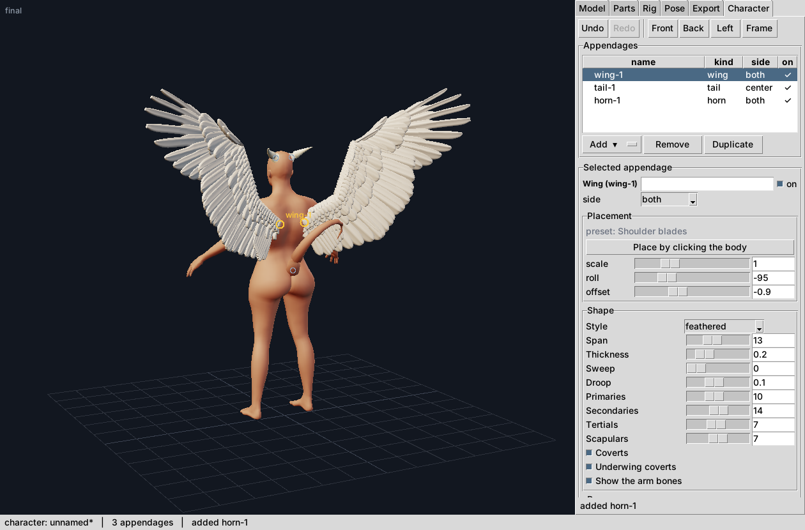

# The Character tab

Add, remove and tune appendages (wings, tails, horns, extra limbs) on a realistic character **in the
running studio**, see the result and print it. Design context:
[appendages_system_design.md](appendages_system_design.md) (D1, D7 steps 3-4, D9 and the T4 status in
section 6c); the renderer it stands on: [renderer.md](renderer.md).

Needs the CC0 MakeHuman assets (`python tools/fetch_makehuman_assets.py`); without them the tab says
so and the rest of the studio is unaffected. Nothing is loaded until the tab is first opened.

## Using it

| You want to | Do |
| --- | --- |
| add an appendage | **Add** menu: one line per kind, split by style (`Wing (feathered)`, `Extra limb (leg)` ...). The menu is generated from the kind registry (`kinds.py`), so a new kind appears by registering it. |
| remove / duplicate | **Remove** (or `Delete` in the list), **Duplicate** (a copy with its own id, in the same place until moved) |
| tune its shape | the **Shape** grid is generated from the kind's `ParamSpec`s: a slider with the declared range and step for a float or int, a check box for a bool, a menu for a choice. A parameter whose `when=` does not hold (a wing's `primaries` while it is a bat) is not shown; changing `style` rebuilds the grid. A typed value is clamped to the range and shows the clamped number. |
| pose it | the **Pose** grid: one slider per control with the **live range of the placed appendage** (a wing placed on a body allows less than a free one, and less as it folds: raise the fold and the other ranges shrink), a named pose menu, and a side switch (`both` / `l` / `r`) that writes one side only |
| place it | choose the preset (kinds with several), set scale / roll / offset, switch the side (`center` `left` `right` `both`), or press **Place by clicking the body** and click a quad of the body: the anchor moves there. The stored quad is always the left-hand one (a click on the right flank stores its mirror image, see D4), a single `left` / `right` appendage follows the side you clicked |
| select | click it in the list, or click it in the picture |
| switch it off | the **on** check box: an appendage that is off is neither drawn nor printed nor does it adapt the body, and stays in the file |
| undo / redo | **Ctrl+Z / Ctrl+Y** (while this tab is selected), or the buttons. A slider drag is one step, however many values it passed through |
| the body | macro sliders (gender, age, muscle, weight, height, ethnicity), ten common shape sliders, "Reset body" |
| skin fillet | the check box "Skin flows into the appendages": the body's skin is moulded around the roots ([junctions.md](junctions.md)); a body-slider or shape drag draws the unshaped skin and the final render (150 ms later) has the fillet; the document stores it only when it is off |
| body adaptation | the check box (and the cap): the wings broaden the chest, the tail the pelvis ... as a derived layer, never saved; the notes say what it did |
| save / open | **Save / Save as / Open** write and read `.mmchar` (the same file `minimaster character` reads); Ctrl+S / Ctrl+O follow the tab |
| print | pick a size, **Check printability** (measures, writes nothing) or **Export STL**. The report appears in the panel: **blocking** findings in red stop the export until **Export anyway**, warnings in amber, the assumptions dim. It is the report `minimaster character -o x.stl` prints and the STL is byte for byte the CLI's |

Picture: drag orbits, middle / right drag pans, the wheel zooms, a click selects (the viewport's
conventions). Buttons: Front / Back / Left / Frame. Adding something to the back swings the view round to
the back and zooms out if it does not fit (never in).

## The two tiers of picture

The picture is a numpy image shown through a `tk.PhotoImage`; the grid and the anchor markers (the
selected appendage in yellow) are ordinary canvas items over it, the grid cut where the figure is.

* **Draft**, on the UI thread, at once, for every change: a 4k-triangle body proxy (smooth shaded) and
  cluster proxies of the posed appendages (flat shaded), drawn at half resolution when the pane is
  larger than 420k pixels and upscaled. It is an approximation, and a drag takes the shortcut that
  fits what it changes:

  | gesture | what the draft does |
  | --- | --- |
  | orbit, pan, zoom | nothing is rebuilt or re-posed (poses and proxies are cached) |
  | pose drag | one wing is posed, the other is its mirror image (both sides of a pair move alike) |
  | body-slider drag | the appendages are **not rebuilt**: the last draft is moved by how far its anchor quad moved with the body |
  | parameter / placement drag | the kind's `draft_params` (a feathered wing without coverts, underwing and bones), and only the left side of a pair is built, the right is mirrored |
  | anything else (add, remove, side, anchor ...) | exact build |

  Per-side poses and single-sided appendages never take the mirror shortcuts. The shortcuts exist only
  in the draft: the picture you stop on is exact.
* **Final**, on a worker thread, 150 ms after the last change: the full body (eyes included) and the full
  appendages through `render_portrait`. A new change cancels it (the worker polls a `CancelToken`
  between shells and rasteriser chunks); the job gets a frozen JSON snapshot of the document and returns
  the PPM bytes, so the UI thread only hands them to tk. The tier on screen is written in the corner.

Everything is cached by content (`Engine`): effective body weights -> morphed vertices, spec + body ->
built appendage (rig, poses, proxies; bounded to 192 MB, plus the last 8 drafts the re-place shortcut remembers), pose -> mesh, body -> shells. A drag on one
appendage rebuilds only that appendage.

## How it is built

| Module | |
| --- | --- |
| `minimaster/character/lab.py` | **no tkinter.** `LabDocument` (the edits and their validation, undo, files), `Engine` (caches, scenes, pictures, picking, export), `PreviewScheduler` (the two tiers, the worker), `Lab` (what the panel holds), `ViewState` (the camera), `BackgroundTask` |
| `minimaster/character/imageview.py` | the only new module that imports tkinter besides the panel: Canvas + PhotoImage, camera gestures as callbacks, the overlay |
| `minimaster/character_panel.py` | the tab: widgets -> calls on `Lab`, the property grid generator, the poll loop |
| `minimaster/app.py` | the wiring (below): 49 added lines and one changed one, in 13 hunks |

The panel is thin on purpose: **every document operation is a method of `LabDocument`**, so the same
sequence (add a wing, add a tail, tune, undo twice, redo, save, reload, export) is driven headless in
`tests/test_lab.py` and through the widgets in `tests/test_character_panel.py`, which asserts the two
give the same `.mmchar` and the same STL bytes.

* **Validation** is the document's, not the widget's: a parameter is checked against its `ParamSpec`
  (type, range, `when=`), a pose control against `Placed.control_range` of the *placed* appendage at its
  current fold, a placement field against the kind's `placement_keys`, a side against `SIDES`. A refused
  edit raises `LabError`, changes nothing and leaves no undo step; the panel shows it as a red status
  line. `clamp=True` (what the widgets pass) clamps instead.
* **Undo** is the studio's `UndoStack` over JSON snapshots of the character. Edits of the same control
  within 0.6 s, or between `begin_gesture` / `end_gesture` (what a slider press / release call), are one
  step. Selection is not part of the history.
* **Picking** builds an id buffer of the FULL body (so the cage quad is exact: `quad = triangle %
  13378`) and the appendage proxies, at the display size; a click returns the quad, the surface point
  and barycentric weights over its corners (the anchor keeps them), or the appendage under the pixel.
  While placing, appendages are ignored (you can place through a wing).
* **Threads.** The worker never calls tkinter. One hazard remained: the cyclic garbage collector runs
  in whichever thread allocates enough, and `tk.Variable.__del__` calls into Tcl, so a variable orphaned
  by a rebuilt property grid could be finalised on the worker (a one second wait per object, or a stall
  until the UI loop services the call). The panel's variables (`StringVar`, `BooleanVar`, `DoubleVar`
  in `character_panel.py`) defer their finaliser to the UI thread, which drains it on every poll.

### How the tab shares the window with the studio's Viewport

The studio's left pane is a `Viewport` (a painter's-algorithm canvas that draws primitive shapes); the
tab needs an image view. **The app swaps the left pane while the tab is selected**: `_swap_stage`
`pack_forget`s the Viewport and packs the ImageView in the same place (`before` the notebook column),
and back when another tab is selected. It is the least invasive of the options considered (a second
pane beside the Viewport would halve both; hosting the image view inside the Viewport would make
`viewport.py` know two kinds of content): no studio widget moves, `app.viewport` stays the same object
at the same size, tab indices 0-4 do not change (the Character tab is the last one), and every
studio code path is unchanged apart from a mode check. The wiring in `app.py` is: the tab and
`_swap_stage`, `undo` / `redo` / `Escape` / `Ctrl+S` / `Save as` / `Ctrl+O` routed to the panel in
character mode, and `refresh` / `_update_status` returning early in that mode (the studio scene is not on
screen). The hunks: the import, `self._right`, the panel and its entry in the tab tuple,
`_on_tab_changed` + `_swap_stage`, and the mode checks in `undo`, `redo`, `_escape`, `refresh`,
`_update_status`, `open_dialog`, `save` and `save_as`. `tools/gui_smoke_test.py` (the studio) is unchanged
and passes.

## Measured

Xvfb (software Tk), Python 3.12, numpy 2.2.6, 4 shared cores (other jobs running), pane 900x806, draft at
half resolution, frames per second **including** `PhotoImage` and the canvas overlay, driven through the
panel's own sliders; body + two wings. `tools/character_smoke.py --measure`, headless columns from
`tools/lab_bench.py` (no tk: the frame and its PPM bytes only).

| gesture | bat wings, tk | angel wings, tk | target | bat, headless | angel, headless |
| --- | --- | --- | --- | --- | --- |
| orbit | 42 fps | 37 fps | >= 20 | 62 fps | 58 fps |
| pose drag | 29 fps | 28 fps | >= 20 | 48 fps | 43 fps |
| body drag | 32 fps | 28 fps | >= 20 | 57 fps | 47 fps |
| shape-parameter drag (`draft_params`) | 17 fps | 13.5-14 fps | >= 10 | 23 fps | 18 fps |

(two runs of the tk measurement agree within about 1.5 fps; the machine was shared with other jobs, so the
headless column moves by +-20% between runs.)

| | measured | target |
| --- | --- | --- |
| final render of the angel, 900x800, all caches cold, assets loaded | 0.59-0.69 s (a fresh process, `import` to the PPM: 0.9-1.0 s) | < 1 s |
| edit -> the final on screen, cold, with the 150 ms debounce | 0.88-0.94 s | |
| the final after a camera move / after a pose edit (warm caches) | 0.2-0.3 s / 0.33-0.45 s | |
| cancel -> the worker stops, while it **renders** | 8-86 ms (median ~32) | <= 100 ms |
| cancel -> the worker stops, while it is **inside the cold angel's wing build** | up to 340 ms | <= 100 ms, **not met** |
| a 5 ms Tk timer while the worker renders the cold angel (real mainloop, the display of the finished frame excluded) | idle 5.1 ms; p99 6-10 ms; worst single gap 6.3 / 9.7 / 15.2 ms in three renders (10.1 ms above the idle median at worst) | <= 10 ms: met at p99, **missed by the single worst gap of one run** |

Notes on what the numbers say:

* Without the shortcuts the body drag measured 11 / 9 fps and the angel's shape drag 7 fps: the wing
  build (47 ms per side for the draft rig, 125 per side for the full one) is the cost, not the drawing.
  The overlay markers read their position from the body quad, because asking the appendage for it
  forced the exact build on every frame (3x slower drags until that was found).
* `PhotoImage.configure(data=PPM)` costs ~15 ms at 900x800 whatever is in the image; at half size plus a
  `np.repeat` upscale it is ~16 ms in total, so half resolution saves the rasteriser, not the display.
* The cancel limit is missed in one place: `kind.instantiate` (a feathered wing's build, 0.25 s for the
  pair) has no checkpoints, so a job cancelled during the first ~0.35 s of a COLD angel final finishes
  that build first (it is cached, so the work is not lost, and the next final reuses it). Hooking
  `sys.settrace` in would make the build cancellable in 0.1 ms and 43% slower; a checkpoint inside the
  wing builder is the right fix and is not in this track's files.
* The timer gap is GIL contention (the display of the finished frame, ~15 ms of `PhotoImage`, is the UI
  thread's own work and is left out of the figure; including it the worst gap was 16-19 ms): the
  worker's longest uninterruptible numpy calls hold the GIL for 10-20 ms. A lighter probe without the app
  (`gc` on, off or frozen alike) measured 8 ms worst; `sys.setswitchinterval` does not change it.

## Tests

* `tests/test_lab.py` (no display, ~10 s): validation of every edit kind including refusals, undo and
  coalescing, files (including unknown kinds surviving a load / edit / save), the caches (a pose edit
  rebuilds nothing, a parameter edit rebuilds one appendage), the draft shortcuts against the exact
  scene, the camera, picking against `ray_mesh_hit`, mirroring of the stored anchor, the scheduler with a
  fake clock and a real worker (stale results dropped, cancel latency, no delivery after a cancel), the
  export against the CLI byte for byte, a blocking report, the whole sequence.
* `tests/test_character_panel.py` (needs tkinter and a display: `xvfb-run -a python -m pytest
  tests/test_character_panel.py`; skipped otherwise): the tab in the studio (pane swap, undo routing,
  assets missing), the generated grid, sliders and gestures, clicking in the picture, the export and its
  report, the panel-vs-core equality, the life cycle and the variable finalisers.
* `tools/character_smoke.py` boots the app and drives it end to end, with screenshots; `tools/lab_bench.py`
  prints the headless timings. Each key test was shown to fail when the behaviour it checks is removed
  (the mutation list is in the track report).

## Limits

* The draft is a proxy: bat wings' silhouettes agree with the full mesh to IoU 0.8 (0.6-0.7 folded), no
  membrane pleats, no eyes. Mirrored sides assume a symmetric body (the final render does not).
* A click places the anchor, not the orientation: roll, offset and up-hint stay those of the preset.
* The final preview renders the body unsubdivided (26k triangles); the export can subdivide
  (`levels`), the panel does not offer it.
* Not measured: native Windows / macOS Tk, HiDPI scaling, numpy 1.24 on the Tk paths.
* The wing build cannot be cancelled mid-way (above).

## Independent review: what the numbers above do not say

A second, independent measurement (real pointer drags rather than `scale.set()`, on a quiet machine) found
lower frame rates than the table above: **orbit 29-31 fps, pose drag 21-22 fps** (17.8-20.6 under load),
still at or above the 20 fps bar for the quiet case. Two stated limits are **not met for a cold build**:

* **Cancel latency** of a cold final render (the first render after a shape edit, which instantiates the
  wing) is a median 213 ms, p90 408 ms, maximum about 0.5 s, not 100 ms: the wing build has no cancel
  checkpoint. A warm final cancels well under 100 ms.
* **Tk timer gap** while a cold final builds is p99 10-12 ms (maximum 12-20 ms), not <= 10 ms. Warm finals
  stay under 9 ms.

A checkpoint inside `kinds.instantiate` / the wing builders is the real fix and is not done.

Dragging a tail shape parameter with wings present runs at 6-9 fps, not 10+: the tail changes the anatomy
layer, so the body key changes and every other appendage gets an exact draft rebuild (89 ms per edit
against 21 ms with the adaptation switched off). "A drag on one appendage rebuilds only it" holds when the
edit leaves the adapted body unchanged.

The review also found, and this change fixed, a memory leak (the re-place shortcut kept every
shape edit's built appendage alive: ~4 MB per feathered-wing edit), an unhandled exception when `nan`,
`inf` or `1e999` was typed into an integer entry, the Cap entry showing what was typed instead of what was
stored, and studio commands (`m`, File > New, New from template, Export STL, Edit > Duplicate/Mirror)
acting on the hidden studio scene while the Character tab was open.
