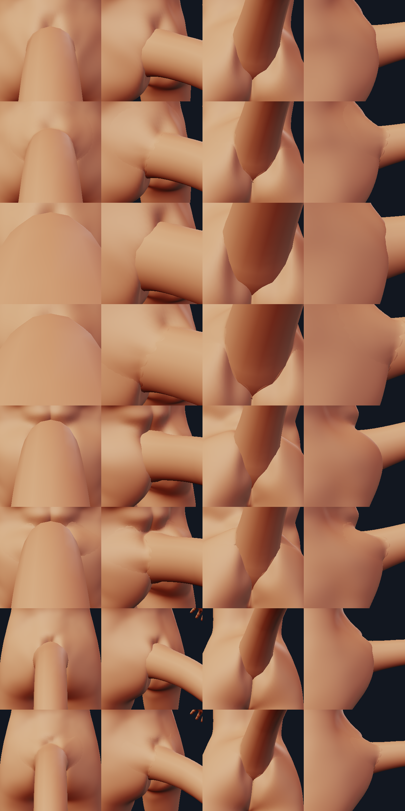
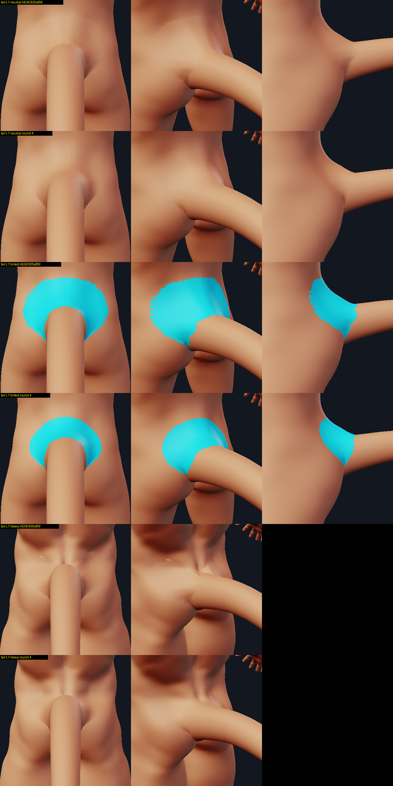
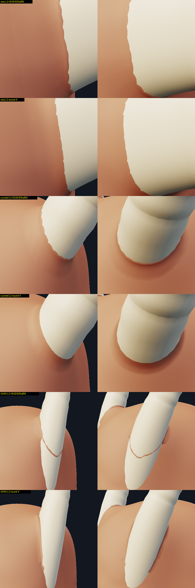
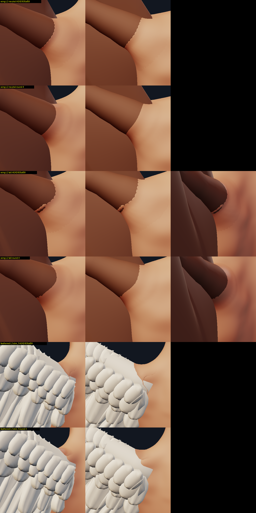
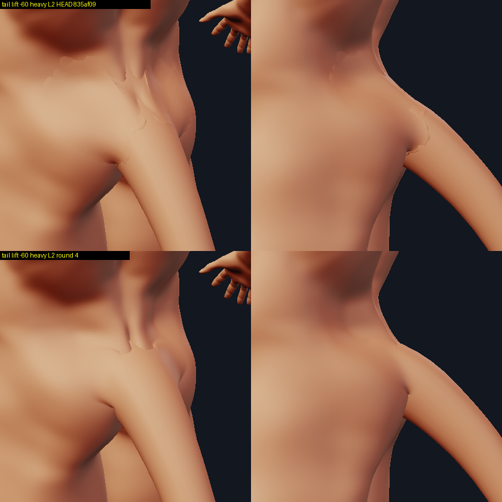
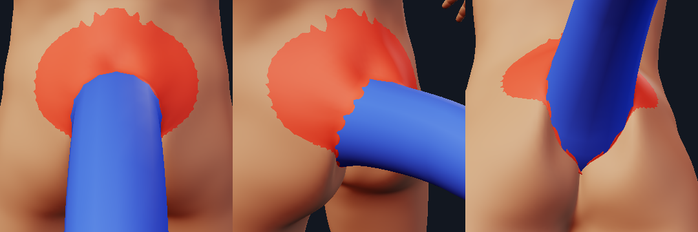
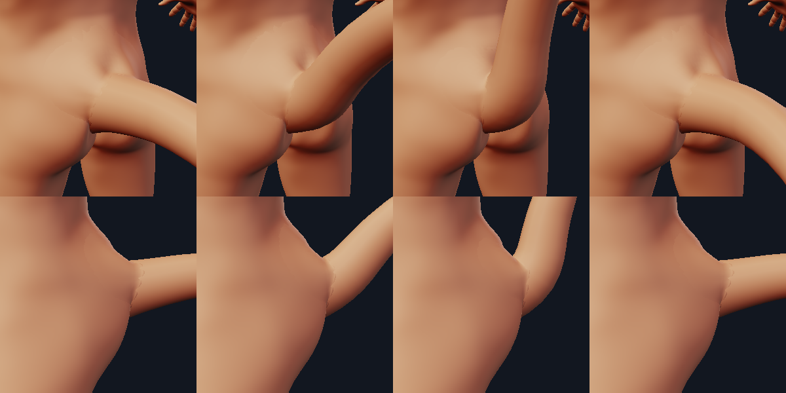
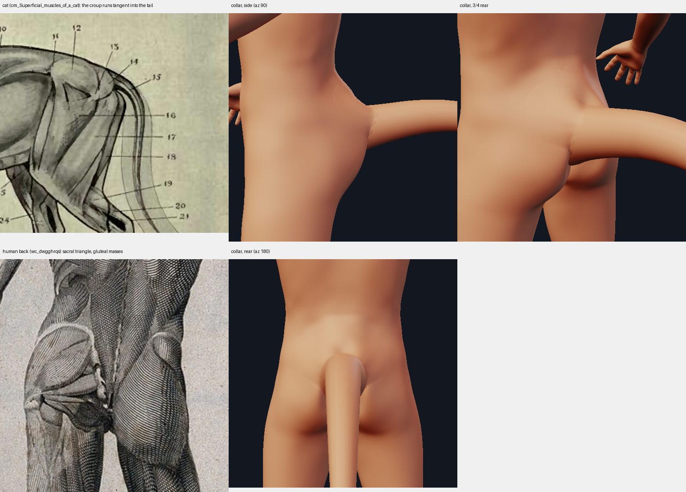
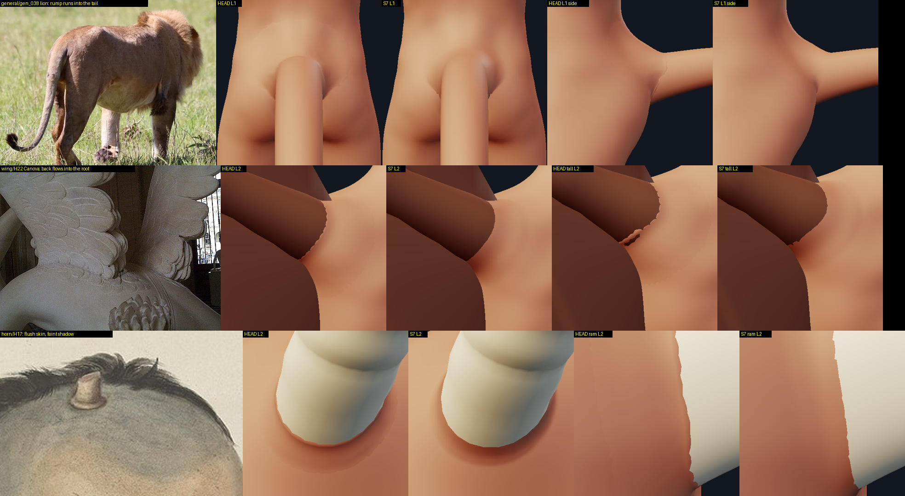

# The root collar: where the skin meets an appendage

Design context: [junctions.md](junctions.md) (the skin junction: the cage displacement that gives the skin MASS
around a root), [anatomy_tail.md](anatomy_tail.md), [anatomy_wing.md](anatomy_wing.md), [anatomy_horn.md](anatomy_horn.md)
(the kinds that use the collar), [appendages_system_design.md](appendages_system_design.md).
Code: `minimaster/character/collar.py`, tests `tests/test_collar.py` (the construction) and `tests/test_collar_seam.py`
(round 4: what the critics saw), numbers `tools/collar_report.py`, the picture measure `junction_checks.seam_report`.



## Round 4: the seam the critics saw, and the default level

The round-3 critics (five independent reviews of the merged tree 835af09, on real-pipeline renders against the
reference library) found that the collar had replaced the pipe-in-a-flange with a STICKER: a lighter shield over the
sacrum and round the wing root with a serrated outline, a sawtooth or scalloped line where it met the wing's arm and
the horns' sheaths, folds and hundreds of crossing triangles on the heavy and child tails, the feathered wing, a lowered
tail and a horn at full tilt, and none of it at level 0, the default of the CLI and of the Character tab. What was
found and what was done, each measured on HEAD and now (`scratchpad/junction/S7_out/s7meas.py` (the join numbers over
6 bodies x 24 kind / pose / parameter cases x 2 levels) and `s7seam.py` (the picture measure), the tests in
`tests/test_collar_seam.py`):

### 1. The sticker was the shading, not the shape

Tinting the collar and switching the occlusion off one shell at a time (`S7_out/e1_tail_neutral_L1.png`) showed the
cause: the renderer shades every shell with area-weighted vertex normals and a cavity AO computed on THAT shell alone.
The collar is a separate shell lying on the skin, so (a) its normals near the rim differ from the skin's by the 3-7
degrees of its ramp and its own facets, and (b) over the 0.1-0.2 units where it lies within the facets' error of the
skin the depth test picks one surface or the other triangle by triangle. Two different shadings, interleaved: a
serrated outline and a tone patch the size of the footprint (with AO off the outline stays; it is the normals).

The fix is the normal transfer used to hide the seams of separately modelled pieces of a character: the collar now
carries the normals and the cavity term it is SHADED with (`collar.CollarMesh`, `collar.shading_transfer`): the skin's
own (its renderer normals and its cavity term, interpolated under each vertex) where it meets the skin, the wall's
where it meets the appendage, its own between, blended by where the vertex lies on the profile (`shade_weights`).
Whichever surface wins the depth test at a seam, the pixel is the same. The mesh keeps the attributes through
`transform` (normals by the inverse transpose), so every place that builds `Shell(mesh.transform(MH_TO_Z_UP), mat)`
(the CLI, the lab, the critics' own `iv.py`, `tv.py`, `wtool.py`, `hv.py`) draws it; `portrait._shell_colors` uses
them when a mesh carries them (a 7-line hunk). The geometry, and so the print, is not changed by it.



Measured on the picture (`junction_checks.seam_report`: the median high-pass on the line where the footprint meets the
skin, over the median on the skin 4-10 pixels away; 1 = cannot be told apart; 320 px close-ups, level 1 and 2,
neutral / heavy / child, two or three views each; `wall_jag`: the share of the image rows and columns crossing the
line where the collar meets the appendage that cross it more than once within 3 pixels, a sawtooth):

| appendage | outline ratio HEAD median (max) | now median (max) | contact-line jag HEAD median (max) | now median (max) |
| --- | --- | --- | --- | --- |
| tail | 2.85 (5.70) | 1.18 (1.46) | 0.037 (0.076) | 0.000 (0.027) |
| wing (membrane) | 5.44 (8.26) | 0.90 (1.12) | 0.052 (0.114) | 0.024 (0.052) |
| horn (curved) | 6.24 (7.24) | 2.07 (2.94) | 0.013 (0.024) | 0.000 (0.008) |
| horn (ram) | 3.64 (4.73) | 0.93 (1.04) | 0.039 (0.077) | 0.010 (0.049) |

The tail, the wing and the ram are at the skin's own level (about 1). The curved horn's 2.1 is the fillet's own concave
shading (drawn with the skin's normals all over, the same views read 0.9-1.3: see the limits), not a seam. Counted in
pixels of the tinted footprint (`S7_out/seamviz.py`): 31,036 -> 18,349 on the tail, 34,702 -> 21,369 on the wing,
14,803 -> 9,755 on the horn (about 60 %).

### 2. The contact lines cross the surfaces they meet

A sheet TANGENT to a surface leaves its edge wherever the two meshes' facets happen to cross: the serrated outline on
the skin, and on the wall a scallop per facet of the sheath (0.0086 R facet depth over tan 3 degrees = 0.16 R, the horn
critic's estimate) and a sawtooth along the wing's arm. The profile `h = H (1 - sqrt(1 - x^k))` is now cut at both
ends (`_column_profile`):

* at the wall it ends where it is `ALPHA_WALL_DEG` (20) off the wall, rescaled so it still reaches the full height, and
  goes on INTO the wall along that direction before turning to the axis: the top edge lies on the REAL, faceted wall
  (ray hits), not on a low-passed circle a hair outside it;
* toward the skin it follows the profile while it is steeper than `ramp` (now the tangent of the crossing angle,
  `GAMMA_SKIN_DEG` = 5) and then goes on straight, through the skin and under it (a short dive, then a skirt that
  closes it). The near-flat outer part of the old profile, which added less than a hundredth of a unit of height and was
  the wide tinted "pair of briefs" of the integration critic, is now under the skin: the tinted footprint of the
  default tail is about 60 % of round 3's, its outline smooth (`images/collar_r4_tail.png`, rows 3-4).

Neither crossing angle is seen: the shading there is the skin's and the wall's (1). Between two columns the collar's
edge is a straight chord, and where a corner of the wall's polygon fell between two columns the chord dipped inside it:
so the columns now sit ON the polygon's corners (`_polygon_columns`: the kinks of the wall's radius round the axis are
its corners; every facet gets the same number of columns, the first on a corner). This works for the tail (24 sides),
the wing's sleeve (32), the curved, spiral and antelope horns, the ossicone and a 6-sided horn; the ram's sheath is not
found as a polygon and keeps 72 even columns. Measured as the wobble of the line where the surface enters the wall
(`contact_lines`: what a quadratic fit over three columns either side leaves of it, p95 - p5, root radii):

| case (6 bodies x levels 1, 2; max) | HEAD | now |
| --- | --- | --- |
| tail rest / sway 45 / collar 2 | 0.096 / 0.096 / 0.110 | 0.018 / 0.018 / 0.018 |
| tail lift 60 / lift 90 | 0.074 / 0.086 | 0.012 / 0.013 |
| tail lift -60 | 0.459 | 0.115 (see below) |
| tail base_radius 0.85 / 1.2 | 0.233 / 0.136 | 0.045 / 0.066 |
| wing membrane rest / swing -45 / raise 60 / swing 45 | 0.143 / 0.141 / 0.059 / 0.073 | 0.026 / 0.028 / 0.015 / 0.010 |
| wing feathered rest / swing -45 | 0.038 / 0.160 | 0.004 / 0.003 |
| wing dragon | 0.139 | 0.030 |
| horn curved / antelope / spiral / ossicone | 0.051 / 0.065 / 0.056 / 0.092 | 0.003 / 0.005 / 0.004 / 0.006 |
| horn ram (not found as a polygon) | 0.046 | 0.024 |
| horn ring_verts 6 | 0.180 | 0.017 |
| horn tilt 60 | 0.127 | 0.040 (neutral 0.025; tall 0.038-0.040, child 0.029-0.034) |
| horn base_radius 0.6 + collar 2 | 0.312 | 0.039 (tall, level 2; 0.008-0.030 on the others) |

Under the 0.03 bound everywhere at rest and at the wing and horn poses, except the horn at tilt 60 on the tall and the
child bodies and the big horn on the tall body at level 2 (0.034-0.040), the bigger tails (0.045-0.066) and the lowered
tail (0.115 on the heavy body). The cause of the last is not established: the heavy body's lowered collar is two runs
of 15 columns of which 8 each are taper, too few untapered columns to measure without them; on the neutral body the
untapered columns alone read 0.030, more than all of its columns together (0.019), so it is not simply the metric
reading the taper (`S7_out/wavetaper.py`). The test (`test_the_contact_line_on_the_wall_is_not_wavy`)
asserts < 0.03 on the curved horn, the ram, the ossicone, the tail and the membrane wing at levels 1 and 2, neutral and
child, and fails on HEAD; `test_the_horn_at_full_tilt_has_no_crack_and_no_teeth` on the neutral body.





### 3. No fold, no crossing: an open ring, reach limits and a guard

Round 3's crossings sat in the hair-thin fold side (0.006 units wide, where the exit curve jumped 0.2-0.5 units along
the wall between neighbouring columns: `S7_out/xdiag.py`) and, at the extremes, where the sheet wrapped round a convex
edge of the body or where neighbouring columns' paths over the skin converged. Now:

* **an open ring**: a column narrower than `CUT_WIDTH` / `CUT_REL` root radii has no collar at all; the kept columns form
  runs closed by an ear-clipped cap at each end, and every run TAPERS to nothing over `TAPER_COLS` columns (reach,
  height, sink and the turn into the appendage), so its caps are small and hidden; a run shorter than `MIN_RUN` is
  dropped. The shell is a swept loop per column (arcs inside the appendage, the sheet, the dive, the skirt, the
  underside, back into the appendage): a torus for a full ring, a closed tube for a run;
* **reach limits** read off a first march over the skin, besides the old lean / crease / fit ones: the reach ends where
  the march turns back, where the skin under it has turned more than `TURN_MAX_DEG` (40) from the exit's normal (a
  lowered tail's collar wrapped round the sacrum and folded its rim back 178 degrees), where neighbouring paths converge
  to `CONVERGE_MIN` of their spacing (a caustic: the rim folds); the lean is read a third of the way out, not at the far
  end of a path that had run over the spine's furrow (that cut the heavy body's dorsal collar to a notch). Each limit
  was switched off in turn over 158 builds (`S7_out/limexp.py`): without the caustic limit the first construction
  crossed itself 816 more times in all and folded 40 more columns, and the guard's cuts took 0.68 of a ring of collar;
  without the turn limit, 48 more crossings (57 instead of 2 on the tall body's lowered tail) and 0.04 of a ring, though
  the 1.2 tail on the neutral body does better without it (a limit that cuts a column also starts a taper next to it).
  A third limit, on a march the skin held back, did nothing for the crossings and cost collar: it was removed;
* **the hidden parts are short and shallow**: the sink is at most `SINK_MAX_REL` root radii and under the focal distance
  of the skin's normals (an inward offset of a convex bend folds), the dive and the skirt are straight continuations of
  the skin's tangent (a strip marched on over a creased skin turned sideways and crossed its neighbours), the turn into
  the appendage is a fraction of the appendage's own radius (a doubled collar turned through the axis);
* **a guard**: the finished shell's crossing triangles (`crossing_pairs`, exact, 40-200 ms) and folded columns are cut
  away (with their neighbours; the runs on either side taper to the gap) and the shell is rebuilt, at most twice; a
  collar that still crosses itself, or whose runs are all too short, is dropped WITH a warning (`collar_shells`,
  `AppendageWarning: no root collar (...)`; the lab adds a note to the final frame).

Self-crossings over the whole matrix (6 bodies x tail rest / lift -60 / 60 / 90 / sway 45 / base_radius 0.85 / 1.2 /
collar 2, wing membrane rest / swing -45 / raise 60 / swing 45, feathered rest / swing -45, dragon, horn curved / ram /
antelope / ossicone / spiral / tilt 60 / ring_verts 6 / base_radius 0.6 + collar 2, x levels 1 and 2):

| case (6 bodies x levels 1, 2) | built HEAD / now | self-crossings HEAD max (sum) | now | rims folded back (> 90 deg) HEAD / now | kept share now (min / median) |
| --- | --- | --- | --- | --- | --- |
| tail rest (and sway 45: the stiff root) | 12 / 12 | 376 (1192) | 0 | 0 / 0 | 0.58 / 0.65 |
| tail lift -60 | 12 / 12 | 3550 (12021) | 0 | 10 / 0 | 0.38 / 0.54 |
| tail lift 60 | 12 / 12 | 175 (805) | 0 | 0 / 0 | 0.56 / 0.65 |
| tail lift 90 | 12 / 12 | 804 (2842) | 0 | 0 / 0 | 0.33 / 0.47 |
| tail base_radius 0.85 | 12 / 12 | 582 (4307) | 0 | 0 / 0 | 0.58 / 0.65 |
| tail base_radius 1.2 | 12 / 12 | 1452 (8228) | 0 | 1 / 0 | 0.17 / 0.53 |
| tail base_radius 2.0 (forced; the kind asks for none above 1.2) | 10 / 0 | 3736 (31079) | - (dropped, with a warning) | 0 / - | - |
| tail collar 2 | 12 / 12 | 333 (1179) | 0 | 0 / 0 | 0.61 / 0.65 |
| wing membrane rest | 12 / 12 | 137 (156) | 0 | 0 / 0 | 0.61 / 0.94 |
| wing membrane swing -45 (heavy: the wing asks for none) | 10 / 10 | 16 (25) | 0 | 0 / 0 | 0.70 / 0.85 |
| wing membrane raise 60 | 12 / 12 | 1 (1) | 0 | 0 / 0 | 0.85 / 1.00 |
| wing membrane swing 45 | 12 / 12 | 22 (67) | 0 | 0 / 0 | 0.86 / 1.00 |
| wing feathered rest | 12 / 12 | 295 (1091) | 0 | 1 / 0 | 0.67 / 0.81 |
| wing feathered swing -45 (heavy: none) | 10 / 10 | 362 (1218) | 0 | 4 / 0 | 0.50 / 0.86 |
| wing dragon | 12 / 12 | 14 (24) | 0 | 0 / 0 | 0.70 / 0.97 |
| horn curved / antelope / ossicone / spiral | 48 / 48 | 0 (0) | 0 | 0 / 0 | 0.91 / 1.00 |
| horn ram | 12 / 12 | 1 (2) | 0 | 0 / 0 | 1.00 / 1.00 |
| horn tilt 60 | 12 / 12 | 369 (3489) | 0 | 0 / 0 | 0.47 / 0.60 |
| horn ring_verts 6 | 12 / 12 | 9 (9) | 0 | 0 / 0 | 1.00 / 1.00 |
| horn base_radius 0.6 + collar 2 | 12 / 12 | 0 (0) | 0 | 0 / 0 | 1.00 / 1.00 |

No collar folds a column (`fold_columns` 0 everywhere, `lip_max` under 1e-15) and none crosses itself: by construction
(the guard rebuilds or drops) and asserted by `test_no_collar_crosses_itself_or_folds_on_any_body_kind_pose_or_extreme`
(six bodies x 18 cases at level 1, `..._at_level_two` on three bodies).



What the guard costs in looks: where it cut columns the collar has a gap, tapered on both sides. `kept` is the share of the ring that has a collar. A tail at rest keeps 0.65 by DESIGN (the fold side, a third of
the ring under the tail, has none: the references' crease); a lifted or lowered tail 0.33-0.62 (no room for a fillet
under a leaning wall); the 1.2 tail 0.17-0.65; the wings 0.50-1.00; the horns 1.00 except tilt 60 (0.47-0.67: the
leaning side) and the spiral horn on the short body at level 2 (0.91). Below the design share the guard has cut a gap
(the limits list where).

### 4. The default level is 1 when a collar is asked for

* CLI: `--subdivide` defaults to None: 1 when an appendage of the document gets a root collar (`collar.default_levels`,
  resolved after the document is loaded, so a saved character with a tail gets it too), else 0. It prints "note: the
  body is subdivided once (--subdivide 1) for the root collars; --subdivide 0 draws the bare cage without them". An
  explicit `--subdivide 0` is honoured with the old note. The STL and the print report follow.
* Character tab: `Lab(levels=None)` (character_panel.py) resolves the final preview's and the export's level the same
  way per document (`Lab.final_levels`); the draft (orbit, drags) is the 4k-triangle proxy at any level and keeps its
  note "the root collar ... is drawn in the final render only". An explicit `Lab(levels=0)` is honoured.

Cost, measured on a 4-core box at load 2 (`S7_out/timeall.sh`: `roottime.py`, `clitime.sh`, `labtime.py`; HEAD = 835af09):

| one root, `collar_pieces` with the body mesh given (neutral, warm, best of 3) | HEAD L1 / L2 | now L1 / L2 |
| --- | --- | --- |
| tail | 152 / 140 ms | 181 / 196 ms |
| membrane wing | 70 / 89 ms | 253 / 293 ms |
| feathered wing | 89 / 86 ms | 402 / 460 ms |
| curved horn | 143 / 163 ms | 182 / 215 ms |
| ram horn | 226 / 317 ms | 198 / 295 ms |

**The cost was not cut: it went up**, most on the wings (4x on the membrane wing, 4.5-5x on the feathered). Half of
the feathered wing's time is the guard's exact crossing check (two passes of 125 ms: one finds the crossing columns, one
checks the rebuilt shell), 95 ms the shading transfer. Under the load of the measurement matrix (several builds at once,
not the same load for both trees; `s7meas.py` medians over six bodies and two levels): tail 160 -> 595 ms, membrane wing
623 -> 1,026 ms, feathered wing 85 -> 478 ms, dragon wing 99 -> 316 ms, curved horn 151 -> 763 ms, ram 250 -> 904 ms.

| the full creature (tail + wing pair + horn pair + lower arms, neutral, medium) | HEAD | now |
| --- | --- | --- |
| CLI STL `--subdivide 0` | 2.65 s, 3.13 MB | 2.75 s, 3.13 MB |
| CLI STL `--subdivide 1` | 3.97 s, 8.98 MB | 5.32 s, 8.65 MB |
| CLI STL `--subdivide 2` | 9.72 s, 25.2 MB | 10.76 s, 24.9 MB |
| CLI STL, no `--subdivide` (the default) | level 0: 2.58 s, 3.13 MB | level 1: 4.99 s, 8.65 MB |
| lab final render 640 x 560, level 1, cold / warm | 1.47 / 0.16 s | 2.01 / 0.17 s |
| lab final render, level 2, cold / warm | 3.57 / 0.86 s | 3.59 / 0.46 s |
| lab draft (the proxy, any level) | 0.43-0.63 s | 0.43-0.64 s |

The default costs the creature 2.4 s more and 2.8x the file: about 1.3 s of it is the subdivision (HEAD's own level 1
is 1.3 s slower than its level 0), the rest the six collars, which are 1.35 s slower to build than HEAD's at level 1.

### 5. The rest

* `LabDocument.set_side` refuses a side the kind does not allow (a tail is one midline structure) and the tab's side
  box offers only the kind's sides.
* The print report checks every collar shell for crossing ITSELF (`Finding("warn", "self-crossing", ...)`): the report
  checks every shell alone and trusts the slicer to union shells, but no union fixes a shell that crosses itself.
* The collar's strength no longer scales its hidden parts: the turn into the appendage and the sink are fractions of
  the appendage's own radius, so `collar = 2` on a 0.6 horn is a wider, taller fillet and nothing else (no tear at
  level 1 or 2, `S7_out/hv_big_cmp.png`).
* `join_report` gained `geo_rim_*` / `geo_wall_*` (the crossing angles of the geometry), `fold_columns`, `lip_max`,
  `wall_wave` / `rim_wave` / `wall_contact_missing`, `kept_share`, `guard_iterations`; `rim_*` and `wall_*` now measure
  the normals the renderer draws with (what they always said they measured; they are 0 to a tenth of a degree by
  construction now, the geometric angles are the `geo_*` keys). The wall is oriented outward before it is measured or
  sampled: the right wing's arm piece (`WingKind.collar_wall`) is wound inside out (volume -1.6) and HEAD's `wall_p95`
  on the right wing read 179.9 degrees.

## Why a collar

The round-1 reviewers all named the same thing: the skin and the appendage meet along a ring. The cause is
geometric, not a tuning problem. The junction moves the vertices of the 13,378-quad body cage, which gives the skin
mass around a root, but

* a cage quad is about 0.28 units across and a root is 0.4-0.6 across, so a fillet is two to three quads wide;
* the body can never get new vertices (1,280 morph targets address it by index);
* so the skin meets the root **53-100 degrees from tangent** (measured here: median 56-80 degrees between the skin
  and the tail wall at the exit, `before` in the table below) and every close-up shows a crisp ring, a flange.

The collar does not depend on the cage. It is a closed shell on the APPENDAGE's own geometry (72 around x about 30 stations,
16 of them the visible sheet, whatever the body is subdivided to) whose outer rim lies on the shaped skin, tangent to it, and that rises
along the wall to meet the wall tangentially. The slicer unions it with the body and the appendage like every other
overlapping shell (the print report counts it, see below).

## The construction (as of round 4)

For every column (an angle ``theta`` round the appendage's axis; as many columns as a multiple of the wall's polygon
sides, at least 72, the first on a corner):

1. **The exit curve.** `X(theta)` is where the wall's generator pierces the skin: a ray from the axis against the REAL
   appendage mesh, a coarse scan, then secant steps on a closest-point signed distance to the subdivided body. `X` is on
   the polygon's low-passed radius (a smooth base for the profile); the TOP edge `E` is on the real, faceted wall.
2. **A walk over the skin** from `X` outward (a step along the tangent, a closest-point projection back onto the surface):
   a first march at the width the side asks for says where to stop (the lean of the wall over the skin a third of the way
   out, a crease, a fold, a turn of more than `TURN_MAX_DEG`, converging neighbours, a failed exit fit);
   the width is cut to that and smoothed round the ring; columns narrower than the cut have no collar (an open ring);
   the runs that are left taper at their ends.
3. **The profile** `top(u) = P(u) + H f(u) D(u)` with `f` the quarter-ellipse-like `hn(x) = 1 - sqrt(1 - x^k)` cut at both
   ends (`_column_profile`): it arrives at the wall `ALPHA_WALL_DEG` off it (and goes on into it) and leaves the skin at
   the `ramp` slope, going under it; `D` is the skin normal at the skin end and the generator at the wall. Stations are
   spaced half in arc length and half in turning angle of that profile (`_visible_stations`).
4. **Hidden parts**: a short dive and a skirt (straight continuations of the skin's tangent past the crossing, offset
   under it), the underside (the skin offset inward by the sink: at most `SINK_MAX_REL` root radii and inside the
   normals' focal distance), the turn into the appendage (an arc of `ARC_RADIUS` of the appendage's own radius). Each
   column is one closed loop of those; the loops are swept round the axis (`assemble_shell`): a torus for a full ring, a
   tube with two ear-clipped end caps per run.
5. **The guard**: crossing triangles and folded columns are cut and the shell rebuilt (twice at most), or the collar is
   dropped with a warning.
6. **The shading** (`shading_transfer`): skin normals and occlusion under the visible sheet near the skin, the wall's
   near the top edge, its own between; the skin's occlusion all the way to the top.

### The asymmetry (the anatomy)

A symmetric collar fills the natal cleft and is the blister the critics named. The references do not do that:

* `tail/cm_Superficial_muscles_of_a_cat`, `tail/cm_PSM_V08_D430_Skeleton_of_the_kangaroo` (3 % deviation measured in the
  digest): the croup and the dorsal line run into the tail tangent-continuously, no step, no collar;
* the same plates, `ov_964703a3` (rhinoceros iguana), `ov_a9455ce0` (monitor): the underside meets the thigh in a crease;
* `skin/wm_leonardo_shoulder_photo` (digest 1b): 0.11 root radii on the fold side, more than 1 radius on the open side.

So `CollarProfile.width` (1.6 root radii) is the open side (`up`, the back and the flanks) and `ventral` (0) the fold side,
blended between `open_deg` (60) and `fold_deg` (115) from `up`: on the open side the sheet reaches 0.87 units on the
neutral body (of which about 0.65 is above the skin since round 4), on the underside there is no collar at all since
round 4 (round 3 drew a hair 0.006 units wide there, which crossed itself; the cleft stays open either way). Besides the profile
the width is cut by what the first march finds: where the wall leans over the skin (the underside of a lifted tail: no
room for a fillet; `LEAN_FROM_DEG`..`LEAN_FULL_DEG`), where the skin is a crease (consecutive normals turning more than
18 degrees or a step leaving the tangent plane by 28: the cleft, a fat fold), where the exit curve could not be fitted
to the skin (`FIT_TOL`), and where the finished rim is more than 15 degrees off the skin's tangent plane (the sheet is
built again, narrower).



## The API

```python
from minimaster.character import collar as CO

CO.CollarProfile(width=1.6, ventral=0.0, height=0.5, sink=0.2, falloff=2.5, lift=0.0, ramp=0.0875,
                 open_deg=60, fold_deg=115, up=(0, 1, 0), material="skin", strength=1.0,
                 segments=72, rings=14)            # lengths in ROOT RADII; ramp: the tangent of the angle the sheet
                                                   # goes under the skin at (round 4; 0.035 was a tangent ramp before)
pieces = CO.collar_pieces(base, shaped_verts, placed, controls=None, levels=2, skin=None, profile=None,
                          diag=None, shade=True)
# -> [(name, CollarMesh, material)] in the MakeHuman frame like Placed.mesh(); [] = no collar (diag["dropped"]: why)
shells = CO.collar_shells(base, shaped_verts, placed_list, levels=2, skin=None, controls=None, enabled=True)
# -> [(placed, name, CollarMesh, material)]: what the pipelines call; a collar asked for and not built is a warning
report = CO.join_report(base, shaped_verts, placed, ...)       # the numbers (see Round 4, 5)
mesh   = CO.build_collar(skin_patch, points, radii, wall_mesh, profile, diag)    # the geometry alone, any skin, any wall
CO.shading_transfer(mesh, skin_patch, wall_mesh)              # the shading it is drawn with (collar_pieces does it)
CO.default_levels(specs_or_placed, enabled) / CO.wants_collar(...)   # 1 when a collar is asked for, else 0
CO.crossing_pairs(V, F) / CO.count_crossings(V, F)            # exact self-crossings, a broad phase sized for a collar
CO.contact_lines(diag, wall, skin_patch)                       # where the surface enters the wall and the skin
junction_checks.seam_report(shells, collar_ids, body_id, wall_ids, ...)   # the outline and the contact line in a picture
```

`CollarMesh` is a `Mesh` that carries `shading_normals`, `shading_cavity` (what the renderer shades it with; kept
through `transform`, `translated`, `scaled`, `copy`; `Mesh.merge` and the print drop them), `profile_x`, and after
`assemble_shell` `column_of`, `vid_top`, `vid_arcs`.

* `Kind.collar_profile(placed)` (`kinds.py`, default `None`: no collar), `Kind.collar_axis(placed, controls)` and
  `Kind.collar_wall(placed, controls)` (the wall is turned outward before it is used: `collar.outward`).
* `shaped_verts` are the body AFTER `junction.apply_junctions`; `levels` is the subdivision the body is MESHED with. The
  collar is fitted to that surface: `skin=` takes the body mesh a pipeline has already built (`collar.skin_from_shell(mesh)`).
* `controls` is the pose: the collar is built on the POSED wall.

### The pipeline

| where | what |
| --- | --- |
| CLI PNG (`minimaster character --add tail -o x.png`) | the collar is one more `Shell` with the skin material, fitted to the body at `--subdivide`, which defaults to 1 when a collar is asked for (round 4; `--subdivide 0`: none, a note) |
| CLI STL | the collar is one more member of the appendage's group (`tail-1/collar`), unioned by the slicer, counted in the report |
| `--no-collar` / `--collar` | `anatomy["collar"] = false` (saved with `--save-character`, written only then); `--no-junction` disables the collar too (`Character.collar_enabled`) |
| lab `Engine.final_scene` / `export` | `Engine.collars(...)`: cached by (shaped body, spec, pose, level, profile), final quality and export only; `LabDocument.set_anatomy(collar=)`; the tab's `Lab(levels=None)` meshes the final and the export at `Lab.final_levels()` (1 with a collar, round 4); a collar that could not be fitted is a note on the frame |
| lab draft (orbit, drags) | skipped, and says so in the frame's notes ("the root collar ... is drawn in the final render only") |
| print report | a `.../collar` piece of the appendage's group: checked as a shell (closed, outward, and since round 4 not crossing ITSELF: a `self-crossing` warning) and in the connection and the volume; **not a root** (it is embedded by construction: a hairline-welded tail would pass the weld rule through it) and **not thickness-probed** (its own thickness is not a printable feature: the union is as thick as the body and the tail) |

## Numbers of round 3 (HEAD 835af09, kept for comparison; round 4's are in the section above)

`python tools/collar_report.py --bodies neutral,tall,short,child,heavy --levels 1,2 --poses rest,curl,droop,lift`. Neutral = gender 1,
muscle 0.55; tall / short = height 1 / 0; child = age 0.1875; heavy = weight 1, muscle 1. `rim` / `wall`: the angle between the
renderer's vertex normal of the collar and the skin's (rim) or the tail's shaded normal (wall), degrees, over the part of the
collar that can be seen. `before`: the angle between the skin and the wall where they meet without the collar (S1b's "join
angle": 90 = the skin runs into the wall). `min h`: the lowest the visible sheet gets over the skin.

```
body     L pose   rim p50/p95  wall p50/p95  before   min h  crease  self  seen    ms
neutral  1 rest  3.4/ 7.0 2.9/ 4.9 63.6 -0.0000 22.9 138 61% 140
neutral  2 rest  2.7/ 4.8 3.0/ 4.8 63.9 -0.0000 17.4 152 62% 149
neutral  1 lift  3.3/ 6.3 5.2/ 13.2 67.8 -0.0000 24.4 128 61% 100
neutral  2 lift  2.6/ 6.0 5.4/ 13.0 71.0 -0.0000 20.7 314 62% 155
tall     1 rest  3.1/ 7.2 2.7/ 4.9 56.1 -0.0000 22.0 84 64% 127
tall     2 rest  2.8/ 4.6 2.8/ 4.9 56.1 -0.0000 16.2 62 62% 119
tall     1 lift  2.7/ 5.3 5.3/ 12.4 65.6 -0.0000 33.2 621 62% 118
tall     2 lift  2.9/ 5.0 5.4/ 11.7 63.9 -0.0000 27.7 493 62% 166
short    1 rest  3.1/ 7.5 2.7/ 4.7 76.5 -0.0000 24.8 151 60% 105
short    2 rest  2.1/ 4.7 2.8/ 4.6 76.7 -0.0000 21.6 143 62% 192
short    1 lift  2.8/ 7.8 4.6/ 8.9 79.3 -0.0000 28.2 292 61% 98
short    2 lift  2.0/ 5.2 4.5/ 8.0 79.8 -0.0000 20.7 138 62% 161
child    1 rest  3.2/ 4.7 3.1/ 5.3 57.8 -0.0000 22.1 149 60% 157
child    2 rest  3.3/ 7.4 2.8/ 5.4 58.6 -0.0000 18.7 147 62% 186
child    1 lift  2.6/ 3.8 4.8/ 13.8 66.0 -0.0000 29.7 145 60% 87
child    2 lift  2.6/ 3.8 4.9/ 11.8 64.8 -0.0000 21.1 141 60% 112
heavy    1 rest  2.8/ 9.3 3.9/ 7.4 74.2 -0.0000 32.2 158 60% 144
heavy    2 rest  3.3/ 7.2 4.0/ 7.5 73.6 -0.0000 25.9 207 54% 149
heavy    1 lift  3.6/ 9.5 5.2/ 12.6 78.3 -0.0000 36.4 384 60% 117
heavy    2 lift  3.6/ 10.7 5.6/ 12.9 78.8 -0.0000 28.8 392 54% 144
```

`curl` and `droop` rows are identical to `rest` (the stiff root: the collar is the root's, a bend starts 2.5 radii out; `sway` likewise); `lift 70` is in
`tools/collar_report.py --poses lift70`.



Reading it honestly:

* **The join is tangent where it can be seen.** Median 2-4 degrees on the rim and the wall, p95 3.8-9.3 on the rim and 4.6-7.5 on the wall
  at rest (a lifted tail: rim 3.8-10.7, wall 8-14), on every body and both levels (target 10), where the skin met the wall at 56-80 degrees (median) before. The
  visible sheet is never under the skin (`min h` 0.0000: the lowest vertex is on it).
* **Only the part that can be seen is measured.** `seen` is the share of the ring wider than 0.04 units (0.08 mm at medium): 54-64 %.
  The rest is the fold side, a hair 0.006 wide that hugs the wall (and, on the heavy body, the fit failures below).
* **Curl, droop and sway cannot change the root** (the first 2.5 radii of the tail are stiff): identical to rest. A lift changes the wall's
  angle to the skin and the join at the wall (p95 8-14 vs 4.6-5.3 at rest on the neutral, tall, short and child bodies).
* **Self-crossings are not zero.** 62-621 pairs of crossing triangles (of ~10,000) in the hair-thin fold zone at the apex of the cleft,
  where the exit curve jumps 0.2 units along the wall between neighbouring columns of a grid whose bands are 0.001 thick. They are hidden
  inside the union (the visible sheet is clean); a strict "no self-intersection" claim cannot be made for the shell. A real fix is to make the
  fold side an open sector closed by caps instead of a thin ring.
* **Cost**: 87-192 ms per root for `collar_pieces` with the body mesh given, median about 125 ms on the development machine (**above the
  100 ms asked for**; a quarter of it is the 72 x 25 grid's closest-point queries, a quarter the rays against the wall, 28 ms the first
  patch of the body). The first collar of a body also pays the Catmull-Clark subdivision of the cage (0.05 s at level 1, 0.26 s at level 2),
  shared by every appendage and cached per body and level. The lab pays it once per final-quality edit, never in a drag.

## What does not work yet (the honest list)

* **The fillet's own shading reads as a soft ring on steep collars.** Where the collar is steep and small (the curved,
  spiral and antelope horns: 0.45 root radii wide, 0.3 high, `hornrig.SHAPES[...]["collar"]`), its concave shape, drawn
  with its own normals between the skin's and the wall's, darkens into a soft ring round the base; the outline measure is
  2.1 median, 2.9 max there (6.2 / 7.2 on HEAD; drawn with the skin's normals all over it, 0.9-1.3: it is the shape,
  not a seam). A flatter
  profile (the horn builder's) would read as the "faint shadow" of horn/H17. The wing's fillet does the same at grazing
  light (the 145 degree view on the tall body: a darker ring with a lighter band next to the arm).
* **The wing's contact line on the arm still has small teeth at close range** (2-5 px at r 0.9, `S7_out/wedge_wing4.png`
  at r 0.2): the columns sit on the sleeve's 32 corners, but the arm's rings near the root flare and the line crosses
  them at the 20 degree arrival angle. `wall_jag` 0.024 median, 0.052 max (HEAD 0.052 / 0.114); the torn dark slit on the tall body is gone.
* **The guard cuts gaps.** Where the construction still crosses itself (the feathered wing on short / slim_f / child, a
  lowered tail on the heavy and child bodies, the 1.2 tail) the columns involved are cut and the collar tapers to the
  gap; the share of the ring left: the 1.2 tail on the tall (0.17) and neutral (0.21-0.25) bodies, the lowered tail on
  the heavy and child bodies (0.38-0.43), the feathered wing swung -45 on the child and slim_f bodies (0.50-0.69), the
  membrane wing on slim_f (0.61-0.62) (a lifted tail's 0.33-0.53 and the tilted horn's 0.47-0.67 are the leaning side,
  not cuts). Most of those gaps are on the arm's underside or the tail's flank, out of the back views.
* **Big tails**: a 1.2 tail keeps 0.17-0.65 of its ring (12-47 of 72 columns; 0.65 is the design's share); a 2.0 tail (the UI maximum) gets no collar on any of the six
  bodies (the exit cannot be fitted on most of the ring, and what is left crosses itself): a warning says so. The tail
  kind still asks for none above `TAIL_COLLAR_MAX_R` = 1.2; removing that cap gives the warning, not a collar.
* **The ram's sheath is not found as a polygon** (`_polygon_columns`): its columns stay 72 even ones and its contact line
  wobbles 0.02 root radii (under the 0.03 bound; the curved horn's, aligned, 0.003). The detection takes the most
  evenly spaced strong kinks of the wall's radius round the axis, which on the horns are the corners plus the odd
  diagonal of a twisted quad (26-28 for a 24-gon): the columns land on the corners closely, not exactly.
* **Level 0 has no collar** (the cage is too coarse to fit one): `--subdivide 0` and `Lab(levels=0)` still show the old
  seam, and say so. The default is level 1 now (below), so the user's default picture and print have the collar.
* **The limb collar** (`harvest`, `collar` above 0, off by default) was not looked at in this round.
* **Cost went up on the wings**: a collar costs 180-460 ms warm on a quiet box (HEAD 70-320 ms; the membrane wing 253
  instead of 70, the feathered 402-460 instead of 86-89), half of it the guard's exact crossing check, more when the
  guard cuts (up to 1.6 s for the 1.2 tail under load). The lab caches it per shaped body, spec, pose and level; the
  lab's final render of the full creature at level 1 is 0.5 s slower cold, the same warm.

## Disclosure: what changes in a saved document

Round 4 (no field of a `.mmchar` changed; v1 and v2 files load as before, nothing to migrate):

* **The default level**: a document with a tail, a wing or a horn (any appendage whose collar is on) now renders and
  exports at level 1 in the CLI and in the Character tab's final preview and export, where it was level 0. The whole body
  is smoothed by one Catmull-Clark level, the picture changes everywhere, the STL has about 2.8x the triangles (the full creature at medium: 8.65 MB instead of 3.13 MB, 5.0 s instead of 2.6 s).
  `--subdivide 0` / `Lab(levels=0)` give the old output. A document without such an appendage is unchanged.
* **The collar's look** at levels 1-2: drawn with the skin's normals and occlusion where it meets the skin and the
  wall's where it meets the appendage; its visible footprint is about 60 % of round 3's (the near-flat outer part is under
  the skin); no collar on the fold side (round 3: a hair); it reaches about 0.8 of its height up the wall and goes in at
  about 20 degrees. In the STL: a different shell (a torus or capped runs instead of a ball), no self-crossings, a
  shallower underside (at most 0.12 root radii).
* A collar the construction cannot build without crossing itself is now left out with a warning (round 3 drew it,
  crossing): the 2.0 tail, parts of the ring at the extremes above.
* The print report can show a new warning, `self-crossing`, for a collar shell that crosses itself (none does by
  construction now).

Round 3 (kept):

* **Every saved tail now renders with a collar at `--subdivide` 1 or 2** (`params["collar"]` is absent in old records and
  defaults to 1.0): `--no-collar` (saved as `anatomy["collar"] = false`) or `collar=0` on the spec gives the old look;
  `--no-junction` does too. A document that does not use it is byte-identical.

## Findings along the way (what had to be found, for the next stage)

Round 4:

* **A separate shell lying on another is two shadings interleaved**: with the occlusion off the outline stayed, with
  the normals transferred it went (`S7_out/e1_tail_neutral_L1.png`, `e2_tail_neutral_L1.png`). Coplanar surfaces of the
  same material show no seam only if they are SHADED the same, and a tangent sheet is coplanar over a band.
* **Tangent joins and faceted meshes do not mix**: a contact line at angle a over a facet of depth d wobbles by d / tan a;
  at the round-3 tangent (2-3 degrees) that was 20x the facet depth. Crossing at 20 degrees and putting the columns on the
  polygon's corners took the curved horn's wobble from 0.036 to 0.002 root radii.
* **Where the crossings were**: 90 % of round 3's in the hair-thin fold side (the exit curve jumping between the two cheeks
  of the cleft), the rest where a column's path over the skin wrapped round a convex edge (the lowered tail: the skin's
  normal turned 67 degrees under one column), converged with its neighbour (a caustic), or where
  offsets along the normals of a convex bend folded (the underside on a slim shoulder). Each has its own reach limit now;
  the guard is the net under them.
* **The exact crossing counter's broad phase** paired 250,000 boxes for a 7,000-face collar (0.9 s): long fan triangles
  and the layered hidden parts put everything in the same 90th-percentile cells. A collar-sized grid with the long
  triangles tested apart, and a coarser underside, made it 40-200 ms.
* **The right wing's arm piece is wound inside out** (`WingKind.collar_wall`, volume -1.6): HEAD's `wall_p95` on that side
  read 179.9 degrees, and transferring its normals would have shaded the collar's top edge inside out.
* **Anything done round the ring must be symmetric in its direction**: an erosion of the sink by one neighbour only
  (`min(sink, roll(sink, 1))`) made a mirrored pair of roots differ by 0.014 units (`test_a_mirrored_pair_is_mirror_symmetric`
  caught it); both neighbours now.

Round 3:

* **z-fight and shading at a tangent rim.** Coplanar surfaces of the same material do not show a band if their shading agrees; a
  step (`lift`) shows as a hairline, an angle of 3 degrees does not (above).
* **Per-shell normals pollute a joint.** The renderer's vertex normals are area weighted over the shell alone (and so is the cavity
  AO): a closing wall at the rim, or a chord next to the wall that is 18 degrees off it, tilts the normal of a visible vertex.
  Both closing parts are hidden and the stations are graded.
* **A tube leaving a fillet-climbed skin.** The cage junction's skin climbs the wall by up to 0.5 units, so the wall's exit curve is
  0.8 units long along the axis (the tail leaves 11 degrees up and the skin around it is a dome): the collar must start where the wall
  meets THAT skin, not the original one.
* **Resolution independence has a limit:** the closest-point surface is the body at the subdivision it is drawn at (level 1 and level 2
  differ by up to 0.02 in a fillet); `collar_pieces(levels=)` takes it.

## References used

| id | what it gave |
| --- | --- |
| `tail/cm_Superficial_muscles_of_a_cat` (`collar_refs.png`, top left) | the croup (gluteus medius, "prominence of the hip bone") running tangent into the tail; the tail base soft and tapering: the open side of the collar is wide and flush, there is no separate collar ring |
| `tail/cm_PSM_V08_D430_Skeleton_of_the_kangaroo` | the dorsal contour of the rump continues into the tail with 3 % deviation (digest), the underside meets the thigh in a crease: `width` vs `ventral` |
| `tail/ov_964703a3`, `tail/ov_a9455ce0` | the same one-sided pattern on the iguana and the monitor |
| `tail/wc_dwgghrqs` (`collar_refs.png`, bottom left) | the human sacral triangle and the two gluteal masses that meet at the cleft: the fold side keeps the cleft open |
| `skin/wm_leonardo_shoulder_photo`, DIGEST 1b | 0.11 root radii of rounding on the fold side, more than one radius on the open side: the widths |
| `skin/wm_giraffe_head`, `skin/ov_giraffe_ossicones` | skin-covered cores flare into the head with no seam: the join is tangent, with the appendage's own flare, not a ring (for the horn stage) |

| `general/gen_038` (lion walking away, rear view) | round 4: the rump runs into the tail with no line at all, only the shape's own shading: the collar's outline must not be seen (the `seam_report` measure) and its footprint must shade as the rump's skin |
| `wing/H22` (Canova, Cupid's wing root) | round 4: the back's surface flows into the root and the root's fillet is soft and shaded as the back: the collar's top edge goes INTO the wing at a definite angle and takes the wing's shading, its rim takes the back's |
| `horn/H17` (scalp horn), TAKEAWAYS 2 | round 4: on bald skin a horn root is "flush skin with a faint shadow": the curved horn's steep collar profile (0.3 high over 0.45 wide) still reads as a soft dark ring, stronger than that (the horn builder's profile: see the limits) |
| `skin/wm_leonardo_shoulder_photo`, TAKEAWAYS 1 | round 4: the fold side is a crease of the skin, not a seam: no collar there at all (an open ring), rather than a hair that crossed itself |
| TAKEAWAYS 3, tail checklist item 5 | round 4: "upper/lateral skin tangent-continuous with the rump (no collar)": the near-flat outer part of the collar (under a hundredth of a unit high, the wide tinted patch) goes under the skin |





## Tests

`tests/test_collar.py` (the construction on a synthetic sphere and 16-gon tube, then real tails: the sheet crosses the
skin at the crossing angle and is drawn with the skin's normals, the visible sheet is above the skin and the dive / skirt
under it, the top edge is ON the faceted wall and goes in at about the wall angle, the columns sit on the polygon's
corners, the ramp sets the crossing angle, the sink is capped, no crossing on an off-pole tube, the open ring on the fold
side; a mirrored pair of roots gets mirrored collars; the pipeline, the CLI, the lab, the print report as before). `tests/test_collar_seam.py` (round 4, what the
critics saw): the outline in the picture (`seam_report`) on the tail (neutral, heavy), the wing and the ram and curved
horns; the shading through the pipeline's own transform; outward wall normals on both wings; the contact line's wobble
on horns, tail and wing at levels 1 and 2; no crossing and no fold over six bodies x 18 kind / pose / parameter cases at
level 1 and six at level 2; the lowered tail on the heavy body; the reach limits keep the FIRST construction of the
lowered tail on the tall body and of the 1.2 tail from folding (the guard is the net, not the design); the horn at full
tilt and with 6 sides; a dropped collar
warns; `wants_collar` / `default_levels`; the CLI and the lab default to level 1 with a collar; `set_side` refuses a
tail's side; the print report flags a crossing collar; the fast crossing counter agrees with the generic one.
Mutations of the new behaviour (`S7_out/s7mut.py`): 18 textual mutations, each run against the tests named for it in a
copy of the tree: all 17 that remain are killed (the shading not carried or not transferred, a tangent arrival at the
wall, no polygon columns, no guard, a closed ring, no turn limit, no caustic limit, the CLI's and the lab's default
level, `set_side` unchecked, the print report blind to crossings, a dropped collar in silence, the wall not oriented, the
sink not capped, a near-tangent crossing of the skin, a one-sided erosion of the sink). The 18th, a limit on a stalled
march, survived every test: switched off over 158 builds it did nothing for the crossings and cost collar, so it was
removed from the code instead of being given a test. Three had survived a first run (the turn and the caustic limits,
whose test only looked at what the guard left, and the crossing angle, which a vertex normal blurred with the dive):
`test_the_reach_stops_before_the_skin_turns_away_or_the_paths_converge` and the chord check in
`test_the_sheet_crosses_the_skin_at_the_crossing_angle_...` were written for them and kill them.
