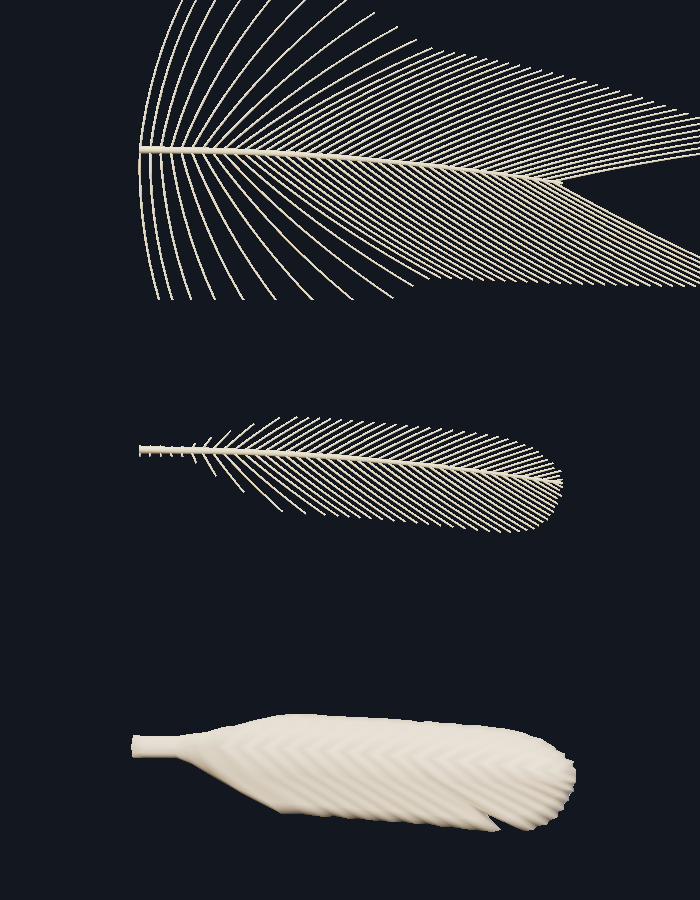
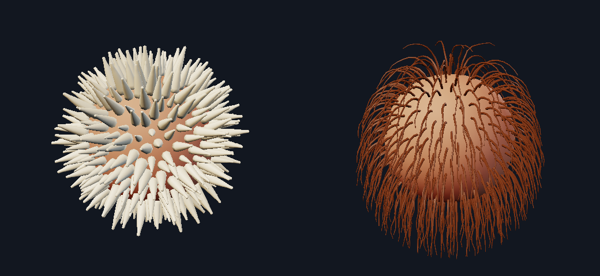
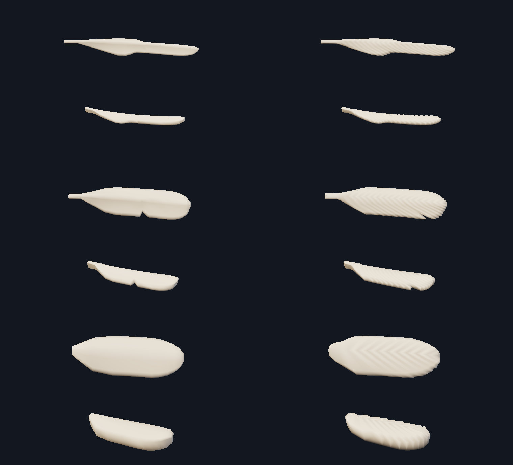
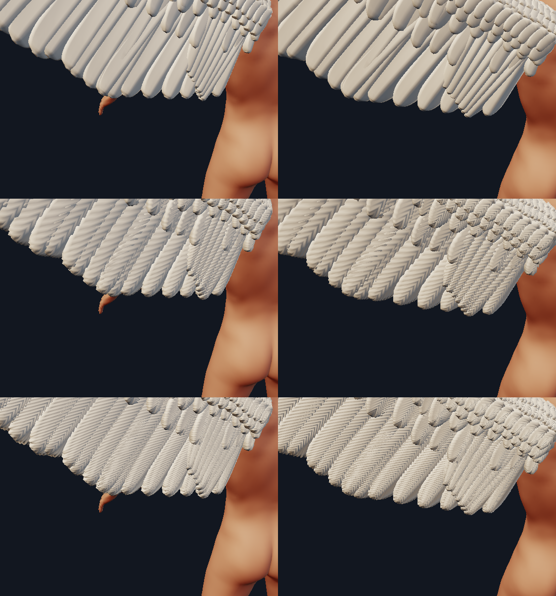
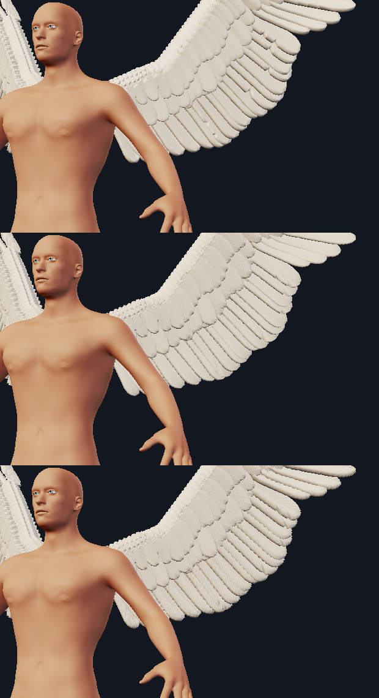
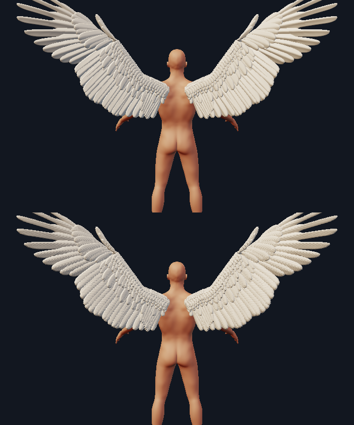

# The hair system, the particle system, and feathers grown with them

Two general systems under `minimaster/core`, with no body, wing or MakeHuman code in them, and the first
thing made with one of them: the wing's feathers, grown from their shafts by the hair system instead of drawn
as sheets. (The particle system is there and tested, and nothing in the shipped pipeline uses it yet; see the
limits.)



*One secondary: its barbs grown as strands from the shaft; the strands cut at the feather's outline; the cut
strands zipped into the feather's mesh (700 triangles; as tubes the same strands are 4,920).*

## The hair system (`core/hair.py`)

A strand is a curve that grows from a root: a hair, a barb, a whisker. All the strands of a system have the
same number of points, so a system is one array (`Strands.points`, `(N, K, 3)`) and every operation is one
vectorised step over all of them. Data and meshing are separate.

| | |
|---|---|
| `grow(roots, heading, length, steps, bend, steer)` | strands leave their roots along a heading and bend as they go. `steer(points, heading, travelled)` is called before every step: gravity, wind, a comb and collision are all a `steer`. With none, every strand is an arc and all of it is computed at once |
| `cut_length`, `trim(strands, margin, at, scale)` | a haircut: every strand is cut where it first leaves a region (a signed margin function) and resampled along what is left |
| `between(guides, per_gap)` | children interpolated between consecutive guides |
| `clump(strands, group, amount)` | the strands of a group drawn towards the group's middle strand |
| `roughen(strands, amount, seed)` | repeatable unevenness (`hash01`: no random state anywhere) |
| `tube_mesh(strands, radius, sides)` | one closed tube per strand: 2 x `sides` triangles a segment |
| `sheet_mesh`, `sheet_meshes` | the strands **zipped**: consecutive strands are the rows of one surface, thickened into a closed slab |

The zipped sheet is the clever mesh. Barbs hook to their neighbours on a bird; here consecutive strands share
an edge, so a segment costs two triangles where a tube costs twelve. Alternate rows are raised a little, which
makes every strand a ridge. The far face is a coarse sheet of its own (every second row, three columns: the
two edges and the keel: a sixth of the near face's triangles), stitched to the fine face row for row: the
closed slab takes about two thirds of what one with two fine faces would. `sheet_meshes` builds many sheets of one size in one pass and
they share one set of triangles.

## The particle system (`core/particles.py`)

A particle is a place and a way round: a position, a frame (heading, up, side) and a size. A system is three
arrays (`Particles`).

| | |
|---|---|
| `emit_curve(curve, count \| at)` | particles along a polyline, heading along it |
| `emit_surface(mesh, count, seed, density, flow)` | particles spread evenly over any mesh (Halton candidates, chosen farthest-first; density 0 gets none), each bound to its triangle so the system can `follow` the mesh when it moves |
| `jitter(particles, seed, yaw, tilt, size)` | repeatable variation |
| `instance(template, particles)` | one template mesh on every particle, realised in one pass: the template's vertices times N frames, its triangles N times with an offset. A left-handed frame places the mirror image |

A strand is what a particle leaves behind when it moves: `hair.grow` takes a particle system's positions and
headings as its roots. Emission is static (particles are placed, not simulated over time).



*400 particles on a 768-triangle ball. Left: a template on each (51,200 triangles realised in 2 ms). Right:
400 strands grown from the same particles under a `steer` that pulls them down (grown and meshed in 10 ms).*

## Feathers grown from their shafts (`character/feather.py`)

`wings._blade` draws a feather as an outline filled with a smooth sheet. `feather.barbed_blade` takes the same
arguments and fills the same outline with a hair system:

1. the shaft is a curve along +X, bowed by `sweep`;
2. a barb leaves it on either side every so often, at `BARB_ANGLE` (38 degrees) to the shaft, squarely at
   the very base and more acutely towards the tip, and sweeps further towards the tip as it goes (`BARB_HOOK`);
3. every barb is cut where it reaches the feather's outline, which is `_blade`'s own (the narrow leading
   vane, the notch of a slotted primary, the rounded end, a covert's butt), so the silhouette is the same;
4. each barb is its own length (the edge frays by up to 3.5%, by `seed`); a **split** in the vane is the row
   between two barbs cut short;
5. the cut barbs are zipped: one row a barb and one between, the barb's row raised `BARB_RELIEF` (0.22 sheet
   thicknesses), a column beside the shaft for its ridge and one where the edge's bevel starts. The feather
   ends in a point its last barbs run into (a fan), not a wall.



*Left: today's sheet. Right: the same arguments, grown. A slotted primary (896 -> 870 triangles, 25 barbs a
side), a secondary with a split (896 -> 700, 20 barbs), a covert (304 -> 302, 11 barbs).*

A feather gets as many barbs as the triangles `_blade` spends on the same feather pay for: the sheet's own rows
(`wings._blade_rows`, less the rows it adds for a split) times its columns, at 34 triangles a barb pair on a
flight feather and 26 on a covert. So a grown feather never has more triangles than its sheet (each of a
wing's 271 has 2 to 28 fewer). `detail` multiplies the count; `both` barbs the far face as well, for two
thirds more triangles on that feather.

**Feathers are grown in batches.** `barbed_blades` takes the arguments of many feathers and grows all that
share a mesh size as ONE strand system. A wing's 271 feathers are ten sizes:

| barbs a side | columns | feathers |
|---|---|---|
| 7 | 5 | 126 (the small coverts) |
| 11 | 5 | 104 (greater and median coverts) |
| 18 to 25 (eight sizes) | 7 | 41 (primaries, secondaries, tertials, scapulars, the alula) |

so a wing is ten passes of arithmetic (0.07 s for all 271, where the sheets take 0.12 s one by one). In the
wing builder a feather that is to be grown is first only its arguments and its placement (`wings._Grown`);
when all are known they are grown together and put in place.

## On the wing

`wing:style=feathered,grown=1` (the parameter "Grown feathers (barb detail)"; `feathered_pieces(grown=1.0)`).
It is opt-in: at 0, the default, the wing is its sheets, bit for bit. The layout, the joints, the 275 pieces
and their names, every pose and the mirrored right wing are the same; only the 271 feathers' meshes differ.

`underside` (on by default, with grown feathers only) barbs both faces of the 41 flight feathers: a spread
wing shows their undersides from the front. The coverts' far faces lie on the wing and stay plain.



*From behind: today's sheets; grown at detail 1; grown at detail 2.*



*From the front: sheets; grown with `underside=false` (the flight feathers' undersides plain); grown (barbed
underneath).*



One wing (275 pieces), and the pair on the neutral man with its sleeve and collar (340 shells a side):

| | triangles, one wing | against the sheets | wing rig built |
|---|---|---|---|
| sheets (today) | 91,880 | | 0.16 s |
| grown, detail 1, `underside=false` | 87,054 | 5% fewer | 0.08 s |
| grown, detail 1 (flight feathers barbed on both faces) | 106,236 | 16% more | 0.08 s |
| grown, detail 2 | 211,132 | 2.3 times | 0.13 s |

The pair on the figure builds in about 0.25 s grown against 0.54 s as sheets.

Printability report on that figure (the report warns "fragile" when over 20% of an appendage's area is under
0.3 mm, and blocks when over 30% is under 0.2 mm):

| | 32 mm: under 0.2 / 0.3 mm | 26 mm: under 0.2 / 0.3 mm |
|---|---|---|
| sheets (today) | 1.3% / 3.0%, passes | 1.8% / 34%, warns |
| grown, detail 1, `underside=false` | 2.5% / 5.6%, passes | 3.5% / 10%, passes, no warning |
| grown, detail 1 | 3.6% / 6.9%, passes | 4.9% / 12%, passes, no warning |
| grown, detail 2 | 23% / 27%, warns | 25% / 32%, warns |

One piece, nothing detached, spread and folded, at every detail. At detail 1 the barbs' ridges ADD to the
vane (the rows between barbs are where the sheet was), which is why the half-size figure stops warning. At
detail 2 the ridges themselves are finer than 0.2 mm on a 32 mm figure: they are for renders and large prints,
and the report says so.

## Known limits

* A barb's ridge is 0.044 units high: 0.08 mm on a 32 mm figure. It shows in renders and on large prints; on
  a 32 mm print the barbs and the fray of the edge are below what resolves (the outline and a split are not).
* **Nothing shipped uses the particle system yet.** The feathers use the hair system only: a feather's barb
  roots are laid along its shaft by `feather.barb_strands`, and the wing's feathers are placed by the wing
  builder. `core/particles.py` is exercised by its tests and by `tools/feather_view.py systems`.
* A covert's far face is a plain coarse sheet (it lies on the wing), and so is a flight feather's with
  `underside=false`. The shaft's ridge is on one face only.
* The loose down at the base of a feather is not grown: barbs are zipped along their whole length.
* Barbs are straight in the plane of the vane apart from their sweep; `clump` and `roughen` are in the hair
  system but a feather only uses length fray and splits so far.
* `hair` and `scatter` (the kinds that cover the skin, [hair_scatter.md](hair_scatter.md)) were written before
  these cores and still carry their own emitter and strand code (`character/scatter.py`,
  `character/strands.py`). They are to move onto `core/particles.py` and `core/hair.py`.
* The covert field is still laid out feather by feather by the wing builder; emitting it from one particle
  emitter bound to the arm's bones is the particle system's next job.

## Regenerating the figures

```
python tools/feather_view.py strands docs/images/feather_strands.png
python tools/feather_view.py systems docs/images/systems_core.png
python tools/feather_view.py feathers docs/images/feather_grown.png
python tools/surface_view.py docs/images/wing_grown_close.png "wing:style=feathered@gender=1,muscle=0.55|wing:style=feathered,grown=1@gender=1,muscle=0.55|wing:style=feathered,grown=2@gender=1,muscle=0.55" --at 4.2,3.6,-1.2 --r 2.7 --size 560x400 180,22 205,30
python tools/surface_view.py docs/images/wing_grown.png "wing:style=feathered@gender=1,muscle=0.55|wing:style=feathered,grown=1@gender=1,muscle=0.55" --at 0,4.6,-0.6 --r 8.6 --size 700x420 180,14
python tools/surface_view.py docs/images/wing_grown_front.png "wing:style=feathered@gender=1,muscle=0.55|wing:style=feathered,grown=1,underside=false@gender=1,muscle=0.55|wing:style=feathered,grown=1@gender=1,muscle=0.55" --at 4.6,5.2,-0.2 --r 3.6 --size 620x380 20,-8
```
