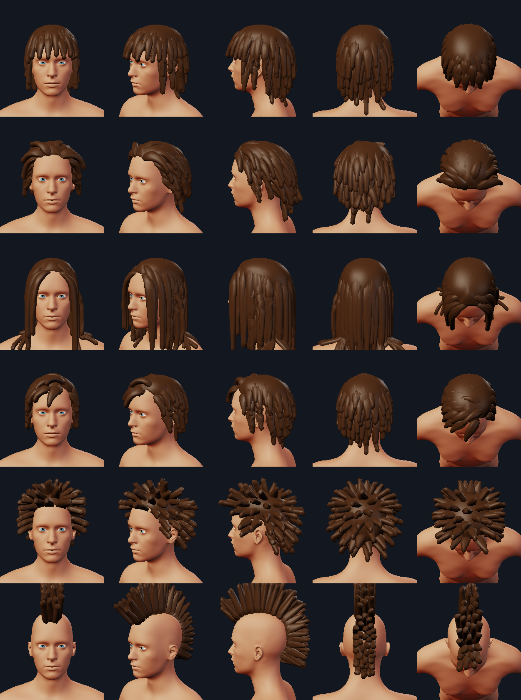
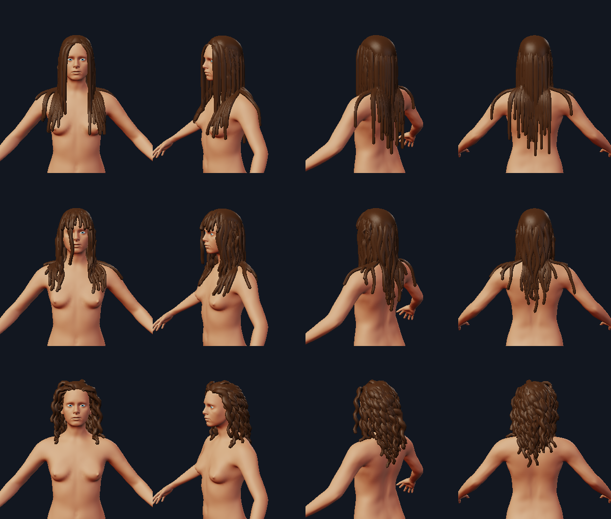
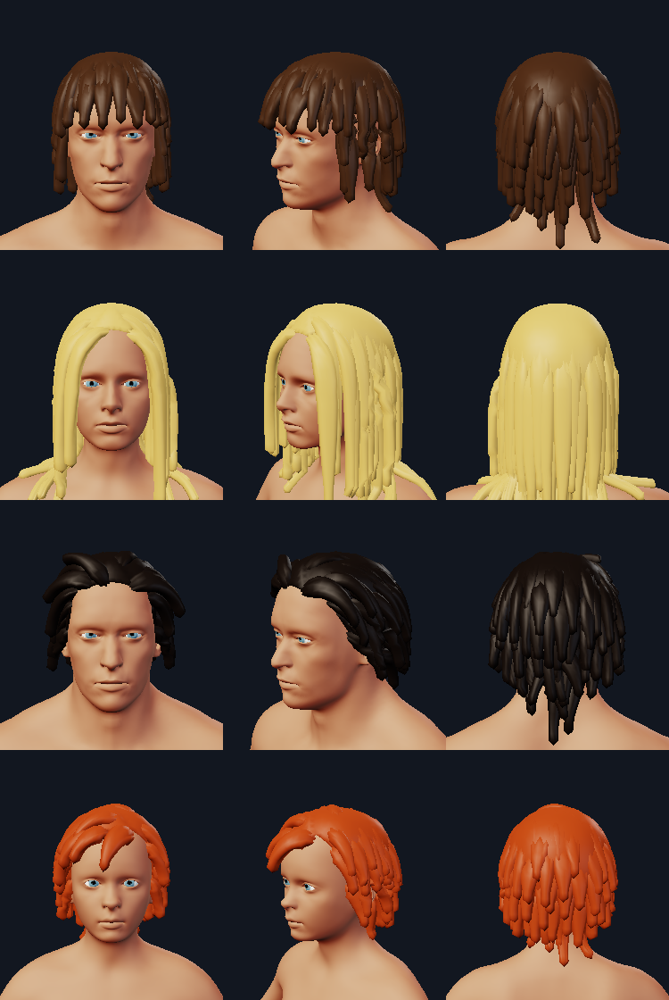
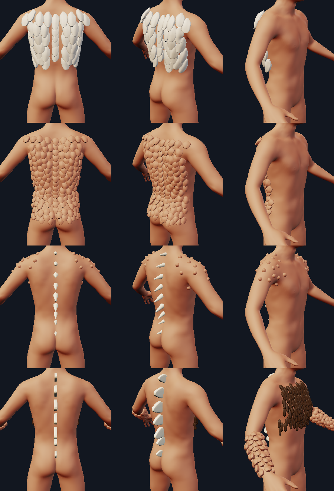
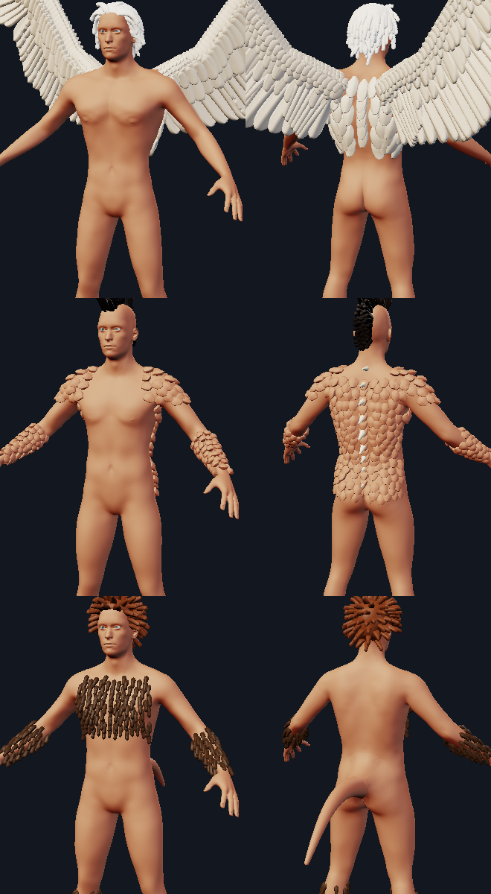

# Hair and scatter: things that grow from many points of the skin

(These two kinds were written before the general hair and particle systems of
[hair_particles.md](hair_particles.md) and still carry their own emitter and strand code; they are to move
onto those cores.)

Two kinds of appendage that cover a region of the body instead of standing on one root:

* **`hair`** is a strand system: locks grown from the scalp and combed into a style.
* **`scatter`** is a particle system: instances (feathers, scales, spikes, dorsal plates, studs, tufts of
  fur) stood on points spread over a region.

Both are built on one emitter, both are records of a character like a wing or a tail
(`--add hair:style=mohawk`, `--add scatter:item=scale,region=shoulders`, the Add menu of the Character tab),
and both are made to **print**: every piece is a closed shell sunk into the body, and the printability
report measures them the way they print.



## What a printer can make of hair

On a 32 mm figure one body unit is 1.83 mm, the head is 4 mm tall and 2.7 mm wide, and the thinnest wall a
resin printer holds safely is 0.3 mm (0.2 mm resolves, fragile). A single hair is a thousandth of that. What
sculptors model instead is a mass of **locks**, each a tapered strip with a crest, lying over one another,
and that is what a strand is here: the centreline of one lock. About 80 of them cover a head at 32 mm;
more are finer and need a bigger figure.

| | units | at 32 mm |
|---|---|---|
| lock width (default) | 0.30 | 0.55 mm |
| lock thickness (default) | 0.17 | 0.31 mm |
| narrowest / thinnest part of a lock (`tip_floor`) | 0.14 | 0.26 mm |
| how deep a lying lock's underside is in the skin | 0.05 | 0.09 mm |
| undercoat over the scalp | 0.09 - 0.24 | 0.16 - 0.44 mm |

## The emitter (`scatter.py`)

A **region** is a set of cage quads (scalp, beard, back, upper back, lower back, chest, shoulders, forearms,
upper arms, shins, thighs, spine), worked out once on the neutral body from its joints; the cage's topology
never changes, so the same quads are the scalp on every body. The hairline is a curve of height against
azimuth round the head (forehead, the corner at the temple, the sideburn, over and round the ear, the nape).

`emit(base, region, count, seed)` spreads points over a region and stores each as four cage vertices and
four weights, so on a morphed body the same weights give the same place on that body's skin. Nothing is
random:

* candidates are a Halton sequence and the points are chosen farthest-first, so a seed gives the same points
  on every machine and no two crowd one another;
* a symmetric emission is a row down the midline (where the region reaches it) and then mirror pairs,
  mirrored through the cage's own vertex map, exact on a symmetric body;
* a quad whose weight is 0 gets nothing (a mohawk's crest is the scalp weighted to a strip);
* `emit_line` walks the midline of a region instead (the spine): evenly spaced by length, each point on a
  midline edge of the cage.

## Strands (`strands.py`, `hair.py`)

`grow` steps every strand at once from its root. It leaves the skin at `lift`, turns towards the ground at
`droop` radians per unit of length, and where it meets the body it is pushed out to its clearance and slides
along the skin (the body is read through the same `SkinProbe` the wings use). A wave or a curl is laid over
the path afterwards and pushed out of the body again.

`lock_meshes` turns each centreline into a closed shell of twelve vertices a ring:

* where the lock **lies on the skin** its section is a crest with a lower ridge either side and a groove
  between, a flat underside 0.05 under the skin, and low walls at the edges: it prints as a ridged relief
  on the head, and one lock reads as several strands;
* where it **hangs clear of the body** the same twelve points become an oval as thick as the lock from
  every side, with no taper to a film, because nothing backs it there;
* a lock that **stands on its root** (a spike, a crest) is sunk a quarter of its length into the head at
  its full width and thickness: its root is its whole weld, and every lock of a crest has 6 - 7% or more of
  its volume in the head.

`cap_mesh` is the undercoat: the scalp's own skin (one subdivision level, the skin that is drawn and
printed) thickened outwards, thinning to a fifth at its edge so the hairline is a line and not the rim of a
bathing cap. No bare scalp shows between the locks and every lock has something to fuse to.

A style is a **comb pattern**, the direction the hair is laid in; length, volume, fall, wave, curl and the
fringe are separate numbers.

| style | the hair is combed |
|---|---|
| `natural` | from the whorl at the back of the crown: forwards over the forehead (the fringe), down the sides and the back |
| `swept_back` | straight back off the face |
| `centre_part` | to each side of a parting down the middle; the back of the head just falls |
| `side_part` | the same, parted over the left eye |
| `spiky` | standing off the head all over |
| `mohawk` | a crest along the midline, standing in the head's middle plane, the rest of the scalp bare |

The fringe of `natural` is cut where forward-combed hair reaches the brow (`fringe` 1.0), higher or lower.



Roots ride the morphs, so a head of hair keeps its locks when the body under it changes:



| parameter | default | |
|---|---|---|
| `style` | `natural` | the comb pattern |
| `length` | 1.0 / 0.9 / 2.4 / 0.7 / 0.5 / 1.0 by style | units; 0.3 cropped, 1 to the jaw, 2.5 to the shoulders, 5 to the waist |
| `locks` | 80 | 12 - 240 |
| `width`, `thickness` | 0.30, 0.17 | of one lock |
| `volume` | 0.3 | how far the hair stands off the head (lift, the undercoat's thickness) |
| `droop` | 2.5 | "Fall": 0 stands straight out, 5 hangs like wet hair |
| `wave`, `curl` | 0 | amplitude of a sideways wave, radius of ringlets |
| `fringe` | 0.8 | `natural` only |
| `undercoat` | on | the cap under the locks |
| `color` | brown | brown, black, chestnut, blonde, red, grey, white |
| `seed` | 0 | another arrangement of the same hair |

## Scatter



Each item is a closed shell in its own frame (root at the origin, +X the way it points, +Y its upper face).

| item | default region | count | size | what it is |
|---|---|---|---|---|
| `feather` | upper back | 44 | 0.95 | the wing's covert blade: the feather tract between the wings |
| `scale` | back | 150 | 0.42 | a keeled shield with a rounded free end |
| `spike` | spine | 9 | 0.75 | a thorn: it keeps its width most of its length |
| `plate` | spine | 7 | 0.95 | a dorsal plate standing in the body's middle plane |
| `stud` | shoulders | 40 | 0.12 high | a dome |
| `tuft` | forearms | 110 | 0.42 | a short lock from `strands.py`: fur |

* **Flat items lie on the skin** (`wrap`). A rigid feather set down along the skin's tangent at its root is a
  shelf where the skin falls away (over the top of a shoulder) and is half buried where the skin rises under
  it. Each instance is bent over the skin it covers instead: the body is read at a small grid of points under
  it and every vertex keeps its own height above the skin there. Its underside is 0.04 under the skin all
  along (the weld), its root end deeper (the row above covers it), its free end rises at `lift` degrees.
* **Standing items** (spike, plate, stud) are placed rigid at `lift` and sunk by a share of their width.
* Things lie **down** the trunk and **along** a limb (elbow to hand); the right side is the mirror image of
  the left: on a symmetric body outright, on a lopsided one each side on its own skin with the mirrored
  shape.
* On the `spine` the points are a line; `grade` makes the row tall in its middle and small at its ends.
* `vary` changes size, lift and direction from one to the next (a mirrored pair varies alike); `seed`
  changes the arrangement; `color` is `auto` (feathers as the wing's, scales and studs as the skin, spikes
  and plates as horn, tufts as hair) or a material.



## Printing

Every piece is its own named shell (`hair-1/lock012`, `hair-1/cap`, `scatter-1/i007`), so the printability
report can name one that is detached.

The report used to measure every shell alone, which is right for a wing's membrane (a free wall) and wrong
for a lock of hair: half of it is sunk in the head, the slicer unions the two, and what prints there is the
head with a ridge on it. Kinds that lie on the body (`Kind.fused`) are measured as part of the printed solid
(`print_report.fused_thickness_samples`): a ray goes in from a face and is followed through every shell of
the group and the body until it is out of all of them. Faces that are buried are not surface and are left
out, and an air gap under 0.06 mm (`PrintRules.seal_gap_mm`) is not a gap. Where the hair hangs free of the
body the answer is the hair's own thickness again.

Measured at 32 mm on the neutral man, level 1 (the report blocks when over 30% of an appendage's area is
under 0.2 mm and warns "fragile" when over 20% is under 0.3 mm):

| | under 0.2 mm | under 0.3 mm | report |
|---|---|---|---|
| hair, `natural`, each shell alone (the old measure) | 9% | 48% | warns |
| hair, `natural` | 4% | 18% | passes |
| hair, `centre_part`, length 4 | 5% | 13% | passes |
| hair, `spiky` | 0.4% | 24% | warns (it stands free) |
| hair, `mohawk` | 14% | 36% | warns (it stands free) |
| feather tract | 0.3% | 9% | passes |
| scales on the back | 5% | 6% | passes |
| spikes down the spine | 14% | 38% | warns (their tips) |
| dorsal plates | 0.2% | 14% | passes |
| studs | 1% | 12% | passes |
| tufts on the forearms | 7% | 50% | warns |

Nothing blocks, alone or together: an angel (feathered wings, the feather tract, swept-back hair), a
scaled figure (scales on the back, shoulders and forearms, spikes, a mohawk), a furred one (tufts on chest,
forearms and shins, spiky hair, a tail) and horns with hair all export from the Character tab with no piece
detached; what the report adds for them is notes that two appendages intersect (a wing's tertial and a
feather of the tract, a horn and the undercoat), which the slicer unions. The six scatter items pass on the
woman, the heavy man and the child as well.

Two things the report does not do for these kinds, which the tests do instead:

* It judges an appendage's root weld by its **best-buried** piece (of a sample of eight, for an appendage of
  many pieces). For pieces that each stand on their own root (a mohawk's locks, spikes, plates, studs,
  tufts) `tests/test_hair_scatter.py` checks every piece: over 5% of its volume in the body.
* A character with hair is meshed at **level 1** by default (`HairKind.fitted_level`), like one with a
  skin-covered ossicone: the undercoat is the drawn skin thickened, 0.03 thick at the hairline, and the bare
  cage (level 0, 0.01 - 0.02 outside it on a head) would cut that edge ragged. A scatter alone stays at
  level 0: it is welded to the cage itself.

Across five bodies (default, man, woman, heavy, child) the four styles that lie on the head
have 14 - 21% of their area under 0.3 mm at 32 mm, either side of the line where the report starts to warn
(what is thin is the free ends of the locks). At 54 mm the same heads have at most 8% under 0.3 mm and the
report says nothing.

Building costs 0.05 - 0.2 s for a head of hair and for a scatter; the report 1 - 3 s.

## Known limits

* **The roots sit on the body before it is moulded round other appendages.** Next to a wing's root the
  skin is raised by the wing's own muscle masses afterwards, and the nearest feathers of a tract are partly
  under it. Hair and scatter should be built last, on the moulded skin.
* **Long hair that lands on top of a shoulder runs along it** instead of falling in front of it or behind.
* The collision is with the body only: locks pass through one another (they print as one mass, which is the
  point, but there is no layering of one lock over the next), through wings, horns and other appendages.
* The probe reads the cage, not the subdivided skin (on a head the two are 0.01 - 0.02 apart; the weld
  depths allow for it).
* Hair is not posed and does not move with a pose of the body (the character has none yet).
* Beards and eyebrows have a region (`beard`) but no style of their own yet; the beard region includes the
  lips.
* At 32 mm a lock's grooves are 0.03 mm deep: they are for renders and large prints.

## Regenerating the figures

```
python tools/surface_view.py docs/images/hair_styles.png "hair:style=natural|hair:style=swept_back|hair:style=centre_part|hair:style=side_part|hair:style=spiky|hair:style=mohawk" --head --size 250x280 0,5 50,10 100,8 180,8 0,65
python tools/surface_view.py docs/images/hair_long.png "hair:style=centre_part,length=4.0@gender=0|hair:style=natural,length=3.2,wave=0.08@gender=0|hair:style=swept_back,length=2.4,curl=0.07@gender=0" --at 0,5.4,0.1 --r 4.2 --size 300x340 0,5 60,10 135,10 180,8
python tools/surface_view.py docs/images/hair_bodies.png "hair@gender=1,muscle=0.55|hair:style=centre_part,color=blonde@gender=0|hair:style=swept_back,color=black@gender=1,weight=0.9,muscle=0.8|hair:style=side_part,color=red@age=0.2" --head --size 250x280 0,5 50,10 180,8
python tools/surface_view.py docs/images/scatter_items.png "scatter@gender=1,muscle=0.55|scatter:item=scale@gender=1,muscle=0.55|scatter:item=spike;scatter:item=stud@gender=1,muscle=0.55|scatter:item=plate;scatter:item=tuft,region=chest;scatter:item=scale,region=forearms,count=120,size=0.3@gender=1,muscle=0.55" --at 0,3.3,-0.2 --r 3.7 --size 300x330 180,12 225,20 300,15
python tools/surface_view.py docs/images/scatter_creatures.png "wing:style=feathered;scatter;hair:style=swept_back,color=white@gender=1,muscle=0.55|scatter:item=scale;scatter:item=scale,region=shoulders,count=60;scatter:item=scale,region=forearms,count=120,size=0.3;scatter:item=spike;hair:style=mohawk,color=black@gender=1,muscle=0.8|scatter:item=tuft,region=chest;scatter:item=tuft;scatter:item=tuft,region=shins,count=140;hair:style=spiky,color=chestnut;tail@gender=1,muscle=0.6" --at 0,3.2,-0.1 --r 6.2 --size 330x400 20,8 200,12
```
