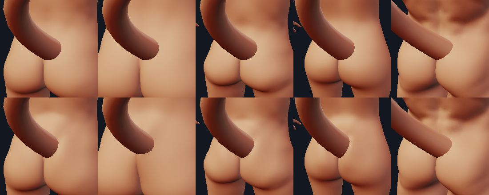
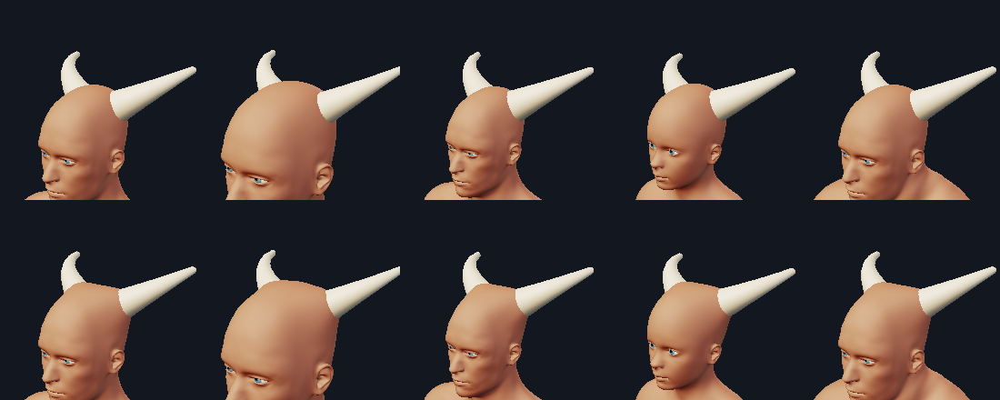
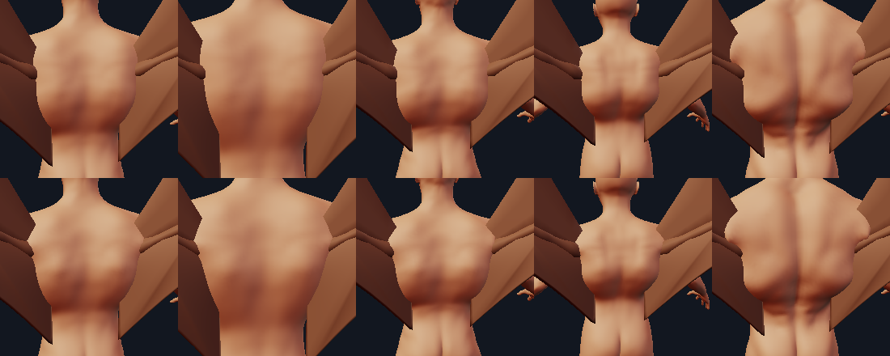
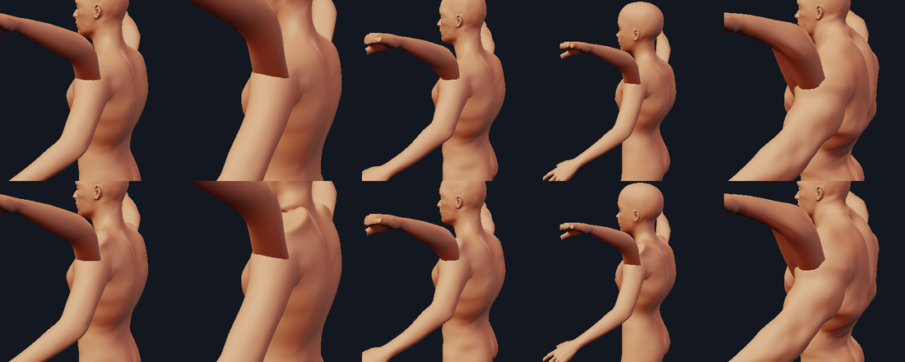
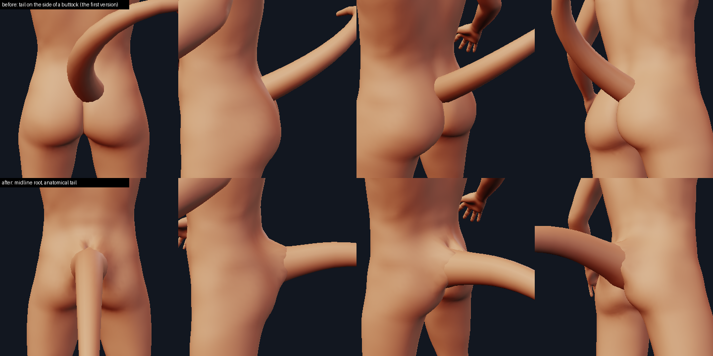

# Skin junctions: the body's skin flows into an appendage root

Design context: [appendages_system_design.md](appendages_system_design.md) (the S1 status in section 6e);
the appendage kinds it plugs into: `kinds.py`; the body it moves: `mhbase.py` (the 19,158-vertex MakeHuman
base, the 13,378-quad body cage). **S1b** made the core robust: a validity pass that bounds
stretch and forbids new self-intersections, skin ownership (a root only moulds the skin of its own part of the
body), body-relative sizes, tubes that follow the real mesh, and a public quality helper
([S1b: what changed and what it cost](#s1b-hardening-the-core)). **S6** (round 2, the core again) fixed what the
independent review of S1b found at the root: a tube that lies inside its mesh by construction, a junction that
cannot make the join worse than none, a head that is not reshaped, sizes that do not move with the appendage's
anatomy coupling, per-spec switches, and a cost that is no higher than before for all of that (about 15 % lower warm on the
largest figure)
([S6: round 2 of the core](#s6-round-2-of-the-core)).

An appendage is its own closed shell that overlaps the body, and the slicer unions overlapping shells. That
is what the first versions did and it is what read as "slapped over the skin": where a tail, a horn, a wing
arm or an extra limb enters the body there was a hard intersection curve and nothing else, the skin did not
rise to meet the root and no flesh gathered around it. The body mesh cannot get new vertices (the 1,280
morph targets address it BY VERTEX INDEX) but its vertices can be MOVED after the morphs are applied. That
is the whole mechanism: `junction.apply_junctions(base, verts, specs) -> verts'`, a pure, deterministic,
topology-preserving displacement of body cage vertices around each appendage root.



The same on horns, a bat wing's arm and an extra pair of arms (before on top, after below; neutral, tall,
short, child, heavy):





## The API (what other tracks build on)

Everything is in the **MakeHuman frame (Y up)**, the frame of the morphed body and of `Placed.mesh()`.

```python
from minimaster.character import junction as J

spec = J.JunctionSpec(
    name="tail-1",
    points=[(x, y, z), ...],     # the centreline, ROOT FIRST: the first points are inside the body
    radii=[r0, r1, ...],         # radius of the surface the skin should hug at each point
    width=1.5,                   # fillet width W in units of base_radius   (W = width * base_radius)
    base_radius=0.45,            # None: max(radii)
    height=0.8,                  # how high the skin climbs the root, over W (1 = a quarter circle)
    sharpness=3.0,               # k of the profile: 2 = quarter ellipse (C1 at W), 3 = C2 at W
    pull=1.0,                    # share of the in-plane redistribution (0 = the skin only climbs)
    strength=1.0,                # scales the whole spec; 0 switches it off
    lead=0.25,                   # the skin starts to rise this many W before the tube's axis reaches it
    mounds=(J.Mound(center, radius, height, end=None, axis=None, stretch=1.0, direction=None,
                    scale=None),),   # scale="trunk": radius / height are FRACTIONS of the body's own trunk radius
    keep=(J.Keep(center, radius, fade=0.5),),   # spheres where the skin must stay as it is
    max_move=None,               # cap on one vertex (default 1.6 W, at least 1.25 x the tallest mound)
    owner="trunk")               # S1b: the part of the body the root belongs to (None: from the skin it exits)

new_verts = J.apply_junctions(base, verts, [spec, ...], info=None)   # pure; verts if nothing to do
q = J.junction_quality(base, verts, new_verts, specs, levels=(1, 2))   # S1b: the validity numbers
assert J.quality_violations(q) == []                                  # S1b: every bound holds
body_verts = J.shaped_body(base, verts, placed, enabled=True)         # from built appendages
specs = J.junction_specs(placed)                                       # [Placed.junction()]
numbers = J.measure_junction(base, verts, new_verts, spec, levels=1)  # see "Numbers"
```

* **`JunctionSpec`** is immutable data (tuples, hashable, `to_dict()` / `from_dict()`, `digest()`,
  `mirrored()` for the right-hand twin of a left-hand spec, `transformed(4x4)` for a rigid motion with
  uniform scale). `J.specs_digest(list)` is a cache key that does not depend on the order. A spec without
  `points` is mounds only (a sacral rise with no tube). A **`Mound`** is a smooth bulge of the skin along its
  own normal (`direction=` a fixed direction instead), `height` < 0 a hollow, `end=` turns it into a ridge or
  a groove along a segment, `axis=` with `stretch=` elongates it. A **`Keep`** is a sphere inside which the
  spec's displacement is zero, growing back to full strength over `fade * radius`: lips, eyelids, a hand.
* **`apply_junctions(base, verts, specs, info=None)`**: `verts` are the **UNDEFORMED morphed control
  vertices** (19,158 x 3) the appendages were placed on; only body cage vertices move (eyes, teeth, joint
  markers do not), the topology and the numbering are untouched so every morph target still addresses the
  same vertices. Returns `verts` ITSELF when no spec is active (a character without appendages is
  bit-identical), never modifies its input, never fed its own result (that would be a second junction on
  the first). Each spec is computed from the INPUT body and the displacements are summed (so the result
  does not depend on the order of the specs and a mirrored pair gives a mirror-symmetric result on a
  symmetric body, to 1e-12), each spec is capped by its own `max_move`, the sum by the largest, and a
  **validity pass** backs off the displacement of the corners of any cage quad that would flip (normal
  turned past 78 degrees) or collapse (area under 12% of its own). `info` receives `moved`, `max_move`,
  `limited` (vertices backed off), `rounds`, `specs`.
* **`Placed.junction(controls=None)`** (`kinds.py`) returns the spec of one placed appendage under its pose
  controls (cached per controls), or `None`. `Kind.junction(placed, controls)` is the hook a kind overrides;
  the base class returns `None`. Every kind has a generic default (below). The spec is built from the placed
  geometry (the loft's own rings, the wing's posed joints, the limb rig's posed joints), never from the
  body, so it is the same on every body.
* **Parameters** of the four kinds (a `ParamSpec`, in the property grid, saved in the record):
  `fillet` (width in root radii; **0 = no junction**; the spec's `width`) and, for tail and horn, `flare`
  (radius multiplier at the base, easing to 1 over the first quarter of the length: `make_tail(...,
  flare=, flare_length=)`, `make_horn` likewise; 0 changes nothing, bit for bit).
* **Pipeline** (`verts -> instantiate -> shaped_body -> everything that meshes the body`):
  `Character.shaped_body(base, verts, placed)` (off when `character.anatomy["junction"]` is false, written
  to the document only then; `Character.junction_enabled`); the CLI (`--no-junction` / `--junction`, both
  saved with `--save-character`); `lab.Engine.shaped_state(...)` (draft, final, pick and export; the
  panel's "Skin flows into the appendages" check box, `LabDocument.set_anatomy(junction=)`); the print path
  (`printprep.character_print_shells(base, shaped_verts, levels)` and `print_report.appendage_report(...,
  verts, body_verts=shaped_verts)`, so the root weld is measured against the body that prints). **Placement
  (`SurfaceAnchor`, the mirror-face map, `kinds.instantiate_all`, `Engine.anchor_points`) keeps using the
  undeformed `verts`**: otherwise an anchor chases its own displacement.
* **`measure_junction(base, verts, shaped, spec, levels)`** returns the numbers in the table below
  (`min_area_ratio`, `flipped`, `join_angle_deg_*`, `p95_dihedral_deg_*`, `dihedral_increase_*`,
  `curvature_step_*`); tests and `tools/junction_report.py` use it.

### Supplying anatomy (what a later track writes)

The horn is the first kind to do it ([anatomy_horn.md](anatomy_horn.md): the spec comes from `hornrig.junction_spec`, and
the sheath's foot and the soft-tissue layer are built against the cage as that spec moulds it,
`hornrig.moulded_cage`). A track that knows what a tail root really is overrides `Kind.junction` (or builds specs itself and passes
them to `apply_junctions`): the centreline of the first vertebrae with the real radii, a sacral **mound**
over the sacrum, a hollow either side, `keep` around anything that must stay sharp, its own `width` and
`height`. Nothing else changes: the pipeline, the cache keys (a content digest of the specs), the print
report, the checks (no flip, no collapse, cap, mirror symmetry) are generic.

## The mechanism

For a body vertex `p` at distance `delta` outside the tube (`0 < delta < W`; `delta` is measured to the
round-cone chain of the centreline, `|p - c(t)| - r(t)`):

1. **Remaining distance** `rho = W f(delta / W)` with `f(u) = 2u^2 - u^3` (`f(0) = 0`, `f(1) = 1`,
   `f'(1) = 1`: C1 at both ends, the skin is unchanged at `W` and tangent to the tube at the join). The
   vertex is pulled toward the tube **in the skin plane** by `delta - rho`. The cage is only 2 to 4 quads
   wide across a fillet, so this does not make the fillet, it puts the vertices ALONG it where the profile
   is steep.
2. **Climb** along the tube wall (the tangent part of the skin normal at the closest point, so a tube
   leaving the skin at any angle, from perpendicular to lying along it, climbs the way it should) to the
   height of the profile `h(rho) = H (1 - sqrt(1 - (1 - rho / W)^k))`, `H = height * W`: vertical at the wall
   (`rho = 0`), horizontal at `rho = W`, curvature-continuous at `W` for `k >= 3`. Every vertex ends on the
   profile.
3. **Only the exposed tube is moulded around.** The displacement is weighted by how far the closest
   centreline point is above the skin: a tube buried more than a root radius (at most `W`) and `lead * W`
   under the skin leaves it alone, the skin starts to rise `lead * W` before the axis reaches it, and (S1b) it
   never climbs higher than the tube stands above it.
4. Vertices **inside** the tube climb with it (they are hidden) and are kept inside it (a bent or tapered
   tube would otherwise leave them outside once they climbed).
5. (S1b) The tube displacement is weighted by the **ownership** of the vertex (0 on another part's skin),
   capped in width by the part's size, **smoothed** over the cage, then mounds (relative sizes resolved) and
   keep spheres are added, the result is faded where two sheets of skin touch, capped, and the **validity
   pass** of [S1b](#s1b-hardening-the-core) backs vertices off until the skin is valid.

Why not just "move toward the appendage surface so the remaining distance is `W f(delta/W)`": for a tube
leaving the skin at a right angle that is an in-plane compression: the vertices bunch up and nothing rises.
The profile (2) is what makes the fillet; the remap (1) is what makes the cage resolve it.

## Defaults per kind (generic; the anatomy tracks replace them)

| kind | tube | `fillet` (W in root radii) | height | mound |
| --- | --- | --- | --- | --- |
| tail | superseded by the tail's own anatomy spec (`tailrig.junction_spec`, [anatomy_tail.md](anatomy_tail.md)): the flared skin tube from the stem to 2 R beyond the skin point, a sacral rise, two cheek mounds, a keep along the cleft | 1.5 | 1.0 | ridge up the back + cheeks, cleft kept |
| horn | the sheath's first part (hornrig: the radius law with the ellipse's minor axis, to the foot's top) | 1.0 | 0.6 | the tent: radius 2.2 R, height max(0.35 R, 0.10), along the horn's axis; Keep on the ear and the eye ([anatomy_horn.md](anatomy_horn.md)) |
| wing | shoulder -> elbow of the posed arm, radius = the arm bone's | 3.0 | 0.4 | scapular mass at the anchor: **radius 0.5, height 0.055 of the body's trunk radius** (`Mound(scale="trunk")`: S6 measured on the figure that HAS the wing, whose anatomy coupling reshapes the body: 0.79 x 0.087 units on the neutral body (trunk 1.58), 0.58 x 0.064 on the child (1.16); S1b documented 0.78 x 0.086 and 0.47 x 0.05, which was the bare body: on the wing figure its trunk size came out 1.14 and the mound 0.57 x 0.063 and 0.37 x 0.041; S1: 1.74 x 0.22 units on everyone). The wing track's own spec (`wingroot.py`) replaces it |
| extra limb (legacy presets; the girdle presets have their own anatomy: [anatomy_limb.md](anatomy_limb.md)) | pivot -> elbow -> into the forearm, posed; radii = the neutral body's own limb profile (`kinds.LIMB_RADII`, fractions of the upper bone) narrowed like the cut end (`neck`) | 1.0 | 0.7 | none |

Owners (S1b): tail, wing and extra limbs `trunk`, horn `head` (`Kind.junction_owner`, `JunctionSpec.owner`).

`ring_verts` of a tail and a horn are now **16 by default** (they were 10 and 8 to 12): the skin meets a tube
along a seam, and against a 10-gon the seam is a zigzag between the facets that no displacement of the body
can hide (24 facets: a clean curve). It changes the mesh of every existing tail and horn, with or without the
junction (say `tail:ring_verts=10` to get the old one back).

## Numbers

`python tools/junction_report.py` (5 bodies x 6 kinds; neutral = gender 1, muscle 0.55; tall/short =
height 1 / 0; child = age 0.1875; heavy = weight 1, muscle 1). Columns: `ms` the time of
`apply_junctions` (min of 5, the skeleton cached); `moved`, `maxmv` vertices moved and the largest move (units; 1 unit = 10 cm of
the character); `lim` vertices backed off by the validity pass; `minA` the smallest cage quad area ratio;
`flip` flipped quads; `join` the angle between the skin normal and the tube wall normal near the wall,
before -> after (90 = the skin runs into the tube, 0 = it is tangent); `dih95` the 95th-percentile crease
between neighbouring quads in the fillet zone on the body subdivided once (L1) and twice (L2), before ->
after, and `inc99` the 99th percentile of what the junction ADDED to the crease of an edge; `curv` the
curvature step across the fillet boundary (0 = continuous); `grow` the largest growth of a cage quad's area,
`lip` the largest difference of two neighbours' displacements per edge length, `xnew` the new crossings of the
skin with itself outside the appendage's own tube (cage / subdivided once / twice); `weld` the printability
report's root weld (the share of the appendage's volume inside the body) before -> after; `blocking` its blocking
findings. (The first version's table, without `grow`, `lip` and `xnew`, is in git history; the S1 -> S1b comparison
is [below](#numbers-s1---s1b).)

```
kind       body        ms moved maxmv lim  minA flip   join b->a        L1 dih95 b->a  inc99        L2 dih95 b->a  inc99     curv b->a  grow  lip  xnew c/1/2     weld b->a  blocking
tail       neutral   21.4    52  0.29   0  0.82    0     91->88     11.9-> 12.5  10.1     5.9->  6.5   5.3   0.27-> 0.11   1.32  0.92   0/ 0/ 0    21%-> 25%  0
tail       tall      17.4    42  0.54   3  0.48    0     93->66     11.5-> 15.5  12.7     6.2->  8.1   7.2   0.12-> 0.36   1.50  1.18   0/ 0/ 0    21%-> 34%  0
tail       short     23.2    87  0.30   0  0.76    0     88->87     12.9-> 13.6  10.0     6.4->  6.7   5.1   0.06-> 0.01   1.40  1.03   0/ 0/ 0    21%-> 25%  0
tail       child     35.5   118  0.49   8  0.91    0     89->82     12.6-> 14.7  16.0     6.1->  7.2   8.7   0.17-> 0.38   1.54  1.24   0/ 0/ 0    21%-> 27%  0
tail       heavy     21.5    65  0.17   0  0.65    0     94->102    19.5-> 19.6   5.1     9.6->  9.8   2.6   0.16-> 0.19   1.26  0.55   0/ 0/ 0    22%-> 23%  0
horn       neutral   40.6   122  0.25   0  0.94    0     56->40     20.0-> 20.8   5.9     9.8-> 10.0   3.0   0.41-> 0.38   1.46  0.66   0/ 0/ 0    52%-> 66%  0
horn       tall      28.4    62  0.25   0  0.96    0     66->43     10.5-> 12.1   4.6     5.4->  6.1   2.8   0.01-> 0.17   1.32  0.66   0/ 0/ 0    53%-> 67%  0
horn       short     55.0   163  0.25   0  0.93    0     51->38     24.0-> 24.2   3.7    11.7-> 11.8   1.9   0.74-> 0.83   1.43  0.67   0/ 0/ 0    51%-> 66%  0
horn       child     55.8   156  0.25   0  0.90    0     58->38     22.5-> 22.5   3.2    11.0-> 11.0   1.7   3.26-> 3.64   1.43  0.68   0/ 0/ 0    52%-> 67%  0
horn       heavy     54.9   122  0.25   0  0.94    0     56->40     19.9-> 20.8   5.9     9.8-> 10.0   3.0   0.47-> 0.40   1.46  0.66   0/ 0/ 0    52%-> 66%  0
bat        neutral   33.5   196  0.26   8  0.79    0     93->73     12.8-> 14.0   6.1     6.4->  6.8   3.3   0.35-> 0.24   1.98  0.82   0/ 0/ 0    13%-> 20%  0
bat        tall      26.1   178  0.29   0  0.88    0     96->76     12.9-> 14.2   6.0     6.2->  6.9   3.4   0.27-> 0.37   1.42  0.71   0/ 0/ 0    17%-> 23%  0
bat        short    116.0   274  0.29  64  0.68    0    100->90     12.8-> 12.1   6.9     6.2->  6.0   3.8   0.40-> 0.38   1.98  1.19   0/ 0/ 0    12%-> 16%  0
bat        child     59.1   182  0.18  16  0.70    0     98->84     11.7-> 11.6   3.5     5.8->  5.8   1.9   0.34-> 0.29   1.92  1.24   0/ 0/ 0    10%-> 14%  0
bat        heavy     28.6   168  0.24  12  0.74    0    102->93     17.6-> 17.9   5.2     9.1->  9.8   2.9   0.12-> 0.23   1.93  0.88   0/ 0/ 0    19%-> 22%  0
angel      neutral  116.2   242  0.27   8  0.73    0     81->67     11.6-> 11.4   2.7     5.5->  5.5   1.4   0.09-> 0.09   1.93  0.75   0/ 0/ 0    13%-> 18%  0
angel      tall      41.0   278  0.43  16  0.43    0     83->67     11.4-> 11.5   4.0     5.6->  5.8   2.3   0.08-> 0.03   1.88  0.87   0/ 0/ 0    15%-> 23%  0
angel      short    264.4   342  0.30  84  0.68    0     80->71     13.9-> 14.1   3.0     6.8->  6.9   1.6   0.08-> 0.06   1.93  1.25   0/ 0/ 0    13%-> 17%  0
angel      child    150.5   260  0.18  20  0.16    0     71->64     15.9-> 16.0   3.1     7.8->  7.8   1.5   0.46-> 0.49   1.90  0.87   0/ 0/ 0    12%-> 14%  0
angel      heavy     43.9   224  0.34  24  0.80    0     81->71     14.8-> 14.8   2.9     7.3->  7.3   1.6   0.17-> 0.11   1.96  1.20   0/ 0/ 0    17%-> 24%  0
upper_arms neutral  113.8   256  0.32  32  0.32    0     68->48     11.5-> 12.4   6.2     5.5->  6.2   4.3   0.18-> 0.29   1.98  1.25   0/ 0/ 0    25%-> 25%  0
upper_arms tall     153.2   401  0.49  60  0.34    0     65->49     20.6-> 21.3  11.2    10.1-> 10.6   5.5   0.15-> 0.33   1.94  1.25   0/ 0/ 0    19%-> 19%  0
upper_arms short     54.3   216  0.26  26  0.29    0     70->49     11.5-> 11.9   6.3     5.6->  6.2   4.1   0.15-> 0.10   1.89  1.17   0/ 0/ 0    22%-> 24%  0
upper_arms child     69.4   242  0.23  24  0.31    0     67->46      9.3-> 10.9   9.1     4.6->  5.5   5.4   0.01-> 0.14   1.93  1.14   0/ 0/ 0    23%-> 23%  0
upper_arms heavy     99.5   164  0.31   8  0.56    0     63->51     13.9-> 14.3   3.9     6.8->  7.1   2.5   0.50-> 0.35   1.95  0.74   0/ 0/ 0    37%-> 38%  0
lower_arms neutral   30.7    82  0.32   0  0.72    0     88->58      8.9-> 10.3   7.9     4.4->  5.1   4.4   0.42-> 0.02   1.71  0.87   0/ 0/ 0    25%-> 30%  0
lower_arms tall      43.3   102  0.49   8  0.88    0     84->56      9.0->  9.3   6.8     4.4->  4.7   3.6   0.34-> 0.30   1.91  0.78   0/ 0/ 0    22%-> 28%  0
lower_arms short     32.3    80  0.26   0  0.91    0     86->62      9.3-> 10.6   8.3     4.6->  5.2   4.8   0.15-> 0.12   1.44  0.87   0/ 0/ 0    27%-> 33%  0
lower_arms child     31.9    70  0.24   0  0.85    0     87->61      8.1->  9.9   8.2     4.0->  5.1   5.0   0.23-> 0.27   1.44  0.80   0/ 0/ 0    26%-> 29%  0
lower_arms heavy     34.5    74  0.31   0  0.83    0     95->71     14.2-> 15.1   6.8     7.0->  7.5   3.8   0.19-> 0.26   1.70  0.76   0/ 0/ 0    32%-> 34%  0
```

Reading it:

* No flipped quad, no blocking finding and **no new crossing of the skin with itself** anywhere; the largest quad
  growth is 1.98, the largest neighbour difference 1.25 edge lengths (guards: 2 and 1.25).
* The skin meets the root at **38-102 degrees from tangent** (41-104 without a junction; 32-81 in S1, with the
  stretch of the next section): 38-43 on the horn, 46-76 on the arms and the wings, 66-102 on the tail. The
  fillet is two to three cage quads wide (the cage is about 0.28 units a quad and a root is 0.4-0.5 across), which
  is the ceiling inside a 2x stretch cap; a Catmull-Clark level or two rounds it (the horn's creases are the body's own at L2)
  but does not close the gap to 0. The child and the wings on short bodies improve least.
* The 99th percentile of the crease the junction adds is 1.4-16 degrees on the twice-subdivided skin (mostly under 8); the worst single
  edge no longer rises by 60-95 degrees where the body already has a crease (S1: the cleft, the armpit): that is what the
  crossing and Lipschitz guards and the tight-gap hold are for.
* The weld (the best root piece's share inside the body) rises for the tail (21% -> 23-34%), the horn
  (52% -> 66%), the bat (10-19% -> 14-23%) and the angel (12-17% -> 14-24%); a lower arm gains 3-8 points, an upper
  arm 0-2 (its weld is the buried root, not the skin).
* The backing-off pass is quiet on most kinds (`lim` 0-24) and busiest where the cage is dense or the root is next to the original limb (the
  bat and the angel on a short body, the upper arms on a tall one: 60-84 vertices): `minA` 0.16-0.96.
* Cost: see [S1b](#numbers-s1---s1b): mostly 20-60 ms for one kind on one body (17-260 in the table), 8 ms of it the skeleton the first time.
* The figure stays one overlap-connected component
  (`tests/test_junction.py::test_the_figure_stays_one_connected_component_and_the_report_has_no_new_block`).

## S1b: hardening the core

The first version (S1, above) raised a collar of skin around a root, but the reviewer found that it did
so by stretching the cage (quad areas up to 2.5-11x, edges 2-5x, neighbours moving 2-4 edge lengths
apart), by pushing the skin through itself in the gluteal cleft and the armpits (12-94 new pairs of
crossing triangles on the cage, 25-166 on the body subdivided once, 55-334 twice: the printed body), by
moulding the skin of other body parts (the original arm's armpit, the neck), by tenting the skin with
a root that was buried or fatter than the mesh it stood for, and by a body-independent scapular mound that
puffed a child's back. S1b fixes the mechanism, not the numbers: nothing is tuned to a body.

### What changed, finding by finding

| finding (S1 review) | mechanism now | where |
| --- | --- | --- |
| stretch unbounded (area up to 6.5x, edges 4.7x, neighbours 3.7 edge lengths apart) | `limit_displacement` backs vertices off in 10% steps until no quad area grows past `MAX_AREA_GROWTH` = 2, no edge past `MAX_EDGE_GROWTH` = 2, no two neighbours differ by more than `MAX_LIPSCHITZ` = 1.25 edge lengths (a vertical wall one edge high is 1.41), no quad flips or shrinks under 12%. Before that the raw displacement is **smoothed** over the cage (`diffuse_displacement`: the pinned inside-the-tube vertices keep their displacement, the rim stays zero, the rest takes the 1/edge-weighted mean of its neighbours, 20 Jacobi rounds) and built on **averaged skin normals** (`smooth_normals`): the normals jump across a crease where the cage is also 4x denser, which was the source of the 3-4x neighbour differences | `junction.py` |
| the skin passes through itself in a cleft or armpit (12-52 pairs on the cage, 30-64 subdivided) | a **triangle-triangle crossing test** on the region (`junction_checks.IntersectionTester`: a grid broad phase and Moller-Trumbore, ~10 ms) in the limiter: a pair that crosses only AFTER the move backs its neighbourhood off, unless both triangles are inside the appendage's own tube (the slicer unions them). A crossing on the SUBDIVIDED body appears where two sheets already touch (the closed cleft: 0.02 apart; the Catmull-Clark limit surface crosses at the slightest move of the cage around it): `tight_gap` = 0.04 holds the skin within two rings of such a place (`facing_pairs`) and fades the displacement back in over two more | `junction.py`, `junction_checks.py` |
| a big or flared horn root swells the head (2,803 vertices moved, 1,424 backed off) | the fillet is capped by the size of the part it lies on (`WIDTH_CAP` = 0.6 radii of the part), and a root thicker than that part (`FIT_NONE` = 1.1 radii) moulds nothing: there is no skin for it to flow into | `junction.py` |
| the extra limbs pull the original arm's armpit; the swung arms make cone spikes | **ownership**: `JunctionSpec.owner` (kinds set `head` / `trunk`; `None`: the part the tube exits in) and `bodyframe.BodyFrame` (the skeleton from the `joint-*` markers, parts head / trunk / arm / leg, the radius of each bone's skin measured on this body) give every skin vertex a weight 0..1 for "my part"; the armpit and a hand get 0. Then only the **exposed** tube moulds (the weight falls as the closest point of the centreline sinks under the skin, with a tolerance of one root radius capped by the fillet width), and the skin never climbs higher than the tube stands above it (`stand`): a root that grazes the skin from inside is a hair high, not a spike of the fillet's height | `junction.py`, `bodyframe.py` |
| the cause of the swung-arm spikes | the harvest spec's tube came from a model of the neutral limb (`LIMB_RADII`) and was up to 2x FATTER than the placed copy's own mesh (a limb tapered to fit the torso, a pose): the skin "hidden inside the tube" stuck out of it. `fit_radii_to_mesh` caps the radii by the real mesh (the 20th percentile of the vertices' distance to the axis, per segment of the centreline) | `junction.py`, `kinds.py` |
| the wing's body-independent mound puffs a child's back and makes lobes beside a folded wing | `Mound.scale`: `radius` / `height` are fractions of a body dimension the core resolves from the skeleton (`"head"`, `"trunk"`, `"arm"`, `"leg"`, `"local"`): the generic wing is now 0.5 x 0.055 of the trunk's radius instead of 1.74 x 0.22 on everyone (units: see the defaults table: S1b's 0.78 x 0.086 and 0.47 x 0.05 were not what a figure with a wing got, S6 corrected both the sizes and the numbers) | `junction.py`, `kinds.py` |
| no way to measure any of this | `junction_quality(base, verts, shaped, specs, levels=(1, 2))` and `quality_violations(q)` | `junction.py` |

### Additions to the API (all backward compatible)

* `apply_junctions(..., max_area_growth=2, max_edge_growth=2, max_lipschitz=1.25, intersections=True,
  smooth=20, tight_gap=0.04, frame=None)`: the S1 call is unchanged and gets the guards. Each guard is
  switched off by `None` / 0 (`frame=False`: no skeleton, so no ownership and absolute mound sizes; the
  synthetic bodies of the tests have no skeleton and behave that way).
  `limit_displacement(..., max_area_growth=, max_edge_growth=, max_lipschitz=, intersections=, benign=)` has
  the same guards, opt-in. `junction_displacement(spec, cage_v, normals, candidates, frame, quads, smooth)` is
  the raw law of one spec (plus ownership and smoothing when given a frame / the cage).
* `JunctionSpec.owner` (`None`, a part, or `"arm"` / `"leg"`) and `Mound.scale`: serialised only when set, so
  the digest of an old spec is the one it always had (`.mmchar` files do not store specs: they are rebuilt from
  the appendage's parameters, so nothing to migrate); `transformed()` does not scale a relative size;
  `mirrored()` keeps both. `Kind.junction_owner` is the class attribute the loft kinds read.
* `resolve_spec(spec, frame)` (relative mounds -> absolute), `fit_radii_to_mesh(points, radii, vertices)`,
  `diffuse_displacement`, `smooth_normals`, `facing_pairs`, `tube_closest` (distance + arclength),
  `tube_emergence` (where the centreline comes out of the skin).
* `bodyframe.BodyFrame(base, verts)`, `frame_or_none(base, verts)` (cached by the vertices' hash):
  `part_scores`, `owner`, `resolve_owner`, `owner_weights`, `size`, `part_size`.
* `junction_checks`: `IntersectionTester`, `self_intersection_pairs`, `stretch_report`,
  `cage_edges`, `neighbour_keys`, `share_a_quad`, `ring_distance`, `pairs_cross`, `vertex_ring`, `overlapping_pairs`.
* `junction_quality(...)` returns `moved`, `max_move`, `flipped`, `area_growth_max`, `area_ratio_min`,
  `edge_growth_max`, `edge_ratio_min`, `lipschitz_max` / `_p99`, the crossings (`selfx_before`, `selfx_after`,
  `selfx_new`, `selfx_new_visible` = outside every tube, and the same per subdivision level as `L1_...`),
  and `by_part` (vertices moved and the largest move per body part); `quality_violations(q)` names every bound
  that is broken. `tools/junction_report.py` prints `grow`, `lip` and `xnew` from it.

### Numbers: S1 -> S1b

Cage quads and edges the junction touched; `join angle` before-after (90 = the skin runs into the tube, 0 =
tangent), measured on the body subdivided twice; "crossings" are NEW pairs of crossing triangles outside the
appendage's own tube on the cage / subdivided once / twice. Neutral, child and heavy bodies (`tools/junction_report.py`
has all five); S1 measured with the same code on the S1 output. `ms` is S1b's cost of `apply_junctions`
(S1: 4-12 ms).

| kind | body | moved | max move | area growth x | edge growth x | neighbour Lipschitz | new crossings cage / L1 / L2 | join angle | L2 crease +p99 | ms |
|---|---|---|---|---|---|---|---|---|---|---|
| tail | neutral | 74 -> 52 | 0.54 -> 0.29 | 2.55 -> 1.32 | 3.38 -> 1.31 | 3.11 -> 0.92 | 12/25/55 -> 0/0/0 | 91-62 -> 91-89 | 9.6 -> 5.3 | 69 |
| tail | child | 159 -> 118 | 0.54 -> 0.49 | 4.27 -> 1.54 | 5.01 -> 1.62 | 4.57 -> 1.24 | 28/53/99 -> 0/0/0 | 89-53 -> 89-81 | 10.0 -> 8.7 | 51 |
| tail | heavy | 106 -> 65 | 0.54 -> 0.17 | 4.63 -> 1.26 | 5.20 -> 1.27 | 4.56 -> 0.55 | 27/43/85 -> 0/0/0 | 95-65 -> 95-100 | 10.6 -> 2.6 | 30 |
| horn | neutral | 118 -> 122 | 0.24 -> 0.25 | 1.74 -> 1.46 | 1.81 -> 1.45 | 1.09 -> 0.66 | 0/0/0 -> 0/0/0 | 56-35 -> 56-40 | 4.3 -> 3.0 | 52 |
| horn | child | 176 -> 156 | 0.25 -> 0.25 | 1.69 -> 1.43 | 1.82 -> 1.46 | 1.13 -> 0.68 | 0/0/0 -> 0/0/0 | 58-34 -> 58-38 | 3.0 -> 1.7 | 70 |
| horn | heavy | 118 -> 122 | 0.24 -> 0.25 | 1.74 -> 1.46 | 1.81 -> 1.45 | 1.09 -> 0.66 | 0/0/0 -> 0/0/0 | 56-35 -> 56-40 | 4.3 -> 3.0 | 53 |
| bat | neutral | 397 -> 196 | 0.37 -> 0.26 | 2.47 -> 1.98 | 2.07 -> 1.78 | 1.37 -> 0.82 | 20/0/0 -> 0/0/0 | 93-56 -> 93-73 | 8.6 -> 3.3 | 45 |
| bat | child | 721 -> 182 | 0.40 -> 0.18 | 2.96 -> 1.92 | 3.02 -> 1.79 | 2.37 -> 1.24 | 66/122/264 -> 0/0/0 | 97-81 -> 97-84 | 9.6 -> 1.9 | 67 |
| bat | heavy | 359 -> 168 | 0.34 -> 0.24 | 2.52 -> 1.93 | 2.22 -> 1.61 | 1.59 -> 0.88 | 42/72/146 -> 0/0/0 | 104-79 -> 104-92 | 9.3 -> 2.9 | 39 |
| angel | neutral | 592 -> 242 | 0.61 -> 0.27 | 5.49 -> 1.93 | 2.81 -> 1.64 | 2.26 -> 0.75 | 52/102/226 -> 0/0/0 | 81-66 -> 81-67 | 5.0 -> 1.4 | 126 |
| angel | child | 1368 -> 260 | 0.63 -> 0.18 | 11.38 -> 1.90 | 4.36 -> 1.63 | 3.71 -> 0.87 | 94/166/334 -> 0/0/0 | 71-60 -> 71-64 | 8.7 -> 1.5 | 198 |
| angel | heavy | 530 -> 224 | 0.56 -> 0.34 | 5.46 -> 1.96 | 3.06 -> 1.56 | 2.08 -> 1.20 | 94/152/268 -> 0/0/0 | 82-59 -> 82-70 | 7.3 -> 1.6 | 55 |
| upper_arms | neutral | 264 -> 256 | 0.32 -> 0.32 | 3.95 -> 1.98 | 2.84 -> 1.72 | 1.85 -> 1.25 | 0/0/0 -> 0/0/0 | 67-38 -> 67-48 | 6.1 -> 4.3 | 151 |
| upper_arms | child | 246 -> 242 | 0.24 -> 0.23 | 2.71 -> 1.93 | 2.57 -> 1.94 | 1.58 -> 1.14 | 0/0/0 -> 0/0/0 | 68-38 -> 68-48 | 7.7 -> 5.4 | 80 |
| upper_arms | heavy | 170 -> 164 | 0.31 -> 0.31 | 2.52 -> 1.95 | 1.94 -> 1.64 | 1.06 -> 0.74 | 0/0/0 -> 0/0/0 | 62-45 -> 62-51 | 4.4 -> 2.5 | 137 |
| lower_arms | neutral | 134 -> 82 | 0.32 -> 0.32 | 1.64 -> 1.71 | 1.63 -> 1.53 | 1.09 -> 0.87 | 0/0/0 -> 0/0/0 | 86-64 -> 86-56 | 8.3 -> 4.4 | 33 |
| lower_arms | child | 124 -> 70 | 0.24 -> 0.24 | 1.65 -> 1.44 | 1.67 -> 1.37 | 1.25 -> 0.80 | 0/0/0 -> 0/0/0 | 88-65 -> 88-59 | 8.7 -> 5.0 | 36 |
| lower_arms | heavy | 118 -> 74 | 0.32 -> 0.31 | 1.81 -> 1.70 | 2.14 -> 1.72 | 1.21 -> 0.76 | 0/0/0 -> 0/0/0 | 98-80 -> 98-71 | 9.5 -> 3.8 | 38 |
| extra_legs | neutral | 1094 -> 526 | 0.39 -> 0.30 | 6.46 -> 1.99 | 4.70 -> 1.73 | 3.71 -> 1.15 | 0/0/0 -> 0/0/0 | 51-39 -> 51-47 | 11.1 -> 3.0 | 88 |
| extra_legs | child | 1158 -> 656 | 0.29 -> 0.25 | 4.34 -> 1.91 | 3.50 -> 1.64 | 2.58 -> 1.17 | 0/0/0 -> 0/0/0 | 55-34 -> 55-48 | 13.3 -> 3.2 | 97 |
| extra_legs | heavy | 840 -> 206 | 0.39 -> 0.12 | 4.19 -> 1.24 | 3.40 -> 1.18 | 2.66 -> 0.37 | 82/126/254 -> 0/0/0 | 41-35 -> 41-41 | 10.2 -> 0.9 | 56 |

Reading it, honestly:

* **Validity is now exact and measured.** Every kind on every body: no flipped quad, area growth <= 2.0
  (S1: up to 11.4), edge growth <= 1.94, neighbours <= 1.25 edge lengths apart (S1: up to 4.6) and **no new
  crossing of the skin with itself on the cage or on the body subdivided once or twice** (S1: up to 94 / 166 / 334).
  `tests/test_junction.py::test_the_junction_is_a_valid_skin_on_every_kind_and_body` asserts it for every kind
  on five bodies.
* **The join angle got worse for the tail and the wing, and that is the price.** S1 bought its 91 -> 62 on the
  tail and 93 -> 56 on the bat with 2.5-3.4x stretched edges and crossing cheeks. On the 0.28-unit cage a
  root 0.4-0.5 wide is two to three quads across, so a fillet that is tangent to the wall needs an edge to
  stretch past 2x or to turn a corner of more than a quarter turn. Within the caps the cage gives 35-50 degrees
  on the horn and the arms (horn 56 -> 40, upper arms 67 -> 48, lower arms 86 -> 56), 73 on the bat, and almost
  nothing on a tail whose root sits in the cleft (91 -> 89; the heavy body 95 -> 100, a slight groove: the two cheeks
  already touch there, so the skin around the root is held, see `tight_gap`). The creases it makes are
  smaller than S1's (the 99th percentile of what the junction adds to an edge's crease on the twice-subdivided
  body: 1-9 degrees, S1 3-13).
* **What limits the tangency** is the smoothing and the area cap, not the Lipschitz bound (a sweep of
  `max_lipschitz` 1.0 - 2.0 - off gives the same join angles to the degree on every kind: the smoothing already
  brings the neighbours within 1). Joins after the guards, for the neutral body; the number in brackets is the
  largest quad growth, `lip` the largest neighbour difference, `p95+` the 99th percentile of the crease the junction adds:

smoothing rounds (join angle after, area growth, Lipschitz, p99 crease increase)

| kind | smooth=0 | smooth=10 | smooth=20 | smooth=40 |
|---|---|---|---|---|
| tail | 78 (x1.35, lip 1.08, p95+6) | 88 (x1.32, lip 0.90, p95+5) | 89 (x1.32, lip 0.92, p95+5) | 90 (x1.32, lip 0.93, p95+5) |
| horn | 35 (x1.72, lip 1.10, p95+4) | 40 (x1.48, lip 0.67, p95+3) | 40 (x1.46, lip 0.66, p95+3) | 40 (x1.45, lip 0.66, p95+3) |
| bat | 70 (x1.90, lip 0.97, p95+7) | 73 (x1.95, lip 0.82, p95+4) | 73 (x1.98, lip 0.82, p95+3) | 73 (x1.99, lip 0.82, p95+3) |
| upper_arms | 41 (x1.98, lip 1.25, p95+6) | 48 (x1.98, lip 1.25, p95+4) | 48 (x1.98, lip 1.25, p95+4) | 48 (x1.98, lip 1.25, p95+4) |
| lower_arms | 47 (x1.71, lip 1.17, p95+7) | 56 (x1.71, lip 0.91, p95+4) | 56 (x1.71, lip 0.87, p95+4) | 56 (x1.71, lip 0.87, p95+4) |

area / edge growth cap

| kind | cap=1.5 | cap=2.0 | cap=3.0 | cap=None |
|---|---|---|---|---|
| tail | 89 (x1.32, lip 0.92, p95+5) | 89 (x1.32, lip 0.92, p95+5) | 89 (x1.32, lip 0.92, p95+5) | 89 (x1.32, lip 0.92, p95+5) |
| horn | 40 (x1.46, lip 0.66, p95+3) | 40 (x1.46, lip 0.66, p95+3) | 40 (x1.46, lip 0.66, p95+3) | 40 (x1.46, lip 0.66, p95+3) |
| bat | 80 (x1.46, lip 0.90, p95+4) | 73 (x1.98, lip 0.82, p95+3) | 72 (x2.11, lip 0.91, p95+3) | 72 (x2.11, lip 0.91, p95+3) |
| upper_arms | 51 (x1.49, lip 1.25, p95+5) | 48 (x1.98, lip 1.25, p95+4) | 46 (x2.84, lip 1.25, p95+4) | 46 (x3.14, lip 1.25, p95+4) |
| lower_arms | 67 (x1.45, lip 0.62, p95+3) | 56 (x1.71, lip 0.87, p95+4) | 56 (x1.71, lip 0.87, p95+4) | 56 (x1.71, lip 0.87, p95+4) |

  Smoothing gives up 4-11 degrees of tangency (smooth=0 would be 35 / 70 / 41 / 47) for creases and neighbour
  differences that S1 did not have; 10 rounds are as good as 20. Allowing a 3x quad (or no cap) buys the bat and the
  upper arms 1-2 degrees and one of them a 2.8-3.1x quad: not worth it. The next step up would be to apply the
  law on the Catmull-Clark subdivided body (4x the vertices, 0.14 units a quad) instead of the cage, or to solve for a
  cage whose limit surface follows the law: both change what `shaped_body` returns and are the pipeline owners' call.
* **The tail is the weakest result and its cause is not the skin.** It is placed off the midline at the side of
  the left buttock (placement is the tail track's), where the body has a closed cleft (the two cheeks 0.02
  apart on a heavy body): the core now refuses to move that skin, which is right, and the collar around the root is
  small there.
* **Cost**: 17-260 ms per `apply_junctions` (mostly under 60; a tail and a horn pair 50-70 ms; the wings on a short body, whose root sits
  by a closed armpit and backs off 60-80 vertices, the slowest) against 4-12 ms: the crossing
  test is ~10 ms a round, the ownership frame 8 ms the first time (cached afterwards), the smoothing 3 ms a spec.
  The lab caches the shaped skin by the body and the specs' content and a drag draws the unshaped skin, so the
  cost is paid once per edit, 150 ms after the last change. `test_a_pair_and_a_tail_take_well_under_150_milliseconds`.

### Poses and the oversized cases the reviewer found

* **Folded wing**: S1's two pillow-like lobes of back skin beside the roots (up to 0.3 units) were the mound
  (1.74 wide), not the tube: beyond the fillet of the arm the skin now moves by at most the mound's 0.086
  (`test_a_wing_pose_does_not_puff_the_back_into_lobes...`, folded, swung and at rest, neutral and child).
* **Swung lower arms** (`arm-1:swing=50`): the cone-shaped spikes were the tube fatter than the arm, and a root
  grazing the skin from inside; the displacement keeps within 1.25 edge lengths and 2x, and the raw law (S1) is shown
  to violate both on this pose in the test.
* **Extra legs / upper arms**: the extra legs moved 1,094 vertices and dragged the original arm's armpit into a
  web; now the original arms and the head move by at most 0.02-0.05 units (the rim of the blend: `by_part` in
  `junction_quality`, `test_an_extra_limb_does_not_mould_the_skin_of_the_original_arm_or_the_head`).
* **`horn:flare=2` and `horn:length=8,base_radius=1.0`**: a root thicker than 1.1 head radii moulds nothing
  (0 vertices moved; S1 moved 1,000-2,800); a sane large one (`flare=1.5,base_radius=0.8`) moves only head skin,
  at most 700 vertices by at most 0.3.

### References used

The skin reference library (`refs/skin`, see its `DIGEST.md`) measured how the skin meets a protrusion, and
what the generic core can and cannot say about it:

* `wm_leonardo_shoulder_photo` (a bare shoulder, arm raised): the arm underside meets the chest wall at an inside
  angle of about 122 degrees with a rounding of 0.06-0.11 root radii: a near-sharp crease where a limb folds
  against the trunk; on the upper side the deltoid and trapezius flow into the neck slope over more than a
  radius. This is why the core does not fillet an armpit (it holds the skin where two sheets touch and gives the
  skin of another part weight 0) and why a single symmetric fillet profile is only the generic part: the
  asymmetric one belongs to the anatomy tracks that know which side of the root is the fold.
* `wm_giraffe_head`, `ov_giraffe_ossicones` (skin-covered horn cores): the cores widen toward the base by 4-8
  degrees a side and their outer edges sweep into the skull without a seam, with a concave crotch between a pair: the
  flare is the appendage's own geometry (`flare`), not something the skin can fake; a hair line, not a fillet, is
  the seam.
* `wm_cassowary_casque` and `wm_antlers_season_start`: hard caps meet the skin along a sharp rim of ~0.05-0.11 root
  radii (casque) and the skin dome of a pedicle is 0.44-0.88 radii high: the fillet widths of the kinds
  (horn 1.0, tail 1.5, harvest 1.0, wing arm 3.0 root radii) are at the generous end for hard roots and about right
  for the soft ones; the digest's reading ("hard caps and creases blend over about 0.1 r, soft muscle masses over more than 1 r")
  is the per-kind decision a later track makes with the `fillet` parameter.
* `wc_ecorche_side_V0008062`, `wc_horse_ecorche_V0016913`, `url_cuyer_fig14_15`, `wm_gray_410`: the visible
  "fillet" around a limb root is mostly a muscle mass bigger than the shaft (x1.3 on a human arm, far more on a
  quadruped limb), the skin a thin shell over it: the core's `Mound` with a relative size is the machinery for that
  mass; the numbers per kind are the tracks' (a generic wing mound of 0.5 x 0.055 trunk radii is deliberately small).
* `tail/wc_dwgghrqs`, `tail/wc_bayw69tw` (the library's takeaways, "human sacral surface"): two gluteal masses meet at a
  midline cleft and "a junction reproduces both, it does not fill the cleft": the core's `tight_gap` hold keeps a closed
  cleft closed instead of raising the skin across it. `horn/A29` (ossicone): a valley fillet of 0.5 root radii between a pair
  and flush skin on the outer flank: the numbers behind the horn's 1.0 r fillet being generous, not short.
* `url_bridgman_armpit_front`, `wm_winged_scapula`: the axilla as an interlocking of masses with a hollow between
  them and a scapular border that tents the skin with a short fillet: what the ownership and the tight-gap hold
  protect (the hollow), and what the relative mound is for (the border).

A side-by-side of a giraffe head with a horn pair, and of the Leonardo shoulder with the extra lower arms, makes the
gap plain (the generic fillet is a faint collar where the references have a flared base and a muscle mass): that
gap is the anatomy tracks' work and the reason the core provides ownership, relative sizes and a validity guard
that a mound or a flare can be built on without breaking the skin.

### Tests that can fail

`tests/test_junction.py` grew from 49 to 115 tests. The guards are tested on synthetic bodies first (a quad that would
grow 3x, an edge 3x, neighbours 3 edge lengths apart, a cap pushed through the opposite cap, a closed cleft; the law
itself with the guards off) and then on the real body: every kind on five bodies must give an empty
`quality_violations`, on the cage and on the body subdivided once (the tail and the wing twice), the poses and the
oversized horns above, the original arm and head untouched by an extra limb, the owners, the skeleton's map of the
body, the tube's radii against the mesh, the lab's mirrored draft and export. A **mutation run** of 40 single-line
mutants (the 20 the S1 reviewer used, plus the guards, the caps, the smoothing, the ownership, the relative sizes, the
fit to the mesh, the neck as a head segment, the exposure tolerance, the 0.6 back-off step that makes a groove): 4 survived
the first version of the new tests (the `stand` weight, the smoothing, the width cap, a mutant that replaced a comment),
each got a test that fails on it, and all 40 are now caught (`tools`-free: the runner is a 60-line script of
`(file, old, new)` triples; the five survivors of the S1 review - `LIMB_RADII` x0.5, the tail's `reach`, the lab export
without `body_verts`, the mirrored twin of a draft, the `sps` factor - are among them and caught).
The two tests of the fillet's law (`..._law_holds_inside_it`, `..._climbs_the_tube...`) now call `apply_junctions` with
the guards off (`LAW_ONLY`) and check the guarded call separately: the law is one thing, what the cage can follow another.
The S1 test that the skin meets every root at least 15 degrees closer to tangent is now 5 degrees for the tail
(S1's 27 was bought with 2.5-3.4x stretched edges and 12 new crossings), and the budget of the pair-and-a-tail test is
150 ms (it was 50 ms for 8 ms of work).

### Caveats

* **The generic tail got valid, not better looking.** Next to the baseline the shaped tail is barely distinguishable on
  the neutral body, and on the heavy body (a closed cleft) the join is 94 -> 102 degrees, a hair worse than none. The tail's
  look comes from where it is placed (the midline anchor) and from the sacral mass behind it (a `Mound(scale="trunk")`, a
  hollow either side, `keep` around the cleft): the tail track's. What the core gives it is that none of that can break the skin.
* **A root thicker than 1.1 radii of the part it grows from moulds nothing.** `horn:flare=2` and `horn:length=8,base_radius=1.0`
  (both reachable in the property grid) switch the junction off for that horn (0 vertices moved; S1 moved 1,000-2,800 and swelled
  the head). Better than a swollen head, but a behaviour change: `FIT_NONE`, `FIT_FULL`.
* **No per-spec opt-out** of the cleft hold (`tight_gap`) or of ownership: *fixed in S6*: `JunctionSpec.tight_gap`,
  `.smooth` (f148619), `.ownership`, `.silhouette` and `.conform` (S6), all serialised.
* **`kinds.py` hunks that other tracks will also rewrite**: `WingKind.junction` (the mound line and `owner`) and
  `HarvestKind.junction` (the `fit_radii_to_mesh` call and `owner`); `Kind.junction_owner` and the two constants
  `WING_MOUND_RADIUS` / `WING_MOUND_HEIGHT` (now fractions of the trunk's radius, not arm lengths).
* Cost is 3-20x S1's (17-260 ms against 4-12), see above.
* Tangency is limited by the cage (above); the table is the honest number, not a target met.
* The crossing test is exact on the cage and the guarantee on the subdivided body (levels 1 and 2) is
  **measured, not proved**: it holds for the kinds, bodies and poses in the tests, through the `tight_gap` hold, which is
  conservative (it can cost a collar next to a closed cleft). A body with another closed fold would be covered by the
  same rule but is not in the tests.
* Ownership is only as good as the skeleton: the deltoid and the shoulder's top are shared between the trunk and the arm
  by the bones' radii, so an extra arm rooted at the shoulder joint (the `upper_arms` preset) has its root skin weighted
  down where it overlaps the original arm. `JunctionSpec.owner` overrides the guess per kind.
* The skin is moulded in the rest pose of the body (the junction is computed on the morphed, unposed body).
* `Mound.scale` needs the skeleton markers (the real base mesh has them); without them (a synthetic body) it stays
  absolute. The skeleton is cached by the hash of the morphed vertices: a body that has not changed costs nothing.

## S6: round 2 of the core

The independent review of S1b scored the core 7/10 as a robustness layer and 1-4/10 as an anatomy deliverable, and named
what was broken in the core itself. Each item below is measured on the code, with the numbers of the review beside it.

### What changed, finding by finding

| finding (S1b review) | mechanism now | where |
| --- | --- | --- |
| **phantom tube**: the extra upper arms' spec centreline had 7 points, 3 inside the placed arm; `fit_radii_to_mesh` extrapolated a radius where the mesh had no vertices and the exposure gate treated the sub-cutaneous phantom as exposed: all 68 skin vertices the spec "hid" were outside the arm and tented up to 0.32 | **the tube is cut down to its mesh**: `JunctionSpec.shell` (a lazy `ShellRef` that `Placed.junction()` attaches: the mesh the tube stands for, in the spec's frame, mirrored with the spec) and `conform_spec`, applied by `apply_junctions` (the spec itself keeps what the kind built, so no kind's own tests move). `junction_checks.fit_tube_to_mesh`: the radius at a station is at most the room across the shell there (`Shells.section_radius`: the circle in the plane across the centreline that lies inside the shell, x `FIT_HUG` 0.98); an end point whose centre is outside the shell, or that has less than 20 % of its radius to spare, is dropped (the sunk end of a cut limb has no shell to hide the tube); one in the middle keeps 2 % (a wire, not a hole); a tube that fits within 6 % comes back as it was. A mirrored pair is cut once and mirrored (a point just inside a mesh on one side must not be outside on the other). `fit_radii_to_mesh` (vertices only, the first-version limb) no longer extrapolates: no mesh near a point is a wire | `junction.py`, `junction_checks.py`, `kinds.py` (`Placed.junction`) |
| no test that the tube lies in the mesh it stands for | `junction_checks.tube_in_mesh` (a ring of 12 samples on the tube's surface at every station and half-way, tested by ray parity per shell: independent of how the tube was cut) and `tests/test_junction.py::test_the_tube_the_junction_uses_lies_inside_the_appendage_it_stands_for`: 11 kinds/presets/poses x 3 bodies, the ring within 0.02 of the mesh and every cage vertex the tube calls hidden really inside the appendage | `junction_checks.py`, tests |
| a mesh is several overlapping shells (a wing: the arm, the membrane, the bones; the feathered one has 275): ray parity over all triangles calls a point inside two of them outside (the left wing's arm was "inside", its mirror image "outside") | `Shells` / `face_components`: inside is inside ANY shell; shells whose box holds no point are not looked at | `junction_checks.py` |
| a guard that makes the join worse than no junction (heavy tail 94 -> 102 degrees) | `apply_junctions(drop_worse=2.0)`: after the validity pass the join angle of every spec with a tube is measured with and without its displacement (`join_angle`: the cage subdivided once, on the patch of the cage around the wall, 2 rings out: the same number as `measure_junction` on the whole body, in a tenth of the time). A spec that is worse by more than 2 degrees (a patch mean is good to about 1) is tried with its tube only, then with its mounds only (a mound is mass, it moves the skin by the wall too; the join is the tube's seam), and left out whole when both are worse. `info`: `dropped`, `tube_only`, `mounds_only`, `join`, `conformed`. The sum of what is left is not re-checked | `junction.py` |
| the default horn reshapes the skull (+10 % half-width at mid-head, +41 % 15 % below the crown, measured on all the head's skin) | `PART_SILHOUETTE = {"head": 0.08}`: a spec may push the skin of the part it belongs to out of that part by at most 8 % of the skin point's own distance from the part's bone (at least half the part's radius), by a soft clip (`limit_silhouette`: growth g becomes g a / (g^4 + a^4)^(1/4): it never exceeds the bound and is hardly changed below it, so there is no crease for the validity pass to back off from), not applied to skin hidden in the tube (blended in over half a root radius). `JunctionSpec.silhouette`: `None` the part's default, `0` off, else the bound | `junction.py` |
| `BodyFrame` sizes noisy (trunk 1.56 bare, 1.73 with a tail, 1.14 with a wing: a p75 of nine fitted radii, each decided by which vertices a round of the fit assigned to it) | `BodyFrame.part_size` is the MEDIAN, over the part's skin, of the distance to the nearest bone in the radii the bones are expected to have (`RADIUS_PRIOR`), times the body's height times `SIZE_FRACTION`, calibrated so that the neutral male body keeps the radii the relative sizes were tuned on. The fitted radii stay for the ownership map | `bodyframe.py` |
| mutants survive: `MAX_MOVE_FACTOR`, the cleft-hold fade, mound ownership | tests of the properties: a spec whose law asks for 2.7 units with a limit of 1.92 moves exactly 1.92; the hold is 0 on rings 0-2, 1/2 on ring 3, 1 from ring 4 of the skin near a closed cleft; a mound beside the original arm moves the arm's skin 40 % as much with ownership as without | tests |
| no per-spec opt-out of ownership / the silhouette bound / the cut | `JunctionSpec.ownership=False`, `.silhouette`, `.conform=False`, `.join_guard=False`; all serialised (and `tight_gap`, `smooth`, which f148619 added to the spec but not to `to_dict` / `from_dict`: the lab's cache is keyed by `specs_digest`, so a `smooth=0` spec collided with the default) | `junction.py` |
| cost 54-410 ms for a figure with several appendages | `diffuse_displacement` works on the patch (local indices), `BodyFrame` distances and `bone_closest` are one broadcast instead of a loop over bones, `np.linalg.norm` on the small arrays of `tube_distance` replaced by `_norm`, the shells and the cut of a tube are cached per mesh / per spec (a mirrored pair is one cut). A wing pair + tail + horn pair + two arm pairs (nine specs, 778 vertices moved): see Numbers | `junction.py`, `bodyframe.py`, `junction_checks.py` |

### Additions to the API (all backward compatible)

* `apply_junctions(..., drop_worse=2.0)` (`None` switches the join guard off); `info` gets `dropped`, `tube_only`, `mounds_only`,
  `conformed`, `join`.
* `JunctionSpec(ownership=True, silhouette=None, conform=True, join_guard=True, shell=None)` and the serialised `tight_gap` / `smooth`; each is
  written to `to_dict` only when it is not the default, so every existing digest is the one it always had. `shell` is not part of
  the value (not compared, hashed or serialised).
* `conform_spec(spec)`, `ShellRef`, `join_angle`, `limit_silhouette`, `PART_SILHOUETTE`, `moulded_cage(base, verts, specs, **kw)`:
  the body cage as `apply_junctions` moulds it around some specs.
* `junction_checks`: `Shells`, `face_components`, `points_in_mesh`, `distance_to_mesh`, `tube_stations`, `tube_ring_samples`,
  `tube_in_mesh`, `fit_tube_to_mesh`, `subdivide_patch` (Catmull-Clark of an open patch, with the mask of the vertices that are
  exact), `shells_of`.
* `BodyFrame.bone_closest(pts, part)`, `BodyFrame.sizes`; `Kind.junction_owner` is now read by `Placed.junction` when a kind's spec
  leaves `owner` unset (the tail's does).

### What this does to the skin (and to existing documents)

Documents store the appendage parameters, not specs, so a saved `.mmchar` loads as it did (the v1 fixtures are untouched) and every
change below is in how it RENDERS. Measured on the neutral male (and the bodies named):

* **tubes cut to their mesh** (tail 10 -> 9 points: the stem that began outside the mesh; horn: the buried radii 0.16 -> 0.07..0.15, the ram's
  0.21 -> 0.05..0.20; wing 5 -> 4 points, radii 0.44 -> 0.39 and 0.39 -> 0.2; feathered wing 0.34 -> 0.14; lower arms exit radius 0.50 -> 0.44;
  upper arms two interior stations are a wire (0.01): the girdle spec's centreline is not on its mesh's axis there, which is the limb track's
  to fix; extra legs exit radius 0.67 -> 0.49). The skin moulded around those roots is moulded around the real root.
* **head bound**: the default and curved horns never reach 8 % (they widen the visible head skin by at most 2 %); the ram's horn at the temple
  crest widened it 9 % (neutral), 14 % (child, slim female), 10 % (heavy) and is held to 7-8 %.
* **sizes**: the bare bodies' trunk size is now neutral 1.564 (as before), child 1.130 (0.93 before), heavy 1.81 (1.72), slim female 1.23 (1.13),
  tall 1.98 (2.02), short 1.40 (1.46); head 0.865 / 0.727 / 0.877 / 0.793 / 1.145 / 0.753; so a relative mound on a child is now 21 % bigger than in S1b
  and the width cap of a trunk root 0.6 x size moves with it. With a wing, tail or horn on the body the size is within 1.5 % of the bare body's
  (leg 3 %); with the arm girdles it is up to +5 % (their coupling really widens the shoulders by 11 %: that is not noise).
* **the join guard** changes 3 of the 56 (8 kinds x 7 bodies) combinations: the tail on the heavy body is applied with its mounds only (the spec made the join
  67 -> 75 degrees, its tube alone 67 -> 74; its mounds alone are 67 -> 69, inside the margin), and the upper arms on the child and on the old man are applied with the tube only
  (the girdle's mounds made the join 76 -> 87 and 65 -> 70; both sides). Nothing is left out whole. The near misses: the short body's tail
  (+0.7 degrees: applied whole) and the slim woman's upper arms (0.0).
* the first-version limb (`harvest` without a girdle preset) hid fewer skin vertices (no extrapolated radius).

### Numbers

Timings are `apply_junctions` on the figure with a wing pair, a tail, a horn pair and two pairs of arms (9 specs, 778 vertices moved), the best of eight runs after the first,
measured with the machine at a load average of 0.5 and again at 2.9 (4 cores, other work running): **warm 103-127 ms (median 109-135) against 128-132 ms for f148619 on the same figure at the same loads**;
cold (the first call after a body or a pose changed: the tubes are cut to their meshes and the skeleton built) 237-297 ms against 197-215 ms. The review measured 250-410 ms for such a
figure at a load of 2; the same code is 1.5-2x slower there. Where the warm time goes (cProfile, per call): the crossing test 34 ms, the nine specs' displacements 50 ms
(`tube_emergence` 14, owner weights 8, smoothing 12), the join guard 27 ms (`join_angle`, nine patches subdivided twice), the cleft hold 8 ms. The cut of a tube to its mesh,
once per spec and mesh: tail 9-12 ms, a pair of arms 11-20 ms each, a membrane wing 12 ms, the feathered wing 47-60 ms plus 50 ms for the shells of its 86,000 triangles (a pose
drag of a feathered wing pays that per frame: `Placed.junction` is asked per pose; the lab's draft path keeps the rest pose). `BodyFrame` 17-18 ms per new body (6-14 ms before: the sizes are medians over a third of the skin).
`tools/junction_report.py` prints `cold` and `warm` per kind and body.

### References used

* skin/wm_giraffe_head, skin/ov_giraffe_ossicones, horn/A29: the ossicone flares 4-8 degrees a side toward its base with no seam; a horn on a
  skull is a thin cuff on bone, not a reshaping of the vault (horn/H15, H17): the head bound.
* skin/wm_leonardo_shoulder_photo (arm diameter x1.31 over the last 0.57 diameters, the underside meets the chest at 122 degrees with a rounding of 0.11 r):
  the fillet of an arm root is a muscle mass with a crease on the fold side; the core does not make that crease (it is under the cage's resolution, 0.05
  units against a quad of 0.28) and that is why it is the appendage's own shell that has to carry the seam.
* tail/wc_dwgghrqs, tail/wc_bayw69tw (two gluteal masses meeting at a cleft): the cleft hold, and the reason the join guard keeps the sacral mounds when the
  tube is what makes the heavy figure's join worse.

### Tests that can fail (S6)

`tests/test_junction.py` grew from 115 to 199 tests. The new ones, and what each is proved to fail on (a **mutation run** of 34 single-line
mutants of `junction.py`, `junction_checks.py`, `bodyframe.py` and `kinds.py`, `S6_core_mut.py` in the work folder: the runner copies the tree,
changes one line and runs the tests that should notice; 33 are killed, the survivor - the patch of `join_angle` reaching 1 ring out instead of 2 - is equivalent: the mask of exact vertices
keeps the measure the same, the rings are only cost):

* the shells (`points_in_mesh` is inside ANY shell, the three rays' majority, the room across a shell, the distance to a mesh, the ring samples of a tube
  all the way round, the patch subdivision against the whole body's) are unit-tested on synthetic closed meshes, including two overlapping spheres (parity over
  all the triangles says a point inside both is outside) and one triangle with three disagreeing rays;
* the cut tube: a phantom (the sunk end 1.2 before the shell, a middle twice as thick as the mesh, an end that runs out of it) is cut to the shell, a tube that fits
  comes back identical, the mirror image of a cut tube is the mirror image of it and not a second cut (counted by how many times the mesh is built), and on 11
  kinds/presets/poses x 3 bodies the tube the junction uses is inside the placed mesh by ring parity (an independent method) and every skin vertex it hides is inside the
  appendage; a real limb's tube fattened 2.2x with a phantom end hides skin outside the arm before the cut and none after;
* the join guard: a displacement turned backwards (the skin pushed away from the root) is not applied (`info["dropped"]`), with a margin it is, with mounds the mounds are
  kept (`mounds_only`), when the mounds are at fault the tube is (`tube_only`), a good one is applied and reports its join;
* the head: the visible skin of the head (the skin inside the horn's own mesh left out) widens by at most 8.5 % at six heights for the default, the curved and the ram's horn on
  four bodies, and with the bound switched off the ram's horn exceeds it on all four (9-14 %): not vacuous; `limit_silhouette` in isolation (never past the bound, smooth,
  direction kept, hidden skin left alone);
* sizes: the same body with a tail, a horn or a wing is within 4 % per part (1.5 % in practice) of the bare body's; the neutral body's sizes are the calibration (labelled as
  such: a re-tune of `SIZE_FRACTION` moves them); a child, a short body, a female body are smaller in every part; a heavy trunk is larger;
* the properties that survived the S1b review as mutants: the displacement is capped at the spec's own limit when the law asks for more (1.92, not 2.70), the cleft hold is 0, 0, 0, 1/2, 1
  on rings 0-4, a mound beside the original arm moves its skin 40 % as much with ownership as without; every switch of a spec round-trips and changes the digest.

Existing assertions changed (each with its reason): `test_the_tube_is_fitted_to_the_mesh...` (no mesh near a point is a wire, not an extrapolated radius);
`test_the_owner_of_each_kind...` (the table now includes the tail, expects what a spec declares - the girdle limbs leave it to the skeleton - and checks it
against the skeleton's own answer for the root); `test_the_harvest_tube_tracks_the_mesh...` (the tail's tube is held to its OWN fillet: the part of it beyond where it
leaves the skin is longer than 1.25 fillet widths, measured on the cage, on three bodies; the 1.5 sink + 1.5 W rule is gone);
`test_the_default_call_smooths...` (measured on the lower arms, whose tube is exposed: the wing's and tail's displacements are mostly mounds and pinned hidden vertices,
so their Lipschitz maximum cannot show smoothing; the p99 is checked too, and that smoothing changed the field at all); `test_the_fillet_is_no_wider...` (built by hand on the
crown, since the horn's parameters are now clamped to what a head can carry); `test_the_junction_is_a_valid_skin_on_every_kind_and_body` gained the contract's
literal numbers (2, 2, 1.25) next to the module's constants.

### Caveats (S6)

* The core cannot make a root look grown: the seam between a 0.28-unit cage and a 0.4-unit root survives in every close-up (a ring around the tail, a boss
  around the arm); what the core guarantees is that the skin it moulds is valid, is moulded around the real root, does not make the join worse and does not
  reshape the part. The seam itself is the appendage's shell (`collar.py`).
* **`hornrig.moulded_cage` should call `junction.moulded_cage(base, verts, spec)`**: it builds the horn's collar and foot against `junction_displacement` with no
  skeleton and `limit_displacement` with no guards, a different skin from the one the pipeline produces (and, now, one without the head bound). That is the
  horn track's edit; it is the likely cause of the `test_horn_anatomy` tests that already fail on f148619.
* The horn track's own `test_the_skin_is_moulded_locally_without_flips_or_ear_and_midline_drag[ram]` asserts that the validity pass backs off nothing; with the
  head bound and the cut tube it backs off 2 vertices on the neutral body (the Lipschitz guard, by 10 %). `JunctionSpec.silhouette=0` and `.conform=False`
  restore the S4 field for that spec.
* The cut is as good as the shell it is given: a spec whose centreline runs outside its mesh (the girdle limbs' root, the wing's arm in some poses) loses the
  tube there, and with it the junction there; that is the intended failure (nothing to tent), but it is the spec's builder that has to fix it.
* The limb track's `test_the_junction_moulds_the_skin_around_the_root_and_never_touches_the_original_limb[upper_arms]` asserts more than 100 vertices moved on every body; on the
  child, the old man and the thin body the guard applies the girdle with its tube only (its mounds, the skirt and the folds, make the join 76 -> 87 degrees there: mass that steepens
  the skin at the wall), 72-80 vertices. `JunctionSpec.join_guard=False` exempts a spec whose mounds are mass on purpose; whether the girdle should is the limb track's call.
* The guard compares the join angle on the cage subdivided once, with a margin of 2 degrees; a body-and-kind combination inside the margin
  can flip from applied to tube-only after a re-tune. The sum of several specs' displacements is not re-checked.
* The head bound is 8 % for every head-owned spec; a spec that really wants a bony boss sets `silhouette`. No other part is bound.
* Not done: the asymmetric fillet (a crease on the fold side, broad on the contour side). Its fold-side radius, 0.11 r = 0.05 units, is a sixth of a cage quad:
  on the cage it would be a cage-scale crease; it belongs on the appendage's shell.
* The no-crossing guarantee on the subdivided body is still measured, not proved; `votes` (three rays, majority) is covered by a unit test on one triangle, not by a
  mesh on which a ray grazes a vertex (the half-open triangle test counts those consistently in the 55 configurations tried).

## Subdivision

The body is subdivided (Catmull-Clark, levels 1-2) for render and print. The junction moves cage vertices
and CC rounds the result, so `levels >= 1` renders and prints the fillet smoothly (the 95th-percentile crease
in the zone falls by about half with each level: horn 20 -> 10 degrees from L1 to L2, `tests/test_junction.py::
test_the_subdivided_shaped_body_is_smooth_where_the_cage_is_coarse`); at level 0 (the CLI's default for a
picture) it is as coarse as the cage. `minimaster character --subdivide 1 -o x.stl` used to die with "cage
is not a closed 2-manifold: 38 edges" even without appendages: the two TEETH helper islands are open (38
boundary edges) and Catmull-Clark of an open cage raises. At level 0 they were dropped by the watertight
check AFTER building; `printprep.character_print_shells` now leaves them out BEFORE subdividing
(`subdiv.cage_is_closed`). Subdivided prints work, with and without appendages. S1b checks the crossings of the
skin with itself on the subdivided body too (`junction_quality(..., levels=(1, 2))`): a cage that does not cross
itself can still make a subdivided body that does where two sheets of skin touch (the closed gluteal cleft), which is
what `tight_gap` holds.

## A kind that knows its anatomy: the tail

The tail is the first kind to replace the generic default (`Kind.junction` returns its own spec, nothing else
changes): [anatomy_tail.md](anatomy_tail.md). Its root is on the midline of the sacrum (a midline anchor: the bound
quad paired with its mirror image), its shell is the envelope of a caudal vertebra chain and a muscle sleeve
(`Placed.layers()`: `bone`, `muscle`, `skin`; `ecorche.py` draws them), and its spec is the tail's flared skin tube, a
low sacral rise up the back, two cheek mounds and a row of `Keep` spheres down the gluteal cleft, which is what stops
the two cleft walls from being pushed through each other (the generic spec added 12 self-intersecting pairs there).
The spec uses only what is documented above (`mounds`, `keep`, `width`, `height`): a kind that needs more than a sphere
of `Keep` can chain several, as the tail does.



## The exact seam: the root collar

The cage displacement cannot make the skin meet a root tangentially (a cage quad is 0.28 units, a root 0.4-0.6 across: 38-102 degrees
from tangent above): the last step is a closed shell on the appendage's own geometry whose rim lies on the shaped skin, tangent to it, and
that rises along the wall to join it tangentially: [collar.md](collar.md) (`collar.py`, the tail only for now: `Kind.collar_profile`).
It is built from the skin AFTER `apply_junctions`, fitted to the body as it is meshed, and switched off by `--no-junction`, `--no-collar`
and the tail's parameter `collar = 0`.

## Seen from the lab, and its limits

* The Character tab draws, picks and exports the shaped skin. During a **body-slider or shape drag the draft
  keeps the unshaped skin** (the 4k-triangle proxy averages a fillet away and reshaping on every frame costs
  30-120 ms); the final render 150 ms later has the fillet. A pose drag keeps the cached skin of the rest pose.
* The body proxy of the draft is cluster-averaged, so the fillet is only faintly there in the draft.
* Appendages that overlap the original limb (the extra upper arms start at the same shoulder) used to pull the
  original limb's skin; since S1b the skin of another part of the body is left alone (ownership), so the root skin
  where the two overlap is moulded less (`JunctionSpec.owner`).
* `junction_specs` skips an appendage whose junction cannot be worked out, with an `AppendageWarning`.
* Not done: the right-hand spec of an asymmetric body is not reflected from the left; per-appendage
  junction parameters beyond `fillet` and `flare` (a tail's `height` / `sharpness` are the kind's); a real
  slicer was not run (the report assumes the union, as before).

## Looking at it

```
python tools/junction_view.py OUT.png "tail;horn" tail 200,12 160,25 --pair --r 1.5
python tools/junction_view.py OUT.png "wing" wing --macro heavy --levels 2 --skin-only
python tools/junction_report.py --kinds tail,horn --bodies neutral,child --levels 1,2
```

and from code (what the tests and a reviewer use):

```python
q = J.junction_quality(base, verts, shaped, J.junction_specs(placed), levels=(1, 2))
print(J.quality_violations(q) or "valid", q["area_growth_max"], q["by_part"])
```

`--pair` puts the body without the junction above and with it below; `--skin-only` hides the appendages
(the shaped skin alone shows whether any of it is left sticking out of the appendage); `--before` is the
old look. The tests are `tests/test_junction.py` (the mechanism on a synthetic sphere, then the real body).
