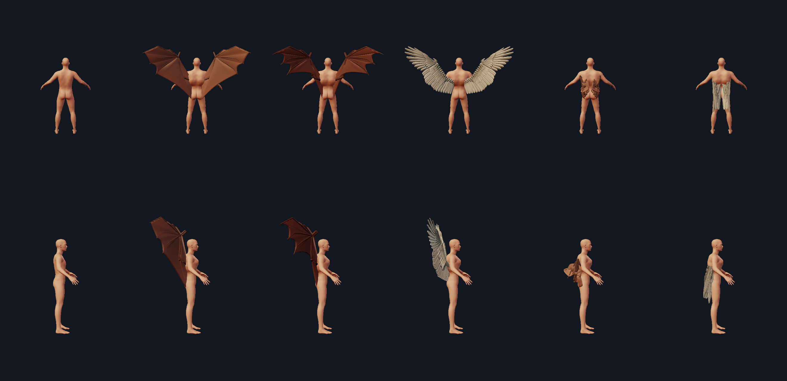
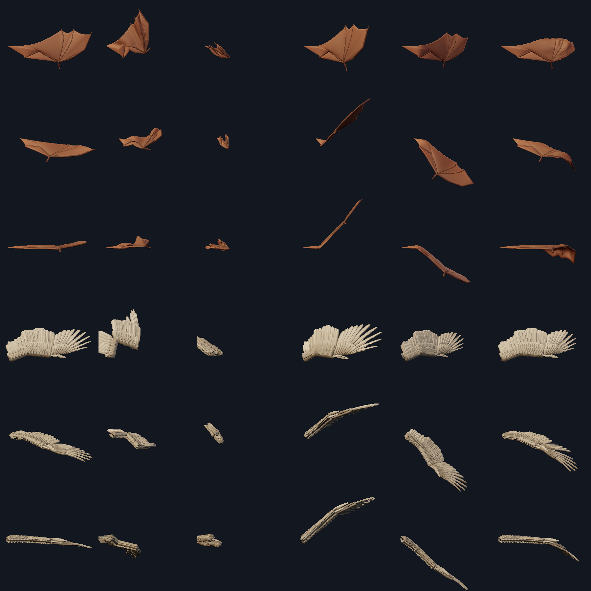

# Wings

A wing is not a shape. In both bats and birds it is a **modified forelimb** —
humerus, radius/ulna, wrist, and then a hand that carries the flight surface.
Everything a viewer reads as "wing" comes from that skeleton: the Z-shaped arm,
the finger struts fanning through a membrane, the scalloped free edge, the
shingled feathers. So `minimaster.character.wings` builds the skeleton first and
hangs the surface on it, and `minimaster.character.wingrig` turns skeleton plus
surface into a **rig**: named joints, skin weights, and poses. Folding, raising
or flapping a wing rotates joints; it never rebuilds a mesh.



*A plain body, then bat/dragon (membrane) wings, angel (feathered) wings, and
the same two folded — a pose of the rig, not a different mesh. Top: from behind.
Bottom: profile.*



*One wing, no body, through rest / half fold / folded / raised 45° / lowered 40° /
fingers curled 35°, in plan, 3/4 and front. Top: membrane. Bottom: feathered.*

```python
from minimaster.character import appendages as A

app = A.back_wings("membrane")                 # or "feathered"
shells = app.build(base, verts)                # [("wing_l", Mesh), ("wing_r", Mesh)]  (spread)

rigs = app.build_rigs(base, verts)             # [("wing_l", PlacedWing), ("wing_r", PlacedWing)]
left = rigs[0][1]
left.pose("upstroke")                          # a named pose ...
left.pose(fold=0.6, raise_=20, curl=10)        # ... or the controls
left.rig.armature                              # the joints, as a core Armature
```

## Where the numbers come from

The proportions are fitted to measurements of real animals, not remembered: CC-licensed
photographs of Indian and grey-headed flying foxes (*Pteropus*) — a mounted skeleton
from two angles, gliding and spread-from-below flight shots, a roosting wrap — and of
a bald eagle with wings half raised, a galah and a flamingo with folded wings, plus a
gargoyle and a dragon for the stylised end. Joint positions and silhouettes were read off
the photographs; things a photograph cannot show (flap amplitudes, joint limits, the
stowed pose) come from the literature and are marked as such. The photographs are
used as measurement references only and are not redistributed in this repository.

All bone lengths are quoted **relative to the forearm (FA)**, the standard measure in
chiropteran morphometrics; angles are in the wing plane, from the span axis (+X)
toward the trailing edge (+Z).

An independent check on the result: the planform-area aspect ratio of the membrane
wing comes out at **4.7**. The literature gives 6–7 for flying foxes; the roost photograph —
foreshortened, wrist flexed — gives 4.7–5.8; the build sits between them
(`test_membrane_planform_has_a_realistic_aspect_ratio` accepts 4.5–8, a paddle being below 3).

## The membrane wing (bat / dragon)

| | measured | |
| --- | --- | --- |
| humerus | 0.72 FA at +25° (aft) | four chord measurements: 0.66, 0.71, 0.74, 0.75 |
| forearm | 1.00 FA at −30° (forward) | **the arm is a Z**: the wrist is the most forward point of the planform |
| digit II | 0.60 + 0.13 FA | short, hugging III |
| digit III | 0.71 + 0.57 + 0.70 FA | longest; makes the wingtip |
| digit IV | 0.70 + 0.43 + 0.33 FA | |
| digit V | 0.73 + 0.36 + 0.30 FA | sweeps back toward the hip |
| hooked tip | +24…+46° at the last knuckle | the falcate wingtip |
| thumb | 0.22 FA + 0.08 FA claw | a small hook that curls forward and up, so it reads from above |
| fan off the forearm | II +40°, III +50°, IV +76°, V +104° | the skeleton and the roost silhouette give 32/56/87/127°; the literature aspect ratio (6–7) wants less. This sits between them (AR 4.7) and makes the wrist a visible forward corner, as in the photographs; II is held close to III so it lies inside the leading edge instead of standing out as a second horn |
| root | ~1.0 FA, down the back to the waist | the plagiopatagium runs shoulder → hip |

The earlier version had a nearly straight arm, single-bone digits, a 0.4 FA root and a
uniform scallop. The previous failure mode, still pinned by a regression test, was fanning
the digits off an already-swept forearm so the angles compounded and digit III ended up
62° off the span axis — a paddle, not a wing.

**Construction.** The sheet is a *fan*: every grid line runs from the arm out to the free
edge, and the lines that carry the digits run exactly down the bones, so a panel's border
and its bone coincide and the membrane can be bound to the fingers it is stretched
between. It is divided as real bats divide it: the *propatagium* fills the elbow notch in
front of the arm (a triangle between the straight shoulder–wrist leading edge and the
bent arm), the *dactylopatagium* spans the fingers, and the *plagiopatagium* runs from
digit V to the body. The leading edge follows digit III's own knuckles out to the tip so
the hooked bone never pokes out in front of the sheet.

**Scallops** differ gap by gap — depth is perpendicular sag over the tip-to-tip chord:

| gap | bat | dragon |
| --- | --- | --- |
| III–IV | 0.03 (taut) | 0.40 |
| IV–V | 0.26 (the deep one) | 0.50 |
| V → body | 0.05 (a long, nearly straight edge) | 0.30 |

The dragon is its own registered style, `A.back_wings("dragon")` / `W.make_wing_rig("dragon")`: the same
skeleton and rig with `SCALLOP_DRAGON`, longer spiny tips, a flatter sheet and ribs 1.35× heavier
(dragon art exaggerates what a bat wing already is). The
digit tips end in short needles — III 0.10 FA, IV and V about half that, II none — and the
scallop arcs meet them at a cusp.

**Surface.** Camber is 6% of chord at rest (a gliding bat reaches 12%); the panels billow
a few percent between the bones; the hand rises ~9° off the arm (`gull`), so the wrist is
the low point of the wing. Bones are tubes laid on the sheet so they read as ridges, with
radii taken from the skeleton photographs (forearm ~0.053 FA across, digit bases ~0.034 FA
tapering to half) — but never thinner than 0.45× the membrane thickness, because a printed
bone has to stay thicker than the sheet it holds up.

## The feathered wing (bird / angel)

Primaries root along the hand, secondaries along the ulna, tertials and scapulars on the
humerus, and five tiers of coverts shingle over their bases.

| row | count | length (× longest primary) | width / length | direction |
| --- | --- | --- | --- | --- |
| primaries P1–P10 | 10 | 0.60 … **1.00** (P7/P8) … 0.70 (P10) | 0.20 (P1) … 0.13 … 0.105 (P10) | **+8° (P10) to +70° (P1), ~7° apart** — P10 continues the hand axis |
| secondaries | 14 | 0.62 … 0.70 | 0.23 | +78° … +100° |
| tertials | 7 | 0.55 … 0.40 | 0.27 | +100° … +118° |
| primary coverts | 10 | 0.30 … 0.15 of the primary | 0.26 | follow their primary |
| greater / median coverts | 14 + 14 | 0.375 / 0.22 | 0.38 / 0.50 | follow their secondary |
| tertial coverts | 7 + 7 | 0.30 / 0.18 | 0.60 / 0.75 | follow their tertial |
| lesser coverts | 3 rows of 18–14 | 0.10 … 0.07 | 0.9 | along the arm's leading edge |
| marginal coverts | 2 rows of 20–18, both faces | 0.11 / 0.09 | 0.8 | rooted *ahead* of the arm, sweeping back over it |
| alula | 3 | 0.20 / 0.26 / 0.32 | 0.22 | rooted at 15 / 30 / 45% along the thumb |
| scapulars | 7 | ~0.45 | 0.32 | +108° … +122° |

The longest primary is ~1.65 FA, so a primary is 7–8× as long as it is wide: a long narrow
blade, not a paddle. The hand is only ~0.58 FA (the first build gave it 0.94), which is what
makes the primaries root at the right spacing (~0.065 FA) and overlap ~65% at the base.

**One feather.** A bare quill for the first tenth of the length, then a vane that widens to
its maximum by ~40% and holds nearly parallel-sided before closing in an ogive onto a
**rounded cap** (`tip_floor`; a point read as a saw along the trailing edge). The
rachis is off-centre — the leading vane is 25–30% of the width on the outer primaries, 35–40%
on the inner ones — and the outer primaries are **emarginated**: the leading vane narrows
sharply near the tip so the feathers separate into slotted fingers. The shaft droops and the
vanes cup away from it.

**Overlap.** On the upper surface each feather lies over its outboard neighbour (P1 over P2,
… P9 over P10), and the stack runs tertials > inner secondaries > outer secondaries > P1 …
P10. That is achieved with **roll**, not height: each feather's leading vane tilts up and its
trailing vane down, so it rides over the next one while every root stays on the arm. (An
earlier version stacked feathers vertically; the roots climbed 1.6 units off the arm and the
bone floated beneath the plumage.) The coverts lie over the flight-feather bases, the
leading-edge row on top. Each tier is **staggered** half a pitch against the one behind it
(each covert straddles two flight feathers, so rows brick instead of stacking into columns),
ends in a rounded tip, and has jittered lengths so its lower edge is not a ruled line. Three
rows of rounded lesser coverts bury the arm, rooted just behind the bone line pointing
straight back; two **marginal** rows root *ahead* of it and sweep back over it with broad
rounded quill ends, so the leading edge seen from the front is feathered right to the front and
not a bare rod with quill ends poking out (the third critique round's main finding on this wing);
the covert field runs on over the tertials to the back instead of stopping at the elbow; an **underwing covert field** covers the
underside, which is what an angel seen from the front shows. Scapulars and the alula are
rigged feathers like the flight feathers, so a fold re-aims all the plumage.

## The rig

Everything below is `wingrig.py`, built on `core/armature.py`.

**Joints.** `root` (the end of the attachment line on the body, the only parentless joint) →
`shoulder` → `elbow` → `wrist` → per-digit base joints `d2_cmc … d5_cmc` (coincident with
the wrist, so the fan can open one finger at a time) → knuckles `dN_mcp`, `dN_ip` → `dN_tip`;
and `thumb_cmc` → `thumb_tip`. A bone is keyed by its child joint, exactly as in `Armature`.
The feathered wing adds a **root and a tip joint for every flight feather**, parented to the
arm joint it grows from, so the fan can open and close.

**Skinning** is linear blend, the same convention as `bodymesh.pose_body_mesh`, so topology
never changes: a shell that is watertight at rest is watertight in every pose.

| piece | binding |
| --- | --- |
| a feather, the thumb, a claw, a joint knob | **rigid**, weight 1 on one bone — a feather is stiff, and smearing it across two bones shears the shingles apart |
| a covert | rigid to the bone of the flight feather it lies over, so it fans with it |
| a finger or the arm | blended **only over its own chain's bones**, by proximity — it bends smoothly at its knuckles and is never pulled by the finger next door |
| the membrane | blended over the arm and finger bones by distance in the wing plane; the **root edge is bound to a body bone**, so the sheet stays glued to the flank however the arm moves |

**Controls** (clamped to anatomical limits, `wingrig.LIMITS`; the caller's object is never
modified):

| control | meaning | range |
| --- | --- | --- |
| `fold` | 0 spread … 1 stowed | 0 … 1 |
| `raise_` | shoulder elevation (flap); the top shrinks with `fold` (100° spread, 25° stowed) | −70° … +100° |
| `swing` | humerus swung back (+) or forward; the top shrinks with `fold` (90° spread, 5° stowed) | −30° … +85° |
| `twist` | roll about the span axis | ±45° |
| `fan` | finger spread, 0 together … 1 rest. A bird's primaries spread about the hand axis; a membrane clamps it to 0.55 … 1.2 (a sheet tears long before the fingers close) | 0 … 1.5 |
| `curl` | finger knuckle flexion | −10° … 150° |
| `wrist_flex` | cocks the hand out of the wing plane at the wrist, tip up (+) or drooping (−) | −60° … +45° |
| `hand_twist` | rolls the hand about its own axis (wash-out) | ±30° |

**Presets** (`wingrig.PRESETS`): `glide`, `half_fold`, `folded`, `upstroke` (wrist up, arm
half-folded, leading edge edge-on), `downstroke`, `mid_downstroke`. `PoseControls.flap(phase)`
generates a cycle in which the shoulder leads while the wrist (40°) and the finger curl (70°) lag it,
so the hand trails the wrist — hanging below it on the upstroke — instead of the whole wing swinging
like a plank. The upstroke is not the downstroke played backwards: the arm half-folds and the fingers
close to shed the air, then the arm extends and the hand pronates for the power stroke.

Feather headings are computed from the **in-plane** rotations only, so lifting, twisting or cocking a
wing tilts its plane without changing where the feathers point within it: the 3D angle between the
first and last primary stays 61° under any raise, twist or wrist flex (a first version read the plan
projection of the tilted frame and spread the fan to 166° at raise 100).

**Folding.** Stowing closes the Z of the arm: the humerus tucks onto the **body line** (the
direction from shoulder to root — *not* the frame's +Z, which on a real placement points
down-and-outward, so folding toward it splays the wing sideways), the forearm swings forward
onto it to an elbow interior of ~25°, the hand folds back along the forearm (wrist 172°), the
fan collapses, the thumb tucks along the forearm, and each finger folds like a concertina at its
knuckles (90% of a full hairpin; the three bones end up roughly parallel). The stowed wing is also
**lifted off its plane** (bat 12°, bird 20° — a feathered wing is deep): that plane is sunk into the back so a print is
welded, and a wing lying along it would be buried in the torso. Feathers fold like a closing fan,
each turning about its own root until it lies along the body line; scapulars, the alula and the
lesser coverts fold with them.

**The membrane in a fold.** Skinning moves the vertices that sit on a finger with that finger
but leaves everything between two fingers wherever blended transforms drop it, and a closing
sheet crumples. A patagium is continuous and inextensible, so each panel is **re-evaluated
between its two posed bounding fingers**: the interior is the chord between them plus the
panel's own rest curvature (scallop sag, billow) scaled by how far the gap has closed, and
the slack the sheet cannot lose buckles into a pleat — a tent of slant L/2 over a base g,
height √(L²−g²)/2, standing along the bones' own up direction, alternating panel to panel the
way a closing fan zig-zags. Skin is elastic, so nothing pleats until a panel has closed by ~10%
(otherwise a gentle finger curl inflates the hand like a balloon), and the fingers do not hairpin
until the wing is past half folded, so a half-fold is a taut half-closed wing and not a scroll.
Each panel pleats in several fine lobes (1/2/2/3) rather than one bladder, and a pleat is softly
capped (`PLEAT_CAP`, 0.45 units per lobe): a stowed membrane is a bundle lying among the fingers,
not a tent three finger-thicknesses tall (the folded bat stood 4.0 units off the plane before, 2.3
after). The slab keeps its grid's own orientation (re-orienting cells toward a skinned "up" vector turned the whole shell inside
out where a panel doubled back: signed volume fell from +0.75 to −0.03), and a stretch limiter pulls
any edge back toward 1.15× its rest length. The long inboard panel pleats less: it hangs as a drape.

**Composition and limits.** A knuckle curl (about the digit's own flexion axis) and the fold
concertina (in the wing plane) are *multiplied* as matrices — curl first, then the swing — rather
than having their Euler angles summed, which is not a rotation of anything once two axes are
involved (`test_a_knuckle_curl_and_the_fold_concertina_multiply_instead_of_adding`). Controls are
offsets on top of what `fold` already does, so the shoulder's `swing` and `raise_` ranges shrink
as the wing stows (`FOLD_LIMITS`): fold 1 with swing 85 once asked the humerus for 195° and put
half the membrane across the midline.

**Slab normals.** A scalloped patagium leaves each fingertip along the grid's own rays, where the
cross product of the two grid tangents collapses and its direction — even its sign — is noise. On
the dragon (scallops 0.30–0.50) 205 vertices were within 20° of degenerate and one column of the
slab had its thickness lying *in* the sheet; the pleats, which stand along that axis, ballooned.
`grid_normals` now blends toward a reference normal (the sheet's mean normal at rest, the skinned
"up" vector when posed) wherever the tangents are within ~20° of parallel, and is bit-identical
elsewhere. Separately, the camber weight stepped from 0.25 to 1.0 at digit V, leaving a 0.13-unit
ledge down the finger (more than half the membrane's thickness); it is now smoothed over nine
columns. The dragon is part of the rig test matrix.

**Validated** (`tests/test_wingrig.py`): the rest pose reproduces the mesh to 1e-12; weights are
a partition of unity with ≤4 influences; rigid pieces use exactly one bone; a finger is pulled
only by its own bones; bones never change length under any pose; every pose of both styles is
watertight per piece; the root stays on the body while the wing flaps (≤0.16 units of drift
against 8–12 at the tip); the membrane root lies in the wing's plane on the back and no folded
wing pokes out in front of the torso (it would have failed on the old placement); finger tubes
stay on the sheet; a posed mirrored pair on the body is
an exact mirror image (1e-15); body-space skin matrices (`M S M⁻¹`) reproduce the placed mesh
for mirrored placements; and the joints attach to a body `Armature` through the chest.

## Placement

Appendages are authored at the origin; the wing's frame is

```
+X  spanwise, shoulder -> wingtip
+Y  down (the underside); camber bulges toward -Y
+Z  chordwise, leading edge -> trailing edge
```

`back_wings()` wraps the placement: a scapula **anchor**, an `up_hint` that aims +X up and out,
a `roll`, and an `offset` that sinks the root into the back so a 32 mm print is welded, not
hairline-joined (at offset 0 only 2% of the root lies inside the torso; at −0.9, ~40%).

On a real body the frame's +Z does not run down the spine — it points down-and-*outward*
(≈ (0.80, −0.55, 0.24) in MakeHuman coordinates) — so a membrane root laid along it hangs in the
air beside the figure. `WING_ROOT` is therefore a **body point** (the lower back at the waist).
The wing plane has to contain it: with a fixed roll the plane slopes forward as it descends the
back, and the projected target landed on the *front of the belly* (a folded wing then poked out
of the abdomen — the old placement measured 28 sampled vertices up to 0.85 units in front of the
torso). When `Appendage.root_point` is set the frame is therefore **built from body-space vectors**:
the span axis is the hint itself (about 18° back from vertical in profile), the chord points at the
root, and only the origin follows the body, sunk a fixed distance straight into the back. The
root is exactly in-plane and on the back, the builder passes its plan coordinates to the wing, and
`fold` stows the wing along the same line. (An earlier version projected the hint into the tangent
plane of one quad of the morphed body, so a shoulder or pectoral slider re-aimed the whole wing —
19.5° between the plain and the anatomy-adjusted body, with the spread membrane anywhere from
flat to 6 units behind the back. `test_the_wings_orientation_does_not_depend_on_body_morphs`
checks five bodies.)

A mirrored pair is an exact mirror image, which took two fixes: the mirrored anchor already
carries a mirrored tangent, so negating local Y (not X) leaves a true mirror; and the anchor
binds to the whole face, not `face[:3]`, because a quad and its mirror are stored with different
corner orders.

## Printing

`thickness` is in wing units. A 32 mm figure makes one unit ≈ 1.9 mm: the 0.16 membrane is
≈ 0.30 mm (right at what a resin printer resolves), feathers 0.20 ≈ 0.38 mm. Bones are inflated
to stay thicker than the sheet. Every piece — membrane, each bone, each feather — is its own
closed solid, merged into one mesh; overlapping closed shells still use every edge exactly twice,
so the mesh passes the watertight gate as-is and the slicer unions them. Print a wing spread (or
posed); a fully folded membrane is a thicket of self-overlapping sheet that no slicer will love.

## Regenerating the figures

```
PYTHONPATH=. python tools/wing_demo.py          # docs/images/wings.png + wing_rig.png  (~100 s)
PYTHONPATH=. python tools/wing_view.py out.png membrane fold=0.5 raise_=40
```

The per-feather and per-row tinting in the renders is vertex colour applied by
`tools/wing_view.py`; the geometry carries none.
